# 🍡 Project Architecture & API Reference

> **Auto-generated** module/symbol graph and API specification (`mochi docgen --write` — regenerate, never hand-edit; see `TECHMAP.md`).
> The **canonical curated architecture doc is [`docs/ARCHITECTURE.md`](docs/ARCHITECTURE.md)** — this dump will drift from it by design.

> Automatically generated architecture graph and API specification.
> **Modules**: 331 | **Total Symbols**: 6429

## 🏗️ Architecture Diagram

```mermaid
graph TD;
  add_js["add.js (1 symbols)"]
  calc_js["calc.js (1 symbols)"]
  cart_js["cart.js (1 symbols)"]
  cart_js --> util_js
  inventory_js["inventory.js (2 symbols)"]
  order_js["order.js (2 symbols)"]
  order_js --> inventory_js
  sum_js["sum.js (1 symbols)"]
  util_js["util.js (1 symbols)"]
  src_acp_ts["src/acp.ts (12 symbols)"]
  src_ambient_ts["src/ambient.ts (8 symbols)"]
  src_budget_ts["src/budget.ts (15 symbols)"]
  src_circle_ts["src/circle.ts (7 symbols)"]
  src_clarify_ts["src/clarify.ts (11 symbols)"]
  src_cli_ts["src/cli.ts (14 symbols)"]
  src_completion_ts["src/completion.ts (8 symbols)"]
  src_config_ts["src/config.ts (8 symbols)"]
```

## 📦 Modules & API Reference

### `add.js`
| Line | Kind | Signature |
| :--- | :--- | :--- |
| 1 | `function` | `export function add(a, b)` |

### `calc.js`
| Line | Kind | Signature |
| :--- | :--- | :--- |
| 1 | `function` | `export function computeCartTotal(items)` |

### `cart.js`
| Line | Kind | Signature |
| :--- | :--- | :--- |
| 3 | `function` | `export function renderCart(items)` |

### `inventory.js`
| Line | Kind | Signature |
| :--- | :--- | :--- |
| 7 | `function` | `export function getPrice(item)` |
| 11 | `function` | `export function getQuantity(item)` |

### `order.js`
| Line | Kind | Signature |
| :--- | :--- | :--- |
| 3 | `function` | `export function calculateOrderTotal(order)` |
| 13 | `function` | `export function processOrder(order)` |

### `sum.js`
| Line | Kind | Signature |
| :--- | :--- | :--- |
| 1 | `function` | `export function sum(a, b)` |

### `util.js`
| Line | Kind | Signature |
| :--- | :--- | :--- |
| 1 | `function` | `export function formatPrice(cents)` |

### `src/acp.ts`
| Line | Kind | Signature |
| :--- | :--- | :--- |
| 52 | `interface` | `export interface AcpSession` |
| 64 | `interface` | `export interface RpcCall` |
| 70 | `interface` | `export interface RpcResponse` |
| 78 | `function` | `function promptText(prompt: unknown): string` |
| 95 | `type` | `export type AcpNotify` |
| 98 | `function` | `function toolKind(toolName: string): string` |
| 110 | `function` | `export async function handleRpc(` |
| 158 | `function` | `const genMessageId = () => ...` |
| 160 | `function` | `const handleEvent = (e: MochiEvent) => ...` |
| 340 | `function` | `export async function serverLoop(cwd: string): Promise<void>` |
| 348 | `function` | `const send = (msg: unknown) => ...` |
| 401 | `function` | `export async function acpCheck(cwd: string): Promise<` |

### `src/ambient.ts`
| Line | Kind | Signature |
| :--- | :--- | :--- |
| 10 | `interface` | `export interface AmbientOpts` |
| 20 | `interface` | `export interface AmbientReport` |
| 31 | `function` | `function run(cmd: string, cwd: string, timeoutMs: number): Promise<` |
| 41 | `function` | `export async function checkOnce(opts: AmbientOpts): Promise<AmbientReport[]>` |
| 58 | `function` | `export function detectCommands(cwd: string): string[]` |
| 71 | `function` | `function writeProposal(cwd: string, report: AmbientReport): string` |
| 98 | `function` | `export async function startAmbient(opts: AmbientOpts): Promise<() => void>` |
| 102 | `function` | `const tick = async () => ...` |

### `src/budget.ts`
| Line | Kind | Signature |
| :--- | :--- | :--- |
| 3 | `interface` | `export interface BudgetLimits` |
| 12 | `type` | `export type BudgetPhase` |
| 14 | `interface` | `export interface BudgetSnapshot` |
| 40 | `class` | `export class BudgetEngine` |
| 100 | `method` | `remainingTokens(): number` |
| 104 | `method` | `remainingCostUsd(): number` |
| 108 | `method` | `remainingDurationMs(): number` |
| 113 | `method` | `ratio(): number` |
| 144 | `method` | `phase(): BudgetPhase` |
| 155 | `method` | `phaseCode(): number` |
| 164 | `method` | `snapshot(_model: string): BudgetSnapshot` |
| 184 | `method` | `canUseTokens(tokens: number): boolean` |
| 188 | `method` | `canMakeModelCall(): boolean` |
| 194 | `method` | `canExecuteTool(): boolean` |
| 201 | `method` | `shouldUseCheaperModel(): boolean` |

### `src/circle.ts`
| Line | Kind | Signature |
| :--- | :--- | :--- |
| 18 | `interface` | `export interface CircleVerdict` |
| 33 | `function` | `function openingPrefix(text: string): string` |
| 38 | `function` | `function shingleSet(text: string, k = 3): Set<string>` |
| 47 | `function` | `function jaccard(a: Set<string>, b: Set<string>): number` |
| 54 | `function` | `function isQuestionOnly(text: string): boolean` |
| 63 | `function` | `function isListOnly(text: string): boolean` |
| 71 | `function` | `export function detectCircle(messages: ChatMessage[], windowSize = 4): CircleVerdict` |

### `src/clarify.ts`
| Line | Kind | Signature |
| :--- | :--- | :--- |
| 9 | `interface` | `export interface Choice` |
| 16 | `interface` | `export interface ClarifyQuestion` |
| 22 | `interface` | `export interface Renderer` |
| 23 | `method` | `render(q: ClarifyQuestion): string;` |
| 24 | `method` | `receive(): Promise<string>;` |
| 28 | `function` | `export function renderMenu(q: ClarifyQuestion): string` |
| 42 | `function` | `export function resolveChoice(q: ClarifyQuestion, raw: string \| null): MenuOutcome` |
| 60 | `interface` | `export interface MenuOutcome` |
| 67 | `function` | `export async function askUserChoice(` |
| 77 | `function` | `export function defaultRenderer(): Renderer` |
| 84 | `method` | `async receive()` |

### `src/cli.ts`
| Line | Kind | Signature |
| :--- | :--- | :--- |
| 31 | `type` | `type RepoModule` |
| 51 | `function` | `function logCrash(kind: string, err: unknown): void` |
| 102 | `function` | `function parseArgs(argv: string[]):` |
| 136 | `interface` | `export interface FlagOverrides extends Partial<MochiConfig>` |
| 144 | `function` | `function configFromFlags(flags: Record<string, string \| boolean>): FlagOverrides` |
| 204 | `function` | `function printHelp()` |
| 283 | `function` | `function cliDirname(): string` |
| 288 | `function` | `function srcFileNewer(dir: string, mtime: number): boolean` |
| 305 | `function` | `async function main()` |
| 508 | `function` | `const post = async (action2: string, extra: Record<string, unknown> = {}) => ...` |
| 1449 | `function` | `const onData = (c: Buffer) => ...` |
| 1654 | `function` | `const onData = (c: Buffer) => ...` |
| 1774 | `function` | `const files = (() => ...` |
| 1833 | `function` | `async function interactive(runtime: import('./runtime.js').Runtime, initialPrompt?: string)` |

### `src/completion.ts`
| Line | Kind | Signature |
| :--- | :--- | :--- |
| 5 | `interface` | `export interface CompletionCommand` |
| 146 | `function` | `export function completionNames(): string[]` |
| 154 | `function` | `export function subcommandNames(cmd: string): string[]` |
| 159 | `function` | `function bashEscape(s: string): string` |
| 163 | `function` | `export function completionBash(): string` |
| 187 | `function` | `export function completionZsh(): string` |
| 210 | `function` | `export function completionFish(): string` |
| 223 | `function` | `export function completionFor(shell: string): string` |

### `src/config.ts`
| Line | Kind | Signature |
| :--- | :--- | :--- |
| 52 | `function` | `function readJsonFile(path: string): Record<string, unknown> \| undefined` |
| 61 | `function` | `function envModelConfig(): Partial<MochiConfig['model']>` |
| 80 | `function` | `export function loadEnvFiles(): void` |
| 110 | `function` | `export function loadConfig(overrides: Partial<MochiConfig> =` |
| 158 | `function` | `function isPlaceholderKey(key: string \| undefined): boolean` |
| 294 | `function` | `function merge(target: Record<string, unknown>, source: Record<string, unknown>)` |
| 309 | `function` | `export function loadProjectConfig(projectDir: string): Partial<MochiConfig>` |
| 319 | `function` | `export function validateConfig(config: MochiConfig): string[]` |

### `src/context.ts`
| Line | Kind | Signature |
| :--- | :--- | :--- |
| 32 | `function` | `function countFilesShallow(root: string): number` |
| 34 | `function` | `const visit = (dir: string, depth: number) => ...` |
| 58 | `function` | `export function clearMachineBlockCache(): void` |
| 62 | `function` | `export function machineAccessBlock(projectRoot?: string): string` |
| 67 | `function` | `const os = (() => ...` |
| 70 | `function` | `const mem = (() => ...` |
| 77 | `function` | `const cpu = (() => ...` |
| 84 | `function` | `const host = (() => ...` |
| 113 | `function` | `function fingerprint(path: string): string` |
| 123 | `function` | `function rulesSource(path: string, label: string): string` |
| 127 | `function` | `export function approxTokens(text: string): number` |
| 156 | `function` | `export function tokenOverlap(a: string, b: string): number` |
| 157 | `function` | `const tok = (s: string) => ...` |
| 175 | `function` | `export function selectRelevantSkills(skills: Skill[], taskText: string, max: number, usageBoost?: Map<string, number>): Skill[]` |
| 193 | `interface` | `export interface ContextState` |
| 207 | `interface` | `export interface ContextPacket` |
| 214 | `class` | `export class ContextEngine` |
| 309 | `method` | `getMessages(): readonly ChatMessage[]` |
| 315 | `method` | `get messageCount(): number` |
| 321 | `method` | `estimateTokens(): number` |
| 332 | `method` | `async estimateTokensAsync(): Promise<number>` |
| 341 | `method` | `private loadMemory(query = ''): string` |
| 371 | `method` | `private loadProjectRules(task?: Task): string` |
| 411 | `method` | `private skills(task?: Task, tools?: ToolDefinition[]): string` |
| 452 | `method` | `private buildSystemPrompt(tools: ToolDefinition[], repo?: RepoInfo, task?: Task): string` |
| 513 | `method` | `private toolGuidelines(tools: ToolDefinition[]): string` |
| 516 | `function` | `const add = (names: string[], text: string) => ...` |
| 547 | `method` | `private buildVolatilePrompt(task?: Task): string` |
| 614 | `method` | `private tinyWorkspaceLine(): string \| null` |
| 635 | `method` | `private buildStatePrompt(task?: Task): string` |
| 670 | `method` | `buildPacket(tools: ToolDefinition[], task?: Task, repo?: RepoInfo): ContextPacket` |
| 779 | `method` | `private trackFileOp(message: ChatMessage)` |
| 809 | `method` | `detectStaleFiles(): string[]` |
| 824 | `method` | `stalenessWarning(): string` |
| 844 | `method` | `effectiveContextTokens(): number` |
| 861 | `method` | `shrinkOldToolOutputs(): number` |
| 887 | `method` | `private stateLedger(): string` |
| 928 | `method` | `async previewCompact(): Promise<ChatMessage[] \| null>` |
| 934 | `method` | `async compact(checkpoint?: string)` |

### `src/contract.ts`
| Line | Kind | Signature |
| :--- | :--- | :--- |
| 15 | `function` | `export function findRulesFile(cwd: string): string \| null` |
| 24 | `function` | `export function loadRules(cwd: string): string` |
| 34 | `function` | `export function contractSection(cwd: string): string` |
| 42 | `function` | `export function appendRule(cwd: string, rule: string):` |
| 54 | `function` | `export function writeRules(cwd: string, body: string):` |
| 61 | `function` | `export function listRules(cwd: string): string[]` |

### `src/discord.ts`
| Line | Kind | Signature |
| :--- | :--- | :--- |
| 10 | `interface` | `export interface DiscordConfig` |
| 19 | `function` | `export function loadDiscordConfig(cwd: string): DiscordConfig \| null` |
| 61 | `function` | `export async function sendDiscordMessage(` |
| 89 | `function` | `export async function handleDiscordMessage(` |

### `src/docgen.ts`
| Line | Kind | Signature |
| :--- | :--- | :--- |
| 9 | `interface` | `export interface ModuleDoc` |
| 15 | `interface` | `export interface ProjectDocs` |
| 27 | `function` | `function scanSourceFiles(dir: string, maxFiles = 500): string[]` |
| 58 | `function` | `function extractImports(content: string): string[]` |
| 73 | `function` | `export function generateProjectDocs(cwd: string, opts:` |

### `src/doctor.ts`
| Line | Kind | Signature |
| :--- | :--- | :--- |
| 17 | `interface` | `export interface SkillHealthEntry` |
| 23 | `interface` | `export interface DoctorReport` |
| 50 | `function` | `export async function doctorReport(opts:` |
| 66 | `function` | `const tsAvailable = (() => ...` |
| 139 | `function` | `const checkFile = (skillPath: string, name: string) => ...` |
| 145 | `function` | `const size = (() => ...` |
| 156 | `function` | `const walk = (dir: string) => ...` |
| 242 | `function` | `async function acpHealth(): Promise<` |
| 253 | `function` | `function editorHealth():` |
| 277 | `function` | `function onboardingHealth():` |
| 288 | `function` | `export function currentThemeInfo():` |
| 300 | `function` | `export function formatDoctor(r: DoctorReport): string` |
| 301 | `function` | `const ok = (b: boolean) => ...` |
| 329 | `interface` | `export interface RepairItem` |
| 336 | `function` | `export async function repairDoctor(opts:` |

### `src/dox.ts`
| Line | Kind | Signature |
| :--- | :--- | :--- |
| 11 | `interface` | `export interface DocChunk` |
| 22 | `function` | `export function indexDocs(root: string, maxChunks = 400): DocChunk[]` |
| 64 | `function` | `export function queryDocs(root: string, query: string, limit = 5): DocChunk[]` |
| 82 | `interface` | `export interface AdrInput` |
| 92 | `function` | `export function nextAdrNumber(adrDir: string): number` |
| 103 | `function` | `export function generateAdr(root: string, input: AdrInput): string` |

### `src/events.ts`
| Line | Kind | Signature |
| :--- | :--- | :--- |
| 6 | `interface` | `export interface EventBusStats` |
| 27 | `class` | `export class EventBus` |
| 65 | `method` | `snapshot(): readonly MochiEvent[]` |
| 69 | `method` | `stats(): EventBusStats` |
| 76 | `method` | `private fanout(event: MochiEvent, record = true): void` |
| 92 | `method` | `private invoke(h: (event: MochiEvent) => void \| Promise<void>, event: MochiEvent): void` |
| 104 | `method` | `emit(event: MochiEvent): void` |
| 110 | `method` | `emitNow(event: MochiEvent): void` |
| 116 | `method` | `flush(): void` |
| 124 | `method` | `async emitAwait(event: MochiEvent): Promise<void>` |
| 144 | `method` | `private stamp(event: MochiEvent): void` |

### `src/exec.ts`
| Line | Kind | Signature |
| :--- | :--- | :--- |
| 13 | `interface` | `export interface SandboxOptions` |
| 23 | `interface` | `export interface ExecOptions` |
| 41 | `interface` | `export interface ExecResult` |
| 53 | `function` | `function finishSpawn(` |
| 67 | `function` | `const done = (code: number \| null, extra?: { timedOut?: boolean; cancelled?: boolean }) => ...` |
| 92 | `function` | `const killTree = (sig: NodeJS.Signals) => ...` |
| 102 | `function` | `const onAbort = () => ...` |
| 141 | `function` | `export function runArgv(cmd: string, args: readonly string[], opts: ExecOptions =` |
| 157 | `function` | `export function runShellString(command: string, opts: ExecOptions &` |
| 172 | `function` | `export function execArgvText(cmd: string, args: readonly string[], opts:` |
| 189 | `function` | `function defaultSandboxWritable(cwd?: string): string[]` |
| 206 | `function` | `export function detectBubblewrap(pathEnv = process.env.PATH ?? ''): string \| null` |
| 223 | `function` | `export function buildBubblewrapArgs(` |
| 249 | `function` | `export function maybeSandbox(` |

### `src/hooks.ts`
| Line | Kind | Signature |
| :--- | :--- | :--- |
| 3 | `type` | `export type HookName` |
| 22 | `interface` | `export interface HookConfig` |
| 26 | `interface` | `export interface HookResult` |
| 33 | `class` | `export class HookManager` |
| 56 | `method` | `list(): HookName[]` |
| 60 | `method` | `enabled(name: HookName): boolean` |
| 64 | `method` | `private commandsFor(name: HookName): string[]` |
| 71 | `method` | `async runBefore(name: HookName, context: Record<string, string> =` |
| 83 | `method` | `async runAfter(name: HookName, context: Record<string, string> =` |

### `src/learning.ts`
| Line | Kind | Signature |
| :--- | :--- | :--- |
| 4 | `interface` | `export interface RecoveryRecord` |
| 11 | `interface` | `export interface LearningState` |
| 23 | `function` | `export function classifyFailure(error: string): RecoveryRecord \| undefined` |
| 32 | `class` | `export class LearningStore` |
| 51 | `method` | `private save()` |
| 57 | `method` | `private find(pattern: string, strategy: string): RecoveryRecord \| undefined` |
| 72 | `method` | `successRate(pattern: string, strategy: string): number` |
| 78 | `method` | `bestStrategy(pattern: string): RecoveryRecord \| undefined` |
| 84 | `method` | `knownStrategies(): RecoveryRecord[]` |

### `src/lessons.ts`
| Line | Kind | Signature |
| :--- | :--- | :--- |
| 13 | `interface` | `export interface Lesson` |
| 27 | `function` | `export function lessonsPath(workspaceDir: string): string` |
| 31 | `function` | `export function loadLessons(workspaceDir: string): Lesson[]` |
| 42 | `function` | `export function saveLessons(workspaceDir: string, lessons: Lesson[]): void` |
| 49 | `function` | `export function recordLesson(workspaceDir: string, lesson: Omit<Lesson, 'useCount' \| 'successCount' \| 'recordedAtMs'>): Lesson[]` |
| 72 | `function` | `export function retrieveLessons(workspaceDir: string, signal: string, kind?: string, limit = 3): Lesson[]` |
| 86 | `function` | `export function markLessonUsed(workspaceDir: string, id: string, succeeded: boolean): void` |
| 97 | `function` | `export function lessonsToPrompt(lessons: Lesson[]): string` |

### `src/mcp-server.ts`
| Line | Kind | Signature |
| :--- | :--- | :--- |
| 19 | `interface` | `export interface McpCall` |
| 25 | `interface` | `export interface McpResponse` |
| 31 | `interface` | `interface ServerState` |
| 67 | `function` | `function getRuntime(state: ServerState): Runtime` |
| 73 | `function` | `export async function handleMcp(` |
| 136 | `function` | `export async function mcpServerLoop(cwd: string): Promise<void>` |
| 139 | `function` | `const write = (msg: unknown) => ...` |

### `src/modes.ts`
| Line | Kind | Signature |
| :--- | :--- | :--- |
| 13 | `type` | `export type AgentMode` |
| 15 | `interface` | `export interface ModeSpec` |
| 75 | `function` | `export function modeSpec(mode: AgentMode): ModeSpec` |
| 79 | `function` | `export function isMode(s: string): s is AgentMode` |
| 86 | `function` | `export function applyMode(config: MochiConfig, mode: AgentMode): MochiConfig` |
| 107 | `function` | `export function modeInstruction(mode: AgentMode): string` |
| 114 | `function` | `export function formatModes(current: AgentMode): string` |

### `src/pipeline.ts`
| Line | Kind | Signature |
| :--- | :--- | :--- |
| 12 | `interface` | `export interface ReviewFinding` |
| 23 | `function` | `export async function readStdin(stream: NodeJS.ReadableStream = process.stdin): Promise<string>` |
| 37 | `function` | `export function parseFindings(text: string): ReviewFinding[]` |
| 66 | `function` | `export function findingsToNdjson(findings: ReviewFinding[]): string` |
| 71 | `function` | `export function renderFindings(findings: ReviewFinding[]): string` |
| 82 | `function` | `export function countBySeverity(findings: ReviewFinding[]): Record<ReviewFinding['severity'], number>` |
| 89 | `function` | `export function loadDiff(files: string[], cwd: string): string` |
| 111 | `function` | `function runGit(cwd: string, args: string[]): string` |
| 121 | `function` | `export function readLocalInput(file: string): string` |

### `src/plugins.ts`
| Line | Kind | Signature |
| :--- | :--- | :--- |
| 14 | `interface` | `export interface PluginManifest` |
| 29 | `interface` | `export interface PluginRecord` |
| 46 | `function` | `export function isHookName(s: string): s is HookName` |
| 51 | `function` | `export function readManifest(dir: string): PluginManifest` |
| 61 | `function` | `function defaultUserPluginsDir(): string` |
| 66 | `class` | `export class PluginRegistry` |
| 73 | `method` | `list(): PluginRecord[]` |
| 100 | `method` | `has(name: string): boolean` |
| 105 | `method` | `isProjectScoped(name: string): boolean` |
| 115 | `method` | `install(sourceDir: string, opts:` |
| 133 | `method` | `remove(name: string): boolean` |
| 143 | `method` | `setEnabled(name: string, enabled: boolean): boolean` |
| 159 | `method` | `info(name: string): string` |
| 174 | `method` | `static validateDir(dir: string): string[]` |
| 191 | `method` | `static lintSandbox(dir: string): string[]` |
| 224 | `method` | `search(query: string): PluginRecord[]` |
| 237 | `method` | `pack(name: string, outDir: string): string` |
| 248 | `method` | `mergedHooks(): HookConfig` |
| 263 | `method` | `syncToHooksFile(hooksFile: string, existing: HookConfig =` |
| 281 | `method` | `get dir()` |
| 285 | `method` | `private ensureUserDir(): string` |
| 292 | `function` | `function toArray(v: string \| string[] \| undefined): string[]` |

### `src/pr.ts`
| Line | Kind | Signature |
| :--- | :--- | :--- |
| 8 | `interface` | `export interface Issue` |
| 16 | `interface` | `export interface PrOptions` |
| 33 | `interface` | `export interface PrResult` |
| 41 | `function` | `function run(cmd: string, args: string[], cwd: string): Promise<string>` |
| 51 | `function` | `export async function fetchIssue(issueNumber: number, ghBin = 'gh'): Promise<Issue>` |
| 64 | `function` | `export async function defaultBranch(cwd: string): Promise<string>` |
| 77 | `function` | `export async function runIssueToPr(opts: PrOptions): Promise<PrResult>` |

### `src/rules.ts`
| Line | Kind | Signature |
| :--- | :--- | :--- |
| 4 | `interface` | `export interface ProjectRule` |
| 15 | `function` | `export function parseRuleFile(filePath: string): ProjectRule \| null` |
| 66 | `function` | `export function loadRules(projectRoot: string): ProjectRule[]` |
| 70 | `function` | `const scanDir = (dirPath: string) => ...` |
| 106 | `function` | `export function selectActiveRules(` |
| 140 | `function` | `export function synthesizeRule(` |

### `src/runtime.ts`
| Line | Kind | Signature |
| :--- | :--- | :--- |
| 23 | `interface` | `export interface RuntimeOptions` |
| 28 | `class` | `export class Runtime` |
| 83 | `method` | `abort(reason = 'aborted by user'): void` |
| 88 | `method` | `resetAbort(): void` |
| 95 | `method` | `get aborted(): boolean` |
| 101 | `method` | `get signal(): AbortSignal` |
| 108 | `function` | `const onSig = () => ...` |
| 121 | `method` | `static create(opts?: RuntimeOptions): Runtime` |
| 125 | `method` | `async checkpoint(message = 'mochi checkpoint'): Promise<CheckpointResult>` |
| 134 | `method` | `async rollback(): Promise<string>` |
| 144 | `method` | `async speculate(question: string): Promise<SpeculativeResult>` |
| 156 | `method` | `setMode(mode: string): string` |
| 163 | `method` | `setReasoning(level: string): string` |
| 191 | `method` | `getReasoning(): import('./types.js').ReasoningLevel` |
| 196 | `method` | `newSession(): string` |
| 204 | `method` | `branchSession(title?: string): string` |
| 229 | `method` | `resetSession(): void` |
| 237 | `method` | `listTools(): Array<` |
| 248 | `method` | `getToolNames(): string[]` |
| 257 | `method` | `async inspect(query: string)` |
| 263 | `method` | `steer(text: string): number` |
| 267 | `method` | `async goal(objective: string, constraints: string[] = [], opts?:` |
| 276 | `method` | `async runGoal(objective: string, constraints: string[] = [], opts?:` |
| 312 | `method` | `async autoImprove(prompt: string, runs: number, opts?:` |
| 428 | `method` | `async selfTrain(opts:` |
| 469 | `method` | `private composeImprovementTask(cycle: number, total: number, focus?: string):` |
| 496 | `method` | `async team(objective: string, opts?:` |
| 513 | `method` | `async plan(objective: string): Promise<string>` |
| 527 | `method` | `async approvePlan(): Promise<string>` |
| 541 | `method` | `async resumeGoal(goalId: string): Promise<string>` |
| 577 | `method` | `async enhance(task: string, mode?: import('./chameleon.js').ChameleonMode, budget?: import('./budget.js').BudgetEngine)` |
| 583 | `method` | `async runPrompt(prompt: string, opts?:` |
| 591 | `method` | `async runPromptDetailed(prompt: string, opts?:` |
| 645 | `method` | `async review(input: string): Promise<string>` |
| 666 | `method` | `async fix(input: string): Promise<string>` |
| 681 | `method` | `private recordUsage(goal: string, result:` |
| 704 | `method` | `providerInfo(): string` |
| 708 | `method` | `modelList(): string[]` |
| 712 | `method` | `async useProvider(providerId: string, model?: string)` |
| 722 | `method` | `async loginProvider(provider: string, apiKey: string, model?: string)` |
| 737 | `method` | `private syncEngines()` |
| 764 | `method` | `async recordGood(): Promise<string>` |
| 768 | `method` | `return (lines.length ? lines.join('\n') : '  (no checks configured)') + '\nRecorded as known-good baseline.';` |
| 771 | `method` | `async knownGood(): Promise<string>` |

### `src/sdk.ts`
| Line | Kind | Signature |
| :--- | :--- | :--- |
| 24 | `interface` | `export interface RunResult` |
| 34 | `interface` | `export interface GoalResultSdk` |
| 41 | `class` | `export class Mochi` |
| 42 | `method` | `private constructor(private rt: Runtime)` |
| 45 | `method` | `static create(opts:` |
| 50 | `method` | `static connect(opts:` |
| 55 | `method` | `async prompt(task: string): Promise<RunResult>` |
| 65 | `method` | `async run(task: string): Promise<RunResult>` |
| 83 | `type` | `type Item` |
| 86 | `function` | `const push = (item: Item) => ...` |
| 127 | `method` | `async goal(objective: string, constraints: string[] = []): Promise<GoalResultSdk>` |
| 136 | `method` | `async plan(objective: string): Promise<string>` |
| 139 | `method` | `async selfTrain(opts:` |
| 145 | `method` | `async useProvider(providerId: string, model?: string): Promise<string>` |
| 150 | `method` | `newSession(): string` |
| 151 | `method` | `branchSession(title?: string): string` |
| 154 | `method` | `sessions(limit = 10): Array<` |
| 159 | `method` | `searchSkills(query: string, limit = 8): Array<` |
| 170 | `method` | `addMcpServer(serverId: string):` |
| 176 | `method` | `remember(statement: string, category: 'fact' \| 'preference' \| 'convention' \| 'history' = 'fact'): boolean` |
| 181 | `method` | `recall(context: string, limit = 15): Array<` |
| 186 | `method` | `get runtime(): Runtime` |
| 201 | `method` | `stream(): AsyncIterable<MochiEvent> &` |
| 203 | `type` | `type Resolve` |
| 208 | `function` | `const push = (e: MochiEvent) => ...` |
| 213 | `function` | `const ensureSub = () => ...` |
| 216 | `function` | `const close = () => ...` |
| 223 | `method` | `next(): Promise<IteratorResult<MochiEvent>>` |
| 231 | `method` | `return(): Promise<IteratorResult<MochiEvent>>` |
| 243 | `class` | `export class RemoteMochi` |
| 246 | `method` | `private base(): string` |
| 247 | `method` | `private headers(): Record<string, string>` |
| 256 | `method` | `async status(): Promise<Record<string, unknown>>` |
| 262 | `method` | `async prompt(task: string): Promise<RunResult>` |
| 276 | `method` | `async statusTyped(): Promise<` |
| 281 | `method` | `async goal(objective: string): Promise<Record<string, unknown>>` |
| 282 | `method` | `async plan(objective: string): Promise<Record<string, unknown>>` |
| 283 | `method` | `async approve(): Promise<Record<string, unknown>>` |
| 284 | `method` | `async resume(goalId: string): Promise<Record<string, unknown>>` |

### `src/sqlite.ts`
| Line | Kind | Signature |
| :--- | :--- | :--- |
| 8 | `interface` | `export interface Stmt` |
| 9 | `method` | `get(...params: unknown[]): unknown;` |
| 10 | `method` | `all(...params: unknown[]): unknown[];` |
| 11 | `method` | `run(...params: unknown[]):` |
| 14 | `interface` | `export interface SqliteDb` |
| 15 | `method` | `exec(sql: string): void;` |
| 16 | `method` | `prepare(sql: string): Stmt;` |
| 17 | `method` | `close(): void;` |
| 20 | `type` | `type DbCtor` |
| 21 | `type` | `export type SqliteSource` |
| 26 | `function` | `async function detect(): Promise<` |
| 58 | `function` | `function ensureReady(): Promise<void>` |
| 71 | `function` | `export async function sqliteDriverAsync(): Promise<DbCtor \| null>` |
| 84 | `function` | `function syncProbe(): void` |
| 118 | `function` | `export function sqliteSource(): SqliteSource` |
| 129 | `function` | `export function hasSqlite(): boolean` |
| 152 | `function` | `export function openDb(path: string): SqliteDb` |

### `src/types.ts`
| Line | Kind | Signature |
| :--- | :--- | :--- |
| 3 | `type` | `export type ModelProfile` |
| 5 | `interface` | `export interface ModelConfig` |
| 31 | `interface` | `export interface PermissionConfig` |
| 41 | `interface` | `export interface SafetyConfig` |
| 61 | `type` | `export type ReasoningLevel` |
| 63 | `interface` | `export interface MochiConfig` |
| 82 | `type` | `export type TaskStatus` |
| 84 | `interface` | `export interface Attempt` |
| 93 | `interface` | `export interface Task` |
| 117 | `interface` | `export interface TodoItem` |
| 124 | `interface` | `export interface Goal` |
| 138 | `type` | `export type AgentRole` |
| 140 | `interface` | `export interface AgentProfile` |
| 151 | `interface` | `export interface ToolParameter` |
| 159 | `interface` | `export interface ToolDefinition` |
| 167 | `interface` | `export interface ToolCall` |
| 176 | `interface` | `export interface ToolResult` |
| 186 | `type` | `export type ContentPart` |
| 190 | `interface` | `export interface ChatMessage` |
| 199 | `function` | `export function contentText(m:` |
| 205 | `interface` | `export interface SplitContent` |
| 216 | `function` | `export function splitContent(content?: string \| ContentPart[]): SplitContent` |
| 237 | `interface` | `export interface StreamToolCall` |
| 247 | `interface` | `export interface StreamChunk` |
| 255 | `interface` | `export interface ModelResponse` |
| 267 | `interface` | `export interface AgentState` |
| 278 | `interface` | `export interface RepoInfo` |
| 290 | `type` | `export type MochiEvent` |
| 357 | `interface` | `export interface EventMeta` |
| 369 | `interface` | `export interface PlanStep` |

### `src/util.ts`
| Line | Kind | Signature |
| :--- | :--- | :--- |
| 21 | `function` | `export function randomSlug(): string` |
| 25 | `interface` | `export interface BinaryResult` |
| 32 | `function` | `export function binarySearch<T>(array: T[], id: string, compare: (item: T) => string): BinaryResult` |
| 46 | `function` | `export function binaryInsert<T>(array: T[], item: T, compare: (item: T) => string): T[]` |
| 54 | `function` | `export function binaryInsertInPlace<T>(array: T[], item: T, compare: (item: T) => string): T[]` |
| 74 | `function` | `export function sortableId(timestamp = Date.now()): string` |
| 92 | `function` | `export function lazy<T>(init: () => T): () => T` |
| 108 | `function` | `export function getFilename(path: string \| undefined): string` |
| 116 | `function` | `export function getDirectory(path: string \| undefined): string` |
| 125 | `function` | `export function getFilenameTruncated(path: string \| undefined, maxLength = 20): string` |
| 138 | `function` | `export function truncateMiddle(text: string, maxLength = 20): string` |
| 156 | `function` | `export function isValidIpv4(s: string): boolean` |

### `src/verification.ts`
| Line | Kind | Signature |
| :--- | :--- | :--- |
| 16 | `function` | `function execFileAsync(cmd: string, args: string[], cwd: string): Promise<string>` |
| 20 | `type` | `export type VerificationStatus` |
| 22 | `interface` | `export interface VerificationEvidence` |
| 31 | `interface` | `export interface VerificationResult` |
| 40 | `interface` | `export interface VerifierOptions` |
| 51 | `class` | `export class VerifierEngine` |
| 70 | `method` | `async verify(task: Task, agentSummary: string): Promise<VerificationResult>` |
| 241 | `method` | `private ruleBased(task: Task, evidence: VerificationEvidence[]): VerificationResult` |
| 292 | `method` | `private build(` |
| 321 | `function` | `const inScope = (f: string) => ...` |
| 394 | `interface` | `export interface VerificationBaseline` |
| 403 | `function` | `export function failureSignature(output: string): string` |
| 430 | `function` | `export async function captureBaseline(` |
| 459 | `function` | `function commandEvidenceList(evidence: VerificationEvidence[]): VerificationEvidence[]` |
| 466 | `function` | `export function normalizeCommandKey(cmd: string): string` |
| 472 | `function` | `export function matchesBaseline(baseline: VerificationBaseline \| undefined, command: string, output: string): boolean` |

### `src/wiki.ts`
| Line | Kind | Signature |
| :--- | :--- | :--- |
| 12 | `interface` | `export interface WikiLookupOptions` |
| 25 | `interface` | `export interface WikiSummaryResult` |
| 35 | `function` | `async function fetchSummary(query: string, lang: string, userAgent: string): Promise<string \| null>` |
| 50 | `function` | `async function fetchSearch(query: string, lang: string, userAgent: string, searchTag: string): Promise<` |
| 69 | `function` | `export async function wikiSummary(` |

### `src/workspace.ts`
| Line | Kind | Signature |
| :--- | :--- | :--- |
| 13 | `class` | `export class QueueMutex` |
| 25 | `interface` | `export interface WorkspaceState` |
| 31 | `class` | `export class Workspace` |
| 77 | `method` | `loadGoal(goalId: string): Goal \| undefined` |
| 85 | `method` | `loadTasks(goalId: string): Task[]` |
| 93 | `method` | `loadState(): AgentState` |
| 121 | `method` | `loadCheckpoint(goalId?: string):` |
| 130 | `method` | `loadTodos(): import('./types.js').TodoItem[]` |
| 157 | `method` | `async appendCompletedTask(title: string): Promise<boolean>` |
| 167 | `method` | `loadWorkspaceState(): WorkspaceState` |
| 175 | `method` | `listGoals(): string[]` |

### `src/utils/http-error.ts`
| Line | Kind | Signature |
| :--- | :--- | :--- |
| 19 | `function` | `function plainFromJson(text: string): string` |
| 35 | `function` | `export function stripHtml(text: string): string` |
| 51 | `class` | `export class ProviderError extends Error` |
| 66 | `function` | `function defaultRetryable(status: number \| undefined, message: string): boolean` |
| 76 | `function` | `export function parseRetryAfter(value: string \| null \| undefined): number \| undefined` |
| 90 | `function` | `export function describeModelError(status: number, body: string, model: string, provider: string, retryAfter?: number): ProviderError` |

### `src/utils/terminal-launch.ts`
| Line | Kind | Signature |
| :--- | :--- | :--- |
| 15 | `interface` | `export interface TerminalChoice` |
| 34 | `type` | `export type TerminalName` |
| 37 | `function` | `export function findTerminalEmulator(pathEnv = process.env.PATH ?? ''): TerminalChoice \| undefined` |
| 51 | `interface` | `export interface LaunchGeometry` |
| 60 | `function` | `export function buildLaunchArgs(` |
| 95 | `function` | `export function resolveSelfCommand(execPath: string, argv: string[]): string[]` |
| 101 | `interface` | `export interface LaunchResult` |
| 114 | `function` | `export async function launchInNewTerminal(` |

### `src/tui/ansi-hygiene.ts`
| Line | Kind | Signature |
| :--- | :--- | :--- |
| 35 | `function` | `export function stripAllAnsi(s: string): string` |
| 44 | `function` | `export function scrubAnsiFragments(s: string): string` |
| 54 | `function` | `export function terminateRow(line: string): string` |
| 72 | `function` | `export function paintCanvasBg(line: string, bg: string): string` |

### `src/tui/app.ts`
| Line | Kind | Signature |
| :--- | :--- | :--- |
| 59 | `type` | `type LineKind` |
| 61 | `interface` | `interface Line` |
| 77 | `interface` | `interface TaskView` |
| 149 | `function` | `export async function launchTui(runtime: Runtime, initialPrompt?: string): Promise<void>` |
| 248 | `type` | `type AppState` |
| 268 | `function` | `function tabBarRow(w: number): string` |
| 314 | `function` | `function tabBarClick(col: number): void` |
| 335 | `function` | `function switchTab(index: number): void` |
| 350 | `function` | `function newTab(title?: string): void` |
| 375 | `function` | `function freshTabState(): AppState` |
| 429 | `function` | `function closeTab(index: number): void` |
| 466 | `function` | `function closeActiveTab(): void` |
| 472 | `function` | `function subscribeTab(tabId: string, rt: Runtime): void` |
| 501 | `function` | `const width = () => ...` |
| 502 | `function` | `const height = () => ...` |
| 504 | `function` | `const pushTo = (target: AppState, kind: LineKind, text: string, fullContent?: string, metadata?: Line['metadata']) => ...` |
| 515 | `function` | `const push = (kind: LineKind, text: string, fullContent?: string, metadata?: Line['metadata']) => ...` |
| 520 | `function` | `const scheduleRender = () => ...` |
| 532 | `function` | `const startSpinner = () => ...` |
| 578 | `function` | `const stopSpinner = (force = false) => ...` |
| 590 | `function` | `function anyTabBusy(): boolean` |
| 596 | `function` | `function prettifyToolCall(text: string): string \| undefined` |
| 600 | `function` | `const get = (key: string) => ...` |
| 622 | `function` | `async function refreshGitStats(force = false)` |
| 631 | `function` | `function transcriptLines(maxWidth: number): string[]` |
| 678 | `function` | `function wrapAnsi(line: string, max: number): string[]` |
| 728 | `function` | `function wrapLine(line: Line, maxWidth: number): string[]` |
| 844 | `function` | `function transcriptGeometry(w: number):` |
| 853 | `function` | `function applySelection(content: string, row: number, indent: number): string` |
| 867 | `function` | `const inc = (c: number) => ...` |
| 894 | `function` | `function selectedText(): string` |
| 913 | `function` | `const sliceEnd = (c: number) => ...` |
| 943 | `function` | `function copyToClipboard(text: string): 'osc52' \| 'x11' \| 'wayland' \| 'pbcopy' \| 'failed'` |
| 976 | `function` | `function beginSelection(row: number, col: number)` |
| 985 | `function` | `function selectWord(row: number, col: number)` |
| 1011 | `function` | `function selectLine(row: number)` |
| 1026 | `function` | `function updateSelection(row: number, col: number)` |
| 1033 | `function` | `function endSelection()` |
| 1061 | `function` | `function clearSelection()` |
| 1067 | `function` | `function currentDropItems()` |
| 1077 | `function` | `function render()` |
| 1104 | `function` | `function safeWrite(payload: string): void` |
| 1118 | `function` | `function renderFrame()` |
| 1482 | `function` | `function stripAnsi(s: string): string` |
| 1486 | `function` | `async function handleCommand(raw: string)` |
| 1506 | `function` | `const lastAssistantIdx = (() => ...` |
| 1512 | `function` | `const lastErrorIdx = (() => ...` |
| 1860 | `function` | `const runSearch = async (query: string) => ...` |
| 2329 | `function` | `async function run(fn: () => Promise<string>, echo = true): Promise<string>` |
| 2401 | `function` | `async function reviewPlan(objective: string, planText: string)` |
| 2434 | `function` | `function ask(question: string): Promise<string>` |
| 2452 | `function` | `function openMenu(title: string, items: string[], mark?: Set<number>): Promise<number>` |
| 2476 | `function` | `function closeMenu(index: number)` |
| 2500 | `function` | `async function runShell(cmd: string)` |
| 2511 | `function` | `async function runTest(extra: string)` |
| 2523 | `function` | `async function loginFlow()` |
| 2549 | `function` | `async function providerMenu()` |
| 2565 | `function` | `async function modelMenu()` |
| 2600 | `function` | `async function reasoningMenu()` |
| 2625 | `function` | `async function themeMenu()` |
| 2646 | `function` | `async function skillsMenu()` |
| 2684 | `function` | `async function renderSourcePacks(sourceName: string)` |
| 2721 | `function` | `function formatTimeAgo(ts: number): string` |
| 2733 | `function` | `async function historySessionMenu()` |
| 2807 | `function` | `function openUncompressedViewer(title: string, fullContent: string)` |
| 2816 | `function` | `function closeUncompressedViewer()` |
| 2826 | `function` | `async function openUncompressedInspectorMenu()` |
| 2827 | `interface` | `interface InspectableItem` |
| 2947 | `interface` | `interface ExportedLine` |
| 2948 | `interface` | `interface ExportedSession` |
| 2950 | `function` | `async function exportSession()` |
| 2972 | `function` | `async function importFlow()` |
| 3003 | `function` | `function listTasks(): string` |
| 3020 | `function` | `function pushHelp()` |
| 3043 | `function` | `function exit()` |
| 3079 | `function` | `function onKey(buf: Buffer)` |
| 3644 | `function` | `function handleEscape(seq: string)` |
| 3680 | `function` | `function scrollPageSize(): number` |
| 3684 | `function` | `function historyPrev()` |
| 3692 | `function` | `function historyNext()` |
| 3708 | `function` | `function scrollTranscript(delta: number)` |
| 3727 | `function` | `function onRuntimeEventFor(tabId: string, event: MochiEvent)` |
| 3749 | `function` | `function onRuntimeEvent(event: MochiEvent)` |
| 3783 | `function` | `async function start()` |
| 3800 | `function` | `const keyListener = (buf: Buffer) => ...` |
| 3802 | `function` | `const resizeListener = () => ...` |
| 3809 | `function` | `const exitListener = () => ...` |
| 3823 | `function` | `const signalExit = () => ...` |
| 3923 | `function` | `async function gitBranch(cwd: string): Promise<string>` |
| 3935 | `function` | `async function gitDiffStats(cwd: string): Promise<` |

### `src/tui/cards.ts`
| Line | Kind | Signature |
| :--- | :--- | :--- |
| 14 | `function` | `function toolColor(tool: string): string` |
| 26 | `function` | `function toolGlyph(tool: string): string` |
| 39 | `function` | `function visibleLen(s: string): number` |
| 43 | `function` | `function padEnd(s: string, n: number): string` |
| 49 | `function` | `export function truncate(s: string, max: number): string` |
| 54 | `function` | `function formatDuration(ms: number \| undefined): string` |
| 65 | `function` | `export function describeToolArgs(rawTool: string, rawArgs: unknown): string` |
| 104 | `function` | `export function describeToolOutcome(` |
| 131 | `interface` | `export interface ToolCardOptions` |
| 136 | `function` | `function renderInlineDiff(oldText: string, newText: string, width: number): string[]` |
| 172 | `function` | `export function renderToolCard(` |
| 234 | `function` | `export function formatToolInvocationCard(rawTool: string, rawArgs: unknown): string` |
| 238 | `function` | `export function formatToolCompletedCard(` |
| 247 | `interface` | `export interface TurnSummary` |
| 257 | `function` | `export function renderTurnSummaryCard(s: TurnSummary): string` |

### `src/tui/chrome.ts`
| Line | Kind | Signature |
| :--- | :--- | :--- |
| 9 | `interface` | `export interface ChromeLayout` |
| 23 | `function` | `export function chromeLayout(opts:` |

### `src/tui/renderer.ts`
| Line | Kind | Signature |
| :--- | :--- | :--- |
| 3 | `interface` | `export interface RenderStats` |
| 11 | `interface` | `export interface Renderer` |
| 12 | `method` | `render(region: UIRegion): void;` |
| 13 | `method` | `flush(): void;` |
| 14 | `method` | `getStats(): RenderStats;` |
| 23 | `class` | `export class AnsiRenderer implements Renderer` |
| 35 | `method` | `render(region: UIRegion): void` |
| 39 | `method` | `flush(): void` |
| 74 | `method` | `getStats(): RenderStats` |

### `src/tui/selection.ts`
| Line | Kind | Signature |
| :--- | :--- | :--- |
| 13 | `function` | `export function visibleLen(s: string): number` |
| 22 | `function` | `export function sliceVisibleRange(s: string, from: number, to: number): string` |
| 48 | `function` | `export function highlightRange(s: string, from: number, to: number): string` |

### `src/tui/semantic.ts`
| Line | Kind | Signature |
| :--- | :--- | :--- |
| 12 | `type` | `export type Semantic` |
| 43 | `type` | `export type StatusKind` |
| 57 | `function` | `export function statusLabel(kind: StatusKind): string` |
| 71 | `type` | `export type Priority` |
| 82 | `function` | `export function paint(text: string, semantic: Semantic): string` |
| 87 | `function` | `export function paintPriority(text: string, priority: Priority): string` |

### `src/tui/state.ts`
| Line | Kind | Signature |
| :--- | :--- | :--- |
| 6 | `type` | `export type LineKind` |
| 8 | `interface` | `export interface TuiLine` |
| 24 | `interface` | `export interface TuiTask` |
| 32 | `interface` | `export interface ActiveSubagentInfo` |
| 39 | `interface` | `export interface TuiState` |
| 82 | `function` | `export function createTuiState(limit = 500): TuiState` |
| 99 | `function` | `export function trimTranscript(state: TuiState): void` |
| 107 | `function` | `export function toAbsLine(state: TuiState, idx: number): number` |
| 115 | `function` | `export function rewrapSummaries(state: TuiState, termWidth: number): boolean` |
| 133 | `function` | `export function toRelLine(state: TuiState, abs: number): number \| undefined` |
| 139 | `function` | `export function truncateArgs(args: unknown): string` |
| 145 | `function` | `export function formatToolInvocation(rawTool: string, rawArgs: unknown): string` |
| 168 | `function` | `export function formatToolCompleted(tool: string, result?:` |
| 181 | `function` | `export function pushLine(` |
| 213 | `function` | `export function toolFamily(text: string): string` |
| 233 | `function` | `export function resolveCommandPrefix(input: string, commands: string[], highlighted?: string): string \| null` |
| 245 | `function` | `function safeArgsSig(args: unknown): string` |
| 255 | `function` | `export function reduceEvent(state: TuiState, event: Record<string, unknown>): boolean` |

### `src/tui/summary-render.ts`
| Line | Kind | Signature |
| :--- | :--- | :--- |
| 24 | `function` | `export function renderSummary(doc: SummaryDocument, width = 80): string[]` |
| 110 | `function` | `const section = (header: string, semantic: Semantic, items: SummaryItem[], painter: (line: string) => ...` |
| 146 | `function` | `function narrativeRows(text: string, innerW: number): string[]` |
| 158 | `function` | `export function renderMetricStrip(metrics: Array<` |
| 180 | `function` | `const flush = () => ...` |
| 196 | `function` | `function metricColor(label: string): string` |
| 208 | `function` | `function paintChangeLine(line: string): string` |
| 217 | `function` | `function paintPathAndDiff(text: string): string` |
| 226 | `function` | `function paintVerifyLine(line: string): string` |
| 233 | `function` | `function paintReferenceLine(line: string): string` |
| 240 | `function` | `function paintNumbers(text: string): string` |

### `src/tui/tabs.ts`
| Line | Kind | Signature |
| :--- | :--- | :--- |
| 6 | `interface` | `export interface TabInfo` |
| 24 | `function` | `export function defaultTabTitle(n: number): string` |
| 28 | `function` | `export function slugTitle(prompt: string): string` |
| 33 | `class` | `export class TabManager` |
| 42 | `method` | `list(): TabInfo[]` |
| 46 | `method` | `activeTab(): TabInfo` |
| 50 | `method` | `activeIndex(): number` |
| 54 | `method` | `count(): number` |
| 58 | `method` | `get(id: string): TabInfo \| undefined` |
| 63 | `method` | `create(title?: string): TabInfo` |
| 85 | `method` | `close(idOrIndex: string \| number): TabInfo` |
| 116 | `method` | `next(): TabInfo` |
| 120 | `method` | `prev(): TabInfo` |
| 124 | `method` | `rename(id: string, title: string): TabInfo` |
| 134 | `method` | `autoTitle(id: string, prompt: string): boolean` |
| 141 | `method` | `setStatus(id: string, status: 'idle' \| 'running' \| 'done' \| 'error', statusText?: string): void` |
| 149 | `method` | `setBusy(id: string, busy: boolean): void` |
| 158 | `method` | `markUnread(id: string): void` |
| 163 | `method` | `clearUnread(id: string): void` |
| 177 | `interface` | `export interface TabBarCell` |
| 196 | `interface` | `export interface TabBarLayout` |
| 217 | `function` | `export function tabBarCells(list: TabInfo[], _activeId: string, maxWidth: number): TabBarLayout` |
| 219 | `function` | `const unreadOf = (t: TabInfo) => ...` |
| 220 | `function` | `const iconOf = (t: TabInfo) => ...` |
| 228 | `function` | `const fixedOf = (t: TabInfo) => ...` |
| 298 | `function` | `export function tabBarHit(` |

### `src/tui/termix.ts`
| Line | Kind | Signature |
| :--- | :--- | :--- |
| 12 | `type` | `export type TermixMode` |
| 14 | `interface` | `export interface TermixOptions` |
| 21 | `interface` | `export interface SessionResult` |
| 32 | `interface` | `export interface TermixRun` |
| 50 | `function` | `const SYSTEM = (role: string, communicate: boolean) => ...` |
| 57 | `function` | `function peerNotes(broadcast: string[], selfIndex: number): string` |
| 61 | `function` | `function nextUserPrompt(i: number, mode: TermixMode, peer: string, mine: string): string` |
| 70 | `function` | `async function runSession(` |
| 146 | `function` | `export async function termix(opts: TermixOptions): Promise<TermixRun>` |

### `src/tui/themes.ts`
| Line | Kind | Signature |
| :--- | :--- | :--- |
| 22 | `interface` | `export interface ThemeColors` |
| 46 | `interface` | `export interface RoleColors` |
| 96 | `interface` | `export interface MochiTheme` |
| 108 | `function` | `function rgbTo256(r: number, g: number, b: number): number` |
| 109 | `function` | `const cube = (v: number) => ...` |
| 117 | `function` | `const comp = (x: number) => ...` |
| 120 | `function` | `const dist = (a: [number, number, number]) => ...` |
| 129 | `function` | `export function parseThemeRgb(s: string, code: 38 \| 48): [number, number, number] \| null` |
| 134 | `function` | `function relativeLuminance([r, g, b]: [number, number, number]): number` |
| 135 | `function` | `const f = (v: number) => ...` |
| 143 | `function` | `export function themeIsDark(t: MochiTheme): boolean` |
| 152 | `function` | `export function themeContrastRatio(t: MochiTheme): number \| null` |
| 161 | `function` | `function downgradeColorCodes(s: string): string` |
| 172 | `function` | `export function canvasBg(): string` |
| 180 | `function` | `export function supportsTruecolor(): boolean` |
| 189 | `function` | `export function honorsNoColor(): boolean` |
| 195 | `function` | `export function prefersReducedMotion(): boolean` |
| 204 | `function` | `export function stripThemeColors(t: MochiTheme): MochiTheme` |
| 205 | `function` | `const blank = (obj: Record<string, unknown>) => ...` |
| 220 | `function` | `export function adaptThemeColors(t: MochiTheme): MochiTheme` |
| 223 | `function` | `const downgradeEntries = (obj: Record<string, unknown>) => ...` |
| 1175 | `function` | `export function defaultRoleColors(p: ThemeColors): RoleColors` |
| 1221 | `function` | `export function resolveRoleColors(theme: MochiTheme): RoleColors` |
| 1233 | `function` | `export function homeDir(): string` |
| 1237 | `function` | `function getThemeConfigPaths(): string[]` |
| 1245 | `function` | `export function loadSavedTheme(): MochiTheme` |
| 1278 | `function` | `export function getTheme(id: string): MochiTheme \| undefined` |
| 1283 | `function` | `export function getAllThemes(): MochiTheme[]` |
| 1287 | `function` | `export function getCurrentTheme(): MochiTheme` |
| 1294 | `function` | `export function applyTheme(id: string): MochiTheme` |
| 1320 | `function` | `export function themeSwatch(t: MochiTheme): string` |

### `src/tui/view.ts`
| Line | Kind | Signature |
| :--- | :--- | :--- |
| 58 | `function` | `export function setTheme(themeId: string): MochiTheme` |
| 68 | `function` | `export function rgb(r: number, g: number, b: number): string` |
| 73 | `function` | `export function lerp(a: [number, number, number], b: [number, number, number], t: number): [number, number, number]` |
| 74 | `function` | `const c = (x: number, y: number) => ...` |
| 91 | `function` | `export function ellipsize(s: string, max: number): string` |
| 96 | `function` | `export function padEnd(s: string, n: number): string` |
| 113 | `function` | `export function spinnerFrame(i: number): string` |
| 117 | `function` | `export function spinnerColored(i: number): string` |
| 124 | `function` | `export function spinnerSweep(i: number, width = 18): string` |
| 137 | `function` | `export function thinkingLine(frame: number, note = ''): string` |
| 149 | `interface` | `export interface GradientBar` |
| 162 | `function` | `function rampColor(pct: number): [number, number, number]` |
| 174 | `function` | `export function gradientContextBar(used: number, total: number \| undefined, width = 12, tick = 0): GradientBar` |
| 195 | `function` | `export function gradientCacheBar(hitRate: number, width = 10, tick = 0): GradientBar` |
| 216 | `interface` | `export interface ContextBar` |
| 222 | `function` | `export function contextBar(used: number, total: number \| undefined, width = 6): ContextBar` |
| 238 | `function` | `export function formatCost(cost: number): string` |
| 245 | `function` | `export function usageText(totalTokens: number, totalCost: number): string` |
| 251 | `interface` | `export interface StatusBarModel` |
| 270 | `function` | `function modeColor(mode: string): string` |
| 286 | `function` | `export function statusBarRow1(m: StatusBarModel, width: number): string` |
| 359 | `function` | `export function statusBarRow2(m: StatusBarModel, width: number): string` |
| 361 | `function` | `const fmtDiff = (n: number) => ...` |
| 408 | `interface` | `export interface RenderEntry` |
| 418 | `function` | `export function renderToolOutput(text: string, indent = 2): string[]` |
| 442 | `function` | `export function highlightShellCommand(cmd: string): string` |
| 486 | `function` | `export function renderMetricGauge(label: string, value: number, max: number, unit = '', width = 12): string` |
| 498 | `function` | `export function accentToolPrefix(text: string): string` |
| 540 | `function` | `export function formatInlineMarkdown(text: string): string` |
| 571 | `function` | `function highlightCodeLine(line: string): string` |
| 603 | `function` | `export function parseTableCells(line: string): string[]` |
| 612 | `function` | `export function isTableDelimiter(line: string): boolean` |
| 622 | `function` | `export function isTableRow(line: string): boolean` |
| 630 | `type` | `export type TableAlignment` |
| 632 | `function` | `export function parseTableAlignments(delimLine: string): TableAlignment[]` |
| 645 | `function` | `export function computeColumnWidths(headers: string[], bodyRows: string[][], maxTableWidth: number): number[]` |
| 753 | `function` | `function formatTableCell(s: string, colW: number, align: TableAlignment = 'left'): string` |
| 770 | `function` | `export function renderTable(headerRaw: string, delimRaw: string, bodyRaws: string[], maxW: number): string[]` |
| 830 | `function` | `export function renderMarkdown(text: string, width?: string \| number): string[]` |
| 839 | `function` | `const emitBlankIfNeeded = () => ...` |
| 847 | `function` | `const emitWrapped = (content: string, indent: number, hang: number, styled: (s: string) => ...` |
| 860 | `function` | `const flushParagraph = () => ...` |
| 1015 | `function` | `function wrappedCount(text: string, width: number): number` |
| 1022 | `function` | `export function renderEntry(entry: RenderEntry, _expandTools = false): string[]` |
| 1065 | `function` | `export function turnRule(width: number, accent: string = T.rule): string` |
| 1071 | `interface` | `export interface ComposerModel` |
| 1076 | `function` | `export function composerTopRule(width: number): string` |
| 1088 | `function` | `export function composerRow(text: string, width: number, isFirst = true): string` |
| 1101 | `function` | `export function composerPlaceholderRow(placeholder: string, width: number): string` |
| 1106 | `function` | `export function composerBottomRule(width: number): string` |
| 1115 | `function` | `export function composerHintRow(hint: string, width: number): string` |
| 1128 | `interface` | `export interface DropdownItem` |
| 1133 | `function` | `export function renderDropdown(items: DropdownItem[], selected: number, width: number): string[]` |
| 1155 | `function` | `export function transcriptIndent(termWidth: number): number` |
| 1196 | `function` | `export function splashFrame(tick: number, width: number, version: string, progress = 1, burstMode = 0): string[]` |
| 1199 | `function` | `const center = (s: string, vis?: number) => ...` |
| 1300 | `interface` | `export interface FarewellModel` |
| 1312 | `function` | `export function formatDuration(ms: number): string` |
| 1320 | `function` | `export function farewellFrame(m: FarewellModel, width: number): string[]` |

### `src/tui/wrap.ts`
| Line | Kind | Signature |
| :--- | :--- | :--- |
| 6 | `function` | `export function stripAnsi(s: string): string` |
| 17 | `function` | `export function cellWidth(cp: number): number` |
| 51 | `function` | `export function visibleCells(s: string): number` |
| 59 | `function` | `export function visibleLen(s: string): number` |
| 66 | `function` | `export function sliceCells(s: string, max: number):` |
| 95 | `function` | `export function wrap(text: string, max: number): string[]` |
| 102 | `function` | `const flush = () => ...` |

### `src/tools/accept-plan.ts`
| Line | Kind | Signature |
| :--- | :--- | :--- |
| 27 | `method` | `async execute(args, ctx)` |

### `src/tools/analyze-code.ts`
| Line | Kind | Signature |
| :--- | :--- | :--- |
| 18 | `method` | `async execute(args, ctx)` |
| 36 | `function` | `const checkFile = (filePath: string) => ...` |
| 59 | `function` | `const analyzeDir = (dir: string, currentDepth: number) => ...` |

### `src/tools/ast-slice.ts`
| Line | Kind | Signature |
| :--- | :--- | :--- |
| 39 | `method` | `async execute(args, ctx)` |

### `src/tools/benchmark.ts`
| Line | Kind | Signature |
| :--- | :--- | :--- |
| 7 | `function` | `function stddev(values: number[], mean: number): number` |
| 23 | `method` | `async execute(args, ctx)` |

### `src/tools/bg-task.ts`
| Line | Kind | Signature |
| :--- | :--- | :--- |
| 25 | `method` | `async execute(args)` |

### `src/tools/blast-radius.ts`
| Line | Kind | Signature |
| :--- | :--- | :--- |
| 19 | `method` | `async execute(args, ctx)` |

### `src/tools/browser.ts`
| Line | Kind | Signature |
| :--- | :--- | :--- |
| 25 | `function` | `function hereDir(): string` |
| 34 | `function` | `function runDriver(args: string[], timeoutMs: number): Promise<string>` |
| 42 | `function` | `const finish = (code: number \| null) => ...` |
| 84 | `method` | `async execute(args, ctx)` |
| 131 | `function` | `export function summarizeResult(command: string, raw: string): string` |

### `src/tools/chameleon.ts`
| Line | Kind | Signature |
| :--- | :--- | :--- |
| 16 | `method` | `async execute(args, ctx)` |

### `src/tools/clipboard.ts`
| Line | Kind | Signature |
| :--- | :--- | :--- |
| 4 | `function` | `function run(cmd: string, args: string[], input?: string): Promise<string>` |
| 17 | `function` | `async function clipboardRead(): Promise<string>` |
| 34 | `function` | `async function clipboardWrite(text: string): Promise<void>` |
| 63 | `method` | `async execute(args)` |

### `src/tools/code-similarity.ts`
| Line | Kind | Signature |
| :--- | :--- | :--- |
| 9 | `interface` | `export interface SimilarityMatch` |
| 22 | `function` | `function tokenize(code: string): string[]` |
| 32 | `function` | `function jaccardSimilarity(setA: Set<string>, setB: Set<string>): number` |
| 46 | `function` | `function findCodeFiles(dir: string, maxFiles = 200): string[]` |
| 76 | `function` | `export function findSimilarCode(` |
| 159 | `method` | `async execute(args, ctx)` |

### `src/tools/codebase-map.ts`
| Line | Kind | Signature |
| :--- | :--- | :--- |
| 9 | `interface` | `interface LangStat` |
| 14 | `interface` | `interface DirSummary` |
| 65 | `interface` | `export interface CodebaseMapResult` |
| 77 | `function` | `export function generateCodebaseMap(` |
| 129 | `function` | `function countLines(content: string): number` |
| 137 | `function` | `function extractExports(content: string): string[]` |
| 164 | `function` | `function scanDir(dir: string, depth: number)` |
| 265 | `function` | `export function formatCodebaseMap(res: CodebaseMapResult, detailLevel: 'compact' \| 'standard' \| 'deep' = 'standard'): string` |
| 323 | `method` | `async execute(args, ctx)` |

### `src/tools/color.ts`
| Line | Kind | Signature |
| :--- | :--- | :--- |
| 34 | `function` | `function hexToRgb(hex: string): [number, number, number] \| null` |
| 39 | `function` | `function rgbToHex(r: number, g: number, b: number): string` |
| 43 | `function` | `function rgbToAnsi(r: number, g: number, b: number): string` |
| 58 | `method` | `async execute(args)` |

### `src/tools/compile-prompt.ts`
| Line | Kind | Signature |
| :--- | :--- | :--- |
| 34 | `method` | `async execute(args, ctx)` |

### `src/tools/create-pr.ts`
| Line | Kind | Signature |
| :--- | :--- | :--- |
| 21 | `function` | `async function run(cmd: string, args: string[], cwd: string, timeoutMs = 120_000): Promise<string>` |
| 31 | `function` | `function sanitizeTitle(title: string): string` |
| 51 | `method` | `async execute(args, ctx)` |

### `src/tools/db-inspect.ts`
| Line | Kind | Signature |
| :--- | :--- | :--- |
| 17 | `method` | `async execute(args, ctx)` |

### `src/tools/deepwiki.ts`
| Line | Kind | Signature |
| :--- | :--- | :--- |
| 18 | `method` | `async execute(args)` |

### `src/tools/delete.ts`
| Line | Kind | Signature |
| :--- | :--- | :--- |
| 17 | `method` | `async execute(args, ctx)` |

### `src/tools/diagnostics-tool.ts`
| Line | Kind | Signature |
| :--- | :--- | :--- |
| 15 | `method` | `async execute(args, ctx)` |

### `src/tools/diff.ts`
| Line | Kind | Signature |
| :--- | :--- | :--- |
| 6 | `function` | `function computeDiff(original: string, modified: string, labelA = 'a', labelB = 'b'): string` |
| 53 | `method` | `async execute(args, ctx)` |

### `src/tools/edit.ts`
| Line | Kind | Signature |
| :--- | :--- | :--- |
| 9 | `function` | `function trimIndent(text: string): string` |
| 26 | `function` | `export function stripLineNumberGutter(text: string): string` |
| 35 | `function` | `export function normalizeRelaxedLine(line: string): string` |
| 43 | `function` | `export function findRelaxedUnique(text: string, needle: string):` |
| 87 | `method` | `async execute(args, ctx)` |

### `src/tools/env.ts`
| Line | Kind | Signature |
| :--- | :--- | :--- |
| 10 | `function` | `function mask(key: string, value: string): string` |
| 14 | `function` | `function parseEnvFile(content: string): Record<string, string>` |
| 43 | `method` | `async execute(args, ctx)` |

### `src/tools/fetch.ts`
| Line | Kind | Signature |
| :--- | :--- | :--- |
| 9 | `function` | `function isPrivateHost(hostname: string): boolean` |
| 34 | `function` | `function assertPublicUrl(rawUrl: string, allowPrivate: boolean): URL` |
| 63 | `method` | `async execute(args)` |

### `src/tools/file-ops.ts`
| Line | Kind | Signature |
| :--- | :--- | :--- |
| 14 | `method` | `async execute(args, ctx)` |
| 41 | `method` | `async execute(args, ctx)` |
| 73 | `method` | `async execute(args, ctx)` |

### `src/tools/find-references.ts`
| Line | Kind | Signature |
| :--- | :--- | :--- |
| 27 | `function` | `function walk(dir: string, out: string[], budget?:` |
| 47 | `function` | `function nodeSearch(cwd: string, scope: string, pattern: RegExp): string[]` |
| 68 | `function` | `function resolveWithin(cwd: string, path2: string): string` |
| 73 | `function` | `async function search(cwd: string, scope: string, rgArgs: string[], regex: RegExp): Promise<string[]>` |
| 98 | `method` | `async execute(args, ctx)` |
| 126 | `method` | `async execute(args, ctx)` |
| 143 | `function` | `function escapeRegExp(s: string): string` |

### `src/tools/format.ts`
| Line | Kind | Signature |
| :--- | :--- | :--- |
| 9 | `interface` | `interface FormatterDef` |
| 57 | `method` | `async execute(args, ctx)` |

### `src/tools/fs-signal.ts`
| Line | Kind | Signature |
| :--- | :--- | :--- |
| 17 | `function` | `export function mutationGeneration(): number` |
| 22 | `function` | `export function markMutation(): void` |

### `src/tools/fuzzy-match.ts`
| Line | Kind | Signature |
| :--- | :--- | :--- |
| 17 | `interface` | `export interface FuzzyMatch` |
| 23 | `function` | `export function normalizeLine(line: string): string` |
| 28 | `function` | `export function levenshtein(a: string, b: string): number` |
| 51 | `function` | `export function lineSimilarity(a: string, b: string): number` |
| 67 | `function` | `export function fuzzyFindUnique(text: string, needle: string): FuzzyMatch \| null` |

### `src/tools/git-blame.ts`
| Line | Kind | Signature |
| :--- | :--- | :--- |
| 20 | `method` | `async execute(args, ctx)` |
| 54 | `method` | `async execute(args, ctx)` |

### `src/tools/git.ts`
| Line | Kind | Signature |
| :--- | :--- | :--- |
| 11 | `function` | `function runGit(cwd: string, args: string[]): Promise<string>` |
| 54 | `method` | `async execute(args, ctx)` |

### `src/tools/glob.ts`
| Line | Kind | Signature |
| :--- | :--- | :--- |
| 24 | `function` | `function matches(pattern: string, parts: string[]): boolean` |
| 50 | `function` | `function matchSegment(pat: string, seg: string): boolean` |
| 58 | `interface` | `interface WalkState` |
| 68 | `function` | `function extractPrefix(pattern: string):` |
| 162 | `method` | `async execute(args, ctx)` |

### `src/tools/index.ts`
| Line | Kind | Signature |
| :--- | :--- | :--- |
| 120 | `function` | `export function trimHeavyTools(map: Map<string, Tool>, taskText: string): number` |
| 146 | `function` | `export function trimToLeanTier(map: Map<string, Tool>, taskText: string): number` |
| 158 | `function` | `export function loadToolsTool(getTools: () => Map<string, Tool>): Tool` |
| 174 | `method` | `async execute(args:` |
| 206 | `function` | `export function isWeakModel(config: MochiConfig): boolean` |
| 212 | `function` | `export function buildTools(config: MochiConfig, allowed?: string[]): Map<string, Tool>` |
| 254 | `function` | `function loadAuthoredToolsSafe(projectDir: string): Map<string, Tool>` |
| 377 | `function` | `export function normalizeToolArgs(toolName: string, args: Record<string, unknown>): Record<string, unknown>` |
| 493 | `function` | `export function toolDescriptions(tools: Map<string, Tool>): string` |
| 504 | `function` | `export function validateArgs(tool: Tool, args: Record<string, unknown>): string \| undefined` |
| 513 | `function` | `export async function executeTool(` |

### `src/tools/inspect.ts`
| Line | Kind | Signature |
| :--- | :--- | :--- |
| 18 | `function` | `function putInspect(cwd: string, query: string, limit: number, result: string, gen: number)` |
| 28 | `function` | `function getInspect(cwd: string, query: string, limit: number, gen: number): string \| null` |
| 42 | `method` | `async execute(args, ctx)` |

### `src/tools/lint.ts`
| Line | Kind | Signature |
| :--- | :--- | :--- |
| 9 | `interface` | `interface LinterDef` |
| 58 | `method` | `async execute(args, ctx)` |

### `src/tools/markdown.ts`
| Line | Kind | Signature |
| :--- | :--- | :--- |
| 14 | `function` | `function toAnsi(md: string): string` |
| 35 | `function` | `function extractToc(md: string): string` |
| 49 | `function` | `function extractLinks(md: string): string` |
| 59 | `function` | `function validateMarkdown(md: string): string` |
| 92 | `method` | `async execute(args, ctx)` |

### `src/tools/mcp-manage.ts`
| Line | Kind | Signature |
| :--- | :--- | :--- |
| 8 | `interface` | `export interface BuiltinMcpServer` |
| 121 | `function` | `function yamlSnippet(server: BuiltinMcpServer): string` |
| 133 | `interface` | `export interface McpSearchHit` |
| 142 | `function` | `export function searchMcpServers(query: string, limit = 8): McpSearchHit[]` |
| 182 | `interface` | `export interface McpAddResult` |
| 193 | `function` | `export function addMcpServerConfig(projectDir: string, serverId: string): McpAddResult` |
| 241 | `method` | `async execute(args, ctx)` |

### `src/tools/mcp.ts`
| Line | Kind | Signature |
| :--- | :--- | :--- |
| 17 | `function` | `function paramType(schemaType: string \| undefined): 'string' \| 'number' \| 'boolean' \| 'integer' \| 'array'` |
| 31 | `interface` | `interface RpcChannel` |
| 32 | `method` | `call(method: string, params: unknown, timeoutMs?: number): Promise<any>;` |
| 33 | `method` | `close(): void;` |
| 38 | `interface` | `interface StdioState` |
| 45 | `function` | `function stdioConnect(name: string, command: string, args: string[], env?: Record<string, string>): Promise<RpcChannel>` |
| 59 | `function` | `const failAll = (err: Error) => ...` |
| 88 | `method` | `async call(method, params, timeoutMs = 15_000)` |
| 127 | `function` | `function httpChannel(` |
| 156 | `method` | `async call(method, params, timeoutMs = 20_000)` |
| 198 | `interface` | `interface McpConnection` |
| 204 | `function` | `async function connectServer(name: string, cfg:` |
| 223 | `function` | `function wrapMcpTool(conn: McpConnection, t:` |
| 242 | `method` | `async execute(args: Record<string, unknown>, _ctx: ToolContext): Promise<string>` |
| 258 | `interface` | `export interface McpServerConfig` |
| 270 | `function` | `export function parseMcpServers(configJson: Record<string, unknown> \| undefined): McpServerConfig[]` |
| 289 | `function` | `export async function loadMcpTools(` |
| 312 | `function` | `export function closeMcpConnections(connections: Array<` |
| 323 | `function` | `function listServerResources(conn: McpConnection): Tool \| null` |
| 332 | `method` | `async execute(_args, _ctx)` |

### `src/tools/memory.ts`
| Line | Kind | Signature |
| :--- | :--- | :--- |
| 17 | `method` | `async execute(args, ctx)` |

### `src/tools/merge-conflict.ts`
| Line | Kind | Signature |
| :--- | :--- | :--- |
| 9 | `interface` | `export interface ConflictBlock` |
| 20 | `function` | `export function parseConflictBlocks(content: string): ConflictBlock[]` |
| 83 | `function` | `export function resolveConflictsInContent(` |
| 145 | `method` | `async execute(args, ctx)` |

### `src/tools/native-match.ts`
| Line | Kind | Signature |
| :--- | :--- | :--- |
| 15 | `function` | `function nativeBin(): string \| undefined` |
| 31 | `function` | `export function fuzzyFindUniqueNative(text: string, needle: string): FuzzyMatch \| null` |

### `src/tools/notes.ts`
| Line | Kind | Signature |
| :--- | :--- | :--- |
| 8 | `interface` | `interface Note` |
| 10 | `function` | `function notesPath(cwd: string): string` |
| 14 | `function` | `function loadNotes(cwd: string): Note[]` |
| 20 | `function` | `function saveNotes(cwd: string, notes: Note[]): void` |
| 26 | `function` | `function genId(): string` |
| 42 | `method` | `async execute(args, ctx)` |

### `src/tools/outline.ts`
| Line | Kind | Signature |
| :--- | :--- | :--- |
| 10 | `interface` | `export interface SymbolOutlineItem` |
| 17 | `function` | `export function extractCodeOutline(content: string, ext: string): SymbolOutlineItem[]` |
| 113 | `method` | `async execute(args, ctx)` |

### `src/tools/output-archive.ts`
| Line | Kind | Signature |
| :--- | :--- | :--- |
| 10 | `interface` | `export interface ToolOutputArchiveEntry` |
| 27 | `function` | `function archivePath(workspaceDir: string): string` |
| 31 | `function` | `function loadEntries(workspaceDir: string): ToolOutputArchiveEntry[]` |
| 42 | `function` | `function saveEntries(workspaceDir: string, entries: ToolOutputArchiveEntry[]): void` |
| 55 | `function` | `export function archiveToolOutput(workspaceDir: string, tool: string, text: string): string \| null` |
| 75 | `function` | `export function recallArchivedOutput(workspaceDir: string, id: string): ToolOutputArchiveEntry \| null` |
| 82 | `function` | `export function listArchivedOutputs(workspaceDir: string, limit = 20): ToolOutputArchiveEntry[]` |
| 87 | `function` | `export function archivedOutputCount(workspaceDir: string): number` |
| 92 | `function` | `export function clearArchivedOutputs(workspaceDir: string): void` |

### `src/tools/output-budget.ts`
| Line | Kind | Signature |
| :--- | :--- | :--- |
| 26 | `function` | `function parseEnvInt(name: string, fallback: number): number` |
| 33 | `interface` | `export interface ClipOptions` |
| 42 | `function` | `export function clipToolOutput(output: string, opts: ClipOptions =` |

### `src/tools/patch.ts`
| Line | Kind | Signature |
| :--- | :--- | :--- |
| 28 | `interface` | `interface HunkLine` |
| 33 | `interface` | `interface FilePatch` |
| 40 | `function` | `export function parsePatch(patch: string): FilePatch[]` |
| 86 | `function` | `function applyHunk(fileLines: string[], hunk: HunkLine[]): string[]` |
| 111 | `function` | `export function applyFilePatch(source: string, fp: FilePatch): string` |
| 139 | `method` | `async execute(args, ctx)` |

### `src/tools/perf-tool.ts`
| Line | Kind | Signature |
| :--- | :--- | :--- |
| 19 | `method` | `async execute(args, ctx)` |

### `src/tools/read.ts`
| Line | Kind | Signature |
| :--- | :--- | :--- |
| 21 | `method` | `async execute(args, ctx)` |

### `src/tools/recall-output.ts`
| Line | Kind | Signature |
| :--- | :--- | :--- |
| 19 | `method` | `async execute(args, ctx)` |

### `src/tools/regex-replace.ts`
| Line | Kind | Signature |
| :--- | :--- | :--- |
| 20 | `method` | `async execute(args, ctx)` |

### `src/tools/rename-symbol.ts`
| Line | Kind | Signature |
| :--- | :--- | :--- |
| 16 | `function` | `function walkCodeFiles(dir: string, out: string[], budget?:` |
| 57 | `method` | `async execute(args, ctx)` |
| 115 | `function` | `function escapeRegExp(s: string): string` |

### `src/tools/repl.ts`
| Line | Kind | Signature |
| :--- | :--- | :--- |
| 7 | `function` | `function getSharedJsContext()` |
| 45 | `method` | `async execute(args, ctx)` |

### `src/tools/replace-symbol.ts`
| Line | Kind | Signature |
| :--- | :--- | :--- |
| 9 | `interface` | `export interface ReplaceSymbolResult` |
| 17 | `function` | `export async function replaceSymbol(cwd: string, name: string, newBody: string): Promise<ReplaceSymbolResult>` |
| 51 | `function` | `export async function insertSymbolBefore(cwd: string, name: string, text: string): Promise<ReplaceSymbolResult>` |
| 84 | `method` | `async execute(args, ctx)` |

### `src/tools/search-replace-multi.ts`
| Line | Kind | Signature |
| :--- | :--- | :--- |
| 10 | `function` | `function findFiles(dir: string, pattern: RegExp, extensions: string[] = [], budget?:` |
| 49 | `method` | `async execute(args, ctx)` |

### `src/tools/search.ts`
| Line | Kind | Signature |
| :--- | :--- | :--- |
| 29 | `function` | `function nativeSearchBin(): string \| undefined` |
| 38 | `function` | `async function nativeSearch(cwd: string, query: string, glob?: string): Promise<string \| null>` |
| 62 | `function` | `function escapeRegex(s: string): string` |
| 66 | `function` | `async function ripgrep(cwd: string, query: string, glob?: string): Promise<string \| null>` |
| 121 | `function` | `function fileOutline(cwd: string, rel: string): string` |
| 159 | `function` | `function putCached(dir: string, key: string, result: string, gen: number)` |
| 169 | `function` | `function getCached(dir: string, key: string, gen: number):` |
| 173 | `interface` | `interface MatchLine` |
| 179 | `interface` | `interface GroupResult` |
| 185 | `function` | `function groupMatches(_cwd: string, raw: MatchLine[]): GroupResult[]` |
| 204 | `function` | `function buildStructured(cwd: string, groups: GroupResult[], limit: number): string` |
| 223 | `function` | `async function fallbackSearch(cwd: string, query: string, glob?: string, limit = 60, displayRoot?: string): Promise<string>` |
| 263 | `function` | `function cacheKey(query: string, glob?: string, dir?: string): string` |
| 279 | `method` | `async execute(args: Record<string, unknown>, ctx: ToolContext)` |

### `src/tools/security-audit.ts`
| Line | Kind | Signature |
| :--- | :--- | :--- |
| 9 | `interface` | `export interface SecurityFinding` |
| 19 | `interface` | `interface AuditPattern` |
| 183 | `function` | `export function runSecurityAudit(` |
| 295 | `function` | `export function formatSecurityReport(findings: SecurityFinding[]): string` |
| 330 | `method` | `async execute(args, ctx)` |

### `src/tools/session-recall.ts`
| Line | Kind | Signature |
| :--- | :--- | :--- |
| 16 | `method` | `async execute(args, ctx)` |

### `src/tools/shell.ts`
| Line | Kind | Signature |
| :--- | :--- | :--- |
| 23 | `function` | `export function desktopGuiReason(command: string): string \| null` |
| 50 | `method` | `async execute(args, ctx)` |

### `src/tools/skill.ts`
| Line | Kind | Signature |
| :--- | :--- | :--- |
| 17 | `function` | `function findSkill(projectDir: string, name: string): Skill \| undefined` |
| 31 | `function` | `export function getSkillsLoadedThisRun(): string[]` |
| 35 | `function` | `export function clearSkillsLoadedThisRun(): void` |
| 39 | `function` | `export function getSkillLoadCounts(): ReadonlyMap<string, number>` |
| 43 | `function` | `export function resetSkillCache(): void` |
| 60 | `method` | `async execute(args, ctx)` |

### `src/tools/subagent.ts`
| Line | Kind | Signature |
| :--- | :--- | :--- |
| 25 | `method` | `async execute(args, ctx)` |

### `src/tools/symbol.ts`
| Line | Kind | Signature |
| :--- | :--- | :--- |
| 11 | `function` | `async function ready(): Promise<void>` |
| 23 | `method` | `async execute(args, ctx)` |
| 35 | `method` | `async execute(args, ctx)` |
| 47 | `method` | `async execute(args, ctx)` |

### `src/tools/system-info.ts`
| Line | Kind | Signature |
| :--- | :--- | :--- |
| 8 | `function` | `async function checkVersion(cmd: string, args: string[]): Promise<string>` |
| 24 | `method` | `async execute(_args, ctx)` |

### `src/tools/think.ts`
| Line | Kind | Signature |
| :--- | :--- | :--- |
| 22 | `method` | `async execute(args, ctx)` |

### `src/tools/timer.ts`
| Line | Kind | Signature |
| :--- | :--- | :--- |
| 6 | `interface` | `interface TimerEntry` |
| 19 | `method` | `async execute(args)` |

### `src/tools/todo.ts`
| Line | Kind | Signature |
| :--- | :--- | :--- |
| 20 | `function` | `function render(todos: TodoItem[]): string` |
| 27 | `function` | `function normalizeTitle(title: string): string` |
| 44 | `method` | `async execute(args, ctx)` |

### `src/tools/tool-factory.ts`
| Line | Kind | Signature |
| :--- | :--- | :--- |
| 28 | `function` | `export function toolsRoot(projectDir: string): string` |
| 31 | `function` | `export function toolsArchiveRoot(projectDir: string): string` |
| 37 | `interface` | `export interface AuthoredToolManifest` |
| 71 | `function` | `export function validateManifest(m: AuthoredToolManifest): string \| null` |
| 96 | `function` | `function manifestPath(projectDir: string, name: string): string` |
| 100 | `interface` | `export interface WriteResult` |
| 107 | `function` | `export function writeAuthoredTool(projectDir: string, m: AuthoredToolManifest): WriteResult` |
| 121 | `function` | `export function readAuthoredManifest(projectDir: string, name: string): AuthoredToolManifest \| null` |
| 130 | `function` | `export function removeAuthoredTool(projectDir: string, name: string): WriteResult` |
| 143 | `function` | `export function listAuthoredTools(projectDir: string): AuthoredToolManifest[]` |
| 161 | `function` | `export function runAuthoredCommand(m: AuthoredToolManifest, args: Record<string, unknown>, projectDir: string): Promise<` |
| 214 | `function` | `function manifestToTool(m: AuthoredToolManifest, projectDir: string): Tool` |
| 228 | `method` | `async execute(args, _ctx: ToolContext)` |
| 241 | `function` | `export function loadAuthoredTools(projectDir: string): Map<string, Tool>` |
| 254 | `function` | `function fingerprint(projectDir: string): string` |
| 273 | `function` | `export function refreshAuthoredTools(tools: Map<string, Tool>, projectDir: string, isReserved: (name: string) => boolean): boolean` |
| 324 | `method` | `async execute(args, ctx)` |

### `src/tools/tool-usage.ts`
| Line | Kind | Signature |
| :--- | :--- | :--- |
| 8 | `interface` | `export interface AuthoredToolUsage` |
| 15 | `type` | `export type AuthoredToolUsageDB` |
| 19 | `function` | `export function usageFilePath(projectDir: string): string` |
| 23 | `function` | `export function loadToolUsage(projectDir: string): AuthoredToolUsageDB` |
| 31 | `function` | `export function saveToolUsage(projectDir: string, db: AuthoredToolUsageDB): void` |
| 37 | `function` | `export function recordToolUsage(projectDir: string, name: string, opts:` |
| 57 | `function` | `export function toolUsageLine(projectDir: string, name: string): string` |

### `src/tools/tree.ts`
| Line | Kind | Signature |
| :--- | :--- | :--- |
| 6 | `function` | `function matchesExclude(name: string, patterns: string[]): boolean` |
| 18 | `function` | `function buildTree(` |
| 64 | `method` | `async execute(args, ctx)` |

### `src/tools/tui-builder.ts`
| Line | Kind | Signature |
| :--- | :--- | :--- |
| 29 | `function` | `function progressBar(current: number, total: number, width = 30, label = '', color = 'green'): string` |
| 37 | `function` | `function table(headers: string[], rows: string[][], style: 'simple' \| 'box' \| 'minimal' = 'box'): string` |
| 39 | `function` | `const pad = (s: string, w: number) => ...` |
| 58 | `function` | `const hline = (l: string, _m: string, r: string) => ...` |
| 59 | `function` | `const row = (cells: string[]) => ...` |
| 70 | `function` | `function spinner(frame = 0, label = ''): string` |
| 74 | `function` | `function box(content: string, title = '', style: 'single' \| 'double' \| 'round' = 'round', color = 'cyan'): string` |
| 85 | `function` | `function menu(items: string[], selected = 0): string` |
| 93 | `function` | `function banner(text: string): string` |
| 108 | `method` | `async execute(args)` |

### `src/tools/types.ts`
| Line | Kind | Signature |
| :--- | :--- | :--- |
| 5 | `interface` | `export interface ReadCacheEntry` |
| 10 | `type` | `export type ReadCache` |
| 12 | `interface` | `export interface ToolContext` |
| 30 | `interface` | `export interface Tool` |
| 32 | `method` | `execute(args: Record<string, unknown>, ctx: ToolContext): Promise<string>;` |

### `src/tools/verify.ts`
| Line | Kind | Signature |
| :--- | :--- | :--- |
| 25 | `method` | `async execute(args, ctx)` |

### `src/tools/web-crawl.ts`
| Line | Kind | Signature |
| :--- | :--- | :--- |
| 13 | `interface` | `interface CrawledPage` |
| 19 | `function` | `function normalizeUrl(raw: string, base?: string): string \| null` |
| 32 | `function` | `function extractLinks(html: string, baseUrl: string): string[]` |
| 44 | `function` | `function htmlToText(html: string): string` |
| 65 | `function` | `async function fetchPage(url: string): Promise<` |
| 98 | `method` | `async execute(args)` |

### `src/tools/web-search.ts`
| Line | Kind | Signature |
| :--- | :--- | :--- |
| 14 | `method` | `async execute(args, ctx)` |

### `src/tools/write.ts`
| Line | Kind | Signature |
| :--- | :--- | :--- |
| 19 | `method` | `async execute(args, ctx)` |

### `src/testutil/fake-openai.ts`
| Line | Kind | Signature |
| :--- | :--- | :--- |
| 23 | `interface` | `export interface FakeScriptToolCall` |
| 29 | `interface` | `export interface FakeScriptResponse` |
| 67 | `function` | `function toSSEToolCall(tc: FakeScriptToolCall): SSEToolCall` |
| 71 | `interface` | `export interface FakeOpenAI` |
| 75 | `method` | `append(responses: FakeScriptResponse[]): void;` |
| 77 | `method` | `close(): Promise<void>;` |
| 88 | `function` | `export async function startFakeOpenAI(script?: FakeScriptResponse[]): Promise<FakeOpenAI>` |

### `src/teams/roles.ts`
| Line | Kind | Signature |
| :--- | :--- | :--- |
| 211 | `function` | `export function getProfile(role: AgentRole): AgentProfile` |
| 215 | `function` | `export function listRoles(): AgentRole[]` |

### `src/teams/team.ts`
| Line | Kind | Signature |
| :--- | :--- | :--- |
| 31 | `type` | `export type TeamPlan` |
| 39 | `function` | `export function assignTeamRoles(_goal: Goal, tasks: Task[]): Task[]` |
| 64 | `function` | `export async function runTeam(` |

### `src/summary/compact.ts`
| Line | Kind | Signature |
| :--- | :--- | :--- |
| 13 | `interface` | `export interface CompactContext` |
| 27 | `interface` | `export interface CompactOptions` |
| 36 | `function` | `function pushBounded(arr: string[], value: string, max: number): void` |
| 45 | `function` | `export function compactSession(events: readonly MochiEvent[], opts: CompactOptions =` |
| 112 | `function` | `export function compactToPrompt(ctx: CompactContext): string` |

### `src/summary/engine.ts`
| Line | Kind | Signature |
| :--- | :--- | :--- |
| 16 | `type` | `export type Priority` |
| 17 | `type` | `export type EventCategory` |
| 19 | `interface` | `export interface ClassifiedEvent` |
| 25 | `interface` | `export interface SummaryMetric` |
| 30 | `interface` | `export interface SummaryItem` |
| 37 | `interface` | `export interface SummaryDocument` |
| 66 | `function` | `export function classify(event: MochiEvent): ClassifiedEvent` |
| 113 | `function` | `export function dedupe(events: ClassifiedEvent[]): ClassifiedEvent[]` |
| 139 | `function` | `export function summarize(events: readonly MochiEvent[], _opts:` |

### `src/stream/fast-events.ts`
| Line | Kind | Signature |
| :--- | :--- | :--- |
| 3 | `type` | `type Handler` |
| 5 | `interface` | `export interface EventBusStats` |
| 13 | `class` | `export class FastEventBus` |
| 26 | `method` | `on(type: CompactEvent['type'] \| '*', handler: Handler): () => void` |
| 45 | `method` | `emit(event: CompactEvent): void` |
| 66 | `method` | `flush(): void` |
| 77 | `method` | `private dispatch(event: CompactEvent, updateStats = true): void` |
| 87 | `method` | `private updateStats(count: number, elapsed: number): void` |
| 95 | `method` | `getStats(): EventBusStats` |

### `src/stream/sse-encode.ts`
| Line | Kind | Signature |
| :--- | :--- | :--- |
| 26 | `function` | `export function encodeSSEChunk(payload: unknown): string` |
| 31 | `function` | `export function encodeSSEDone(): string` |
| 35 | `interface` | `export interface SSEUsage` |
| 42 | `interface` | `export interface SSEWireUsage` |
| 48 | `interface` | `export interface SSEToolCall` |
| 58 | `interface` | `export interface SSEChunk` |
| 70 | `function` | `export function buildContentChunk(` |
| 84 | `function` | `export function buildReasoningChunk(` |
| 99 | `function` | `export function buildToolCallChunk(` |
| 124 | `function` | `export function buildFinishChunk(` |
| 146 | `function` | `export function buildChatCompletion(params:` |
| 193 | `function` | `export function randomChunkId(): string` |

### `src/stream/stream-events.ts`
| Line | Kind | Signature |
| :--- | :--- | :--- |
| 1 | `type` | `export type CompactEvent` |
| 9 | `type` | `export type UIRegion` |
| 20 | `interface` | `export interface DirtySet` |
| 22 | `method` | `mark(region: UIRegion): void;` |
| 23 | `method` | `clear(): void;` |
| 24 | `method` | `has(region: UIRegion): boolean;` |
| 25 | `method` | `isEmpty(): boolean;` |
| 28 | `function` | `export function createDirtySet(): DirtySet` |

### `src/stream/stream-parser.ts`
| Line | Kind | Signature |
| :--- | :--- | :--- |
| 3 | `interface` | `interface ToolCallAccumulator` |
| 16 | `class` | `export class StreamParser` |
| 28 | `method` | `write(chunk: string): CompactEvent[]` |
| 50 | `method` | `end(): CompactEvent[]` |
| 63 | `method` | `private parseLine(line: string, events: CompactEvent[]): 'continue' \| 'done'` |
| 116 | `method` | `private consumeToolCalls(toolCalls: any[], events: CompactEvent[]): void` |
| 140 | `method` | `private emitToolEnds(events: CompactEvent[]): void` |

### `src/state/checkpoint-manager.ts`
| Line | Kind | Signature |
| :--- | :--- | :--- |
| 9 | `interface` | `export interface NamedCheckpoint` |
| 18 | `function` | `function getCheckpointsDir(cwd: string): string` |
| 24 | `function` | `function runGit(cwd: string, args: string[]): string` |
| 32 | `function` | `function runGitChecked(cwd: string, args: string[]):` |
| 40 | `function` | `export async function saveNamedCheckpoint(` |
| 72 | `function` | `export function listNamedCheckpoints(cwd: string): NamedCheckpoint[]` |
| 91 | `function` | `export async function restoreNamedCheckpoint(` |
| 153 | `function` | `export function deleteNamedCheckpoint(cwd: string, name: string): boolean` |

### `src/state/read-cache-store.ts`
| Line | Kind | Signature |
| :--- | :--- | :--- |
| 12 | `function` | `function storePath(projectDir: string): string` |
| 17 | `function` | `export function saveReadCache(projectDir: string, cache: ReadCache): void` |
| 31 | `function` | `export function loadReadCache(projectDir: string): ReadCache` |

### `src/state/session-store.ts`
| Line | Kind | Signature |
| :--- | :--- | :--- |
| 13 | `interface` | `export interface SessionMessage` |
| 19 | `function` | `export function hasSqlite(): boolean` |
| 24 | `interface` | `export interface SessionRow` |
| 62 | `class` | `export class SessionStore` |
| 81 | `method` | `close(): void` |
| 85 | `method` | `begin(obj:` |
| 116 | `method` | `append(sessionId: string, role: string, content: string): void` |
| 128 | `method` | `messages(sessionId: string): SessionMessage[]` |
| 134 | `method` | `search(query: string, limit = 10): Array<` |
| 148 | `method` | `list(limit = 20): SessionRow[]` |
| 159 | `method` | `session(id: string): SessionRow \| undefined` |
| 168 | `method` | `markCompleted(id: string, _status: 'completed'): void` |
| 173 | `method` | `rename(id: string, objective: string): void` |
| 179 | `method` | `recentSummaries(limit = 5): Array<` |
| 193 | `method` | `fullTranscript(sessionId: string): string` |
| 202 | `method` | `delete(id: string): void` |
| 213 | `function` | `export function sessionKey(objective: string): string` |

### `src/state/state-store.ts`
| Line | Kind | Signature |
| :--- | :--- | :--- |
| 3 | `type` | `type Listener` |
| 5 | `class` | `export class StateStore<T extends Record<string, unknown>>` |
| 18 | `method` | `markHot(key: keyof T & string): void` |
| 33 | `method` | `subscribeRegion(region: UIRegion, listener: Listener): () => void` |
| 45 | `method` | `subscribeAll(listener: Listener): () => void` |
| 53 | `method` | `getDirty(): UIRegion[]` |
| 57 | `method` | `isDirty(region: UIRegion): boolean` |
| 61 | `method` | `flush(): void` |
| 78 | `method` | `snapshot(): T` |

### `src/skills/skill-curator.ts`
| Line | Kind | Signature |
| :--- | :--- | :--- |
| 22 | `interface` | `export interface CuratorConfig` |
| 30 | `function` | `export function defaultCuratorConfig(): CuratorConfig` |
| 42 | `interface` | `export interface SkillOpportunity` |
| 53 | `function` | `export function detectSkillOpportunities(` |
| 82 | `function` | `export function opportunitiesToPrompt(opps: SkillOpportunity[]): string \| null` |
| 98 | `interface` | `export interface SkillSnapshot` |
| 108 | `function` | `export function scanSkills(projectDir: string, cfg: CuratorConfig):` |
| 114 | `function` | `const visit = (p: string, category?: string) => ...` |
| 147 | `interface` | `export interface CuratorOutput` |
| 163 | `function` | `export function skillSimilarity(a: string, b: string): number` |
| 180 | `function` | `export function consolidateSkills(` |
| 214 | `function` | `function projectDirFor(skillPath: string): string` |
| 220 | `function` | `export function runCurator(projectDir: string, cfg: CuratorConfig): CuratorOutput` |
| 263 | `interface` | `export interface CuratorState` |
| 271 | `function` | `function statePath(projectDir: string): string` |
| 274 | `function` | `export function loadCuratorState(projectDir: string): CuratorState` |
| 278 | `function` | `export function saveCuratorState(projectDir: string, s: CuratorState): void` |
| 285 | `function` | `export function shouldRunCurator(projectDir: string, cfg: CuratorConfig): boolean` |
| 293 | `function` | `export function recordCuratorRun(projectDir: string, summary: string): void` |
| 307 | `function` | `export function autoDraftSkill(` |
| 374 | `function` | `export async function draftSkillFromToolRoutes(` |
| 412 | `interface` | `export interface SkillDoctorFailure` |
| 421 | `interface` | `export interface SkillDoctorReport` |
| 429 | `interface` | `export interface SkillDoctorHistory` |
| 437 | `function` | `function doctorHistoryPath(projectDir: string): string` |
| 441 | `function` | `export function loadDoctorHistory(projectDir: string): SkillDoctorHistory` |
| 449 | `function` | `export function saveDoctorHistory(projectDir: string, hist: SkillDoctorHistory): void` |
| 454 | `interface` | `export interface SkillDoctorOptions` |
| 461 | `function` | `export function extractVerificationSnippet(rawText: string): string \| null` |
| 489 | `function` | `export function runSkillDoctor(` |

### `src/skills/skill-lint.ts`
| Line | Kind | Signature |
| :--- | :--- | :--- |
| 5 | `interface` | `export interface SkillLintIssue` |
| 11 | `interface` | `export interface SkillLintResult` |
| 26 | `function` | `export function lintSkillDoc(name: string, description: string, body: string): SkillLintResult` |
| 78 | `function` | `export function formatSkillLint(result: SkillLintResult): string` |

### `src/skills/skill-manager.ts`
| Line | Kind | Signature |
| :--- | :--- | :--- |
| 19 | `function` | `export function skillsRoot(projectDir: string): string` |
| 22 | `function` | `export function archiveRoot(projectDir: string): string` |
| 25 | `function` | `export function usagePath(projectDir: string): string` |
| 31 | `interface` | `export interface UsageRecord` |
| 40 | `interface` | `export interface UsageDB` |
| 43 | `interface` | `export interface MarkOpts` |
| 48 | `function` | `export function loadUsage(projectDir: string): UsageDB` |
| 57 | `function` | `export function saveUsage(projectDir: string, db: UsageDB): void` |
| 63 | `function` | `export function markUsed(projectDir: string, name: string, opts: MarkOpts =` |
| 76 | `function` | `export function bumpPatch(projectDir: string, name: string): number` |
| 86 | `function` | `export function listAgentCreated(projectDir: string): UsageRecord[]` |
| 91 | `function` | `export function forget(projectDir: string, name: string): void` |
| 101 | `function` | `export function parseFrontmatter(text: string):` |
| 122 | `function` | `export function renderSkill(p:` |
| 130 | `function` | `export function safeSlug(name: string): string` |
| 140 | `interface` | `export interface CreateInput` |
| 146 | `interface` | `export interface SkillQuality` |
| 154 | `function` | `export function assessSkillQuality(description: string, body: string): SkillQuality` |
| 187 | `interface` | `export interface WriteResult` |
| 195 | `function` | `function atomicWrite(path: string, content: string): void` |
| 211 | `function` | `export function writeSkill(projectDir: string, input: CreateInput): WriteResult` |
| 235 | `interface` | `export interface ResolvedSkill` |
| 241 | `function` | `function findSkillFile(projectDir: string, name: string): ResolvedSkill \| null` |
| 257 | `function` | `export function patchSkill(projectDir: string, name: string, target: ResolvedSkill, oldString: string, newString: string, replaceAll = false): WriteResult` |
| 294 | `function` | `export function curateAutoSkills(projectDir: string, opts:` |
| 324 | `function` | `export function deleteSkill(projectDir: string, name: string): WriteResult` |
| 359 | `method` | `async execute(args, ctx)` |

### `src/skills/skills.ts`
| Line | Kind | Signature |
| :--- | :--- | :--- |
| 16 | `interface` | `export interface Skill` |
| 31 | `function` | `export function validateSkillName(name: string): string[]` |
| 41 | `function` | `export function parseFrontmatter(raw: string):` |
| 80 | `function` | `export function loadSkillFile(filePath: string):` |
| 122 | `function` | `export function discoverSkills(dir: string, depth = 0, maxEntries = 4096):` |
| 173 | `function` | `export function loadProjectSkills(projectDir: string, userDir?: string, extraDirs: string[] = []):` |
| 177 | `function` | `function add(skills: Skill[], d: string[])` |
| 200 | `function` | `export function formatSkillsForPrompt(skills: Skill[], limit?: number): string` |
| 217 | `interface` | `export interface SkillSearchHit` |
| 227 | `function` | `function searchTokens(s: string): Set<string>` |
| 241 | `function` | `export function searchSkills(` |
| 300 | `function` | `export function skillUsagePath(projectDir: string): string` |
| 304 | `interface` | `export interface SkillUsage` |
| 307 | `function` | `export function loadSkillUsage(projectDir: string): Map<string, SkillUsage>` |
| 321 | `function` | `export function recordSkillUsage(projectDir: string, name: string, won?: boolean): void` |
| 335 | `function` | `export function usageBoostMap(usage: Map<string, SkillUsage>): Map<string, number>` |
| 345 | `function` | `export function staleSkills(skills: Skill[], now = Date.now()): string[]` |
| 366 | `function` | `export function skillConflicts(skills: Skill[]): Array<` |
| 377 | `function` | `function skillConflictScore(a: Skill, b: Skill): number` |
| 380 | `function` | `const tok = (s: string) => ...` |
| 393 | `function` | `function esc(s: string): string` |
| 398 | `function` | `export function readSkillBody(skill: Skill, projectDir: string): string` |
| 412 | `type` | `export type SkillContext` |
| 417 | `function` | `export function bundledSkillsDir(): string \| null` |
| 444 | `function` | `export function defaultUserSkillsDir(): string` |
| 451 | `function` | `export function additionalUserSkillDirs(): string[]` |
| 464 | `function` | `export function loadAllSkills(projectDir: string, userDir?: string):` |
| 469 | `function` | `const add = (d: string) => ...` |

### `src/security/permission.ts`
| Line | Kind | Signature |
| :--- | :--- | :--- |
| 13 | `type` | `export type PermissionPolicy` |
| 22 | `function` | `export function detectPolicy(flags: Record<string, string \| boolean>): PermissionPolicy` |
| 44 | `interface` | `export interface PermissionRequest` |
| 51 | `type` | `export type PermissionDecision` |
| 53 | `class` | `export class PermissionManager` |
| 66 | `method` | `get currentPolicy(): PermissionPolicy` |
| 68 | `method` | `setPolicy(p: PermissionPolicy): void` |
| 71 | `method` | `autoAllow(req: PermissionRequest): boolean` |
| 114 | `method` | `badge(): string` |
| 131 | `function` | `export function parsePermissionSlashCommand(` |

### `src/security/security.ts`
| Line | Kind | Signature |
| :--- | :--- | :--- |
| 31 | `function` | `export function redact(input: string): string` |
| 48 | `function` | `export function maybeRedact(input: string): string` |
| 57 | `function` | `export function redactObject<T>(value: T, depth = 3): T` |
| 69 | `type` | `export type CommandRisk` |
| 94 | `function` | `export function classifyCommand(cmd: string): CommandRisk` |
| 104 | `interface` | `export interface Approval` |
| 112 | `class` | `export class ApprovalQueue` |
| 115 | `method` | `request(reason: string): Approval` |
| 121 | `method` | `decide(id: string, status: 'approved' \| 'denied'): Approval \| undefined` |
| 127 | `method` | `pending(): Approval[]` |
| 130 | `function` | `function randomId(): string` |

### `src/repo/codebase-sql.ts`
| Line | Kind | Signature |
| :--- | :--- | :--- |
| 18 | `method` | `async execute(args, ctx)` |

### `src/repo/codegraph.ts`
| Line | Kind | Signature |
| :--- | :--- | :--- |
| 14 | `function` | `function tsc(): typeof import('typescript')` |
| 23 | `function` | `export function hasSqlite(): boolean` |
| 38 | `type` | `export type LanguageId` |
| 99 | `function` | `function heritage(node: ts.ClassLikeDeclaration \| ts.InterfaceDeclaration): string[]` |
| 112 | `function` | `function indexFile(file: string, rel: string, database: SqliteDb): void` |
| 116 | `function` | `const lineOf = (p: number) => ...` |
| 119 | `function` | `const emit = (name: string, kind: string, start: number, body: string) => ...` |
| 124 | `function` | `function visit(node: ts.Node): void` |
| 156 | `type` | `export type ParserBackend` |
| 195 | `function` | `function nameOf(node: any): string \| undefined` |
| 222 | `function` | `export function isLightMode(): boolean` |
| 227 | `function` | `function treeSitterAvailable(): boolean` |
| 241 | `function` | `async function ensureCore(): Promise<boolean>` |
| 265 | `function` | `export async function ensureLanguage(lang: LanguageId \| string): Promise<boolean>` |
| 302 | `function` | `async function preloadGrammars(cwd: string, langs?: readonly string[]): Promise<void>` |
| 335 | `function` | `export function loadTreeSitter():` |
| 346 | `function` | `export function getParserBackend(): ParserBackend` |
| 357 | `function` | `export async function ensureParserLoaded(): Promise<void>` |
| 359 | `function` | `function namedChildren(node: any): any[]` |
| 372 | `function` | `function tsIndexFile(file: string, rel: string, database: SqliteDb): void` |
| 418 | `function` | `function callName(node: any): string \| undefined` |
| 437 | `interface` | `interface CachedDb` |
| 444 | `function` | `function fingerprint(full: string): string` |
| 453 | `function` | `function db(cwd: string): SqliteDb` |
| 502 | `function` | `export async function getFunctionSynapse(cwd: string, name: string): Promise<string>` |
| 513 | `function` | `export async function findCallers(cwd: string, name: string): Promise<string>` |
| 559 | `function` | `export async function typeHierarchy(cwd: string, name: string): Promise<string>` |
| 572 | `interface` | `export interface BlastRadiusReport` |
| 585 | `function` | `export async function computeSymbolBlastRadius(cwd: string, name: string): Promise<BlastRadiusReport>` |
| 626 | `interface` | `interface Sym` |
| 632 | `function` | `export function querySymbolGraph(cwd: string, sql: string, maxRows = 50): Promise<` |
| 644 | `function` | `export function querySymbolGraphSync(cwd: string, sql: string, maxRows = 50):` |
| 665 | `function` | `export async function warmCodegraph(cwd: string, langs?: readonly string[]): Promise<void>` |

### `src/repo/git.ts`
| Line | Kind | Signature |
| :--- | :--- | :--- |
| 4 | `function` | `function run(cwd: string, args: string[]): Promise<string>` |
| 19 | `function` | `export async function isRepo(cwd: string): Promise<boolean>` |
| 28 | `function` | `export async function status(cwd: string): Promise<string>` |
| 33 | `function` | `export async function diff(cwd: string): Promise<string>` |
| 52 | `function` | `export async function log(cwd: string, n = 10): Promise<string>` |
| 57 | `interface` | `export interface CheckpointResult` |
| 63 | `function` | `export async function checkpoint(cwd: string, message = 'mochi checkpoint'): Promise<CheckpointResult>` |
| 82 | `function` | `export async function restore(cwd: string, checkpoint: CheckpointResult): Promise<string>` |
| 102 | `function` | `export async function preEditSnapshot(cwd: string, message = 'mochi pre-edit', stateDir = '.mochi'): Promise<CheckpointResult \| null>` |
| 124 | `function` | `export async function rollbackToSnapshot(cwd: string, cp: CheckpointResult, stateDir = '.mochi'): Promise<string>` |

### `src/repo/repo-map.ts`
| Line | Kind | Signature |
| :--- | :--- | :--- |
| 9 | `interface` | `export interface RepoMapEntry` |
| 24 | `function` | `export function repoMap(cwd: string, topK = TOP_K): RepoMapEntry[]` |
| 102 | `function` | `export function repoMapText(cwd: string, topK = TOP_K): string \| undefined` |

### `src/repo/repo.ts`
| Line | Kind | Signature |
| :--- | :--- | :--- |
| 17 | `interface` | `export interface LangSpec` |
| 94 | `function` | `function pickExisting(root: string, paths: string[]): string[]` |
| 101 | `function` | `function globAny(root: string, glob: string): boolean` |
| 253 | `function` | `export function detectLang(root: string): string \| undefined` |
| 264 | `function` | `function resolveFn<T>(v: T \| ((root: string) => T) \| undefined, root: string): T \| undefined` |
| 268 | `function` | `export function detectRepo(root: string): RepoInfo` |
| 342 | `function` | `export function findProjectRoot(cwd: string): string` |
| 359 | `function` | `export function languageHint(repo: RepoInfo): string` |

### `src/repo/worktree.ts`
| Line | Kind | Signature |
| :--- | :--- | :--- |
| 12 | `interface` | `export interface WorktreeInfo` |
| 20 | `function` | `function git(cwd: string, args: string[]): string` |
| 28 | `function` | `function gitAsync(cwd: string, args: string[]): Promise<string>` |
| 37 | `class` | `export class WorktreeManager` |
| 49 | `method` | `async create(label = 'worker'): Promise<WorktreeInfo>` |
| 70 | `method` | `async merge(id: string, message?: string): Promise<string>` |
| 82 | `method` | `async discard(id: string): Promise<void>` |
| 92 | `method` | `async discardAll(): Promise<void>` |
| 96 | `method` | `list(): WorktreeInfo[]` |
| 100 | `method` | `get(id: string): WorktreeInfo \| undefined` |

### `src/prompt/prompt-compiler.ts`
| Line | Kind | Signature |
| :--- | :--- | :--- |
| 5 | `type` | `export type TaskCategory` |
| 34 | `type` | `export type ComplexityLevel` |
| 42 | `type` | `export type CompilerReasoningLevel` |
| 44 | `interface` | `export interface Assumption` |
| 52 | `interface` | `export interface PhaseContract` |
| 66 | `interface` | `export interface CompiledPromptSpecification` |
| 106 | `class` | `export class MochiPromptCompiler` |
| 235 | `method` | `private classifyTask(prompt: string): TaskCategory[]` |
| 274 | `method` | `private estimateComplexity(prompt: string, classifications: TaskCategory[]): ComplexityLevel` |
| 296 | `method` | `private extractIntent(` |
| 318 | `method` | `private extractExplicitRequirements(prompt: string): string[]` |
| 322 | `method` | `private inferRequirements(` |
| 359 | `method` | `private buildAssumptions(` |
| 382 | `method` | `private extractConstraints(` |
| 394 | `method` | `private assignPriorities(` |
| 408 | `method` | `private generatePhasesForTier(` |
| 599 | `method` | `private buildToolStrategy(_classifications: TaskCategory[], _complexity: ComplexityLevel, tier: CompilerReasoningLevel)` |
| 616 | `method` | `private buildVerificationPlanner(context?:` |
| 624 | `method` | `private buildAcceptanceCriteria(` |
| 644 | `method` | `private renderLowTierPrompt(prompt: string, testCmd: string): string` |
| 659 | `method` | `private renderMediumTierPrompt(prompt: string, constraints: string[], testCmd: string): string` |
| 678 | `method` | `private renderHighTierPrompt(spec: CompiledPromptSpecification): string` |
| 708 | `method` | `private renderMaxTierPrompt(spec: CompiledPromptSpecification): string` |

### `src/ops/update-check.ts`
| Line | Kind | Signature |
| :--- | :--- | :--- |
| 13 | `function` | `export function currentVersion(): string` |
| 22 | `function` | `function cachePath(): string` |
| 26 | `function` | `function cacheFresh(): boolean` |
| 36 | `function` | `function readCachedLatest(): string \| undefined` |
| 45 | `function` | `function writeCache(latest: string): void` |
| 52 | `function` | `export function isNewer(latest: string, current: string): boolean` |
| 53 | `function` | `const parse = (v: string) => ...` |
| 59 | `function` | `async function fetchLatest(): Promise<string \| undefined>` |
| 78 | `function` | `export async function maybeCheckUpdate(): Promise<void>` |

### `src/onboarding/detect.ts`
| Line | Kind | Signature |
| :--- | :--- | :--- |
| 11 | `interface` | `export interface DetectedProvider` |
| 20 | `interface` | `export interface DetectedSkillSource` |
| 26 | `interface` | `export interface DetectedMcpSource` |
| 32 | `interface` | `export interface OnboardScan` |
| 58 | `function` | `function parseDotEnvFile(path: string): Record<string, string>` |
| 77 | `function` | `function loadEnvPool(): Record<string, string>` |
| 93 | `function` | `function isRealKey(v: string \| undefined): boolean` |
| 102 | `function` | `export function maskKey(key: string): string` |
| 107 | `function` | `function fileKeyPool(): Record<string, string>` |
| 130 | `function` | `export function detectProviders(env?: Record<string, string>): DetectedProvider[]` |
| 144 | `function` | `function countSkills(dir: string): number` |
| 164 | `function` | `export function detectSkillSources(): DetectedSkillSource[]` |
| 187 | `function` | `function extractMcpServerNames(file: string): string[]` |
| 223 | `function` | `export function detectMcpSources(cwd = process.cwd()): DetectedMcpSource[]` |
| 249 | `function` | `export function scanForOnboarding(cwd = process.cwd()): OnboardScan` |

### `src/onboarding/import.ts`
| Line | Kind | Signature |
| :--- | :--- | :--- |
| 12 | `interface` | `export interface OnboardedState` |
| 20 | `function` | `export function onboardedPath(): string` |
| 25 | `function` | `export function isOnboarded(): boolean` |
| 34 | `function` | `export function markOnboarded(state: Omit<OnboardedState, 'version' \| 'at'> & Partial<Pick<OnboardedState, 'at'>>): OnboardedState` |
| 50 | `function` | `function readEnvPool(): Record<string, string>` |
| 76 | `function` | `export function importProviderKeys(opts:` |
| 133 | `function` | `export async function importSkillSources(dirs: string[], opts:` |
| 153 | `function` | `export function importMcpSources(files: string[]):` |

### `src/onboarding/wizard.ts`
| Line | Kind | Signature |
| :--- | :--- | :--- |
| 10 | `type` | `export type OnboardStep` |
| 25 | `function` | `export function welcomeFrame(version: string): string[]` |
| 42 | `function` | `export function stepFrame(step: OnboardStep, scan: OnboardScan): string[]` |
| 122 | `interface` | `export interface OnboardChoices` |
| 131 | `function` | `export function defaultChoices(scan: OnboardScan): OnboardChoices` |

### `src/observability/autopsy.ts`
| Line | Kind | Signature |
| :--- | :--- | :--- |
| 13 | `interface` | `export interface DebugAttempt` |
| 26 | `interface` | `export interface Autopsy` |
| 42 | `function` | `function autopsyDir(workspaceDir: string): string` |
| 49 | `function` | `function autopsyPath(workspaceDir: string, taskId: string): string` |
| 58 | `function` | `export function loadOrCreateAutopsy(` |
| 85 | `function` | `export function appendAttempt(` |
| 97 | `function` | `export function finalizeAutopsy(` |
| 109 | `function` | `export function autopsyOneLine(a: Autopsy): string` |

### `src/observability/diagnosis.ts`
| Line | Kind | Signature |
| :--- | :--- | :--- |
| 8 | `type` | `export type FailureKind` |
| 18 | `interface` | `export interface Hypothesis` |
| 26 | `interface` | `export interface DiagnosisResult` |
| 34 | `function` | `export function classifyFailure(failureText: string):` |
| 65 | `function` | `export function rankHypotheses(h: Hypothesis[]): Hypothesis[]` |
| 76 | `function` | `export function syntaxProbe(file: string): string \| undefined` |
| 96 | `function` | `export function typeProbe(file: string): string \| undefined` |
| 115 | `function` | `export function formInitialHypotheses(` |
| 120 | `function` | `const base = (file: string \| undefined) => ...` |
| 176 | `function` | `export function evaluateProbe(` |
| 192 | `function` | `export function diagnosisToPrompt(diag: DiagnosisResult): string` |

### `src/observability/diagnostics.ts`
| Line | Kind | Signature |
| :--- | :--- | :--- |
| 18 | `interface` | `export interface FileDiagnostics` |
| 29 | `function` | `function cap(lines: string[]): string[]` |
| 35 | `interface` | `interface TsService` |
| 43 | `function` | `function getTsService(root: string): TsService \| undefined` |
| 87 | `function` | `async function diagnoseTsViaCli(path: string, cwd: string): Promise<FileDiagnostics>` |
| 96 | `function` | `function diagnoseTs(path: string, root: string): FileDiagnostics` |
| 120 | `function` | `function exec(cmd: string, args: string[], cwd: string, timeout: number): Promise<` |
| 133 | `function` | `async function diagnosePython(path: string, cwd: string): Promise<FileDiagnostics>` |
| 144 | `function` | `export async function diagnoseFile(path: string, cwd: string): Promise<FileDiagnostics>` |
| 188 | `function` | `export function renderDiagnostics(diags: FileDiagnostics[]): string` |

### `src/observability/feedback.ts`
| Line | Kind | Signature |
| :--- | :--- | :--- |
| 21 | `type` | `export type FeedbackVerdict` |
| 23 | `interface` | `export interface FeedbackEntry` |
| 35 | `function` | `function ensureFile(): void` |
| 40 | `function` | `export function recordFeedback(entry: FeedbackEntry): void` |
| 45 | `function` | `export function loadAllFeedback(): FeedbackEntry[]` |
| 58 | `function` | `export function recentFeedback(n = 10): FeedbackEntry[]` |
| 64 | `function` | `export function recentBad(n = 5): FeedbackEntry[]` |
| 71 | `function` | `export function feedbackDigest(): string` |
| 101 | `function` | `export function feedbackPulse(): string` |

### `src/observability/perf.ts`
| Line | Kind | Signature |
| :--- | :--- | :--- |
| 3 | `function` | `function sse(payload: object)` |
| 7 | `interface` | `export interface PerfReport` |
| 18 | `function` | `export function benchmarkStream(chunks = 10_000): PerfReport` |
| 44 | `function` | `export function formatPerfReport(report: PerfReport): string` |
| 45 | `function` | `const pct = (v: number) => ...` |

### `src/observability/performance-pipeline.ts`
| Line | Kind | Signature |
| :--- | :--- | :--- |
| 8 | `interface` | `export interface PipelineState` |
| 18 | `interface` | `export interface PipelineStats` |
| 26 | `class` | `export class PerformancePipeline` |
| 52 | `method` | `private wire(): void` |
| 69 | `method` | `write(chunk: string): void` |
| 76 | `method` | `end(): void` |
| 81 | `method` | `private emitBatched(events: CompactEvent[]): void` |
| 93 | `method` | `markRegion(region: UIRegion): void` |
| 97 | `method` | `render(): void` |
| 101 | `method` | `getStats(): PipelineStats` |

### `src/observability/trace.ts`
| Line | Kind | Signature |
| :--- | :--- | :--- |
| 16 | `interface` | `export interface TraceEntry` |
| 23 | `class` | `export class TraceRecorder` |
| 39 | `method` | `attach(events: EventBus): this` |
| 44 | `method` | `attachAgent(events: EventBus, agentId: string): this` |
| 49 | `method` | `private write(event: MochiEvent, forcedAgent?: string): void` |
| 66 | `method` | `log(entry: TraceEntry): void` |
| 72 | `method` | `close(): void` |
| 80 | `function` | `export function readTrace(workspaceDir: string, runId: string): TraceEntry[]` |
| 91 | `function` | `export function formatTrace(entries: TraceEntry[]): string` |
| 112 | `function` | `export function pruneTraces(workspaceDir: string, maxFiles = 100, maxBytes = 32 * 1024 * 1024): number` |

### `src/native/agent-protocol.ts`
| Line | Kind | Signature |
| :--- | :--- | :--- |
| 19 | `interface` | `export interface PlanRequestMessage` |
| 27 | `interface` | `export interface PlanResponse` |
| 38 | `function` | `function agentPath(): string \| null` |
| 53 | `function` | `export function isRustRuntimeAvailable(): boolean` |
| 57 | `function` | `function ensureProc(): ChildProcess \| null` |
| 97 | `function` | `function rejectAll()` |
| 102 | `function` | `function writeLine(line: string): Promise<string>` |
| 123 | `function` | `export async function rustRuntimeVersion(): Promise<string \| null>` |
| 136 | `function` | `export async function nativePlanCompaction(messages: PlanRequestMessage[], keep = 6): Promise<PlanResponse \| null>` |
| 153 | `function` | `export async function nativeTokensCount(serializedMessages: string[]): Promise<number \| null>` |
| 171 | `interface` | `export interface AssembledStream` |
| 180 | `function` | `export async function nativeAssembleStream(chunks: Record<string, unknown>[]): Promise<AssembledStream \| null>` |
| 202 | `function` | `export function closeRustRuntime(): void` |

### `src/native/core.ts`
| Line | Kind | Signature |
| :--- | :--- | :--- |
| 9 | `interface` | `export interface NativeFuzzyResult` |
| 14 | `interface` | `export interface NativeDiffStats` |
| 30 | `interface` | `interface BunFFI` |
| 31 | `method` | `dlopen(path: string, defs: Record<string, unknown>):` |
| 33 | `method` | `ptr(buf: object): unknown;` |
| 36 | `function` | `function detectBunFFI(): BunFFI \| undefined` |
| 45 | `function` | `function findNativePaths():` |
| 82 | `function` | `function initNativeCore()` |
| 174 | `function` | `export function nativeFuzzyMatch(text: string, needle: string): NativeFuzzyResult \| null` |
| 210 | `function` | `export function nativeGitBranch(dir: string): string \| null` |
| 244 | `function` | `export function nativeSearchDir(dir: string, query: string, glob = '', limit = 60): string \| null` |
| 281 | `function` | `export function nativeStripThinkTags(text: string): string \| null` |
| 315 | `function` | `export function nativeHashPrompt(text: string): bigint \| null` |
| 342 | `function` | `export function nativeEstimateCostUsd(` |
| 377 | `function` | `export function nativeDiffNumstat(output: string): NativeDiffStats \| null` |
| 418 | `function` | `export function nativeClassifyPrompt(prompt: string): string \| null` |
| 448 | `function` | `export function isNativeCoreAvailable(): boolean` |
| 457 | `function` | `export function nativeCountTokens(text: string): number \| null` |
| 475 | `function` | `export function nativeTruncateToTokens(text: string, maxTokens: number): string \| null` |
| 492 | `function` | `export function nativeUnifiedDiff(` |
| 515 | `function` | `export function nativeSkeletonizeSource(source: string, ext = 'ts'): string \| null` |
| 538 | `function` | `export function nativeRedactSecrets(input: string): string \| null` |
| 580 | `type` | `export type BudgetPhase` |
| 582 | `interface` | `export interface BudgetDecision` |
| 598 | `function` | `export function nativeBudgetDecide(` |
| 660 | `type` | `export type CommandRiskNative` |
| 667 | `function` | `export function nativeClassifyCommand(cmd: string): CommandRiskNative \| null` |
| 700 | `interface` | `export interface NativeFoldResult` |
| 716 | `function` | `export function nativeFoldOutput(` |
| 766 | `interface` | `export interface CommandAvailableResult` |
| 779 | `function` | `export function nativeCommandAvailable(` |
| 833 | `function` | `export function nativeStripAnsi(text: string): string \| null` |

### `src/model/anthropic.ts`
| Line | Kind | Signature |
| :--- | :--- | :--- |
| 7 | `function` | `function logBackoff(attempt: number, delayMs: number, err: unknown): void` |
| 12 | `function` | `export function createAnthropicProvider(config: ProviderConfig)` |
| 21 | `function` | `const sysText = (msgs: ChatMessage[]) => ...` |
| 22 | `function` | `const sysMsg = (msgs: ChatMessage[]) => ...` |
| 27 | `function` | `const bodyMsg = (m: ChatMessage) => ...` |
| 77 | `function` | `async function chat(messages: ChatMessage[], tools: ToolDefinition[], options?:` |

### `src/model/capability.ts`
| Line | Kind | Signature |
| :--- | :--- | :--- |
| 21 | `type` | `export type ProviderStatus` |
| 23 | `interface` | `export interface CapabilityRecord` |
| 36 | `type` | `export type CapabilityProbe` |
| 41 | `function` | `function safeKey(key: string): string` |
| 45 | `function` | `function describeError(message: string): string` |
| 49 | `class` | `export class CapabilityRegistry` |
| 57 | `method` | `private path(key: string): string` |
| 61 | `method` | `private read(key: string): CapabilityRecord \| undefined` |
| 76 | `method` | `private write(key: string, rec: CapabilityRecord): void` |
| 156 | `function` | `export function providerKey(provider: string, baseUrl: string): string` |
| 168 | `function` | `export async function probeAndRecord(` |

### `src/model/credential-pool.ts`
| Line | Kind | Signature |
| :--- | :--- | :--- |
| 19 | `interface` | `export interface PooledKey` |
| 32 | `function` | `function providerNormalize(provider: string): string` |
| 36 | `function` | `function envCandidates(provider: string): string[]` |
| 57 | `function` | `function fileKeys(provider: string): string[]` |
| 71 | `function` | `function keyHash(key: string): string` |
| 79 | `function` | `export function poolKeys(provider: string): string[]` |
| 91 | `function` | `export function nextKey(provider: string, current?: string \| null): PooledKey` |
| 117 | `function` | `export function retireKey(_provider: string, key: string \| null, cooldownMs = 30_000): void` |
| 123 | `function` | `export function redactPool(provider: string): number` |
| 131 | `function` | `export async function inspectPool(provider: string, current?: string \| null)` |

### `src/model/gemini.ts`
| Line | Kind | Signature |
| :--- | :--- | :--- |
| 7 | `function` | `function logBackoff(attempt: number, delayMs: number, err: unknown): void` |
| 12 | `function` | `function toGeminiTools(tools: ToolDefinition[])` |
| 37 | `function` | `export function createGeminiProvider(config: ProviderConfig)` |
| 41 | `function` | `const toContents = (msgs: ChatMessage[]) => ...` |
| 94 | `function` | `const system = (msgs: ChatMessage[]) => ...` |
| 96 | `function` | `async function chat(messages: ChatMessage[], tools: ToolDefinition[], options?:` |

### `src/model/kv-cache.ts`
| Line | Kind | Signature |
| :--- | :--- | :--- |
| 9 | `type` | `export type CacheState` |
| 11 | `interface` | `export interface CacheStatus` |
| 28 | `class` | `export class KvCacheTracker` |
| 33 | `method` | `get lastCacheSaved(): number` |
| 35 | `method` | `get totalCacheSaved(): number` |
| 55 | `method` | `recordCacheHit(savedTokens: number): void` |
| 61 | `method` | `status(): CacheStatus` |
| 89 | `method` | `badge(): string` |
| 95 | `method` | `reset(): void` |

### `src/model/model-manager.ts`
| Line | Kind | Signature |
| :--- | :--- | :--- |
| 4 | `interface` | `export interface ProviderSelection` |
| 11 | `function` | `export function currentConfig(): MochiConfig` |
| 15 | `function` | `export function setProvider(config: MochiConfig, selection: ProviderSelection): MochiConfig` |
| 45 | `function` | `export function login(config: MochiConfig, providerId: string, apiKey: string, model?: string): MochiConfig` |
| 56 | `function` | `export function selectProviderById(config: MochiConfig, providerId: string, model?: string): MochiConfig` |
| 66 | `function` | `export function listProviderIds(): string[]` |
| 70 | `function` | `export function listModelsForProvider(providerId: string): string[]` |
| 75 | `function` | `export function describeConfig(config: MochiConfig): string` |
| 84 | `function` | `export function maskApiKey(key: string): string` |

### `src/model/model-router.ts`
| Line | Kind | Signature |
| :--- | :--- | :--- |
| 13 | `type` | `export type TaskTier` |
| 17 | `function` | `export function classifyTaskTier(taskTitle: string, taskRole?: string): TaskTier` |
| 34 | `function` | `export function resolveModel(config: ModelConfig, tier: TaskTier): string` |
| 51 | `interface` | `export interface EscalationDecision` |
| 60 | `function` | `export function nextEscalationTier(` |
| 77 | `function` | `async function sleep(ms: number): Promise<void>` |
| 81 | `interface` | `export interface RetryConfig` |
| 93 | `function` | `export async function withFailover<T>(` |

### `src/model/openai.ts`
| Line | Kind | Signature |
| :--- | :--- | :--- |
| 9 | `function` | `function logBackoff(attempt: number, delayMs: number, err: unknown): void` |
| 14 | `interface` | `export interface ProviderConfig` |
| 21 | `function` | `function toOpenAITools(tools: ToolDefinition[])` |
| 47 | `function` | `function openAITools(tools: ToolDefinition[])` |
| 56 | `function` | `export function createOpenAIProvider(config: ProviderConfig)` |
| 68 | `function` | `function rotateCredentials(err: unknown): void` |
| 87 | `function` | `function mapMessages(messages: ChatMessage[]): Record<string, unknown>[]` |
| 179 | `function` | `const onAbort = () => ...` |
| 348 | `function` | `async function chat(messages: ChatMessage[], tools: ToolDefinition[], options?:` |
| 395 | `type` | `type ToolCallAccum` |

### `src/model/provider-failure.ts`
| Line | Kind | Signature |
| :--- | :--- | :--- |
| 8 | `interface` | `export interface ProviderFailure` |
| 19 | `function` | `export function describeProviderFailure(err: unknown): ProviderFailure` |

### `src/model/providers.ts`
| Line | Kind | Signature |
| :--- | :--- | :--- |
| 6 | `type` | `export type ProviderKind` |
| 8 | `interface` | `export interface Provider` |
| 51 | `function` | `export function configFilePath(): string` |
| 57 | `function` | `export function loadConfigFile(): MochiConfig` |
| 67 | `function` | `export function saveConfigFile(cfg: MochiConfig): void` |

### `src/model/rate-limit.ts`
| Line | Kind | Signature |
| :--- | :--- | :--- |
| 15 | `interface` | `export interface RetryOptions` |
| 40 | `function` | `const sleep = (ms: number, signal?: AbortSignal) => ...` |
| 49 | `function` | `const onAbort = () => ...` |
| 73 | `class` | `class TokenBucket` |
| 86 | `method` | `private refill(): void` |
| 97 | `method` | `async acquire(signal?: AbortSignal): Promise<void>` |
| 113 | `class` | `class Semaphore` |
| 131 | `method` | `private wait(): Promise<void>` |
| 139 | `method` | `private release(): void` |
| 149 | `function` | `function readThrottleConfig():` |
| 164 | `function` | `function throttleKey(): string` |
| 168 | `function` | `function throttle():` |
| 174 | `function` | `export function resetThrottleForTests(): void` |
| 184 | `function` | `export async function throttled<T>(fn: () => Promise<T>, signal?: AbortSignal): Promise<T>` |
| 188 | `function` | `const run = () => ...` |
| 192 | `interface` | `export interface RateLimitInfo` |
| 213 | `function` | `function causeCodes(err: unknown): string[]` |
| 228 | `function` | `export function isAbort(err: unknown): boolean` |
| 236 | `function` | `export function classifyError(err: unknown): RateLimitInfo` |
| 257 | `function` | `function applyJitter(base: number, jitter: number): number` |
| 265 | `function` | `export async function withRetries<T>(fn: () => Promise<T>, opts: RetryOptions =` |

### `src/model/router.ts`
| Line | Kind | Signature |
| :--- | :--- | :--- |
| 29 | `function` | `function opencodeBase(baseUrl: string): boolean` |
| 33 | `function` | `function resolveModelForBase(baseUrl: string, model: string): string` |
| 48 | `function` | `export function resolveProvider(config: ModelConfig): ProviderConfig` |
| 56 | `function` | `export function selectModel(config: ModelConfig, profile: ModelProfile): string` |
| 60 | `function` | `export function createProvider(config: ModelConfig, profile?: ModelProfile)` |
| 84 | `function` | `export function withFailover(chain: RawProvider[], primaryName: string): RawProvider` |
| 112 | `function` | `async function chat(messages: ChatMessage[], tools: ToolDefinition[], options?:` |
| 136 | `function` | `function createRawProvider(config: ModelConfig, profile?: ModelProfile)` |
| 148 | `function` | `function kindOf(id: string): 'openai' \| 'anthropic' \| 'gemini' \| undefined` |
| 154 | `interface` | `interface RawProvider` |
| 155 | `method` | `streamChat(messages: ChatMessage[], tools: ToolDefinition[], options?:` |
| 156 | `method` | `chat(messages: ChatMessage[], tools: ToolDefinition[], options?:` |
| 170 | `function` | `function withCapabilityGate(provider: RawProvider, config: ModelConfig, resolved: ProviderConfig)` |
| 223 | `function` | `async function chat(messages: ChatMessage[], tools: ToolDefinition[], opts?:` |
| 241 | `function` | `function isPermanent(err: unknown): boolean` |
| 253 | `function` | `export function resetCapabilityRegistry()` |

### `src/model/usage.ts`
| Line | Kind | Signature |
| :--- | :--- | :--- |
| 5 | `interface` | `export interface UsageRecord` |
| 21 | `interface` | `export interface UsageEntry` |
| 32 | `interface` | `export interface UsageStoreData` |
| 36 | `class` | `export class UsageStore` |
| 68 | `method` | `private save()` |
| 74 | `method` | `record(model: string, goal: string, usage: Partial<UsageRecord>): void` |
| 96 | `method` | `total(): UsageRecord` |
| 111 | `method` | `lastContextUsed(): number` |
| 119 | `method` | `summary(): string` |
| 139 | `method` | `recent(n = 5): string` |

### `src/memory/consolidate.ts`
| Line | Kind | Signature |
| :--- | :--- | :--- |
| 26 | `function` | `function failureReason(task: Task): string` |
| 37 | `interface` | `export interface ConsolidationResult` |
| 43 | `function` | `export function consolidate(workspaceDir: string, result: GoalResult, model = 'mochi'): ConsolidationResult` |
| 68 | `function` | `export function consolidateReason(task: Pick<Task, 'attempts' \| 'output'>): string` |

### `src/memory/memory-store.ts`
| Line | Kind | Signature |
| :--- | :--- | :--- |
| 13 | `interface` | `export interface MemoryFact` |
| 29 | `function` | `function memoryFile(): string` |
| 36 | `function` | `function ensure(): void` |
| 41 | `function` | `function randomId(): string` |
| 45 | `function` | `export function addFact(statement: string, category: MemoryFact['category'] = 'fact', source = 'session'): MemoryFact \| null` |
| 65 | `function` | `export function loadFacts(): MemoryFact[]` |
| 84 | `function` | `export function recordFactAttempt(id: string, success: boolean): void` |
| 107 | `function` | `function noteFactSurfaced(id: string): void` |
| 112 | `function` | `export function takeSurfacedFactIds(): string[]` |
| 120 | `function` | `export function forgetFact(query: string): number` |
| 132 | `function` | `function tokenize(text: string): Set<string>` |
| 141 | `function` | `export function memorySimilarity(a: string, b: string): number` |
| 158 | `function` | `export function recallFacts(context: string, maxFacts = 15): MemoryFact[]` |
| 182 | `function` | `export function decayFacts(maxAgeMs = 60 * 24 * 3600 * 1000): number` |
| 195 | `function` | `export function memoryDigest(taskContext?: string): string` |
| 218 | `function` | `export function memoryPulse(): string` |

### `src/memory/memory.ts`
| Line | Kind | Signature |
| :--- | :--- | :--- |
| 4 | `interface` | `export interface MemoryEntry` |
| 12 | `function` | `function entryToMarkdown(e: MemoryEntry): string` |
| 22 | `class` | `export class MemoryStore` |
| 73 | `method` | `load(kind?: MemoryEntry['kind']): string` |
| 93 | `method` | `entries(kind?: MemoryEntry['kind']): MemoryEntry[]` |
| 120 | `method` | `summary(): string` |

### `src/memory/project-memory.ts`
| Line | Kind | Signature |
| :--- | :--- | :--- |
| 17 | `function` | `export function projectMemoryPath(projectDir: string): string` |
| 21 | `interface` | `interface MemEntry` |
| 24 | `function` | `function parseEntries(projectDir: string): MemEntry[]` |
| 38 | `function` | `export function loadProjectMemory(projectDir: string): string` |
| 50 | `function` | `function normalizeFact(s: string): string` |
| 55 | `function` | `function similarity(a: string, b: string): number` |
| 68 | `function` | `export function recordProjectMemory(projectDir: string, fact: string): void` |
| 107 | `function` | `export function projectMemoryPrefix(projectDir: string): string` |

### `src/memory/relevance.ts`
| Line | Kind | Signature |
| :--- | :--- | :--- |
| 53 | `function` | `function stem(t: string): string` |
| 60 | `function` | `function tokenize(text: string): string[]` |
| 74 | `function` | `export function tokenOverlap(query: string, candidate: string): number` |
| 89 | `function` | `export function scoreEntry(query: string, title: string, body: string, kind = ''): number` |
| 95 | `interface` | `export interface SelectableEntry` |
| 110 | `function` | `export function selectRelevant(` |

### `src/memory/retention.ts`
| Line | Kind | Signature |
| :--- | :--- | :--- |
| 7 | `interface` | `export interface RetentionResult` |
| 15 | `function` | `function pruneDir(dirPath: string, maxAgeMs: number): RetentionResult` |
| 46 | `function` | `export function runRetention(opts:` |

### `src/memory/retrieval.ts`
| Line | Kind | Signature |
| :--- | :--- | :--- |
| 8 | `interface` | `export interface SymbolInfo` |
| 15 | `interface` | `export interface ReferenceInfo` |
| 21 | `interface` | `export interface ImportInfo` |
| 26 | `interface` | `export interface RetrievalResult` |
| 36 | `class` | `export class RetrievalEngine` |
| 39 | `method` | `listFiles(max = 2000): string[]` |
| 41 | `function` | `const walk = (dir: string) => ...` |
| 128 | `method` | `private gitLog(file: string): Promise<string[]>` |
| 139 | `method` | `private scoreFile(query: string, file: string): number` |
| 151 | `method` | `async inspect(query: string, maxResults = 5): Promise<RetrievalResult>` |

### `src/mcp/deepwiki-server.ts`
| Line | Kind | Signature |
| :--- | :--- | :--- |
| 23 | `function` | `async function wikiSummary(query: string, lang: string): Promise<string>` |
| 37 | `function` | `function respond(id: number \| string \| null, result: unknown): void` |
| 41 | `function` | `function respondError(id: number \| string \| null, code: number, message: string): void` |

### `src/mcp/index.ts`
| Line | Kind | Signature |
| :--- | :--- | :--- |
| 15 | `interface` | `export interface McpServerConfig` |
| 31 | `interface` | `export interface McpToolInput` |
| 37 | `interface` | `export interface McpResourceInput` |
| 44 | `interface` | `export interface McpPromptInput` |
| 50 | `interface` | `export interface McpPromptMessage` |
| 55 | `interface` | `interface JsonRpcResponse` |
| 65 | `interface` | `export interface McpTransport` |
| 67 | `method` | `send(frame: string): void;` |
| 70 | `method` | `close(): void;` |
| 74 | `class` | `export class StdioTransport implements McpTransport` |
| 103 | `method` | `send(frame: string): void` |
| 115 | `method` | `close(): void` |
| 127 | `class` | `export class HttpTransport implements McpTransport` |
| 138 | `method` | `send(frame: string): void` |
| 207 | `method` | `close(): void` |
| 212 | `class` | `export class McpClient` |
| 234 | `method` | `static forConfig(config: McpServerConfig, label: string = 'mcp'): McpClient` |
| 239 | `method` | `private handleLine(line: string): void` |
| 257 | `method` | `private rejectAll(err: Error): void` |
| 262 | `method` | `private request(method: string, params: unknown): Promise<unknown>` |
| 288 | `method` | `private notify(method: string, params: unknown): void` |
| 296 | `method` | `async initialize(): Promise<void>` |
| 307 | `method` | `async listTools(): Promise<McpToolInput[]>` |
| 316 | `method` | `async listResources(): Promise<McpResourceInput[]>` |
| 323 | `method` | `async readResource(uri: string): Promise<string>` |
| 335 | `method` | `async listPrompts(): Promise<McpPromptInput[]>` |
| 342 | `method` | `async getPrompt(name: string, args: Record<string, string> =` |
| 351 | `method` | `async callTool(name: string, args: Record<string, unknown>): Promise<string>` |
| 363 | `method` | `close(): void` |
| 373 | `function` | `export function schemaToParameters(schema?: McpToolInput['inputSchema']): import('../types.js').ToolParameter[]` |

### `src/mcp/oauth.ts`
| Line | Kind | Signature |
| :--- | :--- | :--- |
| 16 | `interface` | `export interface McpOAuthConfig` |
| 25 | `interface` | `interface CachedToken` |
| 33 | `function` | `function expandEnv(s: string): string` |
| 47 | `function` | `function storePath(storeDir?: string): string` |
| 53 | `function` | `function loadStore(storeDir?: string): Record<string, CachedToken>` |
| 62 | `function` | `function saveStore(store: Record<string, CachedToken>, storeDir?: string): void` |
| 70 | `function` | `async function exchangeToken(cfg: McpOAuthConfig, params: Record<string, string>): Promise<` |
| 91 | `function` | `export async function getOAuthToken(serverId: string, cfg: McpOAuthConfig, storeDir?: string): Promise<string>` |
| 142 | `function` | `export async function oauthHeaders(serverId: string, cfg?: McpOAuthConfig, storeDir?: string): Promise<Record<string, string>>` |

### `src/mcp/tools.ts`
| Line | Kind | Signature |
| :--- | :--- | :--- |
| 10 | `interface` | `export interface McpToolMap` |
| 19 | `type` | `type McpServerSpec` |
| 21 | `function` | `function normalizeServerConfig(servers: Record<string, Partial<McpServerConfig>>): McpServerSpec` |
| 34 | `function` | `export async function buildMcpTools(` |
| 62 | `method` | `async execute(args, ctx)` |
| 87 | `method` | `async execute()` |
| 102 | `method` | `async execute(args)` |
| 133 | `method` | `async execute()` |
| 154 | `method` | `async execute(args)` |

### `src/goals/goal.ts`
| Line | Kind | Signature |
| :--- | :--- | :--- |
| 20 | `interface` | `export interface GoalResult` |
| 48 | `class` | `export class GoalEngine` |
| 69 | `method` | `private rotateFailover(config: import('../types.js').ModelConfig, index?: number): import('../types.js').ModelConfig` |
| 90 | `method` | `private noteGoalFiles(files: readonly string[] \| undefined): void` |
| 98 | `method` | `steerActive(text: string): number` |
| 116 | `method` | `async createGoal(objective: string, constraints: string[] = []): Promise<Goal>` |
| 136 | `method` | `async decompose(goal: Goal): Promise<Task[]>` |
| 236 | `method` | `async runGoal(goal: Goal, tasks?: Task[], extraContext: string[] = [], signal?: AbortSignal, sessionId?: string): Promise<GoalResult>` |
| 314 | `function` | `const externalAbort = () => ...` |
| 416 | `method` | `private recordSave(goal: Goal, task: Task, result:` |
| 428 | `method` | `private runningCount(scheduler: TaskScheduler): number` |
| 432 | `method` | `private agentId(task: Task): string` |

### `src/goals/scheduler.ts`
| Line | Kind | Signature |
| :--- | :--- | :--- |
| 4 | `interface` | `export interface SchedulerState` |
| 11 | `class` | `export class TaskScheduler` |
| 30 | `method` | `get(id: string): Task \| undefined` |
| 34 | `method` | `all(): Task[]` |
| 38 | `method` | `readyTasks(): Task[]` |
| 61 | `method` | `private collectRunningScopes():` |
| 80 | `method` | `start(id: string, agentId?: string): boolean` |
| 91 | `method` | `complete(id: string, agentId?: string): boolean` |
| 102 | `method` | `fail(id: string, reason?: string, agentId?: string): boolean` |
| 113 | `method` | `isDone(): boolean` |
| 120 | `method` | `blockedTasks(): Task[]` |
| 131 | `method` | `progress(): number` |
| 137 | `method` | `serialize(): SchedulerState` |

### `src/goals/task.ts`
| Line | Kind | Signature |
| :--- | :--- | :--- |
| 4 | `function` | `export function createTask(` |
| 28 | `function` | `export function addAttempt(task: Task, strategy: string, actions: string[], result: Attempt['result'], failureReason?: string): Task` |

### `src/features/skill-importer.ts`
| Line | Kind | Signature |
| :--- | :--- | :--- |
| 32 | `interface` | `export interface ImportedSkillInfo` |
| 40 | `interface` | `export interface SkillImportReport` |
| 58 | `function` | `export function resolveSkillSource(spec: string): string \| null` |
| 70 | `function` | `export function originForSource(resolvedPath: string, sourceSpec?: string): string` |
| 81 | `function` | `export function isGitSourceSpec(spec: string): boolean` |
| 92 | `function` | `export function repoCacheDir(): string` |
| 97 | `function` | `function repoNameFromSpec(spec: string): string` |
| 111 | `function` | `export async function resolveSourceDir(spec: string,` |
| 121 | `function` | `const git = (args: string[], cwd = cache) => ...` |
| 142 | `interface` | `export interface DiscoveredSkill` |
| 153 | `function` | `export function discoverSourceSkills(sourceDir: string):` |
| 158 | `function` | `const walk = (dir: string, depth: number) => ...` |
| 198 | `function` | `export function installedSkillNames(targetDirs: string[]): Set<string>` |
| 207 | `function` | `function findSkillNames(dir: string, out: Set<string>, depth: number): void` |
| 242 | `function` | `export async function importSkills(opts:` |
| 321 | `interface` | `export interface SkillPackManifest` |
| 328 | `interface` | `export interface SkillPackResult` |
| 341 | `function` | `export function packSkills(names: string[], searchDirs: string[], outDir: string, origin = 'pack'): SkillPackResult` |

### `src/features/skill-registry.ts`
| Line | Kind | Signature |
| :--- | :--- | :--- |
| 31 | `interface` | `export interface SkillSource` |
| 44 | `interface` | `export interface RegistryState` |
| 48 | `interface` | `export interface PackInfo` |
| 58 | `function` | `export function registryPath(): string` |
| 63 | `function` | `export function loadRegistry(): RegistryState` |
| 79 | `function` | `export function saveRegistry(state: RegistryState): void` |
| 86 | `function` | `export function registerSource(spec:` |
| 101 | `function` | `export function unregisterSource(name: string): boolean` |
| 110 | `function` | `export function getSource(name: string): SkillSource \| undefined` |
| 120 | `function` | `export function loadCatalog(sourceDir: string, catalogFile = DEFAULT_CATALOG): PackInfo[] \| null` |
| 137 | `function` | `export function discoverPacks(sourceDir: string, catalogFile = DEFAULT_CATALOG): PackInfo[]` |
| 176 | `function` | `export function resolvePackDir(sourceDir: string, packName: string, catalogFile = DEFAULT_CATALOG): string \| undefined` |
| 215 | `function` | `export function buildCatalogFromSkills(skillsRootDir: string): PackInfo[]` |

### `src/daemon/background-tasks.ts`
| Line | Kind | Signature |
| :--- | :--- | :--- |
| 20 | `interface` | `export interface BackgroundTask` |
| 42 | `function` | `function statePathFor(cwd: string): string` |
| 46 | `function` | `function writeLedger(dir: string \| undefined, list: BackgroundTask[]): void` |
| 65 | `function` | `function persist(): void` |
| 69 | `function` | `function prune()` |
| 79 | `function` | `function isPidAlive(pid?: number): boolean` |
| 90 | `function` | `export function startBackgroundTask(` |
| 118 | `function` | `const flush = (force = false) => ...` |
| 168 | `function` | `export function killTask(id: string): boolean` |
| 191 | `function` | `export function getTask(id: string): BackgroundTask \| undefined` |
| 195 | `function` | `export function listTasks(): BackgroundTask[]` |
| 201 | `function` | `function readLedger(cwd: string): BackgroundTask[]` |
| 216 | `function` | `export function listPersistedTasks(cwd: string): BackgroundTask[]` |
| 233 | `function` | `export function getPersistedTask(id: string, cwd: string): BackgroundTask \| undefined` |
| 240 | `function` | `export function killPersistedTask(id: string, cwd: string): boolean` |
| 267 | `function` | `export function describeTask(t: BackgroundTask, maxOutput = 1500): string` |

### `src/daemon/cron.ts`
| Line | Kind | Signature |
| :--- | :--- | :--- |
| 13 | `interface` | `export interface CronJob` |
| 30 | `function` | `export function everyInterval(spec: string): number \| null` |
| 41 | `function` | `function fieldSet(v: string): number[]` |
| 57 | `function` | `function nextCron(fields: string[], from: number): number \| null` |
| 73 | `function` | `function matches(d: Date, mins: number[], hours: number[], doms: number[], mons: number[], dows: number[]): boolean` |
| 84 | `function` | `export function nextRunFor(spec: string, from = Date.now()): number \| null` |
| 92 | `function` | `export function isRunnable(spec: string): boolean` |
| 97 | `function` | `export function bumpJob(job: CronJob): CronJob` |
| 103 | `function` | `function loadJobs(dir: string): CronJob[]` |
| 136 | `function` | `function saveJobs(dir: string, jobs: CronJob[]): void` |
| 147 | `function` | `export function validateNotify(notify: string): string \| null` |
| 166 | `function` | `export function addJob(dir: string, prompt: string, schedule: string, notify?: string):` |
| 196 | `function` | `export async function notifyJobResult(job: CronJob, summary: string): Promise<void>` |
| 239 | `function` | `export function jobNotify(job: CronJob): string \| null` |
| 243 | `function` | `export function removeJob(dir: string, id: string): boolean` |
| 249 | `function` | `export function updateJob(dir: string, job: CronJob): void` |
| 254 | `function` | `export function listJobs(dir: string): CronJob[]` |
| 259 | `function` | `export function dueJobs(dir: string, now = Date.now()): CronJob[]` |

### `src/daemon/daemon.ts`
| Line | Kind | Signature |
| :--- | :--- | :--- |
| 20 | `interface` | `export interface DaemonInfo` |
| 37 | `interface` | `export interface DaemonAuth` |
| 42 | `function` | `export function isTokenExpired(auth: Pick<DaemonAuth, 'expiresAt'>, now = Date.now()): boolean` |
| 47 | `function` | `export function rotateAuth(auth: DaemonAuth, now = Date.now()):` |
| 53 | `function` | `export function daemonInfoPath(workspaceDir: string): string` |
| 57 | `function` | `export function readDaemonInfo(workspaceDir: string): DaemonInfo \| undefined` |
| 76 | `function` | `function pidAlive(pid: number): boolean` |
| 86 | `function` | `function timingSafeEqualStr(a: string, b: string): boolean` |
| 94 | `function` | `export function daemonRunning(workspaceDir: string): boolean` |
| 99 | `function` | `function writeInfo(workspaceDir: string, info: DaemonInfo): void` |
| 114 | `function` | `export async function startDaemon(opts:` |
| 154 | `function` | `export async function startDaemonInProcess(opts:` |
| 169 | `function` | `const persist = () => ...` |
| 200 | `function` | `const runDue = async () => ...` |
| 233 | `function` | `function getDashboardHtml(token: string): string` |
| 325 | `function` | `async function sendGoal()` |
| 373 | `function` | `function sendQuick(cmd)` |
| 378 | `function` | `function addMsg(text, type)` |
| 392 | `function` | `async function handleRequest(` |
| 399 | `function` | `const send = (code: number, body: unknown) => ...` |
| 546 | `function` | `const sse = (event: string, data: unknown) => ...` |
| 552 | `function` | `const onAbort = () => ...` |
| 583 | `function` | `export async function serverMain(argv: string[]): Promise<void>` |
| 591 | `function` | `const persist = (port: number) => ...` |

### `src/daemon/scheduler.ts`
| Line | Kind | Signature |
| :--- | :--- | :--- |
| 1 | `type` | `type Task` |
| 3 | `class` | `export class BatchScheduler` |
| 8 | `method` | `schedule(task: Task): void` |
| 15 | `method` | `flush(): void` |

### `src/core/ast-guard.ts`
| Line | Kind | Signature |
| :--- | :--- | :--- |
| 11 | `function` | `function getTsCompiler(): typeof import('typescript') \| null` |
| 20 | `interface` | `export interface ASTDiagnosticError` |
| 27 | `interface` | `export interface ASTDiagnosticResult` |
| 34 | `function` | `export function validateTypeScriptSyntax(filePath: string, content: string): ASTDiagnosticResult` |
| 86 | `function` | `export function validateRelativeImports(filePath: string, content: string): ASTDiagnosticResult` |
| 138 | `function` | `export function validateJSON(content: string): ASTDiagnosticResult` |
| 162 | `function` | `export function validateBalancedStructure(content: string, language: string): ASTDiagnosticResult` |
| 287 | `function` | `export function validatePythonSyntax(content: string): ASTDiagnosticResult` |
| 315 | `function` | `export function validatePythonStructure(content: string): ASTDiagnosticResult` |
| 363 | `function` | `export function detectLazyPlaceholders(content: string): ASTDiagnosticResult` |
| 389 | `function` | `export function validateFileSyntax(filePath: string, content: string): ASTDiagnosticResult` |

### `src/core/ast-slicer.ts`
| Line | Kind | Signature |
| :--- | :--- | :--- |
| 10 | `interface` | `export interface ASTSliceOptions` |
| 18 | `interface` | `export interface ASTSliceResult` |
| 35 | `function` | `export function extractSymbolFromSource(` |
| 169 | `function` | `export async function generateASTSlice(options: ASTSliceOptions): Promise<ASTSliceResult \| null>` |

### `src/core/branch-racer.ts`
| Line | Kind | Signature |
| :--- | :--- | :--- |
| 14 | `interface` | `export interface BranchTrialPatch` |
| 19 | `interface` | `export interface BranchCandidate` |
| 27 | `interface` | `export interface BranchRaceResult` |
| 43 | `class` | `export class SpeculativeBranchRacer` |
| 54 | `method` | `async raceCandidates(` |

### `src/core/capability-registry.ts`
| Line | Kind | Signature |
| :--- | :--- | :--- |
| 8 | `class` | `export class CapabilityRegistry` |
| 12 | `method` | `register(cap: Capability): void` |
| 21 | `method` | `unregister(name: string): boolean` |
| 31 | `method` | `get(name: string): Capability \| undefined` |
| 36 | `method` | `has(name: string): boolean` |
| 41 | `method` | `list(): Capability[]` |
| 45 | `method` | `getDomains(): string[]` |
| 49 | `method` | `getByDomain(domain: string): Capability[]` |
| 55 | `method` | `getSchemas(activeDomains?: string[]): ToolDefinition[]` |
| 65 | `method` | `async execute(` |
| 128 | `function` | `export function toolToCapability(tool: Tool): Capability` |
| 222 | `function` | `export function createDefaultCapabilityRegistry(_config: any, allowed?: string[]): CapabilityRegistry` |

### `src/core/capability.ts`
| Line | Kind | Signature |
| :--- | :--- | :--- |
| 12 | `type` | `export type CapabilityKind` |
| 14 | `type` | `export type CapabilityPermissionLevel` |
| 21 | `interface` | `export interface CapabilityContext` |
| 31 | `method` | `log(message: string): void;` |
| 34 | `interface` | `export interface CapabilityExecutionRequest` |
| 41 | `interface` | `export interface CapabilityExecutionResponse` |
| 52 | `interface` | `export interface Capability` |
| 61 | `method` | `execute(req: CapabilityExecutionRequest): Promise<CapabilityExecutionResponse>;` |

### `src/core/diff-hygiene.ts`
| Line | Kind | Signature |
| :--- | :--- | :--- |
| 7 | `interface` | `export interface HygieneFinding` |
| 17 | `function` | `function isTestLike(file: string): boolean` |
| 21 | `function` | `function codeFile(file: string): boolean` |
| 25 | `interface` | `interface Rule` |
| 44 | `function` | `export function scanDiffForHygiene(diff: string): HygieneFinding[]` |
| 83 | `function` | `export function renderHygieneFindings(f: HygieneFinding[]): string` |

### `src/core/env-profiler.ts`
| Line | Kind | Signature |
| :--- | :--- | :--- |
| 7 | `interface` | `export interface ToolchainBinary` |
| 13 | `interface` | `export interface HostEnvironmentProfile` |
| 25 | `function` | `function probeBinary(name: string, versionFlag = '--version'): ToolchainBinary` |
| 88 | `function` | `export function getHostEnvironmentProfile(forceRefresh = false): HostEnvironmentProfile` |
| 153 | `function` | `export function formatEnvironmentBlock(profile?: HostEnvironmentProfile): string` |
| 172 | `function` | `export function resetEnvironmentProfileCache(): void` |

### `src/core/execution-registry.ts`
| Line | Kind | Signature |
| :--- | :--- | :--- |
| 17 | `interface` | `export interface ExecutionRequest` |
| 25 | `type` | `export type ExecutionStatus` |
| 27 | `interface` | `export interface ExecutionRecord` |
| 40 | `interface` | `export interface RegistryOptions` |
| 52 | `function` | `export function argsKey(args: Record<string, unknown>): string` |
| 61 | `function` | `function stableStringify(value: unknown): string` |
| 71 | `class` | `export class ExecutionRegistry` |
| 92 | `method` | `register(request: ExecutionRequest): ExecutionRecord` |
| 145 | `method` | `markCompleted(executionId: string, result: unknown): void` |
| 156 | `method` | `markFailed(executionId: string, error: unknown): void` |
| 167 | `method` | `markCanceled(executionId: string): void` |
| 180 | `method` | `cancelAll(reason?: string): number` |
| 194 | `method` | `get(executionId: string): ExecutionRecord \| undefined` |
| 198 | `method` | `isRunning(executionId: string): boolean` |
| 202 | `method` | `stats():` |
| 213 | `method` | `private trimCompleted(): void` |

### `src/core/greenfield.ts`
| Line | Kind | Signature |
| :--- | :--- | :--- |
| 19 | `function` | `export function expectsFileOutput(` |
| 35 | `function` | `export function isGreenfieldTask(` |

### `src/core/mutation.ts`
| Line | Kind | Signature |
| :--- | :--- | :--- |
| 23 | `interface` | `export interface MutationCheck` |
| 72 | `function` | `function isTestFile(path: string): boolean` |
| 91 | `function` | `function isInStringOrComment(source: string, idx: number): boolean` |
| 125 | `function` | `export function findMutation(source: string):` |
| 157 | `function` | `export function changedSourceFiles(cwd: string): string[]` |
| 208 | `function` | `export async function runMutationCheck(` |

### `src/core/one-shot.ts`
| Line | Kind | Signature |
| :--- | :--- | :--- |
| 10 | `interface` | `interface ClassifyInput` |
| 17 | `type` | `export type OneShotKind` |
| 49 | `function` | `export function classifyOneShot(input: ClassifyInput):` |
| 97 | `function` | `export function classifyContentOnly(input: ClassifyInput): boolean` |

### `src/core/output-condenser.ts`
| Line | Kind | Signature |
| :--- | :--- | :--- |
| 8 | `function` | `export function stripAnsi(str: string): string` |
| 12 | `interface` | `export interface CondenserResult` |
| 21 | `function` | `export function condenseOutput(` |
| 120 | `function` | `function extractErrors(lines: string[]): string[]` |

### `src/core/plan-cache.ts`
| Line | Kind | Signature |
| :--- | :--- | :--- |
| 9 | `interface` | `export interface PlanCacheEntry` |
| 18 | `function` | `function cachePath(projectDir: string): string` |
| 28 | `function` | `export function planSignature(title: string, description = ''): string` |
| 38 | `function` | `export function loadPlanCache(projectDir: string): PlanCacheEntry[]` |
| 49 | `function` | `export function savePlanCache(projectDir: string, entries: PlanCacheEntry[]): void` |
| 60 | `function` | `export function recordPlanSuccess(projectDir: string, title: string, description: string, plan: string): void` |
| 74 | `function` | `export function findPriorPlan(projectDir: string, title: string, description = ''): PlanCacheEntry \| null` |

### `src/core/prefetch.ts`
| Line | Kind | Signature |
| :--- | :--- | :--- |
| 18 | `interface` | `export interface PrefetchEntry` |
| 25 | `function` | `function normRel(workspaceDir: string, p: string): string \| null` |
| 45 | `interface` | `interface PrefetchStats` |
| 50 | `function` | `function statsPath(workspaceDir: string): string` |
| 54 | `function` | `function loadStats(workspaceDir: string): PrefetchStats` |
| 64 | `function` | `function saveStats(workspaceDir: string, stats: PrefetchStats): void` |
| 72 | `function` | `export function recordPrefetchOutcome(` |
| 95 | `function` | `export function prefetchSignalWeights(workspaceDir: string): Record<string, number>` |
| 116 | `function` | `export function prefetchBadge(workspaceDir: string): string` |
| 138 | `function` | `export function prefetchFiles(` |
| 199 | `function` | `export function prefetchText(workspaceDir: string, recentlyTouched: string[] = []): string` |
| 212 | `function` | `export function warmReadCache(` |

### `src/core/taskkind.ts`
| Line | Kind | Signature |
| :--- | :--- | :--- |
| 6 | `type` | `export type TaskKind` |
| 19 | `function` | `export function classifyTaskKind(task: Pick<Task, 'title' \| 'description' \| 'role'>): TaskKind` |
| 67 | `function` | `export function resolveAutoReasoning(kind: TaskKind): 'low' \| 'medium' \| 'high' \| 'max'` |
| 86 | `function` | `export function isSimpleScriptTask(task: Task): boolean` |
| 100 | `function` | `export function isTrivialWriteTask(task: Task): boolean` |
| 107 | `function` | `export function kindHint(kind: TaskKind): string` |

### `src/core/test-density.ts`
| Line | Kind | Signature |
| :--- | :--- | :--- |
| 7 | `interface` | `export interface TestDensityReport` |
| 18 | `function` | `export function isTestFilePath(filePath: string): boolean` |
| 33 | `function` | `export function analyzeDiffTestDensity(gitDiffOutput: string):` |
| 75 | `function` | `export function evaluateTestDensity(cwd: string, gitDiffOutput: string): TestDensityReport` |
| 116 | `function` | `export function synthesizeTestSkeleton(` |

### `src/core/testdetect.ts`
| Line | Kind | Signature |
| :--- | :--- | :--- |
| 25 | `function` | `function hasProjectMarker(dir: string): boolean` |
| 38 | `function` | `function nearestProjectRoot(dir: string): string \| undefined` |
| 47 | `function` | `export function autoTestCommand(cwd: string, fileScope: string[] \| undefined): string \| null` |
| 163 | `function` | `export function isWeakVerification(command: string \| undefined): boolean` |
| 187 | `function` | `export function cwdForScope(cwd: string, fileScope: string[] \| undefined): string \| undefined` |
| 215 | `function` | `export function withCwd(cmd: string, dir: string \| undefined): string` |

### `src/core/tool-dispatcher.ts`
| Line | Kind | Signature |
| :--- | :--- | :--- |
| 16 | `interface` | `export interface ToolCallSpec` |
| 22 | `class` | `export class ToolDispatcher` |
| 30 | `method` | `private canceledResponse(call: ToolCallSpec, reason: string): CapabilityExecutionResponse` |
| 44 | `method` | `private duplicateResponse(call: ToolCallSpec, executionId: string, cached: unknown): CapabilityExecutionResponse` |
| 66 | `method` | `async dispatchBatch(` |

### `src/core/tool-output.ts`
| Line | Kind | Signature |
| :--- | :--- | :--- |
| 18 | `interface` | `export interface OutputPolicyOptions` |
| 27 | `interface` | `export interface OutputPolicyResult` |
| 43 | `interface` | `export interface ToolOutputStats` |
| 52 | `function` | `export function getToolOutputStats(): ReadonlyMap<string, ToolOutputStats>` |
| 56 | `function` | `export function resetToolOutputStats(): void` |
| 60 | `function` | `function recordStats(toolName: string, r:` |
| 71 | `function` | `export function formatToolOutputStats(): string` |
| 82 | `function` | `function splitLines(content: string): string[]` |
| 89 | `function` | `function byteLen(s: string): number` |
| 93 | `function` | `function formatSize(bytes: number): string` |
| 103 | `function` | `export function applyToolOutputPolicy(content: string, options: OutputPolicyOptions =` |

### `src/core/tool-sequence.ts`
| Line | Kind | Signature |
| :--- | :--- | :--- |
| 9 | `interface` | `export interface ToolSeqStore` |
| 17 | `function` | `function storePath(workspaceDir: string): string` |
| 21 | `function` | `export function loadToolSeqs(workspaceDir: string): ToolSeqStore` |
| 33 | `function` | `export function saveToolSeq(workspaceDir: string, store: ToolSeqStore, seq: string[]): void` |
| 44 | `interface` | `export interface Bigram` |
| 47 | `function` | `export function mineBigrams(store: ToolSeqStore, top = 12): Bigram[]` |
| 65 | `function` | `export function toolPatternText(store: ToolSeqStore): string` |

### `src/cognitive/anchor.ts`
| Line | Kind | Signature |
| :--- | :--- | :--- |
| 8 | `type` | `export type EpistemicClass` |
| 10 | `interface` | `export interface EpistemicClaim` |
| 18 | `interface` | `export interface OperationalCheckpoint` |
| 31 | `class` | `export class AnchorEngine` |
| 40 | `method` | `recordClaim(text: string, classification: EpistemicClass, source?: string): EpistemicClaim` |
| 56 | `method` | `verifyClaim(id: string, evidence: string): boolean` |
| 68 | `method` | `rejectApproach(approach: string, reason: string): void` |
| 72 | `method` | `isApproachRejected(approach: string): boolean` |
| 79 | `method` | `createCheckpoint(data: Partial<OperationalCheckpoint> =` |
| 99 | `method` | `renderContinuityContext(): string` |

### `src/cognitive/chameleon.ts`
| Line | Kind | Signature |
| :--- | :--- | :--- |
| 17 | `type` | `export type ChameleonMode` |
| 29 | `type` | `export type StallStrategy` |
| 47 | `interface` | `export interface EnhanceOptions` |
| 58 | `interface` | `export interface EnhanceResult` |
| 112 | `function` | `function tierFor(mode: ChameleonMode): number` |
| 139 | `function` | `export function getCachedScaffold(task: string, cwd = process.cwd()): string \| undefined` |
| 153 | `function` | `export async function primeScaffold(task: string, cwd = process.cwd(), _unused?: unknown, langs?: readonly string[]): Promise<string>` |
| 170 | `function` | `export function synthesizeDeterministicContext(task: string, cwd = process.cwd()): string` |
| 192 | `class` | `export class ChameleonEngine` |
| 199 | `method` | `async enhance(opts: EnhanceOptions): Promise<EnhanceResult>` |
| 298 | `function` | `export async function enhance(` |

### `src/cognitive/dox.ts`
| Line | Kind | Signature |
| :--- | :--- | :--- |
| 12 | `interface` | `export interface DoxContract` |
| 21 | `function` | `export function findDoxChain(cwd: string, targetPath: string): string[]` |
| 53 | `function` | `export function loadDoxContract(cwd: string, targetPath = '.'): DoxContract` |
| 86 | `function` | `export function auditDoxCloseout(_cwd: string, mutatedFiles: string[]):` |

### `src/cognitive/owl.ts`
| Line | Kind | Signature |
| :--- | :--- | :--- |
| 8 | `interface` | `export interface OwlSignal` |
| 16 | `interface` | `export interface OwlEvaluationResult` |
| 75 | `function` | `export function evaluateOwl(task: string, knownContext = ''): OwlEvaluationResult` |

### `src/cognitive/sispis.ts`
| Line | Kind | Signature |
| :--- | :--- | :--- |
| 8 | `type` | `export type SispisMode` |
| 10 | `interface` | `export interface SispisAssessment` |
| 22 | `function` | `export function evaluateSispis(prompt: string, upstreamSignalsWeight = 0): SispisAssessment` |

### `src/chameleon/adaptive-moe.ts`
| Line | Kind | Signature |
| :--- | :--- | :--- |
| 9 | `type` | `export type ExpertRole` |
| 20 | `interface` | `export interface MicroExpert` |
| 33 | `interface` | `export interface MoEConfig` |
| 65 | `class` | `export class AdaptiveMoE` |
| 104 | `method` | `splitExpert(expert: MicroExpert, nChildren = 2): MicroExpert[]` |
| 123 | `method` | `mergeExperts(experts: MicroExpert[]): MicroExpert` |
| 138 | `method` | `scaleToTask(task: string, difficulty = 'medium'): MicroExpert[]` |
| 151 | `method` | `aggregateResults(experts: MicroExpert[]):` |
| 182 | `method` | `private decomposeGoal(goal: string, n: number): string[]` |

### `src/chameleon/dense-dataset-synthesizer.ts`
| Line | Kind | Signature |
| :--- | :--- | :--- |
| 16 | `interface` | `export interface DenseSyntheticDataset` |
| 33 | `function` | `export function synthesizeDenseDataset(task: string, cwd?: string, difficultyMode = 'medium'): DenseSyntheticDataset` |

### `src/chameleon/task-classifier.ts`
| Line | Kind | Signature |
| :--- | :--- | :--- |
| 8 | `type` | `export type TaskDomain` |
| 20 | `interface` | `export interface TaskClassification` |
| 29 | `function` | `export function classifyTask(task: string): TaskClassification` |

### `src/chameleon/token-saver.ts`
| Line | Kind | Signature |
| :--- | :--- | :--- |
| 10 | `interface` | `export interface CompressionResult` |
| 27 | `function` | `export function compressPrompt(text: string, maxTargetTokens?: number): CompressionResult` |

### `src/agents/profile.ts`
| Line | Kind | Signature |
| :--- | :--- | :--- |
| 6 | `interface` | `export interface ParsedProfile` |
| 16 | `function` | `export function parseProfileMarkdown(text: string): ParsedProfile \| undefined` |
| 58 | `class` | `export class AgentProfileService` |
| 71 | `method` | `private loadUserProfiles()` |
| 107 | `method` | `get(role: string): AgentProfile \| undefined` |
| 111 | `method` | `list(): AgentProfile[]` |
| 119 | `function` | `export function loadDefaultProfiles(): AgentProfile[]` |

### `src/agent/error-diagnostics.ts`
| Line | Kind | Signature |
| :--- | :--- | :--- |
| 8 | `interface` | `export interface CodeDiagnostic` |
| 24 | `function` | `export function parseCompilerDiagnostics(text: string, cwd: string): CodeDiagnostic[]` |
| 147 | `function` | `export function renderCompilerAdvisory(diagnostics: CodeDiagnostic[]): string` |

### `src/agent/loop-state.ts`
| Line | Kind | Signature |
| :--- | :--- | :--- |
| 15 | `type` | `export type LoopPhase` |
| 18 | `interface` | `export interface IterationTrace` |
| 43 | `interface` | `export interface TransitionViolation` |
| 58 | `class` | `export class LoopStateMachine` |
| 71 | `method` | `beginIteration(i: number): void` |
| 83 | `method` | `enter(next: LoopPhase): void` |
| 91 | `method` | `recordToolCalls(n: number): void` |
| 95 | `method` | `addStreamBytes(n: number): void` |
| 104 | `method` | `flush(stopReason?: AgentStopReason \| string): IterationTrace \| undefined` |

### `src/agent/loop.ts`
| Line | Kind | Signature |
| :--- | :--- | :--- |
| 79 | `function` | `export function stripThinkTags(text: string): string` |
| 106 | `function` | `function commandAvailable(command: string, cwd: string): boolean` |
| 147 | `function` | `export function sanitizeVerifyCommand(cmd: string): string` |
| 172 | `function` | `export function isPlanShaped(text: string): boolean` |
| 193 | `function` | `export function extractPathsFromCriterion(criterion: string): string[]` |
| 241 | `function` | `export function isComplexRewritingTask(title: string, description = ''): boolean` |
| 273 | `interface` | `export interface AgentOptions` |
| 298 | `type` | `export type AgentStopReason` |
| 309 | `interface` | `export interface AgentResult` |
| 330 | `class` | `export class Agent` |
| 466 | `method` | `private stallKey(): string` |
| 473 | `method` | `private syncStallBudget(): void` |
| 478 | `method` | `private bumpStallRetries(): void` |
| 550 | `method` | `private resolveReasoning(task: Task): 'off' \| 'low' \| 'medium' \| 'high' \| 'max'` |
| 570 | `method` | `async run(task: Task): Promise<AgentResult>` |
| 1068 | `function` | `const newCallController = () => ...` |
| 1070 | `function` | `const innerAbort = () => ...` |
| 1079 | `function` | `const cleanupCallController = () => ...` |
| 1085 | `function` | `const gatherStream = async (messages: any) => ...` |
| 1102 | `function` | `const maybeSpecExec = (tcIndex: number) => ...` |
| 1142 | `function` | `const suppressReasoning = () => ...` |
| 1450 | `function` | `const boundedGather = async (messages: any) => ...` |
| 1452 | `function` | `const stall = (resolve: (v: { __timedOut: true }) => ...` |
| 1855 | `function` | `const isMutating = (c: ToolCall) => ...` |
| 2356 | `method` | `private pickProvider(): ReturnType<typeof createProvider>` |
| 2395 | `function` | `const est = () => ...` |
| 2505 | `function` | `const gen = (async () => ...` |
| 2546 | `method` | `private pickAlternateModel(): string \| undefined` |
| 2564 | `method` | `private setActiveModel(modelId: string): void` |
| 2576 | `method` | `private switchToNextProvider(): boolean` |
| 2607 | `method` | `private isReadOnly(name: string): boolean` |
| 2622 | `method` | `private vetoToolCall(c: ToolCall, reason: string)` |
| 2627 | `method` | `private trackFileChange(name: string, args: Record<string, unknown>, toolResult?:` |
| 2656 | `method` | `private trackToolResultHash(toolName: string, output: string): void` |
| 2819 | `method` | `steer(text: string): void` |
| 2826 | `method` | `private drainSteerQueue(): boolean` |
| 3020 | `method` | `private fanoutConfig(config: import('../types.js').ModelConfig, index?: number): import('../types.js').ModelConfig` |
| 3479 | `method` | `private parseArgs(raw: string): Record<string, unknown>` |
| 3540 | `method` | `private extractToolCallsFromText(text: string): Array<` |
| 3614 | `method` | `private sanitizeVerify(cmd: string): string` |
| 3728 | `method` | `private checkArtifactCriteria(task: Task): string \| null` |
| 3765 | `method` | `private specPreflightEnabled(): boolean` |
| 3821 | `method` | `private maybeSuggestSkill(): void` |
| 3838 | `method` | `private pulse(iteration: number, _task: Task):` |
| 3856 | `method` | `private addAttempt(task: Task, strategy: string, actions: string[], result: Attempt['result'], failureReason?: string)` |
| 3991 | `method` | `private injectStruggleState(iter: number): void` |
| 4082 | `method` | `private totalToolErrors(): number` |
| 4096 | `method` | `private injectAutoPlanEscape(failureText: string): void` |
| 4122 | `method` | `private maybeSelfCritique(task: Task, failureText: string): void` |
| 4183 | `method` | `private recordDurableState(task: Task): void` |
| 4195 | `method` | `private recordSuccess(task: Task, _repo: ReturnType<typeof detectRepo>): void` |
| 4236 | `method` | `private recordFailure(task: Task, summary: string): void` |
| 4286 | `method` | `private extractTaskRunCommand(task: Task): string \| null` |
| 4329 | `method` | `private isGitWorkspace(): boolean` |
| 4365 | `method` | `private shouldSelfReview(_task: Task): boolean` |
| 4409 | `function` | `const narrativeTimeoutMs = (() => ...` |
| 4418 | `function` | `const call = async () => ...` |
| 4695 | `function` | `export function synthesizeSubagentResults(results: string[]): string[]` |

### `src/agent/speculative.ts`
| Line | Kind | Signature |
| :--- | :--- | :--- |
| 15 | `interface` | `export interface SpeculationRecord` |
| 22 | `function` | `export function speculationMemoryPath(workspaceDir: string): string` |
| 28 | `function` | `export function loadSpeculationMemory(workspaceDir: string): SpeculationRecord[]` |
| 37 | `function` | `export function recordSpeculationOutcome(workspaceDir: string, rec: SpeculationRecord): void` |
| 49 | `function` | `export function retrieveSpeculationMemory(workspaceDir: string, taskTitle: string, limit = 5): SpeculationRecord[]` |
| 50 | `function` | `const words = (t: string) => ...` |
| 64 | `function` | `export function speculationMemoryToPrompt(recs: SpeculationRecord[]): string` |
| 81 | `interface` | `export interface SpeculativeCandidate` |
| 89 | `interface` | `export interface SpeculativeResult` |
| 102 | `function` | `export function predictNextFiles(workspaceDir: string, recentlyTouched: string[], limit = 5): string[]` |
| 132 | `class` | `export class SpeculativeEngine` |
| 139 | `method` | `async speculate(question: string, context?:` |

### `site/src/CRTWarp.jsx`
| Line | Kind | Signature |
| :--- | :--- | :--- |
| 126 | `function` | `export default function CRTWarp(` |
| 216 | `function` | `const resize = () => ...` |
| 233 | `function` | `const render = now => ...` |
| 248 | `function` | `const onPointerMove = event => ...` |
| 255 | `function` | `const onPointerLeave = () => ...` |

### `site/src/CRTWarpBackground.jsx`
| Line | Kind | Signature |
| :--- | :--- | :--- |
| 4 | `function` | `export default function CRTWarpBackground()` |

### `site/src/EngineeringGrid.jsx`
| Line | Kind | Signature |
| :--- | :--- | :--- |
| 8 | `function` | `export default function EngineeringGrid(` |
| 19 | `function` | `const onPointerMove = (e) => ...` |

### `site/src/EngineeringGridBackground.jsx`
| Line | Kind | Signature |
| :--- | :--- | :--- |
| 4 | `function` | `export default function EngineeringGridBackground()` |

### `site/src/Features.jsx`
| Line | Kind | Signature |
| :--- | :--- | :--- |
| 53 | `function` | `export function FeatureModal(` |
| 55 | `function` | `const esc = e => ...` |
| 78 | `function` | `export function FeatureGrid()` |

### `site/src/FilmGrain.jsx`
| Line | Kind | Signature |
| :--- | :--- | :--- |
| 10 | `function` | `export default function FilmGrain()` |

### `site/src/Footer.jsx`
| Line | Kind | Signature |
| :--- | :--- | :--- |
| 3 | `function` | `export default function Footer()` |

### `site/src/Iridescence.jsx`
| Line | Kind | Signature |
| :--- | :--- | :--- |
| 117 | `function` | `const clamp = (value, min, max) => ...` |
| 119 | `function` | `const compile = (gl, type, source) => ...` |
| 271 | `function` | `const resolveColor = s => ...` |
| 287 | `function` | `const layoutField = () => ...` |
| 300 | `function` | `const brush = (x, y, dx, dy) => ...` |
| 327 | `function` | `const relaxField = dt => ...` |
| 352 | `function` | `const render = () => ...` |
| 393 | `function` | `const frame = now => ...` |
| 418 | `function` | `const wake = () => ...` |
| 423 | `function` | `const locate = event => ...` |
| 431 | `function` | `const onPointerMove = event => ...` |
| 445 | `function` | `const onPointerLeave = () => ...` |
| 450 | `function` | `const onPointerDown = event => ...` |
| 463 | `function` | `const resize = () => ...` |

### `site/src/Mascot.jsx`
| Line | Kind | Signature |
| :--- | :--- | :--- |
| 3 | `function` | `export default function Mochi(` |

### `site/src/Noise.jsx`
| Line | Kind | Signature |
| :--- | :--- | :--- |
| 11 | `function` | `const clamp = (value, min, max) => ...` |
| 13 | `function` | `const generator = seed => ...` |
| 23 | `function` | `const paintTile = (contrast, colored) => ...` |
| 33 | `function` | `const sample = () => ...` |
| 45 | `function` | `const drawSpeck = (ctx, x, y, radius, tone, alpha) => ...` |
| 62 | `function` | `const drawHair = (ctx, width, height) => ...` |
| 148 | `function` | `const paintDust = (s, step) => ...` |
| 206 | `function` | `const resize = () => ...` |
| 215 | `function` | `const tick = now => ...` |
| 233 | `function` | `const wake = () => ...` |

### `site/src/RepoBrowser.jsx`
| Line | Kind | Signature |
| :--- | :--- | :--- |
| 9 | `function` | `function categorizePaths(paths)` |
| 43 | `function` | `export default function RepoBrowser()` |
| 73 | `function` | `const handleCopy = () => ...` |
| 81 | `function` | `const handleSelectFile = async (path) => ...` |
| 130 | `function` | `const highlightLine = (line) => ...` |

### `site/src/TerminalRain.jsx`
| Line | Kind | Signature |
| :--- | :--- | :--- |
| 12 | `function` | `const randGlyph = () => ...` |
| 14 | `function` | `export default function TerminalRain(` |
| 27 | `function` | `function spawnColumn(x, layer, fresh)` |
| 39 | `function` | `function build()` |
| 56 | `function` | `function frame()` |
| 96 | `function` | `function still()` |

### `site/src/anim.jsx`
| Line | Kind | Signature |
| :--- | :--- | :--- |
| 13 | `function` | `export function SplitText(` |
| 63 | `function` | `export function BlurText(` |
| 105 | `function` | `export function AnimatedContent(` |
| 195 | `function` | `export function EditorialReveal(` |
| 248 | `function` | `export function StaggerGroup(` |
| 262 | `function` | `export function CountUp(` |
| 278 | `function` | `const tick = (now) => ...` |
| 302 | `function` | `export function ScrollFloat(` |
| 312 | `function` | `const onScroll = () => ...` |
| 341 | `function` | `export function ShinyText(` |
| 346 | `function` | `export function Magnetic(` |
| 377 | `function` | `export function TiltCard(` |
| 409 | `function` | `export function GooeyBorder(` |
| 439 | `function` | `export function Marquee2(` |
| 457 | `function` | `export function ScrollProgress()` |
| 460 | `function` | `const onScroll = () => ...` |
| 479 | `function` | `export function ScrollVelocity(` |
| 491 | `function` | `const onScroll = () => ...` |
| 497 | `function` | `const loop = () => ...` |
| 525 | `function` | `export function Marquee(` |
| 543 | `function` | `export function DitherBlock(` |
| 585 | `function` | `export function BenchChart(` |

### `site/src/icons.jsx`
| Line | Kind | Signature |
| :--- | :--- | :--- |
| 3 | `function` | `export function IconBolt(` |
| 11 | `function` | `export function IconCode(` |
| 20 | `function` | `export function IconShield(` |
| 28 | `function` | `export function IconGitBranch(` |
| 39 | `function` | `export function IconCpu(` |
| 56 | `function` | `export function IconTerminal(` |
| 65 | `function` | `export function IconLayers(` |
| 75 | `function` | `export function IconBox(` |
| 85 | `function` | `export function IconUsers(` |
| 96 | `function` | `export function IconGlobe(` |
| 106 | `function` | `export function IconSearch(` |
| 115 | `function` | `export function IconRocket(` |
| 126 | `function` | `export function IconWrench(` |
| 134 | `function` | `export function IconHeart(` |
| 142 | `function` | `export function IconCheck(` |
| 150 | `function` | `export function IconMessageSquare(` |

### `site/src/reactbits/BlurText.jsx`
| Line | Kind | Signature |
| :--- | :--- | :--- |
| 6 | `function` | `const buildKeyframes = (from, steps) => ...` |

### `site/src/reactbits/ClickSpark.jsx`
| Line | Kind | Signature |
| :--- | :--- | :--- |
| 28 | `function` | `const resizeCanvas = () => ...` |
| 36 | `function` | `const handleResize = () => ...` |
| 75 | `function` | `const draw = timestamp => ...` |
| 118 | `function` | `const handleClick = e => ...` |

### `site/src/reactbits/CountUp.jsx`
| Line | Kind | Signature |
| :--- | :--- | :--- |
| 6 | `function` | `export default function CountUp(` |
| 31 | `function` | `const getDecimalPlaces = num => ...` |

### `site/src/reactbits/ScrollVelocity.jsx`
| Line | Kind | Signature |
| :--- | :--- | :--- |
| 15 | `function` | `function useElementWidth(ref)` |
| 19 | `function` | `function updateWidth()` |
| 46 | `function` | `function VelocityText(` |
| 78 | `function` | `function wrap(min, max, v)` |

### `site/src/reactbits/ShinyText.jsx`
| Line | Kind | Signature |
| :--- | :--- | :--- |
| 15 | `function` | `const clamp = (value, min, max) => ...` |
| 19 | `function` | `const parseColor = value => ...` |
| 34 | `function` | `const blend = (from, to, amount) => ...` |
| 35 | `function` | `const channel = (a, b) => ...` |
| 39 | `function` | `const weigh = (a, b) => ...` |
| 126 | `function` | `const extent = () => ...` |
| 130 | `function` | `const entry = () => ...` |
| 131 | `function` | `const exit = () => ...` |
| 132 | `function` | `const nearest = () => ...` |
| 134 | `function` | `const gradient = (pos, fill) => ...` |
| 156 | `function` | `const draw = () => ...` |
| 181 | `function` | `const sweep = (from, to, now) => ...` |
| 191 | `function` | `const wake = () => ...` |
| 199 | `function` | `const tick = now => ...` |
| 257 | `method` | `sweep(state.flip ? exit() : entry(), state.flip ? entry() : exit(), now);` |
| 271 | `function` | `const locate = event => ...` |
| 283 | `function` | `const onEnter = event => ...` |
| 295 | `function` | `const onMove = event => ...` |
| 299 | `function` | `const onLeave = () => ...` |

### `site/src/reactbits/SplitText.jsx`
| Line | Kind | Signature |
| :--- | :--- | :--- |
| 75 | `function` | `const assignTargets = self => ...` |
| 150 | `function` | `const renderTag = () => ...` |

### `site/src/pages/benchmarks.jsx`
| Line | Kind | Signature |
| :--- | :--- | :--- |
| 171 | `function` | `export default function Benchmarks()` |

### `site/src/pages/changelog.jsx`
| Line | Kind | Signature |
| :--- | :--- | :--- |
| 13 | `function` | `function formatItem(text)` |
| 47 | `function` | `export default function Changelog()` |
| 61 | `function` | `const toggleExpand = (ver) => ...` |
| 68 | `function` | `const expandAll = () => ...` |
| 76 | `function` | `const collapseAll = () => ...` |
| 104 | `function` | `const scrollToRelease = (ver) => ...` |

### `site/src/pages/docs.jsx`
| Line | Kind | Signature |
| :--- | :--- | :--- |
| 213 | `function` | `export default function Docs()` |

### `site/src/pages/home.jsx`
| Line | Kind | Signature |
| :--- | :--- | :--- |
| 121 | `function` | `function HeroInstallBar()` |
| 125 | `function` | `const handleCopy = (e) => ...` |
| 139 | `function` | `const fallbackCopy = () => ...` |
| 198 | `function` | `function HeroSection()` |
| 262 | `function` | `function StatsTicker()` |
| 277 | `function` | `function CapabilitiesSection()` |
| 500 | `function` | `function SpecialistRolesSection()` |
| 644 | `function` | `function ArchitectureSection()` |
| 912 | `function` | `function AutonomousEcosystemSection()` |
| 1235 | `function` | `function BenchmarksSection()` |
| 1481 | `function` | `function CodaSection()` |
| 1485 | `function` | `const copyInstall = () => ...` |
| 1619 | `function` | `export default function Home()` |

### `site/src/pages/source.jsx`
| Line | Kind | Signature |
| :--- | :--- | :--- |
| 38 | `function` | `export default function Source()` |

### `site/public/site.js`
| Line | Kind | Signature |
| :--- | :--- | :--- |
| 100 | `function` | `function openDrawer()` |
| 107 | `function` | `function closeDrawer()` |
| 134 | `function` | `function updateScrollState()` |
| 174 | `function` | `function updateIndicator(target)` |

### `site/assets/site.js`
| Line | Kind | Signature |
| :--- | :--- | :--- |
| 100 | `function` | `function openDrawer()` |
| 107 | `function` | `function closeDrawer()` |
| 134 | `function` | `function updateScrollState()` |
| 174 | `function` | `function updateIndicator(target)` |

### `scripts/generate_mascot_gifs.py`
| Line | Kind | Signature |
| :--- | :--- | :--- |
| 16 | `function` | `def draw_speech_bubble(draw, text, tag="MOCHI", tag_bg="#8B67F6", y=70, alpha=1.0)` |
| 65 | `function` | `def draw_sparkle(draw, cx, cy, radius, color=(168, 85, 247, 220))` |
| 79 | `function` | `def compile_gif(frame_dir, out_path)` |
| 93 | `function` | `def generate_docs_gif()` |
| 165 | `function` | `def generate_benchmarks_gif()` |
| 243 | `function` | `def generate_changelog_gif()` |
| 325 | `function` | `def generate_source_gif()` |
| 402 | `function` | `def generate_home_gif()` |

### `scripts/generate_perfect_mascot_gif.py`
| Line | Kind | Signature |
| :--- | :--- | :--- |
| 8 | `function` | `def main()` |

### `scripts/tui-pty-smoke.ts`
| Line | Kind | Signature |
| :--- | :--- | :--- |
| 17 | `function` | `function wait(ms)` |

### `native/rust/fuzzy.rs`
| Line | Kind | Signature |
| :--- | :--- | :--- |
| 20 | `function` | `fn normalize(line: &str) -> String` |
| 24 | `function` | `fn find_unique_range(needle: &[String], text: &[String]) -> Option<(usize, usize)>` |
| 67 | `function` | `fn main()` |

### `native/rust/search.rs`
| Line | Kind | Signature |
| :--- | :--- | :--- |
| 19 | `function` | `fn should_ignore_dir(name: &str) -> bool` |
| 37 | `function` | `fn matches_glob(path: &Path, glob: &str) -> bool` |
| 51 | `function` | `fn extract_outline(path: &Path) -> String` |
| 110 | `function` | `fn walk_and_search(` |
| 203 | `function` | `fn main()` |

### `native/mochi_core/build.rs`
| Line | Kind | Signature |
| :--- | :--- | :--- |
| 16 | `function` | `fn main()` |
| 50 | `function` | `fn find_node_lib_dir() -> Option<String>` |
| 74 | `function` | `fn find_node_lib_dir() -> Option<String>` |

### `native/mochi_core/src/acp.rs`
| Line | Kind | Signature |
| :--- | :--- | :--- |
| 7 | `struct` | `pub struct AcpRequest` |
| 14 | `struct` | `pub struct AcpResponse` |
| 21 | `struct` | `pub struct AcpGateway` |
| 25 | `impl` | `impl Default for AcpGateway` |
| 26 | `function` | `fn default() -> Self` |
| 33 | `impl` | `impl AcpGateway` |
| 34 | `function` | `pub fn new() -> Self` |
| 38 | `function` | `pub fn handle(&self, req: AcpRequest) -> AcpResponse` |

### `native/mochi_core/src/agent_loop.rs`
| Line | Kind | Signature |
| :--- | :--- | :--- |
| 7 | `enum` | `pub enum AgentState` |
| 20 | `struct` | `pub struct Message` |
| 28 | `struct` | `pub struct ToolCall` |
| 35 | `struct` | `pub struct AgentConfig` |
| 43 | `impl` | `impl Default for AgentConfig` |
| 44 | `function` | `fn default() -> Self` |
| 55 | `struct` | `pub struct AgentLoop` |
| 67 | `impl` | `impl AgentLoop` |
| 68 | `function` | `pub fn new(config: AgentConfig) -> Self` |
| 82 | `function` | `pub fn start(&mut self, system_prompt: &str, user_goal: &str)` |
| 102 | `function` | `pub fn handle_model_response(&mut self, content: &str, tool_calls: Vec<ToolCall>) -> AgentState` |
| 136 | `function` | `pub fn record_tool_result(&mut self, tool_call_id: &str, result: &str)` |
| 146 | `function` | `pub fn elapsed_ms(&self) -> u128` |

### `native/mochi_core/src/autopsy.rs`
| Line | Kind | Signature |
| :--- | :--- | :--- |
| 4 | `struct` | `pub struct DiagnosticFinding` |
| 11 | `struct` | `pub struct AutopsyReport` |
| 18 | `function` | `pub fn analyze_failure_output(raw_output: &str) -> AutopsyReport` |

### `native/mochi_core/src/budget.rs`
| Line | Kind | Signature |
| :--- | :--- | :--- |
| 7 | `struct` | `pub struct ModelPricing` |
| 13 | `struct` | `pub struct BudgetTracker` |
| 22 | `impl` | `impl Default for BudgetTracker` |
| 23 | `function` | `fn default() -> Self` |
| 68 | `impl` | `impl BudgetTracker` |
| 69 | `function` | `pub fn new() -> Self` |
| 73 | `function` | `pub fn get_pricing(&self, model: &str) -> &ModelPricing` |
| 83 | `function` | `pub fn estimate_cost(` |
| 97 | `function` | `pub fn record_usage(` |
| 125 | `struct` | `pub struct BudgetLimitsInput` |
| 134 | `struct` | `pub struct BudgetUsedInput` |
| 146 | `function` | `pub fn budget_ratio(limits: &BudgetLimitsInput, used: &BudgetUsedInput) -> f64` |
| 179 | `function` | `pub fn budget_phase_code(ratio: f64) -> c_int` |
| 197 | `function` | `fn lim() -> BudgetLimitsInput` |
| 208 | `function` | `fn ratio_full_when_nothing_used()` |
| 221 | `function` | `fn ratio_uses_min_of_all_dimensions()` |
| 236 | `function` | `fn ratio_exhausted_when_overspent()` |
| 250 | `function` | `fn infinite_caps_ignored()` |
| 271 | `function` | `fn phase_thresholds_match_ts()` |
| 287 | `function` | `fn zero_caps_do_not_panic()` |
| 310 | `function` | `fn duration_caps_always_apply()` |
| 341 | `function` | `fn free_model_returns_zero_cost()` |

### `native/mochi_core/src/cmdprobe.rs`
| Line | Kind | Signature |
| :--- | :--- | :--- |
| 26 | `function` | `fn extract_bin(command: &str) -> String` |
| 49 | `function` | `fn is_file(path: &Path) -> bool` |
| 60 | `function` | `pub fn command_available(command: &str, cwd: &str, path_env: &str) -> (bool, String)` |
| 89 | `function` | `fn json_string_field(src: &str, key: &str) -> Option<String>` |
| 135 | `function` | `fn empty_command_returns_no_bin()` |
| 142 | `function` | `fn npx_maps_to_npm()` |
| 149 | `function` | `fn cd_and_chain_extracts_prog()` |
| 155 | `function` | `fn plain_first_token()` |
| 161 | `function` | `fn nonexistent_command_in_empty_path()` |
| 168 | `function` | `fn absolute_path_existing_file()` |
| 176 | `function` | `fn absolute_path_nonexistent()` |
| 182 | `function` | `fn relative_path_uses_cwd()` |
| 197 | `function` | `fn json_parser_escapes()` |

### `native/mochi_core/src/codegraph.rs`
| Line | Kind | Signature |
| :--- | :--- | :--- |
| 10 | `struct` | `pub struct Symbol` |
| 19 | `struct` | `pub struct CodeGraph` |
| 26 | `impl` | `impl CodeGraph` |
| 27 | `function` | `pub fn new() -> Self` |
| 31 | `function` | `pub fn index_file(&mut self, root: &Path, file_path: &Path) -> Result<(), std::io::Error>` |
| 119 | `function` | `pub fn find_symbol(&self, query: &str) -> Vec<&Symbol>` |

### `native/mochi_core/src/context.rs`
| Line | Kind | Signature |
| :--- | :--- | :--- |
| 5 | `struct` | `pub struct ContextManager` |
| 11 | `impl` | `impl Default for ContextManager` |
| 12 | `function` | `fn default() -> Self` |
| 21 | `impl` | `impl ContextManager` |
| 22 | `function` | `pub fn new(max_tokens: usize) -> Self` |
| 29 | `function` | `pub fn estimate_message_tokens(msg: &Message) -> usize` |
| 39 | `function` | `pub fn prune_messages(&self, messages: &[Message]) -> Vec<Message>` |
| 76 | `function` | `pub fn plan_compaction_cut(&self, messages: &[Message], keep_window: usize) -> Option<usize>` |

### `native/mochi_core/src/daemon.rs`
| Line | Kind | Signature |
| :--- | :--- | :--- |
| 8 | `struct` | `pub struct DaemonTask` |
| 16 | `struct` | `pub struct DaemonServer` |
| 22 | `impl` | `impl Default for DaemonServer` |
| 23 | `function` | `fn default() -> Self` |
| 32 | `impl` | `impl DaemonServer` |
| 33 | `function` | `pub fn new(port: u16) -> Self` |
| 41 | `function` | `pub fn register_task(&mut self, id: String, prompt: String)` |
| 54 | `function` | `pub fn complete_task(&mut self, id: &str, result: String) -> bool` |
| 64 | `function` | `pub fn task_status(&self, id: &str) -> Option<&DaemonTask>` |

### `native/mochi_core/src/diff.rs`
| Line | Kind | Signature |
| :--- | :--- | :--- |
| 3 | `struct` | `pub struct DiffStats` |
| 9 | `function` | `pub fn parse_diff_numstat(output: &str) -> DiffStats` |
| 37 | `enum` | `pub enum DiffOp<'a>` |
| 44 | `function` | `pub fn compute_line_diff<'a>(old_text: &'a str, new_text: &'a str) -> Vec<DiffOp<'a>>` |
| 100 | `function` | `pub fn generate_unified_diff(old_text: &str, new_text: &str, old_file: &str, new_file: &str) -> String` |

### `native/mochi_core/src/fold.rs`
| Line | Kind | Signature |
| :--- | :--- | :--- |
| 20 | `function` | `fn split_lines(text: &str) -> Vec<&str>` |
| 35 | `function` | `fn byte_len(s: &str) -> usize` |
| 41 | `function` | `pub fn fold_output(text: &str, max_lines: usize, max_bytes: usize) -> (Vec<String>, Vec<String>, usize, bool, &'static str, usize, usize)` |
| 95 | `function` | `pub fn fold_output_json(text: &str, max_lines: usize, max_bytes: usize) -> String` |
| 111 | `function` | `pub fn json_escape_string(s: &str) -> String` |
| 134 | `function` | `pub fn json_string_field(src: &str, key: &str) -> Option<String>` |
| 179 | `function` | `pub fn json_usize_field(src: &str, key: &str) -> Option<usize>` |
| 206 | `function` | `fn passthrough_when_within_limits()` |
| 219 | `function` | `fn line_limit_truncates_middle()` |
| 234 | `function` | `fn byte_limit_truncates_middle()` |
| 248 | `function` | `fn empty_input_returns_empty()` |
| 259 | `function` | `fn trailing_newline_drops_empty_line()` |
| 267 | `function` | `fn fold_kicks_in_when_either_limit_breached()` |
| 281 | `function` | `fn json_escape_string_escapes_specials()` |
| 287 | `function` | `fn json_parser_handles_text_with_quotes()` |
| 297 | `function` | `fn json_parser_handles_escaped_backslash()` |
| 303 | `function` | `fn json_output_roundtrip_small()` |

### `native/mochi_core/src/fuzzy.rs`
| Line | Kind | Signature |
| :--- | :--- | :--- |
| 3 | `function` | `pub fn normalize_line(line: &str) -> String` |
| 7 | `function` | `pub fn fuzzy_find_unique(text: &str, needle: &str) -> Option<(usize, usize)>` |

### `native/mochi_core/src/git.rs`
| Line | Kind | Signature |
| :--- | :--- | :--- |
| 7 | `function` | `pub fn fast_git_branch(dir: &Path) -> Option<String>` |
| 30 | `function` | `pub fn is_git_repo(dir: &Path) -> bool` |

### `native/mochi_core/src/http_client.rs`
| Line | Kind | Signature |
| :--- | :--- | :--- |
| 7 | `struct` | `pub struct HttpRequest` |
| 16 | `struct` | `pub struct HttpResponse` |
| 23 | `struct` | `pub struct RateLimiter` |
| 30 | `impl` | `impl Default for RateLimiter` |
| 31 | `function` | `fn default() -> Self` |
| 41 | `impl` | `impl RateLimiter` |
| 42 | `function` | `pub fn new(rpm: u32) -> Self` |
| 49 | `function` | `pub fn acquire(&mut self) -> Result<Duration, Duration>` |
| 65 | `function` | `pub fn record_retry_after(&mut self, seconds: u64)` |

### `native/mochi_core/src/kv_cache.rs`
| Line | Kind | Signature |
| :--- | :--- | :--- |
| 6 | `enum` | `pub enum CacheState` |
| 13 | `struct` | `pub struct KvCacheTracker` |
| 21 | `impl` | `impl Default for KvCacheTracker` |
| 22 | `function` | `fn default() -> Self` |
| 33 | `impl` | `impl KvCacheTracker` |
| 34 | `function` | `pub fn new() -> Self` |
| 38 | `function` | `pub fn record_cache_hit(&mut self, saved_tokens: u64)` |
| 46 | `function` | `pub fn state(&self) -> CacheState` |
| 60 | `function` | `pub fn remaining_secs(&self) -> i64` |
| 72 | `function` | `pub fn badge(&self) -> String` |

### `native/mochi_core/src/lib.rs`
| Line | Kind | Signature |
| :--- | :--- | :--- |
| 81 | `function` | `pub unsafe extern "C" fn mochi_fuzzy_match(` |
| 109 | `function` | `pub unsafe extern "C" fn mochi_git_branch(` |
| 136 | `function` | `pub unsafe extern "C" fn mochi_search(` |
| 174 | `function` | `pub unsafe extern "C" fn mochi_strip_think_tags(` |
| 201 | `function` | `pub unsafe extern "C" fn mochi_hash_prompt(` |
| 213 | `function` | `pub unsafe extern "C" fn mochi_redact_secrets(` |
| 247 | `function` | `pub unsafe extern "C" fn mochi_budget_decide(` |
| 295 | `function` | `fn json_f64(src: &str, path: &[&str]) -> Option<f64>` |
| 328 | `function` | `pub unsafe extern "C" fn mochi_classify_command(cmd_ptr: *const c_char) -> c_int` |
| 342 | `function` | `pub unsafe extern "C" fn mochi_command_available(` |
| 380 | `function` | `pub unsafe extern "C" fn mochi_fold_output(` |
| 410 | `function` | `pub unsafe extern "C" fn mochi_estimate_cost_usd(` |
| 431 | `function` | `pub unsafe extern "C" fn mochi_diff_numstat(` |
| 453 | `function` | `pub unsafe extern "C" fn mochi_classify_prompt(prompt_ptr: *const c_char) -> c_int` |
| 471 | `function` | `pub unsafe extern "C" fn mochi_strip_ansi(` |
| 498 | `function` | `pub unsafe extern "C" fn mochi_estimate_tokens(text_ptr: *const c_char) -> usize` |

### `native/mochi_core/src/main.rs`
| Line | Kind | Signature |
| :--- | :--- | :--- |
| 31 | `function` | `fn print_banner()` |
| 36 | `function` | `fn print_help()` |
| 53 | `function` | `fn main()` |
| 155 | `function` | `fn json_number_field(src: &str, key: &str) -> Option<i64>` |
| 181 | `function` | `fn json_object_field(src: &str, key: &str) -> Option<String>` |
| 220 | `function` | `fn json_array_field(src: &str, key: &str) -> Option<Vec<String>>` |
| 269 | `function` | `fn json_escape(s: &str) -> String` |
| 293 | `function` | `fn json_string_field(src: &str, key: &str) -> Option<String>` |
| 329 | `function` | `fn json_usize_field(src: &str, key: &str) -> Option<usize>` |
| 348 | `function` | `fn json_array_objects(src: &str, key: &str) -> Vec<String>` |
| 393 | `function` | `fn run_plan_protocol()` |

### `native/mochi_core/src/mcp_gateway.rs`
| Line | Kind | Signature |
| :--- | :--- | :--- |
| 6 | `struct` | `pub struct McpTool` |
| 13 | `struct` | `pub struct McpServerConfig` |
| 19 | `struct` | `pub struct McpRegistry` |
| 24 | `impl` | `impl Default for McpRegistry` |
| 25 | `function` | `fn default() -> Self` |
| 33 | `impl` | `impl McpRegistry` |
| 34 | `function` | `pub fn new() -> Self` |
| 38 | `function` | `pub fn register_server(&mut self, name: String, config: McpServerConfig)` |
| 42 | `function` | `pub fn register_tool(&mut self, tool: McpTool)` |
| 46 | `function` | `pub fn list_tools(&self) -> Vec<&McpTool>` |

### `native/mochi_core/src/memory_index.rs`
| Line | Kind | Signature |
| :--- | :--- | :--- |
| 6 | `struct` | `pub struct MemoryItem` |
| 13 | `struct` | `pub struct MemoryIndex` |
| 17 | `impl` | `impl Default for MemoryIndex` |
| 18 | `function` | `fn default() -> Self` |
| 25 | `impl` | `impl MemoryIndex` |
| 26 | `function` | `pub fn new() -> Self` |
| 30 | `function` | `pub fn set(&mut self, key: String, content: String)` |
| 42 | `function` | `pub fn get(&self, key: &str) -> Option<&MemoryItem>` |
| 46 | `function` | `pub fn search(&self, query: &str) -> Vec<&MemoryItem>` |

### `native/mochi_core/src/napi.rs`
| Line | Kind | Signature |
| :--- | :--- | :--- |
| 18 | `function` | `fn napi_create_function(` |
| 27 | `function` | `fn napi_set_named_property(` |
| 34 | `function` | `fn napi_get_cb_info(` |
| 43 | `function` | `fn napi_get_value_string_utf8(` |
| 51 | `function` | `fn napi_create_string_utf8(` |
| 58 | `function` | `fn napi_create_int32(env: NapiEnv, value: i32, result: *mut NapiValue) -> i32;` |
| 59 | `function` | `fn napi_create_int64(env: NapiEnv, value: i64, result: *mut NapiValue) -> i32;` |
| 60 | `function` | `fn napi_create_bigint_uint64(env: NapiEnv, value: u64, result: *mut NapiValue) -> i32;` |
| 61 | `function` | `fn napi_create_double(env: NapiEnv, value: f64, result: *mut NapiValue) -> i32;` |
| 62 | `function` | `fn napi_create_object(env: NapiEnv, result: *mut NapiValue) -> i32;` |
| 63 | `function` | `fn napi_get_null(env: NapiEnv, result: *mut NapiValue) -> i32;` |
| 64 | `function` | `fn napi_get_value_int64(env: NapiEnv, value: NapiValue, result: *mut i64) -> i32;` |
| 67 | `function` | `unsafe fn get_string_arg(env: NapiEnv, val: NapiValue) -> Option<String>` |
| 76 | `function` | `unsafe fn get_int64_arg(env: NapiEnv, val: NapiValue) -> i64` |
| 82 | `function` | `unsafe extern "C" fn js_fuzzy_match(env: NapiEnv, info: NapiCallbackInfo) -> NapiValue` |
| 121 | `function` | `unsafe extern "C" fn js_git_branch(env: NapiEnv, info: NapiCallbackInfo) -> NapiValue` |
| 147 | `function` | `unsafe extern "C" fn js_search(env: NapiEnv, info: NapiCallbackInfo) -> NapiValue` |
| 179 | `function` | `unsafe extern "C" fn js_strip_think_tags(env: NapiEnv, info: NapiCallbackInfo) -> NapiValue` |
| 202 | `function` | `unsafe extern "C" fn js_estimate_cost(env: NapiEnv, info: NapiCallbackInfo) -> NapiValue` |
| 229 | `function` | `unsafe extern "C" fn js_diff_numstat(env: NapiEnv, info: NapiCallbackInfo) -> NapiValue` |
| 267 | `function` | `unsafe extern "C" fn js_classify_prompt(env: NapiEnv, info: NapiCallbackInfo) -> NapiValue` |
| 298 | `function` | `unsafe extern "C" fn js_hash_prompt(env: NapiEnv, info: NapiCallbackInfo) -> NapiValue` |
| 320 | `function` | `unsafe extern "C" fn js_count_tokens(env: NapiEnv, info: NapiCallbackInfo) -> NapiValue` |
| 340 | `function` | `unsafe extern "C" fn js_truncate_to_tokens(env: NapiEnv, info: NapiCallbackInfo) -> NapiValue` |
| 366 | `function` | `unsafe extern "C" fn js_unified_diff(env: NapiEnv, info: NapiCallbackInfo) -> NapiValue` |
| 393 | `function` | `unsafe extern "C" fn js_skeletonize_source(env: NapiEnv, info: NapiCallbackInfo) -> NapiValue` |
| 416 | `function` | `unsafe extern "C" fn js_strip_ansi(env: NapiEnv, info: NapiCallbackInfo) -> NapiValue` |
| 438 | `function` | `unsafe extern "C" fn js_estimate_tokens(env: NapiEnv, info: NapiCallbackInfo) -> NapiValue` |
| 459 | `function` | `unsafe extern "C" fn js_redact_secrets(env: NapiEnv, info: NapiCallbackInfo) -> NapiValue` |
| 482 | `function` | `unsafe extern "C" fn js_budget_decide(env: NapiEnv, info: NapiCallbackInfo) -> NapiValue` |
| 521 | `function` | `unsafe extern "C" fn js_classify_command(env: NapiEnv, info: NapiCallbackInfo) -> NapiValue` |
| 546 | `function` | `unsafe extern "C" fn js_fold_output(env: NapiEnv, info: NapiCallbackInfo) -> NapiValue` |
| 584 | `function` | `unsafe extern "C" fn js_command_available(env: NapiEnv, info: NapiCallbackInfo) -> NapiValue` |
| 623 | `function` | `pub unsafe extern "C" fn napi_register_module_v1(env: NapiEnv, exports: NapiValue) -> NapiValue` |

### `native/mochi_core/src/patch_engine.rs`
| Line | Kind | Signature |
| :--- | :--- | :--- |
| 3 | `struct` | `pub struct PatchHunk` |
| 11 | `struct` | `pub struct PatchEngine;` |
| 13 | `impl` | `impl PatchEngine` |
| 14 | `function` | `pub fn apply_patch(original: &str, patch_content: &str) -> Result<String, String>` |

### `native/mochi_core/src/planner.rs`
| Line | Kind | Signature |
| :--- | :--- | :--- |
| 4 | `enum` | `pub enum TaskKind` |
| 13 | `struct` | `pub struct TaskStep` |
| 21 | `struct` | `pub struct PlanEngine` |
| 26 | `impl` | `impl Default for PlanEngine` |
| 27 | `function` | `fn default() -> Self` |
| 35 | `impl` | `impl PlanEngine` |
| 36 | `function` | `pub fn new() -> Self` |
| 40 | `function` | `pub fn classify_prompt(prompt: &str) -> TaskKind` |
| 57 | `function` | `pub fn add_step(&mut self, description: String, kind: TaskKind, files: Vec<String>)` |
| 68 | `function` | `pub fn complete_current(&mut self) -> bool` |

### `native/mochi_core/src/pty_manager.rs`
| Line | Kind | Signature |
| :--- | :--- | :--- |
| 3 | `struct` | `pub struct AnsiProcessor` |
| 7 | `impl` | `impl Default for AnsiProcessor` |
| 8 | `function` | `fn default() -> Self` |
| 13 | `impl` | `impl AnsiProcessor` |
| 14 | `function` | `pub fn new() -> Self` |
| 18 | `function` | `pub fn strip_ansi_escape_codes(input: &str) -> String` |
| 46 | `struct` | `pub struct RingBuffer` |
| 51 | `impl` | `impl RingBuffer` |
| 52 | `function` | `pub fn new(capacity: usize) -> Self` |
| 59 | `function` | `pub fn push(&mut self, line: String)` |
| 66 | `function` | `pub fn content(&self) -> String` |

### `native/mochi_core/src/redact.rs`
| Line | Kind | Signature |
| :--- | :--- | :--- |
| 24 | `struct` | `struct Pattern` |
| 74 | `function` | `fn match_pattern(input: &[u8], start: usize, p: &Pattern) -> Option<usize>` |
| 133 | `function` | `fn match_private_key(input: &[u8], start: usize) -> Option<usize>` |
| 164 | `function` | `pub fn redact_secrets(input: &str) -> String` |
| 202 | `function` | `fn assert_redacted(input: &str)` |
| 214 | `function` | `fn redacts_openai()` |
| 219 | `function` | `fn redacts_anthropic()` |
| 224 | `function` | `fn redacts_github_all_variants()` |
| 232 | `function` | `fn redacts_aws()` |
| 237 | `function` | `fn redacts_jwt_three_part()` |
| 243 | `function` | `fn does_not_redact_eyJ_without_three_parts()` |
| 250 | `function` | `fn redacts_bearer_case_insensitive()` |
| 257 | `function` | `fn redacts_google_aiza()` |
| 262 | `function` | `fn redacts_rsa_private_key()` |
| 269 | `function` | `fn redacts_open_ssh_private_key()` |
| 276 | `function` | `fn redacts_slack_all_variants()` |
| 284 | `function` | `fn redacts_gitlab()` |
| 289 | `function` | `fn idempotent()` |
| 297 | `function` | `fn empty_passthrough()` |
| 302 | `function` | `fn short_sk_does_not_redact()` |
| 309 | `function` | `fn no_secret_passthrough()` |
| 315 | `function` | `fn redacts_inside_json_value()` |
| 322 | `function` | `fn redacts_inside_fenced_code_block()` |
| 329 | `function` | `fn multiple_secrets_in_one_string()` |
| 337 | `function` | `fn utf8_passthrough_safe()` |

### `native/mochi_core/src/repo.rs`
| Line | Kind | Signature |
| :--- | :--- | :--- |
| 7 | `struct` | `pub struct RepoFileInfo` |
| 14 | `struct` | `pub struct RepoScanner` |
| 19 | `impl` | `impl RepoScanner` |
| 20 | `function` | `pub fn new(root: PathBuf) -> Self` |
| 33 | `function` | `pub fn scan(&self) -> Vec<RepoFileInfo>` |
| 39 | `function` | `fn walk(&self, dir: &Path, results: &mut Vec<RepoFileInfo>)` |

### `native/mochi_core/src/risk.rs`
| Line | Kind | Signature |
| :--- | :--- | :--- |
| 14 | `function` | `fn icontains(haystack: &[u8], needle: &[u8]) -> bool` |
| 44 | `function` | `fn word_match(haystack: &[u8], needle: &[u8]) -> bool` |
| 91 | `function` | `fn is_word_char(b: u8) -> bool` |
| 195 | `function` | `pub fn classify_command(cmd: &str) -> u8` |
| 228 | `function` | `fn class(cmd: &str) -> &'static str` |
| 238 | `function` | `fn empty_is_low()` |
| 245 | `function` | `fn reads_are_low()` |
| 253 | `function` | `fn destructive_basic()` |
| 277 | `function` | `fn network_basic()` |
| 293 | `function` | `fn destructive_takes_priority_over_network()` |
| 299 | `function` | `fn word_boundary_holds()` |
| 309 | `function` | `fn case_insensitive()` |

### `native/mochi_core/src/search.rs`
| Line | Kind | Signature |
| :--- | :--- | :--- |
| 7 | `function` | `pub fn extract_file_outline(path: &Path) -> String` |
| 66 | `function` | `fn should_ignore(name: &str) -> bool` |
| 84 | `function` | `fn matches_filter(path: &Path, glob: &str) -> bool` |
| 98 | `function` | `pub fn search_directory(root: &Path, query: &str, glob: &str, limit: usize) -> String` |

### `native/mochi_core/src/skills.rs`
| Line | Kind | Signature |
| :--- | :--- | :--- |
| 6 | `struct` | `pub struct Skill` |
| 13 | `struct` | `pub struct SkillRegistry` |
| 17 | `impl` | `impl Default for SkillRegistry` |
| 18 | `function` | `fn default() -> Self` |
| 25 | `impl` | `impl SkillRegistry` |
| 26 | `function` | `pub fn new() -> Self` |
| 30 | `function` | `pub fn register(&mut self, skill: Skill)` |
| 34 | `function` | `pub fn find(&self, query: &str) -> Vec<&Skill>` |

### `native/mochi_core/src/speculative_decoder.rs`
| Line | Kind | Signature |
| :--- | :--- | :--- |
| 6 | `struct` | `pub struct SpeculativeCandidate` |
| 13 | `struct` | `pub struct SpeculativeEngine` |
| 18 | `impl` | `impl Default for SpeculativeEngine` |
| 19 | `function` | `fn default() -> Self` |
| 27 | `impl` | `impl SpeculativeEngine` |
| 28 | `function` | `pub fn new() -> Self` |
| 32 | `function` | `pub fn register_draft(&mut self, prefix_key: String, tokens: Vec<u32>)` |
| 36 | `function` | `pub fn verify_draft(&self, target_tokens: &[u32], draft: &[u32]) -> usize` |

### `native/mochi_core/src/sqlite_engine.rs`
| Line | Kind | Signature |
| :--- | :--- | :--- |
| 6 | `struct` | `pub struct SessionRecord` |
| 15 | `struct` | `pub struct MessageRecord` |
| 23 | `struct` | `pub struct SessionStorageEngine` |
| 28 | `impl` | `impl Default for SessionStorageEngine` |
| 29 | `function` | `fn default() -> Self` |
| 37 | `impl` | `impl SessionStorageEngine` |
| 38 | `function` | `pub fn new() -> Self` |
| 42 | `function` | `pub fn create_session(&mut self, id: String, title: String) -> SessionRecord` |
| 55 | `function` | `pub fn append_message(&mut self, session_id: &str, role: &str, content: &str)` |
| 66 | `function` | `pub fn search_transcripts(&self, query: &str) -> Vec<&MessageRecord>` |

### `native/mochi_core/src/stream.rs`
| Line | Kind | Signature |
| :--- | :--- | :--- |
| 3 | `function` | `pub fn strip_think_tags_native(text: &str) -> String` |

### `native/mochi_core/src/symbol_analyzer.rs`
| Line | Kind | Signature |
| :--- | :--- | :--- |
| 6 | `struct` | `pub struct ExtractedSymbol` |
| 14 | `struct` | `pub struct SymbolNode` |
| 21 | `struct` | `pub struct SymbolHierarchy` |
| 25 | `impl` | `impl Default for SymbolHierarchy` |
| 26 | `function` | `fn default() -> Self` |
| 33 | `impl` | `impl SymbolHierarchy` |
| 34 | `function` | `pub fn new() -> Self` |
| 38 | `function` | `pub fn insert_symbol(&mut self, name: String, kind: String, parent: Option<String>)` |
| 57 | `function` | `pub fn extract_symbols(source: &str, ext: &str) -> Vec<ExtractedSymbol>` |
| 222 | `function` | `pub fn skeletonize_source(source: &str, ext: &str) -> String` |

### `native/mochi_core/src/tokenizer.rs`
| Line | Kind | Signature |
| :--- | :--- | :--- |
| 6 | `struct` | `pub struct BpeTokenizer` |
| 12 | `impl` | `impl Default for BpeTokenizer` |
| 13 | `function` | `fn default() -> Self` |
| 32 | `impl` | `impl BpeTokenizer` |
| 33 | `function` | `pub fn new() -> Self` |
| 37 | `function` | `pub fn count_tokens(&self, text: &str) -> usize` |
| 113 | `function` | `pub fn truncate_to_tokens(&self, text: &str, max_tokens: usize) -> String` |

### `native/mochi_core/src/tokens.rs`
| Line | Kind | Signature |
| :--- | :--- | :--- |
| 3 | `function` | `pub fn fnv1a_64_hash(bytes: &[u8]) -> u64` |
| 15 | `function` | `pub fn estimate_tokens_approx(text: &str) -> usize` |
| 29 | `function` | `pub fn strip_ansi(s: &str) -> String` |
| 61 | `function` | `fn test_strip_ansi()` |
| 76 | `function` | `fn test_estimate_tokens()` |

### `native/mochi_core/src/tui_renderer.rs`
| Line | Kind | Signature |
| :--- | :--- | :--- |
| 3 | `struct` | `pub struct TerminalRenderer` |
| 9 | `impl` | `impl Default for TerminalRenderer` |
| 10 | `function` | `fn default() -> Self` |
| 19 | `impl` | `impl TerminalRenderer` |
| 20 | `function` | `pub fn new(width: usize, height: usize) -> Self` |
| 28 | `function` | `pub fn draw_box(title: &str, content: &str, width: usize) -> String` |
| 46 | `function` | `pub fn highlight_syntax(code: &str) -> String` |

### `native/mochi_core/src/tui_state.rs`
| Line | Kind | Signature |
| :--- | :--- | :--- |
| 4 | `struct` | `pub struct TuiLine` |
| 11 | `struct` | `pub struct TuiTask` |
| 20 | `struct` | `pub struct TuiState` |
| 30 | `impl` | `impl TuiState` |
| 31 | `function` | `pub fn new() -> Self` |
| 35 | `function` | `pub fn push_line(&mut self, kind: &str, text: &str)` |
| 46 | `function` | `pub fn add_task(&mut self, id: String, tool: String, args: String)` |
| 57 | `function` | `pub fn complete_task(&mut self, id: &str, duration_ms: u64)` |

### `native/mochi_core/src/verification.rs`
| Line | Kind | Signature |
| :--- | :--- | :--- |
| 3 | `struct` | `pub struct VerificationResult` |
| 11 | `function` | `pub fn sanitize_verify_command(command: &str) -> String` |

### `native/cpp/fuzzy.cpp`
| Line | Kind | Signature |
| :--- | :--- | :--- |
| 21 | `function` | `static std::string normalize(const std::string& line)` |
| 22 | `function` | `std::istringstream in(line);` |
| 61 | `function` | `int main()` |

### `editors/vscode/src/extension.ts`
| Line | Kind | Signature |
| :--- | :--- | :--- |
| 8 | `type` | `export type RpcId` |
| 10 | `interface` | `export interface RpcError` |
| 15 | `interface` | `export interface RpcMessage` |
| 27 | `interface` | `interface InitializeResult` |
| 36 | `interface` | `interface NewSessionResult` |
| 41 | `interface` | `interface PromptResult` |
| 45 | `function` | `export function missingBinaryMessage(binary: string): string` |
| 53 | `function` | `function cfg<T>(key: string, fallback: T): T` |
| 57 | `function` | `function configBinaryPath(): string` |
| 62 | `function` | `function configTimeoutMs(): number` |
| 68 | `function` | `function configMaxHistory(): number` |
| 74 | `function` | `function configNotifications(): boolean` |
| 79 | `function` | `export function rpcKey(id: RpcId): string` |
| 84 | `function` | `export function acpTimeoutMessage(method: string, timeoutMs: number): string` |
| 89 | `class` | `export class AcpClient` |
| 103 | `method` | `private constructor(private readonly proc: ChildProcess)` |
| 138 | `function` | `const onSpawn = () => ...` |
| 142 | `function` | `const onError = (err: Error) => ...` |
| 152 | `method` | `private key(id: RpcId): string` |
| 156 | `method` | `private handleData(chunk: string): void` |
| 178 | `method` | `private route(msg: RpcMessage): void` |
| 241 | `method` | `notify(method: string, params?: Record<string, unknown>): void` |
| 247 | `method` | `async initialize(): Promise<InitializeResult>` |
| 261 | `method` | `newSession(cwd: string, additionalDirectories?: string[]): Promise<NewSessionResult>` |
| 268 | `method` | `prompt(sessionId: string, text: string): Promise<PromptResult>` |
| 275 | `method` | `setMode(sessionId: string, modeId: string): Promise<` |
| 279 | `method` | `cancel(sessionId: string): void` |
| 283 | `method` | `close(sessionId: string): Promise<unknown>` |
| 287 | `method` | `async shutdown(): Promise<void>` |
| 297 | `method` | `dispose(): void` |
| 310 | `type` | `type ChatRole` |
| 312 | `interface` | `interface ChatMessage` |
| 317 | `function` | `export function escapeHtml(s: string): string` |
| 321 | `class` | `class MochiChatProvider implements vscode.WebviewViewProvider` |
| 330 | `method` | `resolveWebviewView(view: vscode.WebviewView): void` |
| 352 | `method` | `push(message: ChatMessage): void` |
| 358 | `method` | `appendAssistantChunk(text: string): void` |
| 368 | `method` | `setModeBadge(mode: string): void` |
| 372 | `method` | `private trim(): void` |
| 379 | `method` | `private post(message: Record<string, unknown>): void` |
| 383 | `method` | `private renderHtml(): string` |
| 484 | `function` | `function configWorkspaceTrust(): boolean` |
| 488 | `function` | `async function workspaceRoot(): Promise<string \| undefined>` |
| 499 | `function` | `function shortSession(id: string): string` |
| 503 | `function` | `function updateStatusBar(): void` |
| 520 | `function` | `function notify(kind: 'info' \| 'warn' \| 'error', message: string): void` |
| 527 | `function` | `function showError(err: unknown): void` |
| 533 | `function` | `function handleAgentUpdate(sid: string, update: Record<string, unknown>): void` |
| 580 | `function` | `async function ensureClient(): Promise<AcpClient>` |
| 622 | `function` | `async function ensureSession(): Promise<string>` |
| 638 | `function` | `async function cmdNewSession(): Promise<void>` |
| 667 | `function` | `export function selectionContext(maxChars = 4000): string` |
| 676 | `function` | `async function sendPrompt(prefill?: string): Promise<void>` |
| 729 | `function` | `async function cmdPromptSelection(): Promise<void>` |
| 743 | `function` | `async function cmdToggleMode(): Promise<void>` |
| 758 | `function` | `async function cmdCancel(): Promise<void>` |
| 771 | `function` | `async function cmdCheckHealth(): Promise<void>` |
| 788 | `function` | `async function cmdShowDiff(): Promise<void>` |
| 814 | `function` | `async function cmdOpenTerminal(): Promise<void>` |
| 831 | `function` | `export function activate(context: vscode.ExtensionContext): void` |
| 867 | `function` | `export function deactivate(): void` |

### `editors/vscode/out/extension.js`
| Line | Kind | Signature |
| :--- | :--- | :--- |
| 49 | `function` | `function missingBinaryMessage(binary)` |
| 54 | `function` | `function cfg(key, fallback)` |
| 57 | `function` | `function configBinaryPath()` |
| 61 | `function` | `function configTimeoutMs()` |
| 67 | `function` | `function configMaxHistory()` |
| 73 | `function` | `function configNotifications()` |
| 77 | `function` | `function rpcKey(id)` |
| 81 | `function` | `function acpTimeoutMessage(method, timeoutMs)` |
| 85 | `class` | `class AcpClient` |
| 127 | `function` | `const onSpawn = () => ...` |
| 131 | `function` | `const onError = (err) => ...` |
| 239 | `method` | `async initialize()` |
| 271 | `method` | `async shutdown()` |
| 295 | `function` | `function escapeHtml(s)` |
| 298 | `class` | `class MochiChatProvider` |
| 454 | `function` | `function configWorkspaceTrust()` |
| 457 | `function` | `async function workspaceRoot()` |
| 466 | `function` | `function shortSession(id)` |
| 469 | `function` | `function updateStatusBar()` |
| 487 | `function` | `function notify(kind, message)` |
| 497 | `function` | `function showError(err)` |
| 502 | `function` | `function handleAgentUpdate(sid, update)` |
| 556 | `function` | `async function ensureClient()` |
| 599 | `function` | `async function ensureSession()` |
| 616 | `function` | `async function cmdNewSession()` |
| 644 | `function` | `function selectionContext(maxChars = 4000)` |
| 653 | `function` | `async function sendPrompt(prefill)` |
| 706 | `function` | `async function cmdPromptSelection()` |
| 720 | `function` | `async function cmdToggleMode()` |
| 735 | `function` | `async function cmdCancel()` |
| 748 | `function` | `async function cmdCheckHealth()` |
| 765 | `function` | `async function cmdShowDiff()` |
| 796 | `function` | `async function cmdOpenTerminal()` |
| 813 | `function` | `function activate(context)` |
| 835 | `function` | `function deactivate()` |

### `dogfood/addition.ts`
| Line | Kind | Signature |
| :--- | :--- | :--- |
| 1 | `function` | `export function add(a: number, b: number): number` |

### `docs/site.js`
| Line | Kind | Signature |
| :--- | :--- | :--- |
| 100 | `function` | `function openDrawer()` |
| 107 | `function` | `function closeDrawer()` |
| 134 | `function` | `function updateScrollState()` |
| 174 | `function` | `function updateIndicator(target)` |

### `docs/assets/site.js`
| Line | Kind | Signature |
| :--- | :--- | :--- |
| 100 | `function` | `function openDrawer()` |
| 107 | `function` | `function closeDrawer()` |
| 134 | `function` | `function updateScrollState()` |
| 174 | `function` | `function updateIndicator(target)` |

### `docs/assets/source-0Y3xZOkG.js`
| Line | Kind | Signature |
| :--- | :--- | :--- |
| 79 | `function` | `export function stripThinkTags(text: string): string` |
| 104 | `function` | `function commandAvailable(command: string, cwd: string): boolean` |
| 145 | `function` | `export function sanitizeVerifyCommand(cmd: string): string` |
| 170 | `function` | `export function isPlanShaped(text: string): boolean` |
| 191 | `function` | `export function extractPathsFromCriterion(criterion: string): string[]` |
| 236 | `function` | `export function isComplexRewritingTask(title: string, description = ''): boolean` |
| 257 | `interface` | `export interface AgentOptions` |
| 296 | `type` | `export type LoopPhase` |
| 299 | `interface` | `export interface IterationTrace` |
| 324 | `interface` | `export interface TransitionViolation` |
| 339 | `class` | `export class LoopStateMachine` |
| 352 | `method` | `beginIteration(i: number): void` |
| 364 | `method` | `enter(next: LoopPhase): void` |
| 372 | `method` | `recordToolCalls(n: number): void` |
| 376 | `method` | `addStreamBytes(n: number): void` |
| 385 | `method` | `flush(stopReason?: AgentStopReason \| string): IterationTrace \| undefined` |
| 408 | `interface` | `export interface CodeDiagnostic` |
| 424 | `function` | `export function parseCompilerDiagnostics(text: string, cwd: string): CodeDiagnostic[]` |
| 547 | `function` | `export function renderCompilerAdvisory(diagnostics: CodeDiagnostic[]): string` |
| 592 | `function` | `function opencodeBase(baseUrl: string): boolean` |
| 596 | `function` | `function resolveModelForBase(baseUrl: string, model: string): string` |
| 611 | `function` | `export function resolveProvider(config: ModelConfig): ProviderConfig` |
| 619 | `function` | `export function selectModel(config: ModelConfig, profile: ModelProfile): string` |
| 623 | `function` | `export function createProvider(config: ModelConfig, profile?: ModelProfile)` |
| 647 | `function` | `export function withFailover(chain: RawProvider[], primaryName: string): RawProvider` |
| 675 | `function` | `async function chat(messages: ChatMessage[], tools: ToolDefinition[], options?:` |
| 699 | `function` | `function createRawProvider(config: ModelConfig, profile?: ModelProfile)` |
| 711 | `function` | `function kindOf(id: string): 'openai' \| 'anthropic' \| 'gemini' \| undefined` |
| 717 | `interface` | `interface RawProvider` |
| 718 | `method` | `streamChat(messages: ChatMessage[], tools: ToolDefinition[], options?:` |
| 719 | `method` | `chat(messages: ChatMessage[], tools: ToolDefinition[], options?:` |
| 733 | `function` | `function withCapabilityGate(provider: RawProvider, config: ModelConfig, resolved: ProviderConfig)` |
| 784 | `function` | `async function chat(messages: ChatMessage[], tools: ToolDefinition[], opts?:` |
| 802 | `function` | `function isPermanent(err: unknown): boolean` |
| 814 | `function` | `export function resetCapabilityRegistry()` |
| 823 | `function` | `function logBackoff(attempt: number, delayMs: number, err: unknown): void` |
| 828 | `function` | `export function createAnthropicProvider(config: ProviderConfig)` |
| 837 | `function` | `const sysText = (msgs: ChatMessage[]) => ...` |
| 838 | `function` | `const sysMsg = (msgs: ChatMessage[]) => ...` |
| 843 | `function` | `const bodyMsg = (m: ChatMessage) => ...` |
| 893 | `function` | `async function chat(messages: ChatMessage[], tools: ToolDefinition[], options?:` |
| 957 | `function` | `function logBackoff(attempt: number, delayMs: number, err: unknown): void` |
| 962 | `interface` | `export interface ProviderConfig` |
| 969 | `function` | `function toOpenAITools(tools: ToolDefinition[])` |
| 995 | `function` | `function openAITools(tools: ToolDefinition[])` |
| 1004 | `function` | `export function createOpenAIProvider(config: ProviderConfig)` |
| 1016 | `function` | `function rotateCredentials(err: unknown): void` |
| 1035 | `function` | `function mapMessages(messages: ChatMessage[]): Record<string, unknown>[]` |
| 1127 | `function` | `const onAbort = () => ...` |
| 1238 | `function` | `function trimIndent(text: string): string` |
| 1255 | `function` | `export function stripLineNumberGutter(text: string): string` |
| 1264 | `function` | `export function normalizeRelaxedLine(line: string): string` |
| 1272 | `function` | `export function findRelaxedUnique(text: string, needle: string):` |
| 1316 | `method` | `async execute(args, ctx)` |
| 1424 | `interface` | `interface HunkLine` |
| 1429 | `interface` | `interface FilePatch` |
| 1436 | `function` | `export function parsePatch(patch: string): FilePatch[]` |
| 1482 | `function` | `function applyHunk(fileLines: string[], hunk: HunkLine[]): string[]` |
| 1507 | `function` | `export function applyFilePatch(source: string, fp: FilePatch): string` |
| 1535 | `method` | `async execute(args, ctx)` |
| 1618 | `method` | `async execute(args, ctx)` |
| 1668 | `function` | `export function desktopGuiReason(command: string): string \| null` |
| 1695 | `method` | `async execute(args, ctx)` |
| 1836 | `function` | `function runDriver(args: string[], timeoutMs: number): Promise<string>` |
| 1844 | `function` | `const finish = (code: number \| null) => ...` |
| 1886 | `method` | `async execute(args, ctx)` |
| 1933 | `function` | `export function summarizeResult(command: string, raw: string): string` |
| 1968 | `interface` | `interface LangStat` |
| 1973 | `interface` | `interface DirSummary` |
| 2024 | `interface` | `export interface CodebaseMapResult` |
| 2036 | `function` | `export function generateCodebaseMap(` |
| 2088 | `function` | `function countLines(content: string): number` |
| 2096 | `function` | `function extractExports(content: string): string[]` |
| 2123 | `function` | `function scanDir(dir: string, depth: number)` |
| 2224 | `function` | `export function formatCodebaseMap(res: CodebaseMapResult, detailLevel: 'compact' \| 'standard' \| 'deep' = 'standard'): string` |
| 2248 | `interface` | `export interface BuiltinMcpServer` |
| 2361 | `function` | `function yamlSnippet(server: BuiltinMcpServer): string` |
| 2373 | `interface` | `export interface McpSearchHit` |
| 2382 | `function` | `export function searchMcpServers(query: string, limit = 8): McpSearchHit[]` |
| 2422 | `interface` | `export interface McpAddResult` |
| 2433 | `function` | `export function addMcpServerConfig(projectDir: string, serverId: string): McpAddResult` |
| 2481 | `method` | `async execute(args, ctx)` |
| 2532 | `function` | `function getTsCompiler(): typeof import('typescript') \| null` |
| 2541 | `interface` | `export interface ASTDiagnosticError` |
| 2548 | `interface` | `export interface ASTDiagnosticResult` |
| 2555 | `function` | `export function validateTypeScriptSyntax(filePath: string, content: string): ASTDiagnosticResult` |
| 2607 | `function` | `export function validateRelativeImports(filePath: string, content: string): ASTDiagnosticResult` |
| 2659 | `function` | `export function validateJSON(content: string): ASTDiagnosticResult` |
| 2683 | `function` | `export function validateBalancedStructure(content: string, language: string): ASTDiagnosticResult` |
| 2809 | `interface` | `export interface HygieneFinding` |
| 2819 | `function` | `function isTestLike(file: string): boolean` |
| 2823 | `function` | `function codeFile(file: string): boolean` |
| 2827 | `interface` | `interface Rule` |
| 2846 | `function` | `export function scanDiffForHygiene(diff: string): HygieneFinding[]` |
| 2885 | `function` | `export function renderHygieneFindings(f: HygieneFinding[]): string` |
| 2906 | `interface` | `export interface ExecutionRequest` |
| 2914 | `type` | `export type ExecutionStatus` |
| 2916 | `interface` | `export interface ExecutionRecord` |
| 2929 | `interface` | `export interface RegistryOptions` |
| 2941 | `function` | `export function argsKey(args: Record<string, unknown>): string` |
| 2950 | `function` | `function stableStringify(value: unknown): string` |
| 2960 | `class` | `export class ExecutionRegistry` |
| 2981 | `method` | `register(request: ExecutionRequest): ExecutionRecord` |
| 3034 | `method` | `markCompleted(executionId: string, result: unknown): void` |
| 3045 | `method` | `markFailed(executionId: string, error: unknown): void` |
| 3056 | `method` | `markCanceled(executionId: string): void` |
| 3069 | `method` | `cancelAll(reason?: string): number` |
| 3083 | `method` | `get(executionId: string): ExecutionRecord \| undefined` |
| 3087 | `method` | `isRunning(executionId: string): boolean` |
| 3091 | `method` | `stats():` |
| 3102 | `method` | `private trimCompleted(): void` |
| 3129 | `interface` | `export interface ToolCallSpec` |
| 3135 | `class` | `export class ToolDispatcher` |
| 3143 | `method` | `private canceledResponse(call: ToolCallSpec, reason: string): CapabilityExecutionResponse` |
| 3157 | `method` | `private duplicateResponse(call: ToolCallSpec, executionId: string, cached: unknown): CapabilityExecutionResponse` |
| 3179 | `method` | `async dispatchBatch(` |
| 3318 | `interface` | `export interface TabInfo` |
| 3334 | `function` | `export function defaultTabTitle(n: number): string` |
| 3338 | `function` | `export function slugTitle(prompt: string): string` |
| 3343 | `class` | `export class TabManager` |
| 3352 | `method` | `list(): TabInfo[]` |
| 3356 | `method` | `activeTab(): TabInfo` |
| 3360 | `method` | `activeIndex(): number` |
| 3364 | `method` | `count(): number` |
| 3368 | `method` | `get(id: string): TabInfo \| undefined` |
| 3373 | `method` | `create(title?: string): TabInfo` |
| 3395 | `method` | `close(idOrIndex: string \| number): TabInfo` |
| 3426 | `method` | `next(): TabInfo` |
| 3430 | `method` | `prev(): TabInfo` |
| 3434 | `method` | `rename(id: string, title: string): TabInfo` |
| 3444 | `method` | `autoTitle(id: string, prompt: string): boolean` |
| 3451 | `method` | `setBusy(id: string, busy: boolean): void` |
| 3457 | `method` | `markUnread(id: string): void` |
| 3462 | `method` | `clearUnread(id: string): void` |
| 3476 | `interface` | `export interface TabBarCell` |
| 3491 | `interface` | `export interface TabBarLayout` |
| 3510 | `function` | `export function tabBarCells(list: TabInfo[], _activeId: string, maxWidth: number): TabBarLayout` |
| 3512 | `function` | `const unreadOf = (t: TabInfo) => ...` |
| 3516 | `function` | `const fixedOf = (t: TabInfo) => ...` |
| 3549 | `function` | `export function tabBarHit(layout: TabBarLayout, col: number):` |
| 3617 | `function` | `export function setTheme(themeId: string): MochiTheme` |
| 3627 | `function` | `export function rgb(r: number, g: number, b: number): string` |
| 3632 | `function` | `export function lerp(a: [number, number, number], b: [number, number, number], t: number): [number, number, number]` |
| 3633 | `function` | `const c = (x: number, y: number) => ...` |
| 3650 | `function` | `export function ellipsize(s: string, max: number): string` |
| 3655 | `function` | `export function padEnd(s: string, n: number): string` |
| 3672 | `function` | `export function spinnerFrame(i: number): string` |
| 3676 | `function` | `export function spinnerColored(i: number): string` |
| 3683 | `function` | `export function spinnerSweep(i: number, width = 18): string` |
| 3696 | `function` | `export function thinkingLine(frame: number, note = ''): string` |
| 3708 | `interface` | `export interface GradientBar` |
| 3721 | `function` | `function rampColor(pct: number): [number, number, number]` |
| 3733 | `function` | `export function gradientContextBar(used: number, total: number \| undefined, width = 12, tick = 0): GradientBar` |
| 3754 | `function` | `export function gradientCacheBar(hitRate: number, width = 10, tick = 0): GradientBar` |
| 3775 | `interface` | `export interface ContextBar` |
| 3781 | `function` | `export function contextBar(used: number, total: number \| undefined, width = 6): ContextBar` |
| 3797 | `function` | `export function formatCost(cost: number): string` |
| 3804 | `function` | `export function usageText(totalTokens: number, totalCost: number): string` |
| 3810 | `interface` | `export interface StatusBarModel` |
| 3829 | `function` | `function modeColor(mode: string): string` |
| 3862 | `interface` | `export interface ThemeColors` |
| 3886 | `interface` | `export interface RoleColors` |
| 3936 | `interface` | `export interface MochiTheme` |
| 3948 | `function` | `function rgbTo256(r: number, g: number, b: number): number` |
| 3949 | `function` | `const cube = (v: number) => ...` |
| 3957 | `function` | `const comp = (x: number) => ...` |
| 3960 | `function` | `const dist = (a: [number, number, number]) => ...` |
| 3969 | `function` | `export function parseThemeRgb(s: string, code: 38 \| 48): [number, number, number] \| null` |
| 3974 | `function` | `function relativeLuminance([r, g, b]: [number, number, number]): number` |
| 3975 | `function` | `const f = (v: number) => ...` |
| 3983 | `function` | `export function themeIsDark(t: MochiTheme): boolean` |
| 3992 | `function` | `export function themeContrastRatio(t: MochiTheme): number \| null` |
| 4001 | `function` | `function downgradeColorCodes(s: string): string` |
| 4012 | `function` | `export function canvasBg(): string` |
| 4020 | `function` | `export function supportsTruecolor(): boolean` |
| 4029 | `function` | `export function honorsNoColor(): boolean` |
| 4035 | `function` | `export function prefersReducedMotion(): boolean` |
| 4044 | `function` | `export function stripThemeColors(t: MochiTheme): MochiTheme` |
| 4045 | `function` | `const blank = (obj: Record<string, unknown>) => ...` |
| 4060 | `function` | `export function adaptThemeColors(t: MochiTheme): MochiTheme` |
| 4063 | `function` | `const downgradeEntries = (obj: Record<string, unknown>) => ...` |
| 4130 | `interface` | `export interface ChromeLayout` |
| 4144 | `function` | `export function chromeLayout(opts:` |
| 4204 | `function` | `export function stripAllAnsi(s: string): string` |
| 4213 | `function` | `export function scrubAnsiFragments(s: string): string` |
| 4223 | `function` | `export function terminateRow(line: string): string` |
| 4241 | `function` | `export function paintCanvasBg(line: string, bg: string): string` |
| 4267 | `interface` | `export interface McpOAuthConfig` |
| 4276 | `interface` | `interface CachedToken` |
| 4282 | `function` | `function expandEnv(s: string): string` |
| 4286 | `function` | `function storePath(storeDir?: string): string` |
| 4292 | `function` | `function loadStore(storeDir?: string): Record<string, CachedToken>` |
| 4301 | `function` | `function saveStore(store: Record<string, CachedToken>, storeDir?: string): void` |
| 4309 | `function` | `async function exchangeToken(cfg: McpOAuthConfig, params: Record<string, string>): Promise<` |
| 4330 | `function` | `export async function getOAuthToken(serverId: string, cfg: McpOAuthConfig, storeDir?: string): Promise<string>` |
| 4381 | `function` | `export async function oauthHeaders(serverId: string, cfg?: McpOAuthConfig, storeDir?: string): Promise<Record<string, string>>` |
| 4408 | `function` | `async function wikiSummary(query: string, lang: string): Promise<string>` |
| 4422 | `function` | `function respond(id: number \| string \| null, result: unknown): void` |
| 4426 | `function` | `function respondError(id: number \| string \| null, code: number, message: string): void` |
| 4509 | `type` | `export type EpistemicClass` |
| 4511 | `interface` | `export interface EpistemicClaim` |
| 4519 | `interface` | `export interface OperationalCheckpoint` |
| 4532 | `class` | `export class AnchorEngine` |
| 4541 | `method` | `recordClaim(text: string, classification: EpistemicClass, source?: string): EpistemicClaim` |
| 4557 | `method` | `verifyClaim(id: string, evidence: string): boolean` |
| 4569 | `method` | `rejectApproach(approach: string, reason: string): void` |
| 4573 | `method` | `isApproachRejected(approach: string): boolean` |
| 4580 | `method` | `createCheckpoint(data: Partial<OperationalCheckpoint> =` |
| 4600 | `method` | `renderContinuityContext(): string` |
| 4639 | `type` | `export type ChameleonMode` |
| 4651 | `type` | `export type StallStrategy` |
| 4669 | `interface` | `export interface EnhanceOptions` |
| 4680 | `interface` | `export interface EnhanceResult` |
| 4734 | `function` | `function tierFor(mode: ChameleonMode): number` |
| 4761 | `function` | `export function getCachedScaffold(task: string, cwd = process.cwd()): string \| undefined` |
| 4775 | `function` | `export async function primeScaffold(task: string, cwd = process.cwd(), _unused?: unknown, langs?: readonly string[]): Promise<string>` |
| 4792 | `function` | `export function synthesizeDeterministicContext(task: string, cwd = process.cwd()): string` |
| 4814 | `class` | `export class ChameleonEngine` |
| 4821 | `method` | `async enhance(opts: EnhanceOptions): Promise<EnhanceResult>` |
| 4911 | `type` | `export type SispisMode` |
| 4913 | `interface` | `export interface SispisAssessment` |
| 4925 | `function` | `export function evaluateSispis(prompt: string, upstreamSignalsWeight = 0): SispisAssessment` |
| 5001 | `interface` | `export interface SandboxOptions` |
| 5011 | `interface` | `export interface ExecOptions` |
| 5029 | `interface` | `export interface ExecResult` |
| 5041 | `function` | `function finishSpawn(` |
| 5055 | `function` | `const done = (code: number \| null, extra?: { timedOut?: boolean; cancelled?: boolean }) => ...` |
| 5080 | `function` | `const killTree = (sig: NodeJS.Signals) => ...` |
| 5090 | `function` | `const onAbort = () => ...` |
| 5129 | `function` | `export function runArgv(cmd: string, args: readonly string[], opts: ExecOptions =` |
| 5145 | `function` | `export function runShellString(command: string, opts: ExecOptions &` |
| 5160 | `function` | `export function execArgvText(cmd: string, args: readonly string[], opts:` |
| 5177 | `function` | `function defaultSandboxWritable(cwd?: string): string[]` |
| 5194 | `function` | `export function detectBubblewrap(pathEnv = process.env.PATH ?? ''): string \| null` |
| 5211 | `function` | `export function buildBubblewrapArgs(` |
| 5237 | `function` | `export function maybeSandbox(` |
| 5579 | `function` | `function measureTime(cmd, args, cwd)` |
| 5586 | `function` | `function measureMem(cmd, args, cwd)` |
| 5594 | `function` | `function bench(target)` |

### `docs/assets/source-AuR3tyW7.js`
| Line | Kind | Signature |
| :--- | :--- | :--- |
| 79 | `function` | `export function stripThinkTags(text: string): string` |
| 104 | `function` | `function commandAvailable(command: string, cwd: string): boolean` |
| 145 | `function` | `export function sanitizeVerifyCommand(cmd: string): string` |
| 170 | `function` | `export function isPlanShaped(text: string): boolean` |
| 191 | `function` | `export function extractPathsFromCriterion(criterion: string): string[]` |
| 236 | `function` | `export function isComplexRewritingTask(title: string, description = ''): boolean` |
| 257 | `interface` | `export interface AgentOptions` |
| 296 | `type` | `export type LoopPhase` |
| 299 | `interface` | `export interface IterationTrace` |
| 324 | `interface` | `export interface TransitionViolation` |
| 339 | `class` | `export class LoopStateMachine` |
| 352 | `method` | `beginIteration(i: number): void` |
| 364 | `method` | `enter(next: LoopPhase): void` |
| 372 | `method` | `recordToolCalls(n: number): void` |
| 376 | `method` | `addStreamBytes(n: number): void` |
| 385 | `method` | `flush(stopReason?: AgentStopReason \| string): IterationTrace \| undefined` |
| 408 | `interface` | `export interface CodeDiagnostic` |
| 424 | `function` | `export function parseCompilerDiagnostics(text: string, cwd: string): CodeDiagnostic[]` |
| 547 | `function` | `export function renderCompilerAdvisory(diagnostics: CodeDiagnostic[]): string` |
| 592 | `function` | `function opencodeBase(baseUrl: string): boolean` |
| 596 | `function` | `function resolveModelForBase(baseUrl: string, model: string): string` |
| 611 | `function` | `export function resolveProvider(config: ModelConfig): ProviderConfig` |
| 619 | `function` | `export function selectModel(config: ModelConfig, profile: ModelProfile): string` |
| 623 | `function` | `export function createProvider(config: ModelConfig, profile?: ModelProfile)` |
| 647 | `function` | `export function withFailover(chain: RawProvider[], primaryName: string): RawProvider` |
| 675 | `function` | `async function chat(messages: ChatMessage[], tools: ToolDefinition[], options?:` |
| 699 | `function` | `function createRawProvider(config: ModelConfig, profile?: ModelProfile)` |
| 711 | `function` | `function kindOf(id: string): 'openai' \| 'anthropic' \| 'gemini' \| undefined` |
| 717 | `interface` | `interface RawProvider` |
| 718 | `method` | `streamChat(messages: ChatMessage[], tools: ToolDefinition[], options?:` |
| 719 | `method` | `chat(messages: ChatMessage[], tools: ToolDefinition[], options?:` |
| 733 | `function` | `function withCapabilityGate(provider: RawProvider, config: ModelConfig, resolved: ProviderConfig)` |
| 784 | `function` | `async function chat(messages: ChatMessage[], tools: ToolDefinition[], opts?:` |
| 802 | `function` | `function isPermanent(err: unknown): boolean` |
| 814 | `function` | `export function resetCapabilityRegistry()` |
| 823 | `function` | `function logBackoff(attempt: number, delayMs: number, err: unknown): void` |
| 828 | `function` | `export function createAnthropicProvider(config: ProviderConfig)` |
| 837 | `function` | `const sysText = (msgs: ChatMessage[]) => ...` |
| 838 | `function` | `const sysMsg = (msgs: ChatMessage[]) => ...` |
| 843 | `function` | `const bodyMsg = (m: ChatMessage) => ...` |
| 893 | `function` | `async function chat(messages: ChatMessage[], tools: ToolDefinition[], options?:` |
| 957 | `function` | `function logBackoff(attempt: number, delayMs: number, err: unknown): void` |
| 962 | `interface` | `export interface ProviderConfig` |
| 969 | `function` | `function toOpenAITools(tools: ToolDefinition[])` |
| 995 | `function` | `function openAITools(tools: ToolDefinition[])` |
| 1004 | `function` | `export function createOpenAIProvider(config: ProviderConfig)` |
| 1016 | `function` | `function rotateCredentials(err: unknown): void` |
| 1035 | `function` | `function mapMessages(messages: ChatMessage[]): Record<string, unknown>[]` |
| 1127 | `function` | `const onAbort = () => ...` |
| 1238 | `function` | `function trimIndent(text: string): string` |
| 1255 | `function` | `export function stripLineNumberGutter(text: string): string` |
| 1264 | `function` | `export function normalizeRelaxedLine(line: string): string` |
| 1272 | `function` | `export function findRelaxedUnique(text: string, needle: string):` |
| 1316 | `method` | `async execute(args, ctx)` |
| 1424 | `interface` | `interface HunkLine` |
| 1429 | `interface` | `interface FilePatch` |
| 1436 | `function` | `export function parsePatch(patch: string): FilePatch[]` |
| 1482 | `function` | `function applyHunk(fileLines: string[], hunk: HunkLine[]): string[]` |
| 1507 | `function` | `export function applyFilePatch(source: string, fp: FilePatch): string` |
| 1535 | `method` | `async execute(args, ctx)` |
| 1618 | `method` | `async execute(args, ctx)` |
| 1668 | `function` | `export function desktopGuiReason(command: string): string \| null` |
| 1695 | `method` | `async execute(args, ctx)` |
| 1836 | `function` | `function runDriver(args: string[], timeoutMs: number): Promise<string>` |
| 1844 | `function` | `const finish = (code: number \| null) => ...` |
| 1886 | `method` | `async execute(args, ctx)` |
| 1933 | `function` | `export function summarizeResult(command: string, raw: string): string` |
| 1968 | `interface` | `interface LangStat` |
| 1973 | `interface` | `interface DirSummary` |
| 2024 | `interface` | `export interface CodebaseMapResult` |
| 2036 | `function` | `export function generateCodebaseMap(` |
| 2088 | `function` | `function countLines(content: string): number` |
| 2096 | `function` | `function extractExports(content: string): string[]` |
| 2123 | `function` | `function scanDir(dir: string, depth: number)` |
| 2224 | `function` | `export function formatCodebaseMap(res: CodebaseMapResult, detailLevel: 'compact' \| 'standard' \| 'deep' = 'standard'): string` |
| 2248 | `interface` | `export interface BuiltinMcpServer` |
| 2361 | `function` | `function yamlSnippet(server: BuiltinMcpServer): string` |
| 2373 | `interface` | `export interface McpSearchHit` |
| 2382 | `function` | `export function searchMcpServers(query: string, limit = 8): McpSearchHit[]` |
| 2422 | `interface` | `export interface McpAddResult` |
| 2433 | `function` | `export function addMcpServerConfig(projectDir: string, serverId: string): McpAddResult` |
| 2481 | `method` | `async execute(args, ctx)` |
| 2532 | `function` | `function getTsCompiler(): typeof import('typescript') \| null` |
| 2541 | `interface` | `export interface ASTDiagnosticError` |
| 2548 | `interface` | `export interface ASTDiagnosticResult` |
| 2555 | `function` | `export function validateTypeScriptSyntax(filePath: string, content: string): ASTDiagnosticResult` |
| 2607 | `function` | `export function validateRelativeImports(filePath: string, content: string): ASTDiagnosticResult` |
| 2659 | `function` | `export function validateJSON(content: string): ASTDiagnosticResult` |
| 2683 | `function` | `export function validateBalancedStructure(content: string, language: string): ASTDiagnosticResult` |
| 2809 | `interface` | `export interface HygieneFinding` |
| 2819 | `function` | `function isTestLike(file: string): boolean` |
| 2823 | `function` | `function codeFile(file: string): boolean` |
| 2827 | `interface` | `interface Rule` |
| 2846 | `function` | `export function scanDiffForHygiene(diff: string): HygieneFinding[]` |
| 2885 | `function` | `export function renderHygieneFindings(f: HygieneFinding[]): string` |
| 2906 | `interface` | `export interface ExecutionRequest` |
| 2914 | `type` | `export type ExecutionStatus` |
| 2916 | `interface` | `export interface ExecutionRecord` |
| 2929 | `interface` | `export interface RegistryOptions` |
| 2941 | `function` | `export function argsKey(args: Record<string, unknown>): string` |
| 2950 | `function` | `function stableStringify(value: unknown): string` |
| 2960 | `class` | `export class ExecutionRegistry` |
| 2981 | `method` | `register(request: ExecutionRequest): ExecutionRecord` |
| 3034 | `method` | `markCompleted(executionId: string, result: unknown): void` |
| 3045 | `method` | `markFailed(executionId: string, error: unknown): void` |
| 3056 | `method` | `markCanceled(executionId: string): void` |
| 3069 | `method` | `cancelAll(reason?: string): number` |
| 3083 | `method` | `get(executionId: string): ExecutionRecord \| undefined` |
| 3087 | `method` | `isRunning(executionId: string): boolean` |
| 3091 | `method` | `stats():` |
| 3102 | `method` | `private trimCompleted(): void` |
| 3129 | `interface` | `export interface ToolCallSpec` |
| 3135 | `class` | `export class ToolDispatcher` |
| 3143 | `method` | `private canceledResponse(call: ToolCallSpec, reason: string): CapabilityExecutionResponse` |
| 3157 | `method` | `private duplicateResponse(call: ToolCallSpec, executionId: string, cached: unknown): CapabilityExecutionResponse` |
| 3179 | `method` | `async dispatchBatch(` |
| 3318 | `interface` | `export interface TabInfo` |
| 3334 | `function` | `export function defaultTabTitle(n: number): string` |
| 3338 | `function` | `export function slugTitle(prompt: string): string` |
| 3343 | `class` | `export class TabManager` |
| 3352 | `method` | `list(): TabInfo[]` |
| 3356 | `method` | `activeTab(): TabInfo` |
| 3360 | `method` | `activeIndex(): number` |
| 3364 | `method` | `count(): number` |
| 3368 | `method` | `get(id: string): TabInfo \| undefined` |
| 3373 | `method` | `create(title?: string): TabInfo` |
| 3395 | `method` | `close(idOrIndex: string \| number): TabInfo` |
| 3426 | `method` | `next(): TabInfo` |
| 3430 | `method` | `prev(): TabInfo` |
| 3434 | `method` | `rename(id: string, title: string): TabInfo` |
| 3444 | `method` | `autoTitle(id: string, prompt: string): boolean` |
| 3451 | `method` | `setBusy(id: string, busy: boolean): void` |
| 3457 | `method` | `markUnread(id: string): void` |
| 3462 | `method` | `clearUnread(id: string): void` |
| 3476 | `interface` | `export interface TabBarCell` |
| 3491 | `interface` | `export interface TabBarLayout` |
| 3510 | `function` | `export function tabBarCells(list: TabInfo[], _activeId: string, maxWidth: number): TabBarLayout` |
| 3512 | `function` | `const unreadOf = (t: TabInfo) => ...` |
| 3516 | `function` | `const fixedOf = (t: TabInfo) => ...` |
| 3549 | `function` | `export function tabBarHit(layout: TabBarLayout, col: number):` |
| 3617 | `function` | `export function setTheme(themeId: string): MochiTheme` |
| 3627 | `function` | `export function rgb(r: number, g: number, b: number): string` |
| 3632 | `function` | `export function lerp(a: [number, number, number], b: [number, number, number], t: number): [number, number, number]` |
| 3633 | `function` | `const c = (x: number, y: number) => ...` |
| 3650 | `function` | `export function ellipsize(s: string, max: number): string` |
| 3655 | `function` | `export function padEnd(s: string, n: number): string` |
| 3672 | `function` | `export function spinnerFrame(i: number): string` |
| 3676 | `function` | `export function spinnerColored(i: number): string` |
| 3683 | `function` | `export function spinnerSweep(i: number, width = 18): string` |
| 3696 | `function` | `export function thinkingLine(frame: number, note = ''): string` |
| 3708 | `interface` | `export interface GradientBar` |
| 3721 | `function` | `function rampColor(pct: number): [number, number, number]` |
| 3733 | `function` | `export function gradientContextBar(used: number, total: number \| undefined, width = 12, tick = 0): GradientBar` |
| 3754 | `function` | `export function gradientCacheBar(hitRate: number, width = 10, tick = 0): GradientBar` |
| 3775 | `interface` | `export interface ContextBar` |
| 3781 | `function` | `export function contextBar(used: number, total: number \| undefined, width = 6): ContextBar` |
| 3797 | `function` | `export function formatCost(cost: number): string` |
| 3804 | `function` | `export function usageText(totalTokens: number, totalCost: number): string` |
| 3810 | `interface` | `export interface StatusBarModel` |
| 3829 | `function` | `function modeColor(mode: string): string` |
| 3862 | `interface` | `export interface ThemeColors` |
| 3886 | `interface` | `export interface RoleColors` |
| 3936 | `interface` | `export interface MochiTheme` |
| 3948 | `function` | `function rgbTo256(r: number, g: number, b: number): number` |
| 3949 | `function` | `const cube = (v: number) => ...` |
| 3957 | `function` | `const comp = (x: number) => ...` |
| 3960 | `function` | `const dist = (a: [number, number, number]) => ...` |
| 3969 | `function` | `export function parseThemeRgb(s: string, code: 38 \| 48): [number, number, number] \| null` |
| 3974 | `function` | `function relativeLuminance([r, g, b]: [number, number, number]): number` |
| 3975 | `function` | `const f = (v: number) => ...` |
| 3983 | `function` | `export function themeIsDark(t: MochiTheme): boolean` |
| 3992 | `function` | `export function themeContrastRatio(t: MochiTheme): number \| null` |
| 4001 | `function` | `function downgradeColorCodes(s: string): string` |
| 4012 | `function` | `export function canvasBg(): string` |
| 4020 | `function` | `export function supportsTruecolor(): boolean` |
| 4029 | `function` | `export function honorsNoColor(): boolean` |
| 4035 | `function` | `export function prefersReducedMotion(): boolean` |
| 4044 | `function` | `export function stripThemeColors(t: MochiTheme): MochiTheme` |
| 4045 | `function` | `const blank = (obj: Record<string, unknown>) => ...` |
| 4060 | `function` | `export function adaptThemeColors(t: MochiTheme): MochiTheme` |
| 4063 | `function` | `const downgradeEntries = (obj: Record<string, unknown>) => ...` |
| 4130 | `interface` | `export interface ChromeLayout` |
| 4144 | `function` | `export function chromeLayout(opts:` |
| 4204 | `function` | `export function stripAllAnsi(s: string): string` |
| 4213 | `function` | `export function scrubAnsiFragments(s: string): string` |
| 4223 | `function` | `export function terminateRow(line: string): string` |
| 4241 | `function` | `export function paintCanvasBg(line: string, bg: string): string` |
| 4267 | `interface` | `export interface McpOAuthConfig` |
| 4276 | `interface` | `interface CachedToken` |
| 4282 | `function` | `function expandEnv(s: string): string` |
| 4286 | `function` | `function storePath(storeDir?: string): string` |
| 4292 | `function` | `function loadStore(storeDir?: string): Record<string, CachedToken>` |
| 4301 | `function` | `function saveStore(store: Record<string, CachedToken>, storeDir?: string): void` |
| 4309 | `function` | `async function exchangeToken(cfg: McpOAuthConfig, params: Record<string, string>): Promise<` |
| 4330 | `function` | `export async function getOAuthToken(serverId: string, cfg: McpOAuthConfig, storeDir?: string): Promise<string>` |
| 4381 | `function` | `export async function oauthHeaders(serverId: string, cfg?: McpOAuthConfig, storeDir?: string): Promise<Record<string, string>>` |
| 4408 | `function` | `async function wikiSummary(query: string, lang: string): Promise<string>` |
| 4422 | `function` | `function respond(id: number \| string \| null, result: unknown): void` |
| 4426 | `function` | `function respondError(id: number \| string \| null, code: number, message: string): void` |
| 4509 | `type` | `export type EpistemicClass` |
| 4511 | `interface` | `export interface EpistemicClaim` |
| 4519 | `interface` | `export interface OperationalCheckpoint` |
| 4532 | `class` | `export class AnchorEngine` |
| 4541 | `method` | `recordClaim(text: string, classification: EpistemicClass, source?: string): EpistemicClaim` |
| 4557 | `method` | `verifyClaim(id: string, evidence: string): boolean` |
| 4569 | `method` | `rejectApproach(approach: string, reason: string): void` |
| 4573 | `method` | `isApproachRejected(approach: string): boolean` |
| 4580 | `method` | `createCheckpoint(data: Partial<OperationalCheckpoint> =` |
| 4600 | `method` | `renderContinuityContext(): string` |
| 4639 | `type` | `export type ChameleonMode` |
| 4651 | `type` | `export type StallStrategy` |
| 4669 | `interface` | `export interface EnhanceOptions` |
| 4680 | `interface` | `export interface EnhanceResult` |
| 4734 | `function` | `function tierFor(mode: ChameleonMode): number` |
| 4761 | `function` | `export function getCachedScaffold(task: string, cwd = process.cwd()): string \| undefined` |
| 4775 | `function` | `export async function primeScaffold(task: string, cwd = process.cwd(), _unused?: unknown, langs?: readonly string[]): Promise<string>` |
| 4792 | `function` | `export function synthesizeDeterministicContext(task: string, cwd = process.cwd()): string` |
| 4814 | `class` | `export class ChameleonEngine` |
| 4821 | `method` | `async enhance(opts: EnhanceOptions): Promise<EnhanceResult>` |
| 4911 | `type` | `export type SispisMode` |
| 4913 | `interface` | `export interface SispisAssessment` |
| 4925 | `function` | `export function evaluateSispis(prompt: string, upstreamSignalsWeight = 0): SispisAssessment` |
| 5001 | `interface` | `export interface SandboxOptions` |
| 5011 | `interface` | `export interface ExecOptions` |
| 5029 | `interface` | `export interface ExecResult` |
| 5041 | `function` | `function finishSpawn(` |
| 5055 | `function` | `const done = (code: number \| null, extra?: { timedOut?: boolean; cancelled?: boolean }) => ...` |
| 5080 | `function` | `const killTree = (sig: NodeJS.Signals) => ...` |
| 5090 | `function` | `const onAbort = () => ...` |
| 5129 | `function` | `export function runArgv(cmd: string, args: readonly string[], opts: ExecOptions =` |
| 5145 | `function` | `export function runShellString(command: string, opts: ExecOptions &` |
| 5160 | `function` | `export function execArgvText(cmd: string, args: readonly string[], opts:` |
| 5177 | `function` | `function defaultSandboxWritable(cwd?: string): string[]` |
| 5194 | `function` | `export function detectBubblewrap(pathEnv = process.env.PATH ?? ''): string \| null` |
| 5211 | `function` | `export function buildBubblewrapArgs(` |
| 5237 | `function` | `export function maybeSandbox(` |
| 5579 | `function` | `function measureTime(cmd, args, cwd)` |
| 5586 | `function` | `function measureMem(cmd, args, cwd)` |
| 5594 | `function` | `function bench(target)` |

### `docs/assets/source-B6TwvHHt.js`
| Line | Kind | Signature |
| :--- | :--- | :--- |
| 87 | `interface` | `export interface TurnContext` |
| 95 | `class` | `export class LoopStateMachine` |
| 99 | `method` | `async executeTurn(ctx: TurnContext, prompt: string): Promise<TurnResult>` |
| 127 | `interface` | `export interface EditParams` |
| 133 | `function` | `export async function applySurgicalEdit(params: EditParams): Promise<` |
| 154 | `class` | `export class McpClient` |
| 157 | `method` | `async connect(command: string, args: string[]): Promise<void>` |
| 172 | `method` | `private send(msg: any)` |
| 182 | `function` | `export function readPss(pid)` |
| 192 | `function` | `export async function measureColdStartup()` |

### `docs/assets/source-BERdsDTL.js`
| Line | Kind | Signature |
| :--- | :--- | :--- |
| 79 | `function` | `export function stripThinkTags(text: string): string` |
| 104 | `function` | `function commandAvailable(command: string, cwd: string): boolean` |
| 145 | `function` | `export function sanitizeVerifyCommand(cmd: string): string` |
| 170 | `function` | `export function isPlanShaped(text: string): boolean` |
| 191 | `function` | `export function extractPathsFromCriterion(criterion: string): string[]` |
| 236 | `function` | `export function isComplexRewritingTask(title: string, description = ''): boolean` |
| 257 | `interface` | `export interface AgentOptions` |
| 296 | `type` | `export type LoopPhase` |
| 299 | `interface` | `export interface IterationTrace` |
| 324 | `interface` | `export interface TransitionViolation` |
| 339 | `class` | `export class LoopStateMachine` |
| 352 | `method` | `beginIteration(i: number): void` |
| 364 | `method` | `enter(next: LoopPhase): void` |
| 372 | `method` | `recordToolCalls(n: number): void` |
| 376 | `method` | `addStreamBytes(n: number): void` |
| 385 | `method` | `flush(stopReason?: AgentStopReason \| string): IterationTrace \| undefined` |
| 408 | `interface` | `export interface CodeDiagnostic` |
| 424 | `function` | `export function parseCompilerDiagnostics(text: string, cwd: string): CodeDiagnostic[]` |
| 547 | `function` | `export function renderCompilerAdvisory(diagnostics: CodeDiagnostic[]): string` |
| 592 | `function` | `function opencodeBase(baseUrl: string): boolean` |
| 596 | `function` | `function resolveModelForBase(baseUrl: string, model: string): string` |
| 611 | `function` | `export function resolveProvider(config: ModelConfig): ProviderConfig` |
| 619 | `function` | `export function selectModel(config: ModelConfig, profile: ModelProfile): string` |
| 623 | `function` | `export function createProvider(config: ModelConfig, profile?: ModelProfile)` |
| 647 | `function` | `export function withFailover(chain: RawProvider[], primaryName: string): RawProvider` |
| 675 | `function` | `async function chat(messages: ChatMessage[], tools: ToolDefinition[], options?:` |
| 699 | `function` | `function createRawProvider(config: ModelConfig, profile?: ModelProfile)` |
| 711 | `function` | `function kindOf(id: string): 'openai' \| 'anthropic' \| 'gemini' \| undefined` |
| 717 | `interface` | `interface RawProvider` |
| 718 | `method` | `streamChat(messages: ChatMessage[], tools: ToolDefinition[], options?:` |
| 719 | `method` | `chat(messages: ChatMessage[], tools: ToolDefinition[], options?:` |
| 733 | `function` | `function withCapabilityGate(provider: RawProvider, config: ModelConfig, resolved: ProviderConfig)` |
| 784 | `function` | `async function chat(messages: ChatMessage[], tools: ToolDefinition[], opts?:` |
| 802 | `function` | `function isPermanent(err: unknown): boolean` |
| 814 | `function` | `export function resetCapabilityRegistry()` |
| 823 | `function` | `function logBackoff(attempt: number, delayMs: number, err: unknown): void` |
| 828 | `function` | `export function createAnthropicProvider(config: ProviderConfig)` |
| 837 | `function` | `const sysText = (msgs: ChatMessage[]) => ...` |
| 838 | `function` | `const sysMsg = (msgs: ChatMessage[]) => ...` |
| 843 | `function` | `const bodyMsg = (m: ChatMessage) => ...` |
| 893 | `function` | `async function chat(messages: ChatMessage[], tools: ToolDefinition[], options?:` |
| 957 | `function` | `function logBackoff(attempt: number, delayMs: number, err: unknown): void` |
| 962 | `interface` | `export interface ProviderConfig` |
| 969 | `function` | `function toOpenAITools(tools: ToolDefinition[])` |
| 995 | `function` | `function openAITools(tools: ToolDefinition[])` |
| 1004 | `function` | `export function createOpenAIProvider(config: ProviderConfig)` |
| 1016 | `function` | `function rotateCredentials(err: unknown): void` |
| 1035 | `function` | `function mapMessages(messages: ChatMessage[]): Record<string, unknown>[]` |
| 1127 | `function` | `const onAbort = () => ...` |
| 1238 | `function` | `function trimIndent(text: string): string` |
| 1255 | `function` | `export function stripLineNumberGutter(text: string): string` |
| 1264 | `function` | `export function normalizeRelaxedLine(line: string): string` |
| 1272 | `function` | `export function findRelaxedUnique(text: string, needle: string):` |
| 1316 | `method` | `async execute(args, ctx)` |
| 1424 | `interface` | `interface HunkLine` |
| 1429 | `interface` | `interface FilePatch` |
| 1436 | `function` | `export function parsePatch(patch: string): FilePatch[]` |
| 1482 | `function` | `function applyHunk(fileLines: string[], hunk: HunkLine[]): string[]` |
| 1507 | `function` | `export function applyFilePatch(source: string, fp: FilePatch): string` |
| 1535 | `method` | `async execute(args, ctx)` |
| 1618 | `method` | `async execute(args, ctx)` |
| 1668 | `function` | `export function desktopGuiReason(command: string): string \| null` |
| 1695 | `method` | `async execute(args, ctx)` |
| 1836 | `function` | `function runDriver(args: string[], timeoutMs: number): Promise<string>` |
| 1844 | `function` | `const finish = (code: number \| null) => ...` |
| 1886 | `method` | `async execute(args, ctx)` |
| 1933 | `function` | `export function summarizeResult(command: string, raw: string): string` |
| 1968 | `interface` | `interface LangStat` |
| 1973 | `interface` | `interface DirSummary` |
| 2024 | `interface` | `export interface CodebaseMapResult` |
| 2036 | `function` | `export function generateCodebaseMap(` |
| 2088 | `function` | `function countLines(content: string): number` |
| 2096 | `function` | `function extractExports(content: string): string[]` |
| 2123 | `function` | `function scanDir(dir: string, depth: number)` |
| 2224 | `function` | `export function formatCodebaseMap(res: CodebaseMapResult, detailLevel: 'compact' \| 'standard' \| 'deep' = 'standard'): string` |
| 2248 | `interface` | `export interface BuiltinMcpServer` |
| 2361 | `function` | `function yamlSnippet(server: BuiltinMcpServer): string` |
| 2373 | `interface` | `export interface McpSearchHit` |
| 2382 | `function` | `export function searchMcpServers(query: string, limit = 8): McpSearchHit[]` |
| 2422 | `interface` | `export interface McpAddResult` |
| 2433 | `function` | `export function addMcpServerConfig(projectDir: string, serverId: string): McpAddResult` |
| 2481 | `method` | `async execute(args, ctx)` |
| 2532 | `function` | `function getTsCompiler(): typeof import('typescript') \| null` |
| 2541 | `interface` | `export interface ASTDiagnosticError` |
| 2548 | `interface` | `export interface ASTDiagnosticResult` |
| 2555 | `function` | `export function validateTypeScriptSyntax(filePath: string, content: string): ASTDiagnosticResult` |
| 2607 | `function` | `export function validateRelativeImports(filePath: string, content: string): ASTDiagnosticResult` |
| 2659 | `function` | `export function validateJSON(content: string): ASTDiagnosticResult` |
| 2683 | `function` | `export function validateBalancedStructure(content: string, language: string): ASTDiagnosticResult` |
| 2809 | `interface` | `export interface HygieneFinding` |
| 2819 | `function` | `function isTestLike(file: string): boolean` |
| 2823 | `function` | `function codeFile(file: string): boolean` |
| 2827 | `interface` | `interface Rule` |
| 2846 | `function` | `export function scanDiffForHygiene(diff: string): HygieneFinding[]` |
| 2885 | `function` | `export function renderHygieneFindings(f: HygieneFinding[]): string` |
| 2906 | `interface` | `export interface ExecutionRequest` |
| 2914 | `type` | `export type ExecutionStatus` |
| 2916 | `interface` | `export interface ExecutionRecord` |
| 2929 | `interface` | `export interface RegistryOptions` |
| 2941 | `function` | `export function argsKey(args: Record<string, unknown>): string` |
| 2950 | `function` | `function stableStringify(value: unknown): string` |
| 2960 | `class` | `export class ExecutionRegistry` |
| 2981 | `method` | `register(request: ExecutionRequest): ExecutionRecord` |
| 3034 | `method` | `markCompleted(executionId: string, result: unknown): void` |
| 3045 | `method` | `markFailed(executionId: string, error: unknown): void` |
| 3056 | `method` | `markCanceled(executionId: string): void` |
| 3069 | `method` | `cancelAll(reason?: string): number` |
| 3083 | `method` | `get(executionId: string): ExecutionRecord \| undefined` |
| 3087 | `method` | `isRunning(executionId: string): boolean` |
| 3091 | `method` | `stats():` |
| 3102 | `method` | `private trimCompleted(): void` |
| 3129 | `interface` | `export interface ToolCallSpec` |
| 3135 | `class` | `export class ToolDispatcher` |
| 3143 | `method` | `private canceledResponse(call: ToolCallSpec, reason: string): CapabilityExecutionResponse` |
| 3157 | `method` | `private duplicateResponse(call: ToolCallSpec, executionId: string, cached: unknown): CapabilityExecutionResponse` |
| 3179 | `method` | `async dispatchBatch(` |
| 3318 | `interface` | `export interface TabInfo` |
| 3334 | `function` | `export function defaultTabTitle(n: number): string` |
| 3338 | `function` | `export function slugTitle(prompt: string): string` |
| 3343 | `class` | `export class TabManager` |
| 3352 | `method` | `list(): TabInfo[]` |
| 3356 | `method` | `activeTab(): TabInfo` |
| 3360 | `method` | `activeIndex(): number` |
| 3364 | `method` | `count(): number` |
| 3368 | `method` | `get(id: string): TabInfo \| undefined` |
| 3373 | `method` | `create(title?: string): TabInfo` |
| 3395 | `method` | `close(idOrIndex: string \| number): TabInfo` |
| 3426 | `method` | `next(): TabInfo` |
| 3430 | `method` | `prev(): TabInfo` |
| 3434 | `method` | `rename(id: string, title: string): TabInfo` |
| 3444 | `method` | `autoTitle(id: string, prompt: string): boolean` |
| 3451 | `method` | `setBusy(id: string, busy: boolean): void` |
| 3457 | `method` | `markUnread(id: string): void` |
| 3462 | `method` | `clearUnread(id: string): void` |
| 3476 | `interface` | `export interface TabBarCell` |
| 3491 | `interface` | `export interface TabBarLayout` |
| 3510 | `function` | `export function tabBarCells(list: TabInfo[], _activeId: string, maxWidth: number): TabBarLayout` |
| 3512 | `function` | `const unreadOf = (t: TabInfo) => ...` |
| 3516 | `function` | `const fixedOf = (t: TabInfo) => ...` |
| 3549 | `function` | `export function tabBarHit(layout: TabBarLayout, col: number):` |
| 3617 | `function` | `export function setTheme(themeId: string): MochiTheme` |
| 3627 | `function` | `export function rgb(r: number, g: number, b: number): string` |
| 3632 | `function` | `export function lerp(a: [number, number, number], b: [number, number, number], t: number): [number, number, number]` |
| 3633 | `function` | `const c = (x: number, y: number) => ...` |
| 3650 | `function` | `export function ellipsize(s: string, max: number): string` |
| 3655 | `function` | `export function padEnd(s: string, n: number): string` |
| 3672 | `function` | `export function spinnerFrame(i: number): string` |
| 3676 | `function` | `export function spinnerColored(i: number): string` |
| 3683 | `function` | `export function spinnerSweep(i: number, width = 18): string` |
| 3696 | `function` | `export function thinkingLine(frame: number, note = ''): string` |
| 3708 | `interface` | `export interface GradientBar` |
| 3721 | `function` | `function rampColor(pct: number): [number, number, number]` |
| 3733 | `function` | `export function gradientContextBar(used: number, total: number \| undefined, width = 12, tick = 0): GradientBar` |
| 3754 | `function` | `export function gradientCacheBar(hitRate: number, width = 10, tick = 0): GradientBar` |
| 3775 | `interface` | `export interface ContextBar` |
| 3781 | `function` | `export function contextBar(used: number, total: number \| undefined, width = 6): ContextBar` |
| 3797 | `function` | `export function formatCost(cost: number): string` |
| 3804 | `function` | `export function usageText(totalTokens: number, totalCost: number): string` |
| 3810 | `interface` | `export interface StatusBarModel` |
| 3829 | `function` | `function modeColor(mode: string): string` |
| 3862 | `interface` | `export interface ThemeColors` |
| 3886 | `interface` | `export interface RoleColors` |
| 3936 | `interface` | `export interface MochiTheme` |
| 3948 | `function` | `function rgbTo256(r: number, g: number, b: number): number` |
| 3949 | `function` | `const cube = (v: number) => ...` |
| 3957 | `function` | `const comp = (x: number) => ...` |
| 3960 | `function` | `const dist = (a: [number, number, number]) => ...` |
| 3969 | `function` | `export function parseThemeRgb(s: string, code: 38 \| 48): [number, number, number] \| null` |
| 3974 | `function` | `function relativeLuminance([r, g, b]: [number, number, number]): number` |
| 3975 | `function` | `const f = (v: number) => ...` |
| 3983 | `function` | `export function themeIsDark(t: MochiTheme): boolean` |
| 3992 | `function` | `export function themeContrastRatio(t: MochiTheme): number \| null` |
| 4001 | `function` | `function downgradeColorCodes(s: string): string` |
| 4012 | `function` | `export function canvasBg(): string` |
| 4020 | `function` | `export function supportsTruecolor(): boolean` |
| 4029 | `function` | `export function honorsNoColor(): boolean` |
| 4035 | `function` | `export function prefersReducedMotion(): boolean` |
| 4044 | `function` | `export function stripThemeColors(t: MochiTheme): MochiTheme` |
| 4045 | `function` | `const blank = (obj: Record<string, unknown>) => ...` |
| 4060 | `function` | `export function adaptThemeColors(t: MochiTheme): MochiTheme` |
| 4063 | `function` | `const downgradeEntries = (obj: Record<string, unknown>) => ...` |
| 4130 | `interface` | `export interface ChromeLayout` |
| 4144 | `function` | `export function chromeLayout(opts:` |
| 4204 | `function` | `export function stripAllAnsi(s: string): string` |
| 4213 | `function` | `export function scrubAnsiFragments(s: string): string` |
| 4223 | `function` | `export function terminateRow(line: string): string` |
| 4241 | `function` | `export function paintCanvasBg(line: string, bg: string): string` |
| 4267 | `interface` | `export interface McpOAuthConfig` |
| 4276 | `interface` | `interface CachedToken` |
| 4282 | `function` | `function expandEnv(s: string): string` |
| 4286 | `function` | `function storePath(storeDir?: string): string` |
| 4292 | `function` | `function loadStore(storeDir?: string): Record<string, CachedToken>` |
| 4301 | `function` | `function saveStore(store: Record<string, CachedToken>, storeDir?: string): void` |
| 4309 | `function` | `async function exchangeToken(cfg: McpOAuthConfig, params: Record<string, string>): Promise<` |
| 4330 | `function` | `export async function getOAuthToken(serverId: string, cfg: McpOAuthConfig, storeDir?: string): Promise<string>` |
| 4381 | `function` | `export async function oauthHeaders(serverId: string, cfg?: McpOAuthConfig, storeDir?: string): Promise<Record<string, string>>` |
| 4408 | `function` | `async function wikiSummary(query: string, lang: string): Promise<string>` |
| 4422 | `function` | `function respond(id: number \| string \| null, result: unknown): void` |
| 4426 | `function` | `function respondError(id: number \| string \| null, code: number, message: string): void` |
| 4509 | `type` | `export type EpistemicClass` |
| 4511 | `interface` | `export interface EpistemicClaim` |
| 4519 | `interface` | `export interface OperationalCheckpoint` |
| 4532 | `class` | `export class AnchorEngine` |
| 4541 | `method` | `recordClaim(text: string, classification: EpistemicClass, source?: string): EpistemicClaim` |
| 4557 | `method` | `verifyClaim(id: string, evidence: string): boolean` |
| 4569 | `method` | `rejectApproach(approach: string, reason: string): void` |
| 4573 | `method` | `isApproachRejected(approach: string): boolean` |
| 4580 | `method` | `createCheckpoint(data: Partial<OperationalCheckpoint> =` |
| 4600 | `method` | `renderContinuityContext(): string` |
| 4639 | `type` | `export type ChameleonMode` |
| 4651 | `type` | `export type StallStrategy` |
| 4669 | `interface` | `export interface EnhanceOptions` |
| 4680 | `interface` | `export interface EnhanceResult` |
| 4734 | `function` | `function tierFor(mode: ChameleonMode): number` |
| 4761 | `function` | `export function getCachedScaffold(task: string, cwd = process.cwd()): string \| undefined` |
| 4775 | `function` | `export async function primeScaffold(task: string, cwd = process.cwd(), _unused?: unknown, langs?: readonly string[]): Promise<string>` |
| 4792 | `function` | `export function synthesizeDeterministicContext(task: string, cwd = process.cwd()): string` |
| 4814 | `class` | `export class ChameleonEngine` |
| 4821 | `method` | `async enhance(opts: EnhanceOptions): Promise<EnhanceResult>` |
| 4911 | `type` | `export type SispisMode` |
| 4913 | `interface` | `export interface SispisAssessment` |
| 4925 | `function` | `export function evaluateSispis(prompt: string, upstreamSignalsWeight = 0): SispisAssessment` |
| 5001 | `interface` | `export interface SandboxOptions` |
| 5011 | `interface` | `export interface ExecOptions` |
| 5029 | `interface` | `export interface ExecResult` |
| 5041 | `function` | `function finishSpawn(` |
| 5055 | `function` | `const done = (code: number \| null, extra?: { timedOut?: boolean; cancelled?: boolean }) => ...` |
| 5080 | `function` | `const killTree = (sig: NodeJS.Signals) => ...` |
| 5090 | `function` | `const onAbort = () => ...` |
| 5129 | `function` | `export function runArgv(cmd: string, args: readonly string[], opts: ExecOptions =` |
| 5145 | `function` | `export function runShellString(command: string, opts: ExecOptions &` |
| 5160 | `function` | `export function execArgvText(cmd: string, args: readonly string[], opts:` |
| 5177 | `function` | `function defaultSandboxWritable(cwd?: string): string[]` |
| 5194 | `function` | `export function detectBubblewrap(pathEnv = process.env.PATH ?? ''): string \| null` |
| 5211 | `function` | `export function buildBubblewrapArgs(` |
| 5237 | `function` | `export function maybeSandbox(` |
| 5579 | `function` | `function measureTime(cmd, args, cwd)` |
| 5586 | `function` | `function measureMem(cmd, args, cwd)` |
| 5594 | `function` | `function bench(target)` |

### `docs/assets/source-BJgQk2I_.js`
| Line | Kind | Signature |
| :--- | :--- | :--- |
| 79 | `function` | `export function stripThinkTags(text: string): string` |
| 104 | `function` | `function commandAvailable(command: string, cwd: string): boolean` |
| 145 | `function` | `export function sanitizeVerifyCommand(cmd: string): string` |
| 170 | `function` | `export function isPlanShaped(text: string): boolean` |
| 191 | `function` | `export function extractPathsFromCriterion(criterion: string): string[]` |
| 236 | `function` | `export function isComplexRewritingTask(title: string, description = ''): boolean` |
| 257 | `interface` | `export interface AgentOptions` |
| 296 | `type` | `export type LoopPhase` |
| 299 | `interface` | `export interface IterationTrace` |
| 324 | `interface` | `export interface TransitionViolation` |
| 339 | `class` | `export class LoopStateMachine` |
| 352 | `method` | `beginIteration(i: number): void` |
| 364 | `method` | `enter(next: LoopPhase): void` |
| 372 | `method` | `recordToolCalls(n: number): void` |
| 376 | `method` | `addStreamBytes(n: number): void` |
| 385 | `method` | `flush(stopReason?: AgentStopReason \| string): IterationTrace \| undefined` |
| 408 | `interface` | `export interface CodeDiagnostic` |
| 424 | `function` | `export function parseCompilerDiagnostics(text: string, cwd: string): CodeDiagnostic[]` |
| 547 | `function` | `export function renderCompilerAdvisory(diagnostics: CodeDiagnostic[]): string` |
| 592 | `function` | `function opencodeBase(baseUrl: string): boolean` |
| 596 | `function` | `function resolveModelForBase(baseUrl: string, model: string): string` |
| 611 | `function` | `export function resolveProvider(config: ModelConfig): ProviderConfig` |
| 619 | `function` | `export function selectModel(config: ModelConfig, profile: ModelProfile): string` |
| 623 | `function` | `export function createProvider(config: ModelConfig, profile?: ModelProfile)` |
| 647 | `function` | `export function withFailover(chain: RawProvider[], primaryName: string): RawProvider` |
| 675 | `function` | `async function chat(messages: ChatMessage[], tools: ToolDefinition[], options?:` |
| 699 | `function` | `function createRawProvider(config: ModelConfig, profile?: ModelProfile)` |
| 711 | `function` | `function kindOf(id: string): 'openai' \| 'anthropic' \| 'gemini' \| undefined` |
| 717 | `interface` | `interface RawProvider` |
| 718 | `method` | `streamChat(messages: ChatMessage[], tools: ToolDefinition[], options?:` |
| 719 | `method` | `chat(messages: ChatMessage[], tools: ToolDefinition[], options?:` |
| 733 | `function` | `function withCapabilityGate(provider: RawProvider, config: ModelConfig, resolved: ProviderConfig)` |
| 784 | `function` | `async function chat(messages: ChatMessage[], tools: ToolDefinition[], opts?:` |
| 802 | `function` | `function isPermanent(err: unknown): boolean` |
| 814 | `function` | `export function resetCapabilityRegistry()` |
| 823 | `function` | `function logBackoff(attempt: number, delayMs: number, err: unknown): void` |
| 828 | `function` | `export function createAnthropicProvider(config: ProviderConfig)` |
| 837 | `function` | `const sysText = (msgs: ChatMessage[]) => ...` |
| 838 | `function` | `const sysMsg = (msgs: ChatMessage[]) => ...` |
| 843 | `function` | `const bodyMsg = (m: ChatMessage) => ...` |
| 893 | `function` | `async function chat(messages: ChatMessage[], tools: ToolDefinition[], options?:` |
| 957 | `function` | `function logBackoff(attempt: number, delayMs: number, err: unknown): void` |
| 962 | `interface` | `export interface ProviderConfig` |
| 969 | `function` | `function toOpenAITools(tools: ToolDefinition[])` |
| 995 | `function` | `function openAITools(tools: ToolDefinition[])` |
| 1004 | `function` | `export function createOpenAIProvider(config: ProviderConfig)` |
| 1016 | `function` | `function rotateCredentials(err: unknown): void` |
| 1035 | `function` | `function mapMessages(messages: ChatMessage[]): Record<string, unknown>[]` |
| 1127 | `function` | `const onAbort = () => ...` |
| 1238 | `function` | `function trimIndent(text: string): string` |
| 1255 | `function` | `export function stripLineNumberGutter(text: string): string` |
| 1264 | `function` | `export function normalizeRelaxedLine(line: string): string` |
| 1272 | `function` | `export function findRelaxedUnique(text: string, needle: string):` |
| 1316 | `method` | `async execute(args, ctx)` |
| 1424 | `interface` | `interface HunkLine` |
| 1429 | `interface` | `interface FilePatch` |
| 1436 | `function` | `export function parsePatch(patch: string): FilePatch[]` |
| 1482 | `function` | `function applyHunk(fileLines: string[], hunk: HunkLine[]): string[]` |
| 1507 | `function` | `export function applyFilePatch(source: string, fp: FilePatch): string` |
| 1535 | `method` | `async execute(args, ctx)` |
| 1618 | `method` | `async execute(args, ctx)` |
| 1668 | `function` | `export function desktopGuiReason(command: string): string \| null` |
| 1695 | `method` | `async execute(args, ctx)` |
| 1836 | `function` | `function runDriver(args: string[], timeoutMs: number): Promise<string>` |
| 1844 | `function` | `const finish = (code: number \| null) => ...` |
| 1886 | `method` | `async execute(args, ctx)` |
| 1933 | `function` | `export function summarizeResult(command: string, raw: string): string` |
| 1968 | `interface` | `interface LangStat` |
| 1973 | `interface` | `interface DirSummary` |
| 2024 | `interface` | `export interface CodebaseMapResult` |
| 2036 | `function` | `export function generateCodebaseMap(` |
| 2088 | `function` | `function countLines(content: string): number` |
| 2096 | `function` | `function extractExports(content: string): string[]` |
| 2123 | `function` | `function scanDir(dir: string, depth: number)` |
| 2224 | `function` | `export function formatCodebaseMap(res: CodebaseMapResult, detailLevel: 'compact' \| 'standard' \| 'deep' = 'standard'): string` |
| 2248 | `interface` | `export interface BuiltinMcpServer` |
| 2361 | `function` | `function yamlSnippet(server: BuiltinMcpServer): string` |
| 2373 | `interface` | `export interface McpSearchHit` |
| 2382 | `function` | `export function searchMcpServers(query: string, limit = 8): McpSearchHit[]` |
| 2422 | `interface` | `export interface McpAddResult` |
| 2433 | `function` | `export function addMcpServerConfig(projectDir: string, serverId: string): McpAddResult` |
| 2481 | `method` | `async execute(args, ctx)` |
| 2532 | `function` | `function getTsCompiler(): typeof import('typescript') \| null` |
| 2541 | `interface` | `export interface ASTDiagnosticError` |
| 2548 | `interface` | `export interface ASTDiagnosticResult` |
| 2555 | `function` | `export function validateTypeScriptSyntax(filePath: string, content: string): ASTDiagnosticResult` |
| 2607 | `function` | `export function validateRelativeImports(filePath: string, content: string): ASTDiagnosticResult` |
| 2659 | `function` | `export function validateJSON(content: string): ASTDiagnosticResult` |
| 2683 | `function` | `export function validateBalancedStructure(content: string, language: string): ASTDiagnosticResult` |
| 2809 | `interface` | `export interface HygieneFinding` |
| 2819 | `function` | `function isTestLike(file: string): boolean` |
| 2823 | `function` | `function codeFile(file: string): boolean` |
| 2827 | `interface` | `interface Rule` |
| 2846 | `function` | `export function scanDiffForHygiene(diff: string): HygieneFinding[]` |
| 2885 | `function` | `export function renderHygieneFindings(f: HygieneFinding[]): string` |
| 2906 | `interface` | `export interface ExecutionRequest` |
| 2914 | `type` | `export type ExecutionStatus` |
| 2916 | `interface` | `export interface ExecutionRecord` |
| 2929 | `interface` | `export interface RegistryOptions` |
| 2941 | `function` | `export function argsKey(args: Record<string, unknown>): string` |
| 2950 | `function` | `function stableStringify(value: unknown): string` |
| 2960 | `class` | `export class ExecutionRegistry` |
| 2981 | `method` | `register(request: ExecutionRequest): ExecutionRecord` |
| 3034 | `method` | `markCompleted(executionId: string, result: unknown): void` |
| 3045 | `method` | `markFailed(executionId: string, error: unknown): void` |
| 3056 | `method` | `markCanceled(executionId: string): void` |
| 3069 | `method` | `cancelAll(reason?: string): number` |
| 3083 | `method` | `get(executionId: string): ExecutionRecord \| undefined` |
| 3087 | `method` | `isRunning(executionId: string): boolean` |
| 3091 | `method` | `stats():` |
| 3102 | `method` | `private trimCompleted(): void` |
| 3129 | `interface` | `export interface ToolCallSpec` |
| 3135 | `class` | `export class ToolDispatcher` |
| 3143 | `method` | `private canceledResponse(call: ToolCallSpec, reason: string): CapabilityExecutionResponse` |
| 3157 | `method` | `private duplicateResponse(call: ToolCallSpec, executionId: string, cached: unknown): CapabilityExecutionResponse` |
| 3179 | `method` | `async dispatchBatch(` |
| 3318 | `interface` | `export interface TabInfo` |
| 3334 | `function` | `export function defaultTabTitle(n: number): string` |
| 3338 | `function` | `export function slugTitle(prompt: string): string` |
| 3343 | `class` | `export class TabManager` |
| 3352 | `method` | `list(): TabInfo[]` |
| 3356 | `method` | `activeTab(): TabInfo` |
| 3360 | `method` | `activeIndex(): number` |
| 3364 | `method` | `count(): number` |
| 3368 | `method` | `get(id: string): TabInfo \| undefined` |
| 3373 | `method` | `create(title?: string): TabInfo` |
| 3395 | `method` | `close(idOrIndex: string \| number): TabInfo` |
| 3426 | `method` | `next(): TabInfo` |
| 3430 | `method` | `prev(): TabInfo` |
| 3434 | `method` | `rename(id: string, title: string): TabInfo` |
| 3444 | `method` | `autoTitle(id: string, prompt: string): boolean` |
| 3451 | `method` | `setBusy(id: string, busy: boolean): void` |
| 3457 | `method` | `markUnread(id: string): void` |
| 3462 | `method` | `clearUnread(id: string): void` |
| 3476 | `interface` | `export interface TabBarCell` |
| 3491 | `interface` | `export interface TabBarLayout` |
| 3510 | `function` | `export function tabBarCells(list: TabInfo[], _activeId: string, maxWidth: number): TabBarLayout` |
| 3512 | `function` | `const unreadOf = (t: TabInfo) => ...` |
| 3516 | `function` | `const fixedOf = (t: TabInfo) => ...` |
| 3549 | `function` | `export function tabBarHit(layout: TabBarLayout, col: number):` |
| 3617 | `function` | `export function setTheme(themeId: string): MochiTheme` |
| 3627 | `function` | `export function rgb(r: number, g: number, b: number): string` |
| 3632 | `function` | `export function lerp(a: [number, number, number], b: [number, number, number], t: number): [number, number, number]` |
| 3633 | `function` | `const c = (x: number, y: number) => ...` |
| 3650 | `function` | `export function ellipsize(s: string, max: number): string` |
| 3655 | `function` | `export function padEnd(s: string, n: number): string` |
| 3672 | `function` | `export function spinnerFrame(i: number): string` |
| 3676 | `function` | `export function spinnerColored(i: number): string` |
| 3683 | `function` | `export function spinnerSweep(i: number, width = 18): string` |
| 3696 | `function` | `export function thinkingLine(frame: number, note = ''): string` |
| 3708 | `interface` | `export interface GradientBar` |
| 3721 | `function` | `function rampColor(pct: number): [number, number, number]` |
| 3733 | `function` | `export function gradientContextBar(used: number, total: number \| undefined, width = 12, tick = 0): GradientBar` |
| 3754 | `function` | `export function gradientCacheBar(hitRate: number, width = 10, tick = 0): GradientBar` |
| 3775 | `interface` | `export interface ContextBar` |
| 3781 | `function` | `export function contextBar(used: number, total: number \| undefined, width = 6): ContextBar` |
| 3797 | `function` | `export function formatCost(cost: number): string` |
| 3804 | `function` | `export function usageText(totalTokens: number, totalCost: number): string` |
| 3810 | `interface` | `export interface StatusBarModel` |
| 3829 | `function` | `function modeColor(mode: string): string` |
| 3862 | `interface` | `export interface ThemeColors` |
| 3886 | `interface` | `export interface RoleColors` |
| 3936 | `interface` | `export interface MochiTheme` |
| 3948 | `function` | `function rgbTo256(r: number, g: number, b: number): number` |
| 3949 | `function` | `const cube = (v: number) => ...` |
| 3957 | `function` | `const comp = (x: number) => ...` |
| 3960 | `function` | `const dist = (a: [number, number, number]) => ...` |
| 3969 | `function` | `export function parseThemeRgb(s: string, code: 38 \| 48): [number, number, number] \| null` |
| 3974 | `function` | `function relativeLuminance([r, g, b]: [number, number, number]): number` |
| 3975 | `function` | `const f = (v: number) => ...` |
| 3983 | `function` | `export function themeIsDark(t: MochiTheme): boolean` |
| 3992 | `function` | `export function themeContrastRatio(t: MochiTheme): number \| null` |
| 4001 | `function` | `function downgradeColorCodes(s: string): string` |
| 4012 | `function` | `export function canvasBg(): string` |
| 4020 | `function` | `export function supportsTruecolor(): boolean` |
| 4029 | `function` | `export function honorsNoColor(): boolean` |
| 4035 | `function` | `export function prefersReducedMotion(): boolean` |
| 4044 | `function` | `export function stripThemeColors(t: MochiTheme): MochiTheme` |
| 4045 | `function` | `const blank = (obj: Record<string, unknown>) => ...` |
| 4060 | `function` | `export function adaptThemeColors(t: MochiTheme): MochiTheme` |
| 4063 | `function` | `const downgradeEntries = (obj: Record<string, unknown>) => ...` |
| 4130 | `interface` | `export interface ChromeLayout` |
| 4144 | `function` | `export function chromeLayout(opts:` |
| 4204 | `function` | `export function stripAllAnsi(s: string): string` |
| 4213 | `function` | `export function scrubAnsiFragments(s: string): string` |
| 4223 | `function` | `export function terminateRow(line: string): string` |
| 4241 | `function` | `export function paintCanvasBg(line: string, bg: string): string` |
| 4267 | `interface` | `export interface McpOAuthConfig` |
| 4276 | `interface` | `interface CachedToken` |
| 4282 | `function` | `function expandEnv(s: string): string` |
| 4286 | `function` | `function storePath(storeDir?: string): string` |
| 4292 | `function` | `function loadStore(storeDir?: string): Record<string, CachedToken>` |
| 4301 | `function` | `function saveStore(store: Record<string, CachedToken>, storeDir?: string): void` |
| 4309 | `function` | `async function exchangeToken(cfg: McpOAuthConfig, params: Record<string, string>): Promise<` |
| 4330 | `function` | `export async function getOAuthToken(serverId: string, cfg: McpOAuthConfig, storeDir?: string): Promise<string>` |
| 4381 | `function` | `export async function oauthHeaders(serverId: string, cfg?: McpOAuthConfig, storeDir?: string): Promise<Record<string, string>>` |
| 4408 | `function` | `async function wikiSummary(query: string, lang: string): Promise<string>` |
| 4422 | `function` | `function respond(id: number \| string \| null, result: unknown): void` |
| 4426 | `function` | `function respondError(id: number \| string \| null, code: number, message: string): void` |
| 4509 | `type` | `export type EpistemicClass` |
| 4511 | `interface` | `export interface EpistemicClaim` |
| 4519 | `interface` | `export interface OperationalCheckpoint` |
| 4532 | `class` | `export class AnchorEngine` |
| 4541 | `method` | `recordClaim(text: string, classification: EpistemicClass, source?: string): EpistemicClaim` |
| 4557 | `method` | `verifyClaim(id: string, evidence: string): boolean` |
| 4569 | `method` | `rejectApproach(approach: string, reason: string): void` |
| 4573 | `method` | `isApproachRejected(approach: string): boolean` |
| 4580 | `method` | `createCheckpoint(data: Partial<OperationalCheckpoint> =` |
| 4600 | `method` | `renderContinuityContext(): string` |
| 4639 | `type` | `export type ChameleonMode` |
| 4651 | `type` | `export type StallStrategy` |
| 4669 | `interface` | `export interface EnhanceOptions` |
| 4680 | `interface` | `export interface EnhanceResult` |
| 4734 | `function` | `function tierFor(mode: ChameleonMode): number` |
| 4761 | `function` | `export function getCachedScaffold(task: string, cwd = process.cwd()): string \| undefined` |
| 4775 | `function` | `export async function primeScaffold(task: string, cwd = process.cwd(), _unused?: unknown, langs?: readonly string[]): Promise<string>` |
| 4792 | `function` | `export function synthesizeDeterministicContext(task: string, cwd = process.cwd()): string` |
| 4814 | `class` | `export class ChameleonEngine` |
| 4821 | `method` | `async enhance(opts: EnhanceOptions): Promise<EnhanceResult>` |
| 4911 | `type` | `export type SispisMode` |
| 4913 | `interface` | `export interface SispisAssessment` |
| 4925 | `function` | `export function evaluateSispis(prompt: string, upstreamSignalsWeight = 0): SispisAssessment` |
| 5001 | `interface` | `export interface SandboxOptions` |
| 5011 | `interface` | `export interface ExecOptions` |
| 5029 | `interface` | `export interface ExecResult` |
| 5041 | `function` | `function finishSpawn(` |
| 5055 | `function` | `const done = (code: number \| null, extra?: { timedOut?: boolean; cancelled?: boolean }) => ...` |
| 5080 | `function` | `const killTree = (sig: NodeJS.Signals) => ...` |
| 5090 | `function` | `const onAbort = () => ...` |
| 5129 | `function` | `export function runArgv(cmd: string, args: readonly string[], opts: ExecOptions =` |
| 5145 | `function` | `export function runShellString(command: string, opts: ExecOptions &` |
| 5160 | `function` | `export function execArgvText(cmd: string, args: readonly string[], opts:` |
| 5177 | `function` | `function defaultSandboxWritable(cwd?: string): string[]` |
| 5194 | `function` | `export function detectBubblewrap(pathEnv = process.env.PATH ?? ''): string \| null` |
| 5211 | `function` | `export function buildBubblewrapArgs(` |
| 5237 | `function` | `export function maybeSandbox(` |
| 5579 | `function` | `function measureTime(cmd, args, cwd)` |
| 5586 | `function` | `function measureMem(cmd, args, cwd)` |
| 5594 | `function` | `function bench(target)` |

### `docs/assets/source-BUGEevQg.js`
| Line | Kind | Signature |
| :--- | :--- | :--- |
| 87 | `interface` | `export interface TurnContext` |
| 95 | `class` | `export class LoopStateMachine` |
| 99 | `method` | `async executeTurn(ctx: TurnContext, prompt: string): Promise<TurnResult>` |
| 127 | `interface` | `export interface EditParams` |
| 133 | `function` | `export async function applySurgicalEdit(params: EditParams): Promise<` |
| 154 | `class` | `export class McpClient` |
| 157 | `method` | `async connect(command: string, args: string[]): Promise<void>` |
| 172 | `method` | `private send(msg: any)` |
| 182 | `function` | `export function readPss(pid)` |
| 192 | `function` | `export async function measureColdStartup()` |

### `docs/assets/source-BZlwLczV.js`
| Line | Kind | Signature |
| :--- | :--- | :--- |
| 79 | `function` | `export function stripThinkTags(text: string): string` |
| 104 | `function` | `function commandAvailable(command: string, cwd: string): boolean` |
| 145 | `function` | `export function sanitizeVerifyCommand(cmd: string): string` |
| 170 | `function` | `export function isPlanShaped(text: string): boolean` |
| 191 | `function` | `export function extractPathsFromCriterion(criterion: string): string[]` |
| 236 | `function` | `export function isComplexRewritingTask(title: string, description = ''): boolean` |
| 257 | `interface` | `export interface AgentOptions` |
| 296 | `type` | `export type LoopPhase` |
| 299 | `interface` | `export interface IterationTrace` |
| 324 | `interface` | `export interface TransitionViolation` |
| 339 | `class` | `export class LoopStateMachine` |
| 352 | `method` | `beginIteration(i: number): void` |
| 364 | `method` | `enter(next: LoopPhase): void` |
| 372 | `method` | `recordToolCalls(n: number): void` |
| 376 | `method` | `addStreamBytes(n: number): void` |
| 385 | `method` | `flush(stopReason?: AgentStopReason \| string): IterationTrace \| undefined` |
| 408 | `interface` | `export interface CodeDiagnostic` |
| 424 | `function` | `export function parseCompilerDiagnostics(text: string, cwd: string): CodeDiagnostic[]` |
| 547 | `function` | `export function renderCompilerAdvisory(diagnostics: CodeDiagnostic[]): string` |
| 592 | `function` | `function opencodeBase(baseUrl: string): boolean` |
| 596 | `function` | `function resolveModelForBase(baseUrl: string, model: string): string` |
| 611 | `function` | `export function resolveProvider(config: ModelConfig): ProviderConfig` |
| 619 | `function` | `export function selectModel(config: ModelConfig, profile: ModelProfile): string` |
| 623 | `function` | `export function createProvider(config: ModelConfig, profile?: ModelProfile)` |
| 647 | `function` | `export function withFailover(chain: RawProvider[], primaryName: string): RawProvider` |
| 675 | `function` | `async function chat(messages: ChatMessage[], tools: ToolDefinition[], options?:` |
| 699 | `function` | `function createRawProvider(config: ModelConfig, profile?: ModelProfile)` |
| 711 | `function` | `function kindOf(id: string): 'openai' \| 'anthropic' \| 'gemini' \| undefined` |
| 717 | `interface` | `interface RawProvider` |
| 718 | `method` | `streamChat(messages: ChatMessage[], tools: ToolDefinition[], options?:` |
| 719 | `method` | `chat(messages: ChatMessage[], tools: ToolDefinition[], options?:` |
| 733 | `function` | `function withCapabilityGate(provider: RawProvider, config: ModelConfig, resolved: ProviderConfig)` |
| 784 | `function` | `async function chat(messages: ChatMessage[], tools: ToolDefinition[], opts?:` |
| 802 | `function` | `function isPermanent(err: unknown): boolean` |
| 814 | `function` | `export function resetCapabilityRegistry()` |
| 823 | `function` | `function logBackoff(attempt: number, delayMs: number, err: unknown): void` |
| 828 | `function` | `export function createAnthropicProvider(config: ProviderConfig)` |
| 837 | `function` | `const sysText = (msgs: ChatMessage[]) => ...` |
| 838 | `function` | `const sysMsg = (msgs: ChatMessage[]) => ...` |
| 843 | `function` | `const bodyMsg = (m: ChatMessage) => ...` |
| 893 | `function` | `async function chat(messages: ChatMessage[], tools: ToolDefinition[], options?:` |
| 957 | `function` | `function logBackoff(attempt: number, delayMs: number, err: unknown): void` |
| 962 | `interface` | `export interface ProviderConfig` |
| 969 | `function` | `function toOpenAITools(tools: ToolDefinition[])` |
| 995 | `function` | `function openAITools(tools: ToolDefinition[])` |
| 1004 | `function` | `export function createOpenAIProvider(config: ProviderConfig)` |
| 1016 | `function` | `function rotateCredentials(err: unknown): void` |
| 1035 | `function` | `function mapMessages(messages: ChatMessage[]): Record<string, unknown>[]` |
| 1127 | `function` | `const onAbort = () => ...` |
| 1238 | `function` | `function trimIndent(text: string): string` |
| 1255 | `function` | `export function stripLineNumberGutter(text: string): string` |
| 1264 | `function` | `export function normalizeRelaxedLine(line: string): string` |
| 1272 | `function` | `export function findRelaxedUnique(text: string, needle: string):` |
| 1316 | `method` | `async execute(args, ctx)` |
| 1424 | `interface` | `interface HunkLine` |
| 1429 | `interface` | `interface FilePatch` |
| 1436 | `function` | `export function parsePatch(patch: string): FilePatch[]` |
| 1482 | `function` | `function applyHunk(fileLines: string[], hunk: HunkLine[]): string[]` |
| 1507 | `function` | `export function applyFilePatch(source: string, fp: FilePatch): string` |
| 1535 | `method` | `async execute(args, ctx)` |
| 1618 | `method` | `async execute(args, ctx)` |
| 1668 | `function` | `export function desktopGuiReason(command: string): string \| null` |
| 1695 | `method` | `async execute(args, ctx)` |
| 1836 | `function` | `function runDriver(args: string[], timeoutMs: number): Promise<string>` |
| 1844 | `function` | `const finish = (code: number \| null) => ...` |
| 1886 | `method` | `async execute(args, ctx)` |
| 1933 | `function` | `export function summarizeResult(command: string, raw: string): string` |
| 1968 | `interface` | `interface LangStat` |
| 1973 | `interface` | `interface DirSummary` |
| 2024 | `interface` | `export interface CodebaseMapResult` |
| 2036 | `function` | `export function generateCodebaseMap(` |
| 2088 | `function` | `function countLines(content: string): number` |
| 2096 | `function` | `function extractExports(content: string): string[]` |
| 2123 | `function` | `function scanDir(dir: string, depth: number)` |
| 2224 | `function` | `export function formatCodebaseMap(res: CodebaseMapResult, detailLevel: 'compact' \| 'standard' \| 'deep' = 'standard'): string` |
| 2248 | `interface` | `export interface BuiltinMcpServer` |
| 2361 | `function` | `function yamlSnippet(server: BuiltinMcpServer): string` |
| 2373 | `interface` | `export interface McpSearchHit` |
| 2382 | `function` | `export function searchMcpServers(query: string, limit = 8): McpSearchHit[]` |
| 2422 | `interface` | `export interface McpAddResult` |
| 2433 | `function` | `export function addMcpServerConfig(projectDir: string, serverId: string): McpAddResult` |
| 2481 | `method` | `async execute(args, ctx)` |
| 2532 | `function` | `function getTsCompiler(): typeof import('typescript') \| null` |
| 2541 | `interface` | `export interface ASTDiagnosticError` |
| 2548 | `interface` | `export interface ASTDiagnosticResult` |
| 2555 | `function` | `export function validateTypeScriptSyntax(filePath: string, content: string): ASTDiagnosticResult` |
| 2607 | `function` | `export function validateRelativeImports(filePath: string, content: string): ASTDiagnosticResult` |
| 2659 | `function` | `export function validateJSON(content: string): ASTDiagnosticResult` |
| 2683 | `function` | `export function validateBalancedStructure(content: string, language: string): ASTDiagnosticResult` |
| 2809 | `interface` | `export interface HygieneFinding` |
| 2819 | `function` | `function isTestLike(file: string): boolean` |
| 2823 | `function` | `function codeFile(file: string): boolean` |
| 2827 | `interface` | `interface Rule` |
| 2846 | `function` | `export function scanDiffForHygiene(diff: string): HygieneFinding[]` |
| 2885 | `function` | `export function renderHygieneFindings(f: HygieneFinding[]): string` |
| 2906 | `interface` | `export interface ExecutionRequest` |
| 2914 | `type` | `export type ExecutionStatus` |
| 2916 | `interface` | `export interface ExecutionRecord` |
| 2929 | `interface` | `export interface RegistryOptions` |
| 2941 | `function` | `export function argsKey(args: Record<string, unknown>): string` |
| 2950 | `function` | `function stableStringify(value: unknown): string` |
| 2960 | `class` | `export class ExecutionRegistry` |
| 2981 | `method` | `register(request: ExecutionRequest): ExecutionRecord` |
| 3034 | `method` | `markCompleted(executionId: string, result: unknown): void` |
| 3045 | `method` | `markFailed(executionId: string, error: unknown): void` |
| 3056 | `method` | `markCanceled(executionId: string): void` |
| 3069 | `method` | `cancelAll(reason?: string): number` |
| 3083 | `method` | `get(executionId: string): ExecutionRecord \| undefined` |
| 3087 | `method` | `isRunning(executionId: string): boolean` |
| 3091 | `method` | `stats():` |
| 3102 | `method` | `private trimCompleted(): void` |
| 3129 | `interface` | `export interface ToolCallSpec` |
| 3135 | `class` | `export class ToolDispatcher` |
| 3143 | `method` | `private canceledResponse(call: ToolCallSpec, reason: string): CapabilityExecutionResponse` |
| 3157 | `method` | `private duplicateResponse(call: ToolCallSpec, executionId: string, cached: unknown): CapabilityExecutionResponse` |
| 3179 | `method` | `async dispatchBatch(` |
| 3318 | `interface` | `export interface TabInfo` |
| 3334 | `function` | `export function defaultTabTitle(n: number): string` |
| 3338 | `function` | `export function slugTitle(prompt: string): string` |
| 3343 | `class` | `export class TabManager` |
| 3352 | `method` | `list(): TabInfo[]` |
| 3356 | `method` | `activeTab(): TabInfo` |
| 3360 | `method` | `activeIndex(): number` |
| 3364 | `method` | `count(): number` |
| 3368 | `method` | `get(id: string): TabInfo \| undefined` |
| 3373 | `method` | `create(title?: string): TabInfo` |
| 3395 | `method` | `close(idOrIndex: string \| number): TabInfo` |
| 3426 | `method` | `next(): TabInfo` |
| 3430 | `method` | `prev(): TabInfo` |
| 3434 | `method` | `rename(id: string, title: string): TabInfo` |
| 3444 | `method` | `autoTitle(id: string, prompt: string): boolean` |
| 3451 | `method` | `setBusy(id: string, busy: boolean): void` |
| 3457 | `method` | `markUnread(id: string): void` |
| 3462 | `method` | `clearUnread(id: string): void` |
| 3476 | `interface` | `export interface TabBarCell` |
| 3491 | `interface` | `export interface TabBarLayout` |
| 3510 | `function` | `export function tabBarCells(list: TabInfo[], _activeId: string, maxWidth: number): TabBarLayout` |
| 3512 | `function` | `const unreadOf = (t: TabInfo) => ...` |
| 3516 | `function` | `const fixedOf = (t: TabInfo) => ...` |
| 3549 | `function` | `export function tabBarHit(layout: TabBarLayout, col: number):` |
| 3617 | `function` | `export function setTheme(themeId: string): MochiTheme` |
| 3627 | `function` | `export function rgb(r: number, g: number, b: number): string` |
| 3632 | `function` | `export function lerp(a: [number, number, number], b: [number, number, number], t: number): [number, number, number]` |
| 3633 | `function` | `const c = (x: number, y: number) => ...` |
| 3650 | `function` | `export function ellipsize(s: string, max: number): string` |
| 3655 | `function` | `export function padEnd(s: string, n: number): string` |
| 3672 | `function` | `export function spinnerFrame(i: number): string` |
| 3676 | `function` | `export function spinnerColored(i: number): string` |
| 3683 | `function` | `export function spinnerSweep(i: number, width = 18): string` |
| 3696 | `function` | `export function thinkingLine(frame: number, note = ''): string` |
| 3708 | `interface` | `export interface GradientBar` |
| 3721 | `function` | `function rampColor(pct: number): [number, number, number]` |
| 3733 | `function` | `export function gradientContextBar(used: number, total: number \| undefined, width = 12, tick = 0): GradientBar` |
| 3754 | `function` | `export function gradientCacheBar(hitRate: number, width = 10, tick = 0): GradientBar` |
| 3775 | `interface` | `export interface ContextBar` |
| 3781 | `function` | `export function contextBar(used: number, total: number \| undefined, width = 6): ContextBar` |
| 3797 | `function` | `export function formatCost(cost: number): string` |
| 3804 | `function` | `export function usageText(totalTokens: number, totalCost: number): string` |
| 3810 | `interface` | `export interface StatusBarModel` |
| 3829 | `function` | `function modeColor(mode: string): string` |
| 3862 | `interface` | `export interface ThemeColors` |
| 3886 | `interface` | `export interface RoleColors` |
| 3936 | `interface` | `export interface MochiTheme` |
| 3948 | `function` | `function rgbTo256(r: number, g: number, b: number): number` |
| 3949 | `function` | `const cube = (v: number) => ...` |
| 3957 | `function` | `const comp = (x: number) => ...` |
| 3960 | `function` | `const dist = (a: [number, number, number]) => ...` |
| 3969 | `function` | `export function parseThemeRgb(s: string, code: 38 \| 48): [number, number, number] \| null` |
| 3974 | `function` | `function relativeLuminance([r, g, b]: [number, number, number]): number` |
| 3975 | `function` | `const f = (v: number) => ...` |
| 3983 | `function` | `export function themeIsDark(t: MochiTheme): boolean` |
| 3992 | `function` | `export function themeContrastRatio(t: MochiTheme): number \| null` |
| 4001 | `function` | `function downgradeColorCodes(s: string): string` |
| 4012 | `function` | `export function canvasBg(): string` |
| 4020 | `function` | `export function supportsTruecolor(): boolean` |
| 4029 | `function` | `export function honorsNoColor(): boolean` |
| 4035 | `function` | `export function prefersReducedMotion(): boolean` |
| 4044 | `function` | `export function stripThemeColors(t: MochiTheme): MochiTheme` |
| 4045 | `function` | `const blank = (obj: Record<string, unknown>) => ...` |
| 4060 | `function` | `export function adaptThemeColors(t: MochiTheme): MochiTheme` |
| 4063 | `function` | `const downgradeEntries = (obj: Record<string, unknown>) => ...` |
| 4130 | `interface` | `export interface ChromeLayout` |
| 4144 | `function` | `export function chromeLayout(opts:` |
| 4204 | `function` | `export function stripAllAnsi(s: string): string` |
| 4213 | `function` | `export function scrubAnsiFragments(s: string): string` |
| 4223 | `function` | `export function terminateRow(line: string): string` |
| 4241 | `function` | `export function paintCanvasBg(line: string, bg: string): string` |
| 4267 | `interface` | `export interface McpOAuthConfig` |
| 4276 | `interface` | `interface CachedToken` |
| 4282 | `function` | `function expandEnv(s: string): string` |
| 4286 | `function` | `function storePath(storeDir?: string): string` |
| 4292 | `function` | `function loadStore(storeDir?: string): Record<string, CachedToken>` |
| 4301 | `function` | `function saveStore(store: Record<string, CachedToken>, storeDir?: string): void` |
| 4309 | `function` | `async function exchangeToken(cfg: McpOAuthConfig, params: Record<string, string>): Promise<` |
| 4330 | `function` | `export async function getOAuthToken(serverId: string, cfg: McpOAuthConfig, storeDir?: string): Promise<string>` |
| 4381 | `function` | `export async function oauthHeaders(serverId: string, cfg?: McpOAuthConfig, storeDir?: string): Promise<Record<string, string>>` |
| 4408 | `function` | `async function wikiSummary(query: string, lang: string): Promise<string>` |
| 4422 | `function` | `function respond(id: number \| string \| null, result: unknown): void` |
| 4426 | `function` | `function respondError(id: number \| string \| null, code: number, message: string): void` |
| 4509 | `type` | `export type EpistemicClass` |
| 4511 | `interface` | `export interface EpistemicClaim` |
| 4519 | `interface` | `export interface OperationalCheckpoint` |
| 4532 | `class` | `export class AnchorEngine` |
| 4541 | `method` | `recordClaim(text: string, classification: EpistemicClass, source?: string): EpistemicClaim` |
| 4557 | `method` | `verifyClaim(id: string, evidence: string): boolean` |
| 4569 | `method` | `rejectApproach(approach: string, reason: string): void` |
| 4573 | `method` | `isApproachRejected(approach: string): boolean` |
| 4580 | `method` | `createCheckpoint(data: Partial<OperationalCheckpoint> =` |
| 4600 | `method` | `renderContinuityContext(): string` |
| 4639 | `type` | `export type ChameleonMode` |
| 4651 | `type` | `export type StallStrategy` |
| 4669 | `interface` | `export interface EnhanceOptions` |
| 4680 | `interface` | `export interface EnhanceResult` |
| 4734 | `function` | `function tierFor(mode: ChameleonMode): number` |
| 4761 | `function` | `export function getCachedScaffold(task: string, cwd = process.cwd()): string \| undefined` |
| 4775 | `function` | `export async function primeScaffold(task: string, cwd = process.cwd(), _unused?: unknown, langs?: readonly string[]): Promise<string>` |
| 4792 | `function` | `export function synthesizeDeterministicContext(task: string, cwd = process.cwd()): string` |
| 4814 | `class` | `export class ChameleonEngine` |
| 4821 | `method` | `async enhance(opts: EnhanceOptions): Promise<EnhanceResult>` |
| 4911 | `type` | `export type SispisMode` |
| 4913 | `interface` | `export interface SispisAssessment` |
| 4925 | `function` | `export function evaluateSispis(prompt: string, upstreamSignalsWeight = 0): SispisAssessment` |
| 5001 | `interface` | `export interface SandboxOptions` |
| 5011 | `interface` | `export interface ExecOptions` |
| 5029 | `interface` | `export interface ExecResult` |
| 5041 | `function` | `function finishSpawn(` |
| 5055 | `function` | `const done = (code: number \| null, extra?: { timedOut?: boolean; cancelled?: boolean }) => ...` |
| 5080 | `function` | `const killTree = (sig: NodeJS.Signals) => ...` |
| 5090 | `function` | `const onAbort = () => ...` |
| 5129 | `function` | `export function runArgv(cmd: string, args: readonly string[], opts: ExecOptions =` |
| 5145 | `function` | `export function runShellString(command: string, opts: ExecOptions &` |
| 5160 | `function` | `export function execArgvText(cmd: string, args: readonly string[], opts:` |
| 5177 | `function` | `function defaultSandboxWritable(cwd?: string): string[]` |
| 5194 | `function` | `export function detectBubblewrap(pathEnv = process.env.PATH ?? ''): string \| null` |
| 5211 | `function` | `export function buildBubblewrapArgs(` |
| 5237 | `function` | `export function maybeSandbox(` |
| 5579 | `function` | `function measureTime(cmd, args, cwd)` |
| 5586 | `function` | `function measureMem(cmd, args, cwd)` |
| 5594 | `function` | `function bench(target)` |

### `docs/assets/source-BZod_rKi.js`
| Line | Kind | Signature |
| :--- | :--- | :--- |
| 79 | `function` | `export function stripThinkTags(text: string): string` |
| 104 | `function` | `function commandAvailable(command: string, cwd: string): boolean` |
| 145 | `function` | `export function sanitizeVerifyCommand(cmd: string): string` |
| 170 | `function` | `export function isPlanShaped(text: string): boolean` |
| 191 | `function` | `export function extractPathsFromCriterion(criterion: string): string[]` |
| 236 | `function` | `export function isComplexRewritingTask(title: string, description = ''): boolean` |
| 257 | `interface` | `export interface AgentOptions` |
| 296 | `type` | `export type LoopPhase` |
| 299 | `interface` | `export interface IterationTrace` |
| 324 | `interface` | `export interface TransitionViolation` |
| 339 | `class` | `export class LoopStateMachine` |
| 352 | `method` | `beginIteration(i: number): void` |
| 364 | `method` | `enter(next: LoopPhase): void` |
| 372 | `method` | `recordToolCalls(n: number): void` |
| 376 | `method` | `addStreamBytes(n: number): void` |
| 385 | `method` | `flush(stopReason?: AgentStopReason \| string): IterationTrace \| undefined` |
| 408 | `interface` | `export interface CodeDiagnostic` |
| 424 | `function` | `export function parseCompilerDiagnostics(text: string, cwd: string): CodeDiagnostic[]` |
| 547 | `function` | `export function renderCompilerAdvisory(diagnostics: CodeDiagnostic[]): string` |
| 592 | `function` | `function opencodeBase(baseUrl: string): boolean` |
| 596 | `function` | `function resolveModelForBase(baseUrl: string, model: string): string` |
| 611 | `function` | `export function resolveProvider(config: ModelConfig): ProviderConfig` |
| 619 | `function` | `export function selectModel(config: ModelConfig, profile: ModelProfile): string` |
| 623 | `function` | `export function createProvider(config: ModelConfig, profile?: ModelProfile)` |
| 647 | `function` | `export function withFailover(chain: RawProvider[], primaryName: string): RawProvider` |
| 675 | `function` | `async function chat(messages: ChatMessage[], tools: ToolDefinition[], options?:` |
| 699 | `function` | `function createRawProvider(config: ModelConfig, profile?: ModelProfile)` |
| 711 | `function` | `function kindOf(id: string): 'openai' \| 'anthropic' \| 'gemini' \| undefined` |
| 717 | `interface` | `interface RawProvider` |
| 718 | `method` | `streamChat(messages: ChatMessage[], tools: ToolDefinition[], options?:` |
| 719 | `method` | `chat(messages: ChatMessage[], tools: ToolDefinition[], options?:` |
| 733 | `function` | `function withCapabilityGate(provider: RawProvider, config: ModelConfig, resolved: ProviderConfig)` |
| 784 | `function` | `async function chat(messages: ChatMessage[], tools: ToolDefinition[], opts?:` |
| 802 | `function` | `function isPermanent(err: unknown): boolean` |
| 814 | `function` | `export function resetCapabilityRegistry()` |
| 823 | `function` | `function logBackoff(attempt: number, delayMs: number, err: unknown): void` |
| 828 | `function` | `export function createAnthropicProvider(config: ProviderConfig)` |
| 837 | `function` | `const sysText = (msgs: ChatMessage[]) => ...` |
| 838 | `function` | `const sysMsg = (msgs: ChatMessage[]) => ...` |
| 843 | `function` | `const bodyMsg = (m: ChatMessage) => ...` |
| 893 | `function` | `async function chat(messages: ChatMessage[], tools: ToolDefinition[], options?:` |
| 957 | `function` | `function logBackoff(attempt: number, delayMs: number, err: unknown): void` |
| 962 | `interface` | `export interface ProviderConfig` |
| 969 | `function` | `function toOpenAITools(tools: ToolDefinition[])` |
| 995 | `function` | `function openAITools(tools: ToolDefinition[])` |
| 1004 | `function` | `export function createOpenAIProvider(config: ProviderConfig)` |
| 1016 | `function` | `function rotateCredentials(err: unknown): void` |
| 1035 | `function` | `function mapMessages(messages: ChatMessage[]): Record<string, unknown>[]` |
| 1127 | `function` | `const onAbort = () => ...` |
| 1238 | `function` | `function trimIndent(text: string): string` |
| 1255 | `function` | `export function stripLineNumberGutter(text: string): string` |
| 1264 | `function` | `export function normalizeRelaxedLine(line: string): string` |
| 1272 | `function` | `export function findRelaxedUnique(text: string, needle: string):` |
| 1316 | `method` | `async execute(args, ctx)` |
| 1424 | `interface` | `interface HunkLine` |
| 1429 | `interface` | `interface FilePatch` |
| 1436 | `function` | `export function parsePatch(patch: string): FilePatch[]` |
| 1482 | `function` | `function applyHunk(fileLines: string[], hunk: HunkLine[]): string[]` |
| 1507 | `function` | `export function applyFilePatch(source: string, fp: FilePatch): string` |
| 1535 | `method` | `async execute(args, ctx)` |
| 1618 | `method` | `async execute(args, ctx)` |
| 1668 | `function` | `export function desktopGuiReason(command: string): string \| null` |
| 1695 | `method` | `async execute(args, ctx)` |
| 1836 | `function` | `function runDriver(args: string[], timeoutMs: number): Promise<string>` |
| 1844 | `function` | `const finish = (code: number \| null) => ...` |
| 1886 | `method` | `async execute(args, ctx)` |
| 1933 | `function` | `export function summarizeResult(command: string, raw: string): string` |
| 1968 | `interface` | `interface LangStat` |
| 1973 | `interface` | `interface DirSummary` |
| 2024 | `interface` | `export interface CodebaseMapResult` |
| 2036 | `function` | `export function generateCodebaseMap(` |
| 2088 | `function` | `function countLines(content: string): number` |
| 2096 | `function` | `function extractExports(content: string): string[]` |
| 2123 | `function` | `function scanDir(dir: string, depth: number)` |
| 2224 | `function` | `export function formatCodebaseMap(res: CodebaseMapResult, detailLevel: 'compact' \| 'standard' \| 'deep' = 'standard'): string` |
| 2248 | `interface` | `export interface BuiltinMcpServer` |
| 2361 | `function` | `function yamlSnippet(server: BuiltinMcpServer): string` |
| 2373 | `interface` | `export interface McpSearchHit` |
| 2382 | `function` | `export function searchMcpServers(query: string, limit = 8): McpSearchHit[]` |
| 2422 | `interface` | `export interface McpAddResult` |
| 2433 | `function` | `export function addMcpServerConfig(projectDir: string, serverId: string): McpAddResult` |
| 2481 | `method` | `async execute(args, ctx)` |
| 2532 | `function` | `function getTsCompiler(): typeof import('typescript') \| null` |
| 2541 | `interface` | `export interface ASTDiagnosticError` |
| 2548 | `interface` | `export interface ASTDiagnosticResult` |
| 2555 | `function` | `export function validateTypeScriptSyntax(filePath: string, content: string): ASTDiagnosticResult` |
| 2607 | `function` | `export function validateRelativeImports(filePath: string, content: string): ASTDiagnosticResult` |
| 2659 | `function` | `export function validateJSON(content: string): ASTDiagnosticResult` |
| 2683 | `function` | `export function validateBalancedStructure(content: string, language: string): ASTDiagnosticResult` |
| 2809 | `interface` | `export interface HygieneFinding` |
| 2819 | `function` | `function isTestLike(file: string): boolean` |
| 2823 | `function` | `function codeFile(file: string): boolean` |
| 2827 | `interface` | `interface Rule` |
| 2846 | `function` | `export function scanDiffForHygiene(diff: string): HygieneFinding[]` |
| 2885 | `function` | `export function renderHygieneFindings(f: HygieneFinding[]): string` |
| 2906 | `interface` | `export interface ExecutionRequest` |
| 2914 | `type` | `export type ExecutionStatus` |
| 2916 | `interface` | `export interface ExecutionRecord` |
| 2929 | `interface` | `export interface RegistryOptions` |
| 2941 | `function` | `export function argsKey(args: Record<string, unknown>): string` |
| 2950 | `function` | `function stableStringify(value: unknown): string` |
| 2960 | `class` | `export class ExecutionRegistry` |
| 2981 | `method` | `register(request: ExecutionRequest): ExecutionRecord` |
| 3034 | `method` | `markCompleted(executionId: string, result: unknown): void` |
| 3045 | `method` | `markFailed(executionId: string, error: unknown): void` |
| 3056 | `method` | `markCanceled(executionId: string): void` |
| 3069 | `method` | `cancelAll(reason?: string): number` |
| 3083 | `method` | `get(executionId: string): ExecutionRecord \| undefined` |
| 3087 | `method` | `isRunning(executionId: string): boolean` |
| 3091 | `method` | `stats():` |
| 3102 | `method` | `private trimCompleted(): void` |
| 3129 | `interface` | `export interface ToolCallSpec` |
| 3135 | `class` | `export class ToolDispatcher` |
| 3143 | `method` | `private canceledResponse(call: ToolCallSpec, reason: string): CapabilityExecutionResponse` |
| 3157 | `method` | `private duplicateResponse(call: ToolCallSpec, executionId: string, cached: unknown): CapabilityExecutionResponse` |
| 3179 | `method` | `async dispatchBatch(` |
| 3318 | `interface` | `export interface TabInfo` |
| 3334 | `function` | `export function defaultTabTitle(n: number): string` |
| 3338 | `function` | `export function slugTitle(prompt: string): string` |
| 3343 | `class` | `export class TabManager` |
| 3352 | `method` | `list(): TabInfo[]` |
| 3356 | `method` | `activeTab(): TabInfo` |
| 3360 | `method` | `activeIndex(): number` |
| 3364 | `method` | `count(): number` |
| 3368 | `method` | `get(id: string): TabInfo \| undefined` |
| 3373 | `method` | `create(title?: string): TabInfo` |
| 3395 | `method` | `close(idOrIndex: string \| number): TabInfo` |
| 3426 | `method` | `next(): TabInfo` |
| 3430 | `method` | `prev(): TabInfo` |
| 3434 | `method` | `rename(id: string, title: string): TabInfo` |
| 3444 | `method` | `autoTitle(id: string, prompt: string): boolean` |
| 3451 | `method` | `setBusy(id: string, busy: boolean): void` |
| 3457 | `method` | `markUnread(id: string): void` |
| 3462 | `method` | `clearUnread(id: string): void` |
| 3476 | `interface` | `export interface TabBarCell` |
| 3491 | `interface` | `export interface TabBarLayout` |
| 3510 | `function` | `export function tabBarCells(list: TabInfo[], _activeId: string, maxWidth: number): TabBarLayout` |
| 3512 | `function` | `const unreadOf = (t: TabInfo) => ...` |
| 3516 | `function` | `const fixedOf = (t: TabInfo) => ...` |
| 3549 | `function` | `export function tabBarHit(layout: TabBarLayout, col: number):` |
| 3617 | `function` | `export function setTheme(themeId: string): MochiTheme` |
| 3627 | `function` | `export function rgb(r: number, g: number, b: number): string` |
| 3632 | `function` | `export function lerp(a: [number, number, number], b: [number, number, number], t: number): [number, number, number]` |
| 3633 | `function` | `const c = (x: number, y: number) => ...` |
| 3650 | `function` | `export function ellipsize(s: string, max: number): string` |
| 3655 | `function` | `export function padEnd(s: string, n: number): string` |
| 3672 | `function` | `export function spinnerFrame(i: number): string` |
| 3676 | `function` | `export function spinnerColored(i: number): string` |
| 3683 | `function` | `export function spinnerSweep(i: number, width = 18): string` |
| 3696 | `function` | `export function thinkingLine(frame: number, note = ''): string` |
| 3708 | `interface` | `export interface GradientBar` |
| 3721 | `function` | `function rampColor(pct: number): [number, number, number]` |
| 3733 | `function` | `export function gradientContextBar(used: number, total: number \| undefined, width = 12, tick = 0): GradientBar` |
| 3754 | `function` | `export function gradientCacheBar(hitRate: number, width = 10, tick = 0): GradientBar` |
| 3775 | `interface` | `export interface ContextBar` |
| 3781 | `function` | `export function contextBar(used: number, total: number \| undefined, width = 6): ContextBar` |
| 3797 | `function` | `export function formatCost(cost: number): string` |
| 3804 | `function` | `export function usageText(totalTokens: number, totalCost: number): string` |
| 3810 | `interface` | `export interface StatusBarModel` |
| 3829 | `function` | `function modeColor(mode: string): string` |
| 3862 | `interface` | `export interface ThemeColors` |
| 3886 | `interface` | `export interface RoleColors` |
| 3936 | `interface` | `export interface MochiTheme` |
| 3948 | `function` | `function rgbTo256(r: number, g: number, b: number): number` |
| 3949 | `function` | `const cube = (v: number) => ...` |
| 3957 | `function` | `const comp = (x: number) => ...` |
| 3960 | `function` | `const dist = (a: [number, number, number]) => ...` |
| 3969 | `function` | `export function parseThemeRgb(s: string, code: 38 \| 48): [number, number, number] \| null` |
| 3974 | `function` | `function relativeLuminance([r, g, b]: [number, number, number]): number` |
| 3975 | `function` | `const f = (v: number) => ...` |
| 3983 | `function` | `export function themeIsDark(t: MochiTheme): boolean` |
| 3992 | `function` | `export function themeContrastRatio(t: MochiTheme): number \| null` |
| 4001 | `function` | `function downgradeColorCodes(s: string): string` |
| 4012 | `function` | `export function canvasBg(): string` |
| 4020 | `function` | `export function supportsTruecolor(): boolean` |
| 4029 | `function` | `export function honorsNoColor(): boolean` |
| 4035 | `function` | `export function prefersReducedMotion(): boolean` |
| 4044 | `function` | `export function stripThemeColors(t: MochiTheme): MochiTheme` |
| 4045 | `function` | `const blank = (obj: Record<string, unknown>) => ...` |
| 4060 | `function` | `export function adaptThemeColors(t: MochiTheme): MochiTheme` |
| 4063 | `function` | `const downgradeEntries = (obj: Record<string, unknown>) => ...` |
| 4130 | `interface` | `export interface ChromeLayout` |
| 4144 | `function` | `export function chromeLayout(opts:` |
| 4204 | `function` | `export function stripAllAnsi(s: string): string` |
| 4213 | `function` | `export function scrubAnsiFragments(s: string): string` |
| 4223 | `function` | `export function terminateRow(line: string): string` |
| 4241 | `function` | `export function paintCanvasBg(line: string, bg: string): string` |
| 4267 | `interface` | `export interface McpOAuthConfig` |
| 4276 | `interface` | `interface CachedToken` |
| 4282 | `function` | `function expandEnv(s: string): string` |
| 4286 | `function` | `function storePath(storeDir?: string): string` |
| 4292 | `function` | `function loadStore(storeDir?: string): Record<string, CachedToken>` |
| 4301 | `function` | `function saveStore(store: Record<string, CachedToken>, storeDir?: string): void` |
| 4309 | `function` | `async function exchangeToken(cfg: McpOAuthConfig, params: Record<string, string>): Promise<` |
| 4330 | `function` | `export async function getOAuthToken(serverId: string, cfg: McpOAuthConfig, storeDir?: string): Promise<string>` |
| 4381 | `function` | `export async function oauthHeaders(serverId: string, cfg?: McpOAuthConfig, storeDir?: string): Promise<Record<string, string>>` |
| 4408 | `function` | `async function wikiSummary(query: string, lang: string): Promise<string>` |
| 4422 | `function` | `function respond(id: number \| string \| null, result: unknown): void` |
| 4426 | `function` | `function respondError(id: number \| string \| null, code: number, message: string): void` |
| 4509 | `type` | `export type EpistemicClass` |
| 4511 | `interface` | `export interface EpistemicClaim` |
| 4519 | `interface` | `export interface OperationalCheckpoint` |
| 4532 | `class` | `export class AnchorEngine` |
| 4541 | `method` | `recordClaim(text: string, classification: EpistemicClass, source?: string): EpistemicClaim` |
| 4557 | `method` | `verifyClaim(id: string, evidence: string): boolean` |
| 4569 | `method` | `rejectApproach(approach: string, reason: string): void` |
| 4573 | `method` | `isApproachRejected(approach: string): boolean` |
| 4580 | `method` | `createCheckpoint(data: Partial<OperationalCheckpoint> =` |
| 4600 | `method` | `renderContinuityContext(): string` |
| 4639 | `type` | `export type ChameleonMode` |
| 4651 | `type` | `export type StallStrategy` |
| 4669 | `interface` | `export interface EnhanceOptions` |
| 4680 | `interface` | `export interface EnhanceResult` |
| 4734 | `function` | `function tierFor(mode: ChameleonMode): number` |
| 4761 | `function` | `export function getCachedScaffold(task: string, cwd = process.cwd()): string \| undefined` |
| 4775 | `function` | `export async function primeScaffold(task: string, cwd = process.cwd(), _unused?: unknown, langs?: readonly string[]): Promise<string>` |
| 4792 | `function` | `export function synthesizeDeterministicContext(task: string, cwd = process.cwd()): string` |
| 4814 | `class` | `export class ChameleonEngine` |
| 4821 | `method` | `async enhance(opts: EnhanceOptions): Promise<EnhanceResult>` |
| 4911 | `type` | `export type SispisMode` |
| 4913 | `interface` | `export interface SispisAssessment` |
| 4925 | `function` | `export function evaluateSispis(prompt: string, upstreamSignalsWeight = 0): SispisAssessment` |
| 5001 | `interface` | `export interface SandboxOptions` |
| 5011 | `interface` | `export interface ExecOptions` |
| 5029 | `interface` | `export interface ExecResult` |
| 5041 | `function` | `function finishSpawn(` |
| 5055 | `function` | `const done = (code: number \| null, extra?: { timedOut?: boolean; cancelled?: boolean }) => ...` |
| 5080 | `function` | `const killTree = (sig: NodeJS.Signals) => ...` |
| 5090 | `function` | `const onAbort = () => ...` |
| 5129 | `function` | `export function runArgv(cmd: string, args: readonly string[], opts: ExecOptions =` |
| 5145 | `function` | `export function runShellString(command: string, opts: ExecOptions &` |
| 5160 | `function` | `export function execArgvText(cmd: string, args: readonly string[], opts:` |
| 5177 | `function` | `function defaultSandboxWritable(cwd?: string): string[]` |
| 5194 | `function` | `export function detectBubblewrap(pathEnv = process.env.PATH ?? ''): string \| null` |
| 5211 | `function` | `export function buildBubblewrapArgs(` |
| 5237 | `function` | `export function maybeSandbox(` |
| 5579 | `function` | `function measureTime(cmd, args, cwd)` |
| 5586 | `function` | `function measureMem(cmd, args, cwd)` |
| 5594 | `function` | `function bench(target)` |

### `docs/assets/source-BoYul75H.js`
| Line | Kind | Signature |
| :--- | :--- | :--- |
| 79 | `function` | `export function stripThinkTags(text: string): string` |
| 104 | `function` | `function commandAvailable(command: string, cwd: string): boolean` |
| 145 | `function` | `export function sanitizeVerifyCommand(cmd: string): string` |
| 170 | `function` | `export function isPlanShaped(text: string): boolean` |
| 191 | `function` | `export function extractPathsFromCriterion(criterion: string): string[]` |
| 236 | `function` | `export function isComplexRewritingTask(title: string, description = ''): boolean` |
| 257 | `interface` | `export interface AgentOptions` |
| 296 | `type` | `export type LoopPhase` |
| 299 | `interface` | `export interface IterationTrace` |
| 324 | `interface` | `export interface TransitionViolation` |
| 339 | `class` | `export class LoopStateMachine` |
| 352 | `method` | `beginIteration(i: number): void` |
| 364 | `method` | `enter(next: LoopPhase): void` |
| 372 | `method` | `recordToolCalls(n: number): void` |
| 376 | `method` | `addStreamBytes(n: number): void` |
| 385 | `method` | `flush(stopReason?: AgentStopReason \| string): IterationTrace \| undefined` |
| 408 | `interface` | `export interface CodeDiagnostic` |
| 424 | `function` | `export function parseCompilerDiagnostics(text: string, cwd: string): CodeDiagnostic[]` |
| 547 | `function` | `export function renderCompilerAdvisory(diagnostics: CodeDiagnostic[]): string` |
| 592 | `function` | `function opencodeBase(baseUrl: string): boolean` |
| 596 | `function` | `function resolveModelForBase(baseUrl: string, model: string): string` |
| 611 | `function` | `export function resolveProvider(config: ModelConfig): ProviderConfig` |
| 619 | `function` | `export function selectModel(config: ModelConfig, profile: ModelProfile): string` |
| 623 | `function` | `export function createProvider(config: ModelConfig, profile?: ModelProfile)` |
| 647 | `function` | `export function withFailover(chain: RawProvider[], primaryName: string): RawProvider` |
| 675 | `function` | `async function chat(messages: ChatMessage[], tools: ToolDefinition[], options?:` |
| 699 | `function` | `function createRawProvider(config: ModelConfig, profile?: ModelProfile)` |
| 711 | `function` | `function kindOf(id: string): 'openai' \| 'anthropic' \| 'gemini' \| undefined` |
| 717 | `interface` | `interface RawProvider` |
| 718 | `method` | `streamChat(messages: ChatMessage[], tools: ToolDefinition[], options?:` |
| 719 | `method` | `chat(messages: ChatMessage[], tools: ToolDefinition[], options?:` |
| 733 | `function` | `function withCapabilityGate(provider: RawProvider, config: ModelConfig, resolved: ProviderConfig)` |
| 784 | `function` | `async function chat(messages: ChatMessage[], tools: ToolDefinition[], opts?:` |
| 802 | `function` | `function isPermanent(err: unknown): boolean` |
| 814 | `function` | `export function resetCapabilityRegistry()` |
| 823 | `function` | `function logBackoff(attempt: number, delayMs: number, err: unknown): void` |
| 828 | `function` | `export function createAnthropicProvider(config: ProviderConfig)` |
| 837 | `function` | `const sysText = (msgs: ChatMessage[]) => ...` |
| 838 | `function` | `const sysMsg = (msgs: ChatMessage[]) => ...` |
| 843 | `function` | `const bodyMsg = (m: ChatMessage) => ...` |
| 893 | `function` | `async function chat(messages: ChatMessage[], tools: ToolDefinition[], options?:` |
| 957 | `function` | `function logBackoff(attempt: number, delayMs: number, err: unknown): void` |
| 962 | `interface` | `export interface ProviderConfig` |
| 969 | `function` | `function toOpenAITools(tools: ToolDefinition[])` |
| 995 | `function` | `function openAITools(tools: ToolDefinition[])` |
| 1004 | `function` | `export function createOpenAIProvider(config: ProviderConfig)` |
| 1016 | `function` | `function rotateCredentials(err: unknown): void` |
| 1035 | `function` | `function mapMessages(messages: ChatMessage[]): Record<string, unknown>[]` |
| 1127 | `function` | `const onAbort = () => ...` |
| 1238 | `function` | `function trimIndent(text: string): string` |
| 1255 | `function` | `export function stripLineNumberGutter(text: string): string` |
| 1264 | `function` | `export function normalizeRelaxedLine(line: string): string` |
| 1272 | `function` | `export function findRelaxedUnique(text: string, needle: string):` |
| 1316 | `method` | `async execute(args, ctx)` |
| 1424 | `interface` | `interface HunkLine` |
| 1429 | `interface` | `interface FilePatch` |
| 1436 | `function` | `export function parsePatch(patch: string): FilePatch[]` |
| 1482 | `function` | `function applyHunk(fileLines: string[], hunk: HunkLine[]): string[]` |
| 1507 | `function` | `export function applyFilePatch(source: string, fp: FilePatch): string` |
| 1535 | `method` | `async execute(args, ctx)` |
| 1618 | `method` | `async execute(args, ctx)` |
| 1668 | `function` | `export function desktopGuiReason(command: string): string \| null` |
| 1695 | `method` | `async execute(args, ctx)` |
| 1836 | `function` | `function runDriver(args: string[], timeoutMs: number): Promise<string>` |
| 1844 | `function` | `const finish = (code: number \| null) => ...` |
| 1886 | `method` | `async execute(args, ctx)` |
| 1933 | `function` | `export function summarizeResult(command: string, raw: string): string` |
| 1968 | `interface` | `interface LangStat` |
| 1973 | `interface` | `interface DirSummary` |
| 2024 | `interface` | `export interface CodebaseMapResult` |
| 2036 | `function` | `export function generateCodebaseMap(` |
| 2088 | `function` | `function countLines(content: string): number` |
| 2096 | `function` | `function extractExports(content: string): string[]` |
| 2123 | `function` | `function scanDir(dir: string, depth: number)` |
| 2224 | `function` | `export function formatCodebaseMap(res: CodebaseMapResult, detailLevel: 'compact' \| 'standard' \| 'deep' = 'standard'): string` |
| 2248 | `interface` | `export interface BuiltinMcpServer` |
| 2361 | `function` | `function yamlSnippet(server: BuiltinMcpServer): string` |
| 2373 | `interface` | `export interface McpSearchHit` |
| 2382 | `function` | `export function searchMcpServers(query: string, limit = 8): McpSearchHit[]` |
| 2422 | `interface` | `export interface McpAddResult` |
| 2433 | `function` | `export function addMcpServerConfig(projectDir: string, serverId: string): McpAddResult` |
| 2481 | `method` | `async execute(args, ctx)` |
| 2532 | `function` | `function getTsCompiler(): typeof import('typescript') \| null` |
| 2541 | `interface` | `export interface ASTDiagnosticError` |
| 2548 | `interface` | `export interface ASTDiagnosticResult` |
| 2555 | `function` | `export function validateTypeScriptSyntax(filePath: string, content: string): ASTDiagnosticResult` |
| 2607 | `function` | `export function validateRelativeImports(filePath: string, content: string): ASTDiagnosticResult` |
| 2659 | `function` | `export function validateJSON(content: string): ASTDiagnosticResult` |
| 2683 | `function` | `export function validateBalancedStructure(content: string, language: string): ASTDiagnosticResult` |
| 2809 | `interface` | `export interface HygieneFinding` |
| 2819 | `function` | `function isTestLike(file: string): boolean` |
| 2823 | `function` | `function codeFile(file: string): boolean` |
| 2827 | `interface` | `interface Rule` |
| 2846 | `function` | `export function scanDiffForHygiene(diff: string): HygieneFinding[]` |
| 2885 | `function` | `export function renderHygieneFindings(f: HygieneFinding[]): string` |
| 2906 | `interface` | `export interface ExecutionRequest` |
| 2914 | `type` | `export type ExecutionStatus` |
| 2916 | `interface` | `export interface ExecutionRecord` |
| 2929 | `interface` | `export interface RegistryOptions` |
| 2941 | `function` | `export function argsKey(args: Record<string, unknown>): string` |
| 2950 | `function` | `function stableStringify(value: unknown): string` |
| 2960 | `class` | `export class ExecutionRegistry` |
| 2981 | `method` | `register(request: ExecutionRequest): ExecutionRecord` |
| 3034 | `method` | `markCompleted(executionId: string, result: unknown): void` |
| 3045 | `method` | `markFailed(executionId: string, error: unknown): void` |
| 3056 | `method` | `markCanceled(executionId: string): void` |
| 3069 | `method` | `cancelAll(reason?: string): number` |
| 3083 | `method` | `get(executionId: string): ExecutionRecord \| undefined` |
| 3087 | `method` | `isRunning(executionId: string): boolean` |
| 3091 | `method` | `stats():` |
| 3102 | `method` | `private trimCompleted(): void` |
| 3129 | `interface` | `export interface ToolCallSpec` |
| 3135 | `class` | `export class ToolDispatcher` |
| 3143 | `method` | `private canceledResponse(call: ToolCallSpec, reason: string): CapabilityExecutionResponse` |
| 3157 | `method` | `private duplicateResponse(call: ToolCallSpec, executionId: string, cached: unknown): CapabilityExecutionResponse` |
| 3179 | `method` | `async dispatchBatch(` |
| 3318 | `interface` | `export interface TabInfo` |
| 3334 | `function` | `export function defaultTabTitle(n: number): string` |
| 3338 | `function` | `export function slugTitle(prompt: string): string` |
| 3343 | `class` | `export class TabManager` |
| 3352 | `method` | `list(): TabInfo[]` |
| 3356 | `method` | `activeTab(): TabInfo` |
| 3360 | `method` | `activeIndex(): number` |
| 3364 | `method` | `count(): number` |
| 3368 | `method` | `get(id: string): TabInfo \| undefined` |
| 3373 | `method` | `create(title?: string): TabInfo` |
| 3395 | `method` | `close(idOrIndex: string \| number): TabInfo` |
| 3426 | `method` | `next(): TabInfo` |
| 3430 | `method` | `prev(): TabInfo` |
| 3434 | `method` | `rename(id: string, title: string): TabInfo` |
| 3444 | `method` | `autoTitle(id: string, prompt: string): boolean` |
| 3451 | `method` | `setBusy(id: string, busy: boolean): void` |
| 3457 | `method` | `markUnread(id: string): void` |
| 3462 | `method` | `clearUnread(id: string): void` |
| 3476 | `interface` | `export interface TabBarCell` |
| 3491 | `interface` | `export interface TabBarLayout` |
| 3510 | `function` | `export function tabBarCells(list: TabInfo[], _activeId: string, maxWidth: number): TabBarLayout` |
| 3512 | `function` | `const unreadOf = (t: TabInfo) => ...` |
| 3516 | `function` | `const fixedOf = (t: TabInfo) => ...` |
| 3549 | `function` | `export function tabBarHit(layout: TabBarLayout, col: number):` |
| 3617 | `function` | `export function setTheme(themeId: string): MochiTheme` |
| 3627 | `function` | `export function rgb(r: number, g: number, b: number): string` |
| 3632 | `function` | `export function lerp(a: [number, number, number], b: [number, number, number], t: number): [number, number, number]` |
| 3633 | `function` | `const c = (x: number, y: number) => ...` |
| 3650 | `function` | `export function ellipsize(s: string, max: number): string` |
| 3655 | `function` | `export function padEnd(s: string, n: number): string` |
| 3672 | `function` | `export function spinnerFrame(i: number): string` |
| 3676 | `function` | `export function spinnerColored(i: number): string` |
| 3683 | `function` | `export function spinnerSweep(i: number, width = 18): string` |
| 3696 | `function` | `export function thinkingLine(frame: number, note = ''): string` |
| 3708 | `interface` | `export interface GradientBar` |
| 3721 | `function` | `function rampColor(pct: number): [number, number, number]` |
| 3733 | `function` | `export function gradientContextBar(used: number, total: number \| undefined, width = 12, tick = 0): GradientBar` |
| 3754 | `function` | `export function gradientCacheBar(hitRate: number, width = 10, tick = 0): GradientBar` |
| 3775 | `interface` | `export interface ContextBar` |
| 3781 | `function` | `export function contextBar(used: number, total: number \| undefined, width = 6): ContextBar` |
| 3797 | `function` | `export function formatCost(cost: number): string` |
| 3804 | `function` | `export function usageText(totalTokens: number, totalCost: number): string` |
| 3810 | `interface` | `export interface StatusBarModel` |
| 3829 | `function` | `function modeColor(mode: string): string` |
| 3862 | `interface` | `export interface ThemeColors` |
| 3886 | `interface` | `export interface RoleColors` |
| 3936 | `interface` | `export interface MochiTheme` |
| 3948 | `function` | `function rgbTo256(r: number, g: number, b: number): number` |
| 3949 | `function` | `const cube = (v: number) => ...` |
| 3957 | `function` | `const comp = (x: number) => ...` |
| 3960 | `function` | `const dist = (a: [number, number, number]) => ...` |
| 3969 | `function` | `export function parseThemeRgb(s: string, code: 38 \| 48): [number, number, number] \| null` |
| 3974 | `function` | `function relativeLuminance([r, g, b]: [number, number, number]): number` |
| 3975 | `function` | `const f = (v: number) => ...` |
| 3983 | `function` | `export function themeIsDark(t: MochiTheme): boolean` |
| 3992 | `function` | `export function themeContrastRatio(t: MochiTheme): number \| null` |
| 4001 | `function` | `function downgradeColorCodes(s: string): string` |
| 4012 | `function` | `export function canvasBg(): string` |
| 4020 | `function` | `export function supportsTruecolor(): boolean` |
| 4029 | `function` | `export function honorsNoColor(): boolean` |
| 4035 | `function` | `export function prefersReducedMotion(): boolean` |
| 4044 | `function` | `export function stripThemeColors(t: MochiTheme): MochiTheme` |
| 4045 | `function` | `const blank = (obj: Record<string, unknown>) => ...` |
| 4060 | `function` | `export function adaptThemeColors(t: MochiTheme): MochiTheme` |
| 4063 | `function` | `const downgradeEntries = (obj: Record<string, unknown>) => ...` |
| 4130 | `interface` | `export interface ChromeLayout` |
| 4144 | `function` | `export function chromeLayout(opts:` |
| 4204 | `function` | `export function stripAllAnsi(s: string): string` |
| 4213 | `function` | `export function scrubAnsiFragments(s: string): string` |
| 4223 | `function` | `export function terminateRow(line: string): string` |
| 4241 | `function` | `export function paintCanvasBg(line: string, bg: string): string` |
| 4267 | `interface` | `export interface McpOAuthConfig` |
| 4276 | `interface` | `interface CachedToken` |
| 4282 | `function` | `function expandEnv(s: string): string` |
| 4286 | `function` | `function storePath(storeDir?: string): string` |
| 4292 | `function` | `function loadStore(storeDir?: string): Record<string, CachedToken>` |
| 4301 | `function` | `function saveStore(store: Record<string, CachedToken>, storeDir?: string): void` |
| 4309 | `function` | `async function exchangeToken(cfg: McpOAuthConfig, params: Record<string, string>): Promise<` |
| 4330 | `function` | `export async function getOAuthToken(serverId: string, cfg: McpOAuthConfig, storeDir?: string): Promise<string>` |
| 4381 | `function` | `export async function oauthHeaders(serverId: string, cfg?: McpOAuthConfig, storeDir?: string): Promise<Record<string, string>>` |
| 4408 | `function` | `async function wikiSummary(query: string, lang: string): Promise<string>` |
| 4422 | `function` | `function respond(id: number \| string \| null, result: unknown): void` |
| 4426 | `function` | `function respondError(id: number \| string \| null, code: number, message: string): void` |
| 4509 | `type` | `export type EpistemicClass` |
| 4511 | `interface` | `export interface EpistemicClaim` |
| 4519 | `interface` | `export interface OperationalCheckpoint` |
| 4532 | `class` | `export class AnchorEngine` |
| 4541 | `method` | `recordClaim(text: string, classification: EpistemicClass, source?: string): EpistemicClaim` |
| 4557 | `method` | `verifyClaim(id: string, evidence: string): boolean` |
| 4569 | `method` | `rejectApproach(approach: string, reason: string): void` |
| 4573 | `method` | `isApproachRejected(approach: string): boolean` |
| 4580 | `method` | `createCheckpoint(data: Partial<OperationalCheckpoint> =` |
| 4600 | `method` | `renderContinuityContext(): string` |
| 4639 | `type` | `export type ChameleonMode` |
| 4651 | `type` | `export type StallStrategy` |
| 4669 | `interface` | `export interface EnhanceOptions` |
| 4680 | `interface` | `export interface EnhanceResult` |
| 4734 | `function` | `function tierFor(mode: ChameleonMode): number` |
| 4761 | `function` | `export function getCachedScaffold(task: string, cwd = process.cwd()): string \| undefined` |
| 4775 | `function` | `export async function primeScaffold(task: string, cwd = process.cwd(), _unused?: unknown, langs?: readonly string[]): Promise<string>` |
| 4792 | `function` | `export function synthesizeDeterministicContext(task: string, cwd = process.cwd()): string` |
| 4814 | `class` | `export class ChameleonEngine` |
| 4821 | `method` | `async enhance(opts: EnhanceOptions): Promise<EnhanceResult>` |
| 4911 | `type` | `export type SispisMode` |
| 4913 | `interface` | `export interface SispisAssessment` |
| 4925 | `function` | `export function evaluateSispis(prompt: string, upstreamSignalsWeight = 0): SispisAssessment` |
| 5001 | `interface` | `export interface SandboxOptions` |
| 5011 | `interface` | `export interface ExecOptions` |
| 5029 | `interface` | `export interface ExecResult` |
| 5041 | `function` | `function finishSpawn(` |
| 5055 | `function` | `const done = (code: number \| null, extra?: { timedOut?: boolean; cancelled?: boolean }) => ...` |
| 5080 | `function` | `const killTree = (sig: NodeJS.Signals) => ...` |
| 5090 | `function` | `const onAbort = () => ...` |
| 5129 | `function` | `export function runArgv(cmd: string, args: readonly string[], opts: ExecOptions =` |
| 5145 | `function` | `export function runShellString(command: string, opts: ExecOptions &` |
| 5160 | `function` | `export function execArgvText(cmd: string, args: readonly string[], opts:` |
| 5177 | `function` | `function defaultSandboxWritable(cwd?: string): string[]` |
| 5194 | `function` | `export function detectBubblewrap(pathEnv = process.env.PATH ?? ''): string \| null` |
| 5211 | `function` | `export function buildBubblewrapArgs(` |
| 5237 | `function` | `export function maybeSandbox(` |
| 5579 | `function` | `function measureTime(cmd, args, cwd)` |
| 5586 | `function` | `function measureMem(cmd, args, cwd)` |
| 5594 | `function` | `function bench(target)` |

### `docs/assets/source-C8dn13dk.js`
| Line | Kind | Signature |
| :--- | :--- | :--- |
| 79 | `function` | `export function stripThinkTags(text: string): string` |
| 104 | `function` | `function commandAvailable(command: string, cwd: string): boolean` |
| 145 | `function` | `export function sanitizeVerifyCommand(cmd: string): string` |
| 170 | `function` | `export function isPlanShaped(text: string): boolean` |
| 191 | `function` | `export function extractPathsFromCriterion(criterion: string): string[]` |
| 236 | `function` | `export function isComplexRewritingTask(title: string, description = ''): boolean` |
| 257 | `interface` | `export interface AgentOptions` |
| 296 | `type` | `export type LoopPhase` |
| 299 | `interface` | `export interface IterationTrace` |
| 324 | `interface` | `export interface TransitionViolation` |
| 339 | `class` | `export class LoopStateMachine` |
| 352 | `method` | `beginIteration(i: number): void` |
| 364 | `method` | `enter(next: LoopPhase): void` |
| 372 | `method` | `recordToolCalls(n: number): void` |
| 376 | `method` | `addStreamBytes(n: number): void` |
| 385 | `method` | `flush(stopReason?: AgentStopReason \| string): IterationTrace \| undefined` |
| 408 | `interface` | `export interface CodeDiagnostic` |
| 424 | `function` | `export function parseCompilerDiagnostics(text: string, cwd: string): CodeDiagnostic[]` |
| 547 | `function` | `export function renderCompilerAdvisory(diagnostics: CodeDiagnostic[]): string` |
| 592 | `function` | `function opencodeBase(baseUrl: string): boolean` |
| 596 | `function` | `function resolveModelForBase(baseUrl: string, model: string): string` |
| 611 | `function` | `export function resolveProvider(config: ModelConfig): ProviderConfig` |
| 619 | `function` | `export function selectModel(config: ModelConfig, profile: ModelProfile): string` |
| 623 | `function` | `export function createProvider(config: ModelConfig, profile?: ModelProfile)` |
| 647 | `function` | `export function withFailover(chain: RawProvider[], primaryName: string): RawProvider` |
| 675 | `function` | `async function chat(messages: ChatMessage[], tools: ToolDefinition[], options?:` |
| 699 | `function` | `function createRawProvider(config: ModelConfig, profile?: ModelProfile)` |
| 711 | `function` | `function kindOf(id: string): 'openai' \| 'anthropic' \| 'gemini' \| undefined` |
| 717 | `interface` | `interface RawProvider` |
| 718 | `method` | `streamChat(messages: ChatMessage[], tools: ToolDefinition[], options?:` |
| 719 | `method` | `chat(messages: ChatMessage[], tools: ToolDefinition[], options?:` |
| 733 | `function` | `function withCapabilityGate(provider: RawProvider, config: ModelConfig, resolved: ProviderConfig)` |
| 784 | `function` | `async function chat(messages: ChatMessage[], tools: ToolDefinition[], opts?:` |
| 802 | `function` | `function isPermanent(err: unknown): boolean` |
| 814 | `function` | `export function resetCapabilityRegistry()` |
| 823 | `function` | `function logBackoff(attempt: number, delayMs: number, err: unknown): void` |
| 828 | `function` | `export function createAnthropicProvider(config: ProviderConfig)` |
| 837 | `function` | `const sysText = (msgs: ChatMessage[]) => ...` |
| 838 | `function` | `const sysMsg = (msgs: ChatMessage[]) => ...` |
| 843 | `function` | `const bodyMsg = (m: ChatMessage) => ...` |
| 893 | `function` | `async function chat(messages: ChatMessage[], tools: ToolDefinition[], options?:` |
| 957 | `function` | `function logBackoff(attempt: number, delayMs: number, err: unknown): void` |
| 962 | `interface` | `export interface ProviderConfig` |
| 969 | `function` | `function toOpenAITools(tools: ToolDefinition[])` |
| 995 | `function` | `function openAITools(tools: ToolDefinition[])` |
| 1004 | `function` | `export function createOpenAIProvider(config: ProviderConfig)` |
| 1016 | `function` | `function rotateCredentials(err: unknown): void` |
| 1035 | `function` | `function mapMessages(messages: ChatMessage[]): Record<string, unknown>[]` |
| 1127 | `function` | `const onAbort = () => ...` |
| 1238 | `function` | `function trimIndent(text: string): string` |
| 1255 | `function` | `export function stripLineNumberGutter(text: string): string` |
| 1264 | `function` | `export function normalizeRelaxedLine(line: string): string` |
| 1272 | `function` | `export function findRelaxedUnique(text: string, needle: string):` |
| 1316 | `method` | `async execute(args, ctx)` |
| 1424 | `interface` | `interface HunkLine` |
| 1429 | `interface` | `interface FilePatch` |
| 1436 | `function` | `export function parsePatch(patch: string): FilePatch[]` |
| 1482 | `function` | `function applyHunk(fileLines: string[], hunk: HunkLine[]): string[]` |
| 1507 | `function` | `export function applyFilePatch(source: string, fp: FilePatch): string` |
| 1535 | `method` | `async execute(args, ctx)` |
| 1618 | `method` | `async execute(args, ctx)` |
| 1668 | `function` | `export function desktopGuiReason(command: string): string \| null` |
| 1695 | `method` | `async execute(args, ctx)` |
| 1836 | `function` | `function runDriver(args: string[], timeoutMs: number): Promise<string>` |
| 1844 | `function` | `const finish = (code: number \| null) => ...` |
| 1886 | `method` | `async execute(args, ctx)` |
| 1933 | `function` | `export function summarizeResult(command: string, raw: string): string` |
| 1968 | `interface` | `interface LangStat` |
| 1973 | `interface` | `interface DirSummary` |
| 2024 | `interface` | `export interface CodebaseMapResult` |
| 2036 | `function` | `export function generateCodebaseMap(` |
| 2088 | `function` | `function countLines(content: string): number` |
| 2096 | `function` | `function extractExports(content: string): string[]` |
| 2123 | `function` | `function scanDir(dir: string, depth: number)` |
| 2224 | `function` | `export function formatCodebaseMap(res: CodebaseMapResult, detailLevel: 'compact' \| 'standard' \| 'deep' = 'standard'): string` |
| 2248 | `interface` | `export interface BuiltinMcpServer` |
| 2361 | `function` | `function yamlSnippet(server: BuiltinMcpServer): string` |
| 2373 | `interface` | `export interface McpSearchHit` |
| 2382 | `function` | `export function searchMcpServers(query: string, limit = 8): McpSearchHit[]` |
| 2422 | `interface` | `export interface McpAddResult` |
| 2433 | `function` | `export function addMcpServerConfig(projectDir: string, serverId: string): McpAddResult` |
| 2481 | `method` | `async execute(args, ctx)` |
| 2532 | `function` | `function getTsCompiler(): typeof import('typescript') \| null` |
| 2541 | `interface` | `export interface ASTDiagnosticError` |
| 2548 | `interface` | `export interface ASTDiagnosticResult` |
| 2555 | `function` | `export function validateTypeScriptSyntax(filePath: string, content: string): ASTDiagnosticResult` |
| 2607 | `function` | `export function validateRelativeImports(filePath: string, content: string): ASTDiagnosticResult` |
| 2659 | `function` | `export function validateJSON(content: string): ASTDiagnosticResult` |
| 2683 | `function` | `export function validateBalancedStructure(content: string, language: string): ASTDiagnosticResult` |
| 2809 | `interface` | `export interface HygieneFinding` |
| 2819 | `function` | `function isTestLike(file: string): boolean` |
| 2823 | `function` | `function codeFile(file: string): boolean` |
| 2827 | `interface` | `interface Rule` |
| 2846 | `function` | `export function scanDiffForHygiene(diff: string): HygieneFinding[]` |
| 2885 | `function` | `export function renderHygieneFindings(f: HygieneFinding[]): string` |
| 2906 | `interface` | `export interface ExecutionRequest` |
| 2914 | `type` | `export type ExecutionStatus` |
| 2916 | `interface` | `export interface ExecutionRecord` |
| 2929 | `interface` | `export interface RegistryOptions` |
| 2941 | `function` | `export function argsKey(args: Record<string, unknown>): string` |
| 2950 | `function` | `function stableStringify(value: unknown): string` |
| 2960 | `class` | `export class ExecutionRegistry` |
| 2981 | `method` | `register(request: ExecutionRequest): ExecutionRecord` |
| 3034 | `method` | `markCompleted(executionId: string, result: unknown): void` |
| 3045 | `method` | `markFailed(executionId: string, error: unknown): void` |
| 3056 | `method` | `markCanceled(executionId: string): void` |
| 3069 | `method` | `cancelAll(reason?: string): number` |
| 3083 | `method` | `get(executionId: string): ExecutionRecord \| undefined` |
| 3087 | `method` | `isRunning(executionId: string): boolean` |
| 3091 | `method` | `stats():` |
| 3102 | `method` | `private trimCompleted(): void` |
| 3129 | `interface` | `export interface ToolCallSpec` |
| 3135 | `class` | `export class ToolDispatcher` |
| 3143 | `method` | `private canceledResponse(call: ToolCallSpec, reason: string): CapabilityExecutionResponse` |
| 3157 | `method` | `private duplicateResponse(call: ToolCallSpec, executionId: string, cached: unknown): CapabilityExecutionResponse` |
| 3179 | `method` | `async dispatchBatch(` |
| 3318 | `interface` | `export interface TabInfo` |
| 3334 | `function` | `export function defaultTabTitle(n: number): string` |
| 3338 | `function` | `export function slugTitle(prompt: string): string` |
| 3343 | `class` | `export class TabManager` |
| 3352 | `method` | `list(): TabInfo[]` |
| 3356 | `method` | `activeTab(): TabInfo` |
| 3360 | `method` | `activeIndex(): number` |
| 3364 | `method` | `count(): number` |
| 3368 | `method` | `get(id: string): TabInfo \| undefined` |
| 3373 | `method` | `create(title?: string): TabInfo` |
| 3395 | `method` | `close(idOrIndex: string \| number): TabInfo` |
| 3426 | `method` | `next(): TabInfo` |
| 3430 | `method` | `prev(): TabInfo` |
| 3434 | `method` | `rename(id: string, title: string): TabInfo` |
| 3444 | `method` | `autoTitle(id: string, prompt: string): boolean` |
| 3451 | `method` | `setBusy(id: string, busy: boolean): void` |
| 3457 | `method` | `markUnread(id: string): void` |
| 3462 | `method` | `clearUnread(id: string): void` |
| 3476 | `interface` | `export interface TabBarCell` |
| 3491 | `interface` | `export interface TabBarLayout` |
| 3510 | `function` | `export function tabBarCells(list: TabInfo[], _activeId: string, maxWidth: number): TabBarLayout` |
| 3512 | `function` | `const unreadOf = (t: TabInfo) => ...` |
| 3516 | `function` | `const fixedOf = (t: TabInfo) => ...` |
| 3549 | `function` | `export function tabBarHit(layout: TabBarLayout, col: number):` |
| 3617 | `function` | `export function setTheme(themeId: string): MochiTheme` |
| 3627 | `function` | `export function rgb(r: number, g: number, b: number): string` |
| 3632 | `function` | `export function lerp(a: [number, number, number], b: [number, number, number], t: number): [number, number, number]` |
| 3633 | `function` | `const c = (x: number, y: number) => ...` |
| 3650 | `function` | `export function ellipsize(s: string, max: number): string` |
| 3655 | `function` | `export function padEnd(s: string, n: number): string` |
| 3672 | `function` | `export function spinnerFrame(i: number): string` |
| 3676 | `function` | `export function spinnerColored(i: number): string` |
| 3683 | `function` | `export function spinnerSweep(i: number, width = 18): string` |
| 3696 | `function` | `export function thinkingLine(frame: number, note = ''): string` |
| 3708 | `interface` | `export interface GradientBar` |
| 3721 | `function` | `function rampColor(pct: number): [number, number, number]` |
| 3733 | `function` | `export function gradientContextBar(used: number, total: number \| undefined, width = 12, tick = 0): GradientBar` |
| 3754 | `function` | `export function gradientCacheBar(hitRate: number, width = 10, tick = 0): GradientBar` |
| 3775 | `interface` | `export interface ContextBar` |
| 3781 | `function` | `export function contextBar(used: number, total: number \| undefined, width = 6): ContextBar` |
| 3797 | `function` | `export function formatCost(cost: number): string` |
| 3804 | `function` | `export function usageText(totalTokens: number, totalCost: number): string` |
| 3810 | `interface` | `export interface StatusBarModel` |
| 3829 | `function` | `function modeColor(mode: string): string` |
| 3862 | `interface` | `export interface ThemeColors` |
| 3886 | `interface` | `export interface RoleColors` |
| 3936 | `interface` | `export interface MochiTheme` |
| 3948 | `function` | `function rgbTo256(r: number, g: number, b: number): number` |
| 3949 | `function` | `const cube = (v: number) => ...` |
| 3957 | `function` | `const comp = (x: number) => ...` |
| 3960 | `function` | `const dist = (a: [number, number, number]) => ...` |
| 3969 | `function` | `export function parseThemeRgb(s: string, code: 38 \| 48): [number, number, number] \| null` |
| 3974 | `function` | `function relativeLuminance([r, g, b]: [number, number, number]): number` |
| 3975 | `function` | `const f = (v: number) => ...` |
| 3983 | `function` | `export function themeIsDark(t: MochiTheme): boolean` |
| 3992 | `function` | `export function themeContrastRatio(t: MochiTheme): number \| null` |
| 4001 | `function` | `function downgradeColorCodes(s: string): string` |
| 4012 | `function` | `export function canvasBg(): string` |
| 4020 | `function` | `export function supportsTruecolor(): boolean` |
| 4029 | `function` | `export function honorsNoColor(): boolean` |
| 4035 | `function` | `export function prefersReducedMotion(): boolean` |
| 4044 | `function` | `export function stripThemeColors(t: MochiTheme): MochiTheme` |
| 4045 | `function` | `const blank = (obj: Record<string, unknown>) => ...` |
| 4060 | `function` | `export function adaptThemeColors(t: MochiTheme): MochiTheme` |
| 4063 | `function` | `const downgradeEntries = (obj: Record<string, unknown>) => ...` |
| 4130 | `interface` | `export interface ChromeLayout` |
| 4144 | `function` | `export function chromeLayout(opts:` |
| 4204 | `function` | `export function stripAllAnsi(s: string): string` |
| 4213 | `function` | `export function scrubAnsiFragments(s: string): string` |
| 4223 | `function` | `export function terminateRow(line: string): string` |
| 4241 | `function` | `export function paintCanvasBg(line: string, bg: string): string` |
| 4267 | `interface` | `export interface McpOAuthConfig` |
| 4276 | `interface` | `interface CachedToken` |
| 4282 | `function` | `function expandEnv(s: string): string` |
| 4286 | `function` | `function storePath(storeDir?: string): string` |
| 4292 | `function` | `function loadStore(storeDir?: string): Record<string, CachedToken>` |
| 4301 | `function` | `function saveStore(store: Record<string, CachedToken>, storeDir?: string): void` |
| 4309 | `function` | `async function exchangeToken(cfg: McpOAuthConfig, params: Record<string, string>): Promise<` |
| 4330 | `function` | `export async function getOAuthToken(serverId: string, cfg: McpOAuthConfig, storeDir?: string): Promise<string>` |
| 4381 | `function` | `export async function oauthHeaders(serverId: string, cfg?: McpOAuthConfig, storeDir?: string): Promise<Record<string, string>>` |
| 4408 | `function` | `async function wikiSummary(query: string, lang: string): Promise<string>` |
| 4422 | `function` | `function respond(id: number \| string \| null, result: unknown): void` |
| 4426 | `function` | `function respondError(id: number \| string \| null, code: number, message: string): void` |
| 4509 | `type` | `export type EpistemicClass` |
| 4511 | `interface` | `export interface EpistemicClaim` |
| 4519 | `interface` | `export interface OperationalCheckpoint` |
| 4532 | `class` | `export class AnchorEngine` |
| 4541 | `method` | `recordClaim(text: string, classification: EpistemicClass, source?: string): EpistemicClaim` |
| 4557 | `method` | `verifyClaim(id: string, evidence: string): boolean` |
| 4569 | `method` | `rejectApproach(approach: string, reason: string): void` |
| 4573 | `method` | `isApproachRejected(approach: string): boolean` |
| 4580 | `method` | `createCheckpoint(data: Partial<OperationalCheckpoint> =` |
| 4600 | `method` | `renderContinuityContext(): string` |
| 4639 | `type` | `export type ChameleonMode` |
| 4651 | `type` | `export type StallStrategy` |
| 4669 | `interface` | `export interface EnhanceOptions` |
| 4680 | `interface` | `export interface EnhanceResult` |
| 4734 | `function` | `function tierFor(mode: ChameleonMode): number` |
| 4761 | `function` | `export function getCachedScaffold(task: string, cwd = process.cwd()): string \| undefined` |
| 4775 | `function` | `export async function primeScaffold(task: string, cwd = process.cwd(), _unused?: unknown, langs?: readonly string[]): Promise<string>` |
| 4792 | `function` | `export function synthesizeDeterministicContext(task: string, cwd = process.cwd()): string` |
| 4814 | `class` | `export class ChameleonEngine` |
| 4821 | `method` | `async enhance(opts: EnhanceOptions): Promise<EnhanceResult>` |
| 4911 | `type` | `export type SispisMode` |
| 4913 | `interface` | `export interface SispisAssessment` |
| 4925 | `function` | `export function evaluateSispis(prompt: string, upstreamSignalsWeight = 0): SispisAssessment` |
| 5001 | `interface` | `export interface SandboxOptions` |
| 5011 | `interface` | `export interface ExecOptions` |
| 5029 | `interface` | `export interface ExecResult` |
| 5041 | `function` | `function finishSpawn(` |
| 5055 | `function` | `const done = (code: number \| null, extra?: { timedOut?: boolean; cancelled?: boolean }) => ...` |
| 5080 | `function` | `const killTree = (sig: NodeJS.Signals) => ...` |
| 5090 | `function` | `const onAbort = () => ...` |
| 5129 | `function` | `export function runArgv(cmd: string, args: readonly string[], opts: ExecOptions =` |
| 5145 | `function` | `export function runShellString(command: string, opts: ExecOptions &` |
| 5160 | `function` | `export function execArgvText(cmd: string, args: readonly string[], opts:` |
| 5177 | `function` | `function defaultSandboxWritable(cwd?: string): string[]` |
| 5194 | `function` | `export function detectBubblewrap(pathEnv = process.env.PATH ?? ''): string \| null` |
| 5211 | `function` | `export function buildBubblewrapArgs(` |
| 5237 | `function` | `export function maybeSandbox(` |
| 5579 | `function` | `function measureTime(cmd, args, cwd)` |
| 5586 | `function` | `function measureMem(cmd, args, cwd)` |
| 5594 | `function` | `function bench(target)` |

### `docs/assets/source-CDJ8S8sj.js`
| Line | Kind | Signature |
| :--- | :--- | :--- |
| 87 | `interface` | `export interface TurnContext` |
| 95 | `class` | `export class LoopStateMachine` |
| 99 | `method` | `async executeTurn(ctx: TurnContext, prompt: string): Promise<TurnResult>` |
| 127 | `interface` | `export interface EditParams` |
| 133 | `function` | `export async function applySurgicalEdit(params: EditParams): Promise<` |
| 154 | `class` | `export class McpClient` |
| 157 | `method` | `async connect(command: string, args: string[]): Promise<void>` |
| 172 | `method` | `private send(msg: any)` |
| 182 | `function` | `export function readPss(pid)` |
| 192 | `function` | `export async function measureColdStartup()` |

### `docs/assets/source-CdSLnqyJ.js`
| Line | Kind | Signature |
| :--- | :--- | :--- |
| 79 | `function` | `export function stripThinkTags(text: string): string` |
| 104 | `function` | `function commandAvailable(command: string, cwd: string): boolean` |
| 145 | `function` | `export function sanitizeVerifyCommand(cmd: string): string` |
| 170 | `function` | `export function isPlanShaped(text: string): boolean` |
| 191 | `function` | `export function extractPathsFromCriterion(criterion: string): string[]` |
| 236 | `function` | `export function isComplexRewritingTask(title: string, description = ''): boolean` |
| 257 | `interface` | `export interface AgentOptions` |
| 296 | `type` | `export type LoopPhase` |
| 299 | `interface` | `export interface IterationTrace` |
| 324 | `interface` | `export interface TransitionViolation` |
| 339 | `class` | `export class LoopStateMachine` |
| 352 | `method` | `beginIteration(i: number): void` |
| 364 | `method` | `enter(next: LoopPhase): void` |
| 372 | `method` | `recordToolCalls(n: number): void` |
| 376 | `method` | `addStreamBytes(n: number): void` |
| 385 | `method` | `flush(stopReason?: AgentStopReason \| string): IterationTrace \| undefined` |
| 408 | `interface` | `export interface CodeDiagnostic` |
| 424 | `function` | `export function parseCompilerDiagnostics(text: string, cwd: string): CodeDiagnostic[]` |
| 547 | `function` | `export function renderCompilerAdvisory(diagnostics: CodeDiagnostic[]): string` |
| 592 | `function` | `function opencodeBase(baseUrl: string): boolean` |
| 596 | `function` | `function resolveModelForBase(baseUrl: string, model: string): string` |
| 611 | `function` | `export function resolveProvider(config: ModelConfig): ProviderConfig` |
| 619 | `function` | `export function selectModel(config: ModelConfig, profile: ModelProfile): string` |
| 623 | `function` | `export function createProvider(config: ModelConfig, profile?: ModelProfile)` |
| 647 | `function` | `export function withFailover(chain: RawProvider[], primaryName: string): RawProvider` |
| 675 | `function` | `async function chat(messages: ChatMessage[], tools: ToolDefinition[], options?:` |
| 699 | `function` | `function createRawProvider(config: ModelConfig, profile?: ModelProfile)` |
| 711 | `function` | `function kindOf(id: string): 'openai' \| 'anthropic' \| 'gemini' \| undefined` |
| 717 | `interface` | `interface RawProvider` |
| 718 | `method` | `streamChat(messages: ChatMessage[], tools: ToolDefinition[], options?:` |
| 719 | `method` | `chat(messages: ChatMessage[], tools: ToolDefinition[], options?:` |
| 733 | `function` | `function withCapabilityGate(provider: RawProvider, config: ModelConfig, resolved: ProviderConfig)` |
| 784 | `function` | `async function chat(messages: ChatMessage[], tools: ToolDefinition[], opts?:` |
| 802 | `function` | `function isPermanent(err: unknown): boolean` |
| 814 | `function` | `export function resetCapabilityRegistry()` |
| 823 | `function` | `function logBackoff(attempt: number, delayMs: number, err: unknown): void` |
| 828 | `function` | `export function createAnthropicProvider(config: ProviderConfig)` |
| 837 | `function` | `const sysText = (msgs: ChatMessage[]) => ...` |
| 838 | `function` | `const sysMsg = (msgs: ChatMessage[]) => ...` |
| 843 | `function` | `const bodyMsg = (m: ChatMessage) => ...` |
| 893 | `function` | `async function chat(messages: ChatMessage[], tools: ToolDefinition[], options?:` |
| 957 | `function` | `function logBackoff(attempt: number, delayMs: number, err: unknown): void` |
| 962 | `interface` | `export interface ProviderConfig` |
| 969 | `function` | `function toOpenAITools(tools: ToolDefinition[])` |
| 995 | `function` | `function openAITools(tools: ToolDefinition[])` |
| 1004 | `function` | `export function createOpenAIProvider(config: ProviderConfig)` |
| 1016 | `function` | `function rotateCredentials(err: unknown): void` |
| 1035 | `function` | `function mapMessages(messages: ChatMessage[]): Record<string, unknown>[]` |
| 1127 | `function` | `const onAbort = () => ...` |
| 1238 | `function` | `function trimIndent(text: string): string` |
| 1255 | `function` | `export function stripLineNumberGutter(text: string): string` |
| 1264 | `function` | `export function normalizeRelaxedLine(line: string): string` |
| 1272 | `function` | `export function findRelaxedUnique(text: string, needle: string):` |
| 1316 | `method` | `async execute(args, ctx)` |
| 1424 | `interface` | `interface HunkLine` |
| 1429 | `interface` | `interface FilePatch` |
| 1436 | `function` | `export function parsePatch(patch: string): FilePatch[]` |
| 1482 | `function` | `function applyHunk(fileLines: string[], hunk: HunkLine[]): string[]` |
| 1507 | `function` | `export function applyFilePatch(source: string, fp: FilePatch): string` |
| 1535 | `method` | `async execute(args, ctx)` |
| 1618 | `method` | `async execute(args, ctx)` |
| 1668 | `function` | `export function desktopGuiReason(command: string): string \| null` |
| 1695 | `method` | `async execute(args, ctx)` |
| 1836 | `function` | `function runDriver(args: string[], timeoutMs: number): Promise<string>` |
| 1844 | `function` | `const finish = (code: number \| null) => ...` |
| 1886 | `method` | `async execute(args, ctx)` |
| 1933 | `function` | `export function summarizeResult(command: string, raw: string): string` |
| 1968 | `interface` | `interface LangStat` |
| 1973 | `interface` | `interface DirSummary` |
| 2024 | `interface` | `export interface CodebaseMapResult` |
| 2036 | `function` | `export function generateCodebaseMap(` |
| 2088 | `function` | `function countLines(content: string): number` |
| 2096 | `function` | `function extractExports(content: string): string[]` |
| 2123 | `function` | `function scanDir(dir: string, depth: number)` |
| 2224 | `function` | `export function formatCodebaseMap(res: CodebaseMapResult, detailLevel: 'compact' \| 'standard' \| 'deep' = 'standard'): string` |
| 2248 | `interface` | `export interface BuiltinMcpServer` |
| 2361 | `function` | `function yamlSnippet(server: BuiltinMcpServer): string` |
| 2373 | `interface` | `export interface McpSearchHit` |
| 2382 | `function` | `export function searchMcpServers(query: string, limit = 8): McpSearchHit[]` |
| 2422 | `interface` | `export interface McpAddResult` |
| 2433 | `function` | `export function addMcpServerConfig(projectDir: string, serverId: string): McpAddResult` |
| 2481 | `method` | `async execute(args, ctx)` |
| 2532 | `function` | `function getTsCompiler(): typeof import('typescript') \| null` |
| 2541 | `interface` | `export interface ASTDiagnosticError` |
| 2548 | `interface` | `export interface ASTDiagnosticResult` |
| 2555 | `function` | `export function validateTypeScriptSyntax(filePath: string, content: string): ASTDiagnosticResult` |
| 2607 | `function` | `export function validateRelativeImports(filePath: string, content: string): ASTDiagnosticResult` |
| 2659 | `function` | `export function validateJSON(content: string): ASTDiagnosticResult` |
| 2683 | `function` | `export function validateBalancedStructure(content: string, language: string): ASTDiagnosticResult` |
| 2809 | `interface` | `export interface HygieneFinding` |
| 2819 | `function` | `function isTestLike(file: string): boolean` |
| 2823 | `function` | `function codeFile(file: string): boolean` |
| 2827 | `interface` | `interface Rule` |
| 2846 | `function` | `export function scanDiffForHygiene(diff: string): HygieneFinding[]` |
| 2885 | `function` | `export function renderHygieneFindings(f: HygieneFinding[]): string` |
| 2906 | `interface` | `export interface ExecutionRequest` |
| 2914 | `type` | `export type ExecutionStatus` |
| 2916 | `interface` | `export interface ExecutionRecord` |
| 2929 | `interface` | `export interface RegistryOptions` |
| 2941 | `function` | `export function argsKey(args: Record<string, unknown>): string` |
| 2950 | `function` | `function stableStringify(value: unknown): string` |
| 2960 | `class` | `export class ExecutionRegistry` |
| 2981 | `method` | `register(request: ExecutionRequest): ExecutionRecord` |
| 3034 | `method` | `markCompleted(executionId: string, result: unknown): void` |
| 3045 | `method` | `markFailed(executionId: string, error: unknown): void` |
| 3056 | `method` | `markCanceled(executionId: string): void` |
| 3069 | `method` | `cancelAll(reason?: string): number` |
| 3083 | `method` | `get(executionId: string): ExecutionRecord \| undefined` |
| 3087 | `method` | `isRunning(executionId: string): boolean` |
| 3091 | `method` | `stats():` |
| 3102 | `method` | `private trimCompleted(): void` |
| 3129 | `interface` | `export interface ToolCallSpec` |
| 3135 | `class` | `export class ToolDispatcher` |
| 3143 | `method` | `private canceledResponse(call: ToolCallSpec, reason: string): CapabilityExecutionResponse` |
| 3157 | `method` | `private duplicateResponse(call: ToolCallSpec, executionId: string, cached: unknown): CapabilityExecutionResponse` |
| 3179 | `method` | `async dispatchBatch(` |
| 3318 | `interface` | `export interface TabInfo` |
| 3334 | `function` | `export function defaultTabTitle(n: number): string` |
| 3338 | `function` | `export function slugTitle(prompt: string): string` |
| 3343 | `class` | `export class TabManager` |
| 3352 | `method` | `list(): TabInfo[]` |
| 3356 | `method` | `activeTab(): TabInfo` |
| 3360 | `method` | `activeIndex(): number` |
| 3364 | `method` | `count(): number` |
| 3368 | `method` | `get(id: string): TabInfo \| undefined` |
| 3373 | `method` | `create(title?: string): TabInfo` |
| 3395 | `method` | `close(idOrIndex: string \| number): TabInfo` |
| 3426 | `method` | `next(): TabInfo` |
| 3430 | `method` | `prev(): TabInfo` |
| 3434 | `method` | `rename(id: string, title: string): TabInfo` |
| 3444 | `method` | `autoTitle(id: string, prompt: string): boolean` |
| 3451 | `method` | `setBusy(id: string, busy: boolean): void` |
| 3457 | `method` | `markUnread(id: string): void` |
| 3462 | `method` | `clearUnread(id: string): void` |
| 3476 | `interface` | `export interface TabBarCell` |
| 3491 | `interface` | `export interface TabBarLayout` |
| 3510 | `function` | `export function tabBarCells(list: TabInfo[], _activeId: string, maxWidth: number): TabBarLayout` |
| 3512 | `function` | `const unreadOf = (t: TabInfo) => ...` |
| 3516 | `function` | `const fixedOf = (t: TabInfo) => ...` |
| 3549 | `function` | `export function tabBarHit(layout: TabBarLayout, col: number):` |
| 3617 | `function` | `export function setTheme(themeId: string): MochiTheme` |
| 3627 | `function` | `export function rgb(r: number, g: number, b: number): string` |
| 3632 | `function` | `export function lerp(a: [number, number, number], b: [number, number, number], t: number): [number, number, number]` |
| 3633 | `function` | `const c = (x: number, y: number) => ...` |
| 3650 | `function` | `export function ellipsize(s: string, max: number): string` |
| 3655 | `function` | `export function padEnd(s: string, n: number): string` |
| 3672 | `function` | `export function spinnerFrame(i: number): string` |
| 3676 | `function` | `export function spinnerColored(i: number): string` |
| 3683 | `function` | `export function spinnerSweep(i: number, width = 18): string` |
| 3696 | `function` | `export function thinkingLine(frame: number, note = ''): string` |
| 3708 | `interface` | `export interface GradientBar` |
| 3721 | `function` | `function rampColor(pct: number): [number, number, number]` |
| 3733 | `function` | `export function gradientContextBar(used: number, total: number \| undefined, width = 12, tick = 0): GradientBar` |
| 3754 | `function` | `export function gradientCacheBar(hitRate: number, width = 10, tick = 0): GradientBar` |
| 3775 | `interface` | `export interface ContextBar` |
| 3781 | `function` | `export function contextBar(used: number, total: number \| undefined, width = 6): ContextBar` |
| 3797 | `function` | `export function formatCost(cost: number): string` |
| 3804 | `function` | `export function usageText(totalTokens: number, totalCost: number): string` |
| 3810 | `interface` | `export interface StatusBarModel` |
| 3829 | `function` | `function modeColor(mode: string): string` |
| 3862 | `interface` | `export interface ThemeColors` |
| 3886 | `interface` | `export interface RoleColors` |
| 3936 | `interface` | `export interface MochiTheme` |
| 3948 | `function` | `function rgbTo256(r: number, g: number, b: number): number` |
| 3949 | `function` | `const cube = (v: number) => ...` |
| 3957 | `function` | `const comp = (x: number) => ...` |
| 3960 | `function` | `const dist = (a: [number, number, number]) => ...` |
| 3969 | `function` | `export function parseThemeRgb(s: string, code: 38 \| 48): [number, number, number] \| null` |
| 3974 | `function` | `function relativeLuminance([r, g, b]: [number, number, number]): number` |
| 3975 | `function` | `const f = (v: number) => ...` |
| 3983 | `function` | `export function themeIsDark(t: MochiTheme): boolean` |
| 3992 | `function` | `export function themeContrastRatio(t: MochiTheme): number \| null` |
| 4001 | `function` | `function downgradeColorCodes(s: string): string` |
| 4012 | `function` | `export function canvasBg(): string` |
| 4020 | `function` | `export function supportsTruecolor(): boolean` |
| 4029 | `function` | `export function honorsNoColor(): boolean` |
| 4035 | `function` | `export function prefersReducedMotion(): boolean` |
| 4044 | `function` | `export function stripThemeColors(t: MochiTheme): MochiTheme` |
| 4045 | `function` | `const blank = (obj: Record<string, unknown>) => ...` |
| 4060 | `function` | `export function adaptThemeColors(t: MochiTheme): MochiTheme` |
| 4063 | `function` | `const downgradeEntries = (obj: Record<string, unknown>) => ...` |
| 4130 | `interface` | `export interface ChromeLayout` |
| 4144 | `function` | `export function chromeLayout(opts:` |
| 4204 | `function` | `export function stripAllAnsi(s: string): string` |
| 4213 | `function` | `export function scrubAnsiFragments(s: string): string` |
| 4223 | `function` | `export function terminateRow(line: string): string` |
| 4241 | `function` | `export function paintCanvasBg(line: string, bg: string): string` |
| 4267 | `interface` | `export interface McpOAuthConfig` |
| 4276 | `interface` | `interface CachedToken` |
| 4282 | `function` | `function expandEnv(s: string): string` |
| 4286 | `function` | `function storePath(storeDir?: string): string` |
| 4292 | `function` | `function loadStore(storeDir?: string): Record<string, CachedToken>` |
| 4301 | `function` | `function saveStore(store: Record<string, CachedToken>, storeDir?: string): void` |
| 4309 | `function` | `async function exchangeToken(cfg: McpOAuthConfig, params: Record<string, string>): Promise<` |
| 4330 | `function` | `export async function getOAuthToken(serverId: string, cfg: McpOAuthConfig, storeDir?: string): Promise<string>` |
| 4381 | `function` | `export async function oauthHeaders(serverId: string, cfg?: McpOAuthConfig, storeDir?: string): Promise<Record<string, string>>` |
| 4408 | `function` | `async function wikiSummary(query: string, lang: string): Promise<string>` |
| 4422 | `function` | `function respond(id: number \| string \| null, result: unknown): void` |
| 4426 | `function` | `function respondError(id: number \| string \| null, code: number, message: string): void` |
| 4509 | `type` | `export type EpistemicClass` |
| 4511 | `interface` | `export interface EpistemicClaim` |
| 4519 | `interface` | `export interface OperationalCheckpoint` |
| 4532 | `class` | `export class AnchorEngine` |
| 4541 | `method` | `recordClaim(text: string, classification: EpistemicClass, source?: string): EpistemicClaim` |
| 4557 | `method` | `verifyClaim(id: string, evidence: string): boolean` |
| 4569 | `method` | `rejectApproach(approach: string, reason: string): void` |
| 4573 | `method` | `isApproachRejected(approach: string): boolean` |
| 4580 | `method` | `createCheckpoint(data: Partial<OperationalCheckpoint> =` |
| 4600 | `method` | `renderContinuityContext(): string` |
| 4639 | `type` | `export type ChameleonMode` |
| 4651 | `type` | `export type StallStrategy` |
| 4669 | `interface` | `export interface EnhanceOptions` |
| 4680 | `interface` | `export interface EnhanceResult` |
| 4734 | `function` | `function tierFor(mode: ChameleonMode): number` |
| 4761 | `function` | `export function getCachedScaffold(task: string, cwd = process.cwd()): string \| undefined` |
| 4775 | `function` | `export async function primeScaffold(task: string, cwd = process.cwd(), _unused?: unknown, langs?: readonly string[]): Promise<string>` |
| 4792 | `function` | `export function synthesizeDeterministicContext(task: string, cwd = process.cwd()): string` |
| 4814 | `class` | `export class ChameleonEngine` |
| 4821 | `method` | `async enhance(opts: EnhanceOptions): Promise<EnhanceResult>` |
| 4911 | `type` | `export type SispisMode` |
| 4913 | `interface` | `export interface SispisAssessment` |
| 4925 | `function` | `export function evaluateSispis(prompt: string, upstreamSignalsWeight = 0): SispisAssessment` |
| 5001 | `interface` | `export interface SandboxOptions` |
| 5011 | `interface` | `export interface ExecOptions` |
| 5029 | `interface` | `export interface ExecResult` |
| 5041 | `function` | `function finishSpawn(` |
| 5055 | `function` | `const done = (code: number \| null, extra?: { timedOut?: boolean; cancelled?: boolean }) => ...` |
| 5080 | `function` | `const killTree = (sig: NodeJS.Signals) => ...` |
| 5090 | `function` | `const onAbort = () => ...` |
| 5129 | `function` | `export function runArgv(cmd: string, args: readonly string[], opts: ExecOptions =` |
| 5145 | `function` | `export function runShellString(command: string, opts: ExecOptions &` |
| 5160 | `function` | `export function execArgvText(cmd: string, args: readonly string[], opts:` |
| 5177 | `function` | `function defaultSandboxWritable(cwd?: string): string[]` |
| 5194 | `function` | `export function detectBubblewrap(pathEnv = process.env.PATH ?? ''): string \| null` |
| 5211 | `function` | `export function buildBubblewrapArgs(` |
| 5237 | `function` | `export function maybeSandbox(` |
| 5579 | `function` | `function measureTime(cmd, args, cwd)` |
| 5586 | `function` | `function measureMem(cmd, args, cwd)` |
| 5594 | `function` | `function bench(target)` |

### `docs/assets/source-CnVR6x7P.js`
| Line | Kind | Signature |
| :--- | :--- | :--- |
| 87 | `interface` | `export interface TurnContext` |
| 95 | `class` | `export class LoopStateMachine` |
| 99 | `method` | `async executeTurn(ctx: TurnContext, prompt: string): Promise<TurnResult>` |
| 127 | `interface` | `export interface EditParams` |
| 133 | `function` | `export async function applySurgicalEdit(params: EditParams): Promise<` |
| 154 | `class` | `export class McpClient` |
| 157 | `method` | `async connect(command: string, args: string[]): Promise<void>` |
| 172 | `method` | `private send(msg: any)` |
| 182 | `function` | `export function readPss(pid)` |
| 192 | `function` | `export async function measureColdStartup()` |

### `docs/assets/source-CnbN1DqO.js`
| Line | Kind | Signature |
| :--- | :--- | :--- |
| 79 | `function` | `export function stripThinkTags(text: string): string` |
| 104 | `function` | `function commandAvailable(command: string, cwd: string): boolean` |
| 145 | `function` | `export function sanitizeVerifyCommand(cmd: string): string` |
| 170 | `function` | `export function isPlanShaped(text: string): boolean` |
| 191 | `function` | `export function extractPathsFromCriterion(criterion: string): string[]` |
| 236 | `function` | `export function isComplexRewritingTask(title: string, description = ''): boolean` |
| 257 | `interface` | `export interface AgentOptions` |
| 296 | `type` | `export type LoopPhase` |
| 299 | `interface` | `export interface IterationTrace` |
| 324 | `interface` | `export interface TransitionViolation` |
| 339 | `class` | `export class LoopStateMachine` |
| 352 | `method` | `beginIteration(i: number): void` |
| 364 | `method` | `enter(next: LoopPhase): void` |
| 372 | `method` | `recordToolCalls(n: number): void` |
| 376 | `method` | `addStreamBytes(n: number): void` |
| 385 | `method` | `flush(stopReason?: AgentStopReason \| string): IterationTrace \| undefined` |
| 408 | `interface` | `export interface CodeDiagnostic` |
| 424 | `function` | `export function parseCompilerDiagnostics(text: string, cwd: string): CodeDiagnostic[]` |
| 547 | `function` | `export function renderCompilerAdvisory(diagnostics: CodeDiagnostic[]): string` |
| 592 | `function` | `function opencodeBase(baseUrl: string): boolean` |
| 596 | `function` | `function resolveModelForBase(baseUrl: string, model: string): string` |
| 611 | `function` | `export function resolveProvider(config: ModelConfig): ProviderConfig` |
| 619 | `function` | `export function selectModel(config: ModelConfig, profile: ModelProfile): string` |
| 623 | `function` | `export function createProvider(config: ModelConfig, profile?: ModelProfile)` |
| 647 | `function` | `export function withFailover(chain: RawProvider[], primaryName: string): RawProvider` |
| 675 | `function` | `async function chat(messages: ChatMessage[], tools: ToolDefinition[], options?:` |
| 699 | `function` | `function createRawProvider(config: ModelConfig, profile?: ModelProfile)` |
| 711 | `function` | `function kindOf(id: string): 'openai' \| 'anthropic' \| 'gemini' \| undefined` |
| 717 | `interface` | `interface RawProvider` |
| 718 | `method` | `streamChat(messages: ChatMessage[], tools: ToolDefinition[], options?:` |
| 719 | `method` | `chat(messages: ChatMessage[], tools: ToolDefinition[], options?:` |
| 733 | `function` | `function withCapabilityGate(provider: RawProvider, config: ModelConfig, resolved: ProviderConfig)` |
| 784 | `function` | `async function chat(messages: ChatMessage[], tools: ToolDefinition[], opts?:` |
| 802 | `function` | `function isPermanent(err: unknown): boolean` |
| 814 | `function` | `export function resetCapabilityRegistry()` |
| 823 | `function` | `function logBackoff(attempt: number, delayMs: number, err: unknown): void` |
| 828 | `function` | `export function createAnthropicProvider(config: ProviderConfig)` |
| 837 | `function` | `const sysText = (msgs: ChatMessage[]) => ...` |
| 838 | `function` | `const sysMsg = (msgs: ChatMessage[]) => ...` |
| 843 | `function` | `const bodyMsg = (m: ChatMessage) => ...` |
| 893 | `function` | `async function chat(messages: ChatMessage[], tools: ToolDefinition[], options?:` |
| 957 | `function` | `function logBackoff(attempt: number, delayMs: number, err: unknown): void` |
| 962 | `interface` | `export interface ProviderConfig` |
| 969 | `function` | `function toOpenAITools(tools: ToolDefinition[])` |
| 995 | `function` | `function openAITools(tools: ToolDefinition[])` |
| 1004 | `function` | `export function createOpenAIProvider(config: ProviderConfig)` |
| 1016 | `function` | `function rotateCredentials(err: unknown): void` |
| 1035 | `function` | `function mapMessages(messages: ChatMessage[]): Record<string, unknown>[]` |
| 1127 | `function` | `const onAbort = () => ...` |
| 1238 | `function` | `function trimIndent(text: string): string` |
| 1255 | `function` | `export function stripLineNumberGutter(text: string): string` |
| 1264 | `function` | `export function normalizeRelaxedLine(line: string): string` |
| 1272 | `function` | `export function findRelaxedUnique(text: string, needle: string):` |
| 1316 | `method` | `async execute(args, ctx)` |
| 1424 | `interface` | `interface HunkLine` |
| 1429 | `interface` | `interface FilePatch` |
| 1436 | `function` | `export function parsePatch(patch: string): FilePatch[]` |
| 1482 | `function` | `function applyHunk(fileLines: string[], hunk: HunkLine[]): string[]` |
| 1507 | `function` | `export function applyFilePatch(source: string, fp: FilePatch): string` |
| 1535 | `method` | `async execute(args, ctx)` |
| 1618 | `method` | `async execute(args, ctx)` |
| 1668 | `function` | `export function desktopGuiReason(command: string): string \| null` |
| 1695 | `method` | `async execute(args, ctx)` |
| 1836 | `function` | `function runDriver(args: string[], timeoutMs: number): Promise<string>` |
| 1844 | `function` | `const finish = (code: number \| null) => ...` |
| 1886 | `method` | `async execute(args, ctx)` |
| 1933 | `function` | `export function summarizeResult(command: string, raw: string): string` |
| 1968 | `interface` | `interface LangStat` |
| 1973 | `interface` | `interface DirSummary` |
| 2024 | `interface` | `export interface CodebaseMapResult` |
| 2036 | `function` | `export function generateCodebaseMap(` |
| 2088 | `function` | `function countLines(content: string): number` |
| 2096 | `function` | `function extractExports(content: string): string[]` |
| 2123 | `function` | `function scanDir(dir: string, depth: number)` |
| 2224 | `function` | `export function formatCodebaseMap(res: CodebaseMapResult, detailLevel: 'compact' \| 'standard' \| 'deep' = 'standard'): string` |
| 2248 | `interface` | `export interface BuiltinMcpServer` |
| 2361 | `function` | `function yamlSnippet(server: BuiltinMcpServer): string` |
| 2373 | `interface` | `export interface McpSearchHit` |
| 2382 | `function` | `export function searchMcpServers(query: string, limit = 8): McpSearchHit[]` |
| 2422 | `interface` | `export interface McpAddResult` |
| 2433 | `function` | `export function addMcpServerConfig(projectDir: string, serverId: string): McpAddResult` |
| 2481 | `method` | `async execute(args, ctx)` |
| 2532 | `function` | `function getTsCompiler(): typeof import('typescript') \| null` |
| 2541 | `interface` | `export interface ASTDiagnosticError` |
| 2548 | `interface` | `export interface ASTDiagnosticResult` |
| 2555 | `function` | `export function validateTypeScriptSyntax(filePath: string, content: string): ASTDiagnosticResult` |
| 2607 | `function` | `export function validateRelativeImports(filePath: string, content: string): ASTDiagnosticResult` |
| 2659 | `function` | `export function validateJSON(content: string): ASTDiagnosticResult` |
| 2683 | `function` | `export function validateBalancedStructure(content: string, language: string): ASTDiagnosticResult` |
| 2809 | `interface` | `export interface HygieneFinding` |
| 2819 | `function` | `function isTestLike(file: string): boolean` |
| 2823 | `function` | `function codeFile(file: string): boolean` |
| 2827 | `interface` | `interface Rule` |
| 2846 | `function` | `export function scanDiffForHygiene(diff: string): HygieneFinding[]` |
| 2885 | `function` | `export function renderHygieneFindings(f: HygieneFinding[]): string` |
| 2906 | `interface` | `export interface ExecutionRequest` |
| 2914 | `type` | `export type ExecutionStatus` |
| 2916 | `interface` | `export interface ExecutionRecord` |
| 2929 | `interface` | `export interface RegistryOptions` |
| 2941 | `function` | `export function argsKey(args: Record<string, unknown>): string` |
| 2950 | `function` | `function stableStringify(value: unknown): string` |
| 2960 | `class` | `export class ExecutionRegistry` |
| 2981 | `method` | `register(request: ExecutionRequest): ExecutionRecord` |
| 3034 | `method` | `markCompleted(executionId: string, result: unknown): void` |
| 3045 | `method` | `markFailed(executionId: string, error: unknown): void` |
| 3056 | `method` | `markCanceled(executionId: string): void` |
| 3069 | `method` | `cancelAll(reason?: string): number` |
| 3083 | `method` | `get(executionId: string): ExecutionRecord \| undefined` |
| 3087 | `method` | `isRunning(executionId: string): boolean` |
| 3091 | `method` | `stats():` |
| 3102 | `method` | `private trimCompleted(): void` |
| 3129 | `interface` | `export interface ToolCallSpec` |
| 3135 | `class` | `export class ToolDispatcher` |
| 3143 | `method` | `private canceledResponse(call: ToolCallSpec, reason: string): CapabilityExecutionResponse` |
| 3157 | `method` | `private duplicateResponse(call: ToolCallSpec, executionId: string, cached: unknown): CapabilityExecutionResponse` |
| 3179 | `method` | `async dispatchBatch(` |
| 3318 | `interface` | `export interface TabInfo` |
| 3334 | `function` | `export function defaultTabTitle(n: number): string` |
| 3338 | `function` | `export function slugTitle(prompt: string): string` |
| 3343 | `class` | `export class TabManager` |
| 3352 | `method` | `list(): TabInfo[]` |
| 3356 | `method` | `activeTab(): TabInfo` |
| 3360 | `method` | `activeIndex(): number` |
| 3364 | `method` | `count(): number` |
| 3368 | `method` | `get(id: string): TabInfo \| undefined` |
| 3373 | `method` | `create(title?: string): TabInfo` |
| 3395 | `method` | `close(idOrIndex: string \| number): TabInfo` |
| 3426 | `method` | `next(): TabInfo` |
| 3430 | `method` | `prev(): TabInfo` |
| 3434 | `method` | `rename(id: string, title: string): TabInfo` |
| 3444 | `method` | `autoTitle(id: string, prompt: string): boolean` |
| 3451 | `method` | `setBusy(id: string, busy: boolean): void` |
| 3457 | `method` | `markUnread(id: string): void` |
| 3462 | `method` | `clearUnread(id: string): void` |
| 3476 | `interface` | `export interface TabBarCell` |
| 3491 | `interface` | `export interface TabBarLayout` |
| 3510 | `function` | `export function tabBarCells(list: TabInfo[], _activeId: string, maxWidth: number): TabBarLayout` |
| 3512 | `function` | `const unreadOf = (t: TabInfo) => ...` |
| 3516 | `function` | `const fixedOf = (t: TabInfo) => ...` |
| 3549 | `function` | `export function tabBarHit(layout: TabBarLayout, col: number):` |
| 3617 | `function` | `export function setTheme(themeId: string): MochiTheme` |
| 3627 | `function` | `export function rgb(r: number, g: number, b: number): string` |
| 3632 | `function` | `export function lerp(a: [number, number, number], b: [number, number, number], t: number): [number, number, number]` |
| 3633 | `function` | `const c = (x: number, y: number) => ...` |
| 3650 | `function` | `export function ellipsize(s: string, max: number): string` |
| 3655 | `function` | `export function padEnd(s: string, n: number): string` |
| 3672 | `function` | `export function spinnerFrame(i: number): string` |
| 3676 | `function` | `export function spinnerColored(i: number): string` |
| 3683 | `function` | `export function spinnerSweep(i: number, width = 18): string` |
| 3696 | `function` | `export function thinkingLine(frame: number, note = ''): string` |
| 3708 | `interface` | `export interface GradientBar` |
| 3721 | `function` | `function rampColor(pct: number): [number, number, number]` |
| 3733 | `function` | `export function gradientContextBar(used: number, total: number \| undefined, width = 12, tick = 0): GradientBar` |
| 3754 | `function` | `export function gradientCacheBar(hitRate: number, width = 10, tick = 0): GradientBar` |
| 3775 | `interface` | `export interface ContextBar` |
| 3781 | `function` | `export function contextBar(used: number, total: number \| undefined, width = 6): ContextBar` |
| 3797 | `function` | `export function formatCost(cost: number): string` |
| 3804 | `function` | `export function usageText(totalTokens: number, totalCost: number): string` |
| 3810 | `interface` | `export interface StatusBarModel` |
| 3829 | `function` | `function modeColor(mode: string): string` |
| 3862 | `interface` | `export interface ThemeColors` |
| 3886 | `interface` | `export interface RoleColors` |
| 3936 | `interface` | `export interface MochiTheme` |
| 3948 | `function` | `function rgbTo256(r: number, g: number, b: number): number` |
| 3949 | `function` | `const cube = (v: number) => ...` |
| 3957 | `function` | `const comp = (x: number) => ...` |
| 3960 | `function` | `const dist = (a: [number, number, number]) => ...` |
| 3969 | `function` | `export function parseThemeRgb(s: string, code: 38 \| 48): [number, number, number] \| null` |
| 3974 | `function` | `function relativeLuminance([r, g, b]: [number, number, number]): number` |
| 3975 | `function` | `const f = (v: number) => ...` |
| 3983 | `function` | `export function themeIsDark(t: MochiTheme): boolean` |
| 3992 | `function` | `export function themeContrastRatio(t: MochiTheme): number \| null` |
| 4001 | `function` | `function downgradeColorCodes(s: string): string` |
| 4012 | `function` | `export function canvasBg(): string` |
| 4020 | `function` | `export function supportsTruecolor(): boolean` |
| 4029 | `function` | `export function honorsNoColor(): boolean` |
| 4035 | `function` | `export function prefersReducedMotion(): boolean` |
| 4044 | `function` | `export function stripThemeColors(t: MochiTheme): MochiTheme` |
| 4045 | `function` | `const blank = (obj: Record<string, unknown>) => ...` |
| 4060 | `function` | `export function adaptThemeColors(t: MochiTheme): MochiTheme` |
| 4063 | `function` | `const downgradeEntries = (obj: Record<string, unknown>) => ...` |
| 4130 | `interface` | `export interface ChromeLayout` |
| 4144 | `function` | `export function chromeLayout(opts:` |
| 4204 | `function` | `export function stripAllAnsi(s: string): string` |
| 4213 | `function` | `export function scrubAnsiFragments(s: string): string` |
| 4223 | `function` | `export function terminateRow(line: string): string` |
| 4241 | `function` | `export function paintCanvasBg(line: string, bg: string): string` |
| 4267 | `interface` | `export interface McpOAuthConfig` |
| 4276 | `interface` | `interface CachedToken` |
| 4282 | `function` | `function expandEnv(s: string): string` |
| 4286 | `function` | `function storePath(storeDir?: string): string` |
| 4292 | `function` | `function loadStore(storeDir?: string): Record<string, CachedToken>` |
| 4301 | `function` | `function saveStore(store: Record<string, CachedToken>, storeDir?: string): void` |
| 4309 | `function` | `async function exchangeToken(cfg: McpOAuthConfig, params: Record<string, string>): Promise<` |
| 4330 | `function` | `export async function getOAuthToken(serverId: string, cfg: McpOAuthConfig, storeDir?: string): Promise<string>` |
| 4381 | `function` | `export async function oauthHeaders(serverId: string, cfg?: McpOAuthConfig, storeDir?: string): Promise<Record<string, string>>` |
| 4408 | `function` | `async function wikiSummary(query: string, lang: string): Promise<string>` |
| 4422 | `function` | `function respond(id: number \| string \| null, result: unknown): void` |
| 4426 | `function` | `function respondError(id: number \| string \| null, code: number, message: string): void` |
| 4509 | `type` | `export type EpistemicClass` |
| 4511 | `interface` | `export interface EpistemicClaim` |
| 4519 | `interface` | `export interface OperationalCheckpoint` |
| 4532 | `class` | `export class AnchorEngine` |
| 4541 | `method` | `recordClaim(text: string, classification: EpistemicClass, source?: string): EpistemicClaim` |
| 4557 | `method` | `verifyClaim(id: string, evidence: string): boolean` |
| 4569 | `method` | `rejectApproach(approach: string, reason: string): void` |
| 4573 | `method` | `isApproachRejected(approach: string): boolean` |
| 4580 | `method` | `createCheckpoint(data: Partial<OperationalCheckpoint> =` |
| 4600 | `method` | `renderContinuityContext(): string` |
| 4639 | `type` | `export type ChameleonMode` |
| 4651 | `type` | `export type StallStrategy` |
| 4669 | `interface` | `export interface EnhanceOptions` |
| 4680 | `interface` | `export interface EnhanceResult` |
| 4734 | `function` | `function tierFor(mode: ChameleonMode): number` |
| 4761 | `function` | `export function getCachedScaffold(task: string, cwd = process.cwd()): string \| undefined` |
| 4775 | `function` | `export async function primeScaffold(task: string, cwd = process.cwd(), _unused?: unknown, langs?: readonly string[]): Promise<string>` |
| 4792 | `function` | `export function synthesizeDeterministicContext(task: string, cwd = process.cwd()): string` |
| 4814 | `class` | `export class ChameleonEngine` |
| 4821 | `method` | `async enhance(opts: EnhanceOptions): Promise<EnhanceResult>` |
| 4911 | `type` | `export type SispisMode` |
| 4913 | `interface` | `export interface SispisAssessment` |
| 4925 | `function` | `export function evaluateSispis(prompt: string, upstreamSignalsWeight = 0): SispisAssessment` |
| 5001 | `interface` | `export interface SandboxOptions` |
| 5011 | `interface` | `export interface ExecOptions` |
| 5029 | `interface` | `export interface ExecResult` |
| 5041 | `function` | `function finishSpawn(` |
| 5055 | `function` | `const done = (code: number \| null, extra?: { timedOut?: boolean; cancelled?: boolean }) => ...` |
| 5080 | `function` | `const killTree = (sig: NodeJS.Signals) => ...` |
| 5090 | `function` | `const onAbort = () => ...` |
| 5129 | `function` | `export function runArgv(cmd: string, args: readonly string[], opts: ExecOptions =` |
| 5145 | `function` | `export function runShellString(command: string, opts: ExecOptions &` |
| 5160 | `function` | `export function execArgvText(cmd: string, args: readonly string[], opts:` |
| 5177 | `function` | `function defaultSandboxWritable(cwd?: string): string[]` |
| 5194 | `function` | `export function detectBubblewrap(pathEnv = process.env.PATH ?? ''): string \| null` |
| 5211 | `function` | `export function buildBubblewrapArgs(` |
| 5237 | `function` | `export function maybeSandbox(` |
| 5579 | `function` | `function measureTime(cmd, args, cwd)` |
| 5586 | `function` | `function measureMem(cmd, args, cwd)` |
| 5594 | `function` | `function bench(target)` |

### `docs/assets/source-D88YK3At.js`
| Line | Kind | Signature |
| :--- | :--- | :--- |
| 87 | `interface` | `export interface TurnContext` |
| 95 | `class` | `export class LoopStateMachine` |
| 99 | `method` | `async executeTurn(ctx: TurnContext, prompt: string): Promise<TurnResult>` |
| 127 | `interface` | `export interface EditParams` |
| 133 | `function` | `export async function applySurgicalEdit(params: EditParams): Promise<` |
| 154 | `class` | `export class McpClient` |
| 157 | `method` | `async connect(command: string, args: string[]): Promise<void>` |
| 172 | `method` | `private send(msg: any)` |
| 182 | `function` | `export function readPss(pid)` |
| 192 | `function` | `export async function measureColdStartup()` |

### `docs/assets/source-DPnyiMM9.js`
| Line | Kind | Signature |
| :--- | :--- | :--- |
| 79 | `function` | `export function stripThinkTags(text: string): string` |
| 104 | `function` | `function commandAvailable(command: string, cwd: string): boolean` |
| 145 | `function` | `export function sanitizeVerifyCommand(cmd: string): string` |
| 170 | `function` | `export function isPlanShaped(text: string): boolean` |
| 191 | `function` | `export function extractPathsFromCriterion(criterion: string): string[]` |
| 236 | `function` | `export function isComplexRewritingTask(title: string, description = ''): boolean` |
| 257 | `interface` | `export interface AgentOptions` |
| 296 | `type` | `export type LoopPhase` |
| 299 | `interface` | `export interface IterationTrace` |
| 324 | `interface` | `export interface TransitionViolation` |
| 339 | `class` | `export class LoopStateMachine` |
| 352 | `method` | `beginIteration(i: number): void` |
| 364 | `method` | `enter(next: LoopPhase): void` |
| 372 | `method` | `recordToolCalls(n: number): void` |
| 376 | `method` | `addStreamBytes(n: number): void` |
| 385 | `method` | `flush(stopReason?: AgentStopReason \| string): IterationTrace \| undefined` |
| 408 | `interface` | `export interface CodeDiagnostic` |
| 424 | `function` | `export function parseCompilerDiagnostics(text: string, cwd: string): CodeDiagnostic[]` |
| 547 | `function` | `export function renderCompilerAdvisory(diagnostics: CodeDiagnostic[]): string` |
| 592 | `function` | `function opencodeBase(baseUrl: string): boolean` |
| 596 | `function` | `function resolveModelForBase(baseUrl: string, model: string): string` |
| 611 | `function` | `export function resolveProvider(config: ModelConfig): ProviderConfig` |
| 619 | `function` | `export function selectModel(config: ModelConfig, profile: ModelProfile): string` |
| 623 | `function` | `export function createProvider(config: ModelConfig, profile?: ModelProfile)` |
| 647 | `function` | `export function withFailover(chain: RawProvider[], primaryName: string): RawProvider` |
| 675 | `function` | `async function chat(messages: ChatMessage[], tools: ToolDefinition[], options?:` |
| 699 | `function` | `function createRawProvider(config: ModelConfig, profile?: ModelProfile)` |
| 711 | `function` | `function kindOf(id: string): 'openai' \| 'anthropic' \| 'gemini' \| undefined` |
| 717 | `interface` | `interface RawProvider` |
| 718 | `method` | `streamChat(messages: ChatMessage[], tools: ToolDefinition[], options?:` |
| 719 | `method` | `chat(messages: ChatMessage[], tools: ToolDefinition[], options?:` |
| 733 | `function` | `function withCapabilityGate(provider: RawProvider, config: ModelConfig, resolved: ProviderConfig)` |
| 784 | `function` | `async function chat(messages: ChatMessage[], tools: ToolDefinition[], opts?:` |
| 802 | `function` | `function isPermanent(err: unknown): boolean` |
| 814 | `function` | `export function resetCapabilityRegistry()` |
| 823 | `function` | `function logBackoff(attempt: number, delayMs: number, err: unknown): void` |
| 828 | `function` | `export function createAnthropicProvider(config: ProviderConfig)` |
| 837 | `function` | `const sysText = (msgs: ChatMessage[]) => ...` |
| 838 | `function` | `const sysMsg = (msgs: ChatMessage[]) => ...` |
| 843 | `function` | `const bodyMsg = (m: ChatMessage) => ...` |
| 893 | `function` | `async function chat(messages: ChatMessage[], tools: ToolDefinition[], options?:` |
| 957 | `function` | `function logBackoff(attempt: number, delayMs: number, err: unknown): void` |
| 962 | `interface` | `export interface ProviderConfig` |
| 969 | `function` | `function toOpenAITools(tools: ToolDefinition[])` |
| 995 | `function` | `function openAITools(tools: ToolDefinition[])` |
| 1004 | `function` | `export function createOpenAIProvider(config: ProviderConfig)` |
| 1016 | `function` | `function rotateCredentials(err: unknown): void` |
| 1035 | `function` | `function mapMessages(messages: ChatMessage[]): Record<string, unknown>[]` |
| 1127 | `function` | `const onAbort = () => ...` |
| 1238 | `function` | `function trimIndent(text: string): string` |
| 1255 | `function` | `export function stripLineNumberGutter(text: string): string` |
| 1264 | `function` | `export function normalizeRelaxedLine(line: string): string` |
| 1272 | `function` | `export function findRelaxedUnique(text: string, needle: string):` |
| 1316 | `method` | `async execute(args, ctx)` |
| 1424 | `interface` | `interface HunkLine` |
| 1429 | `interface` | `interface FilePatch` |
| 1436 | `function` | `export function parsePatch(patch: string): FilePatch[]` |
| 1482 | `function` | `function applyHunk(fileLines: string[], hunk: HunkLine[]): string[]` |
| 1507 | `function` | `export function applyFilePatch(source: string, fp: FilePatch): string` |
| 1535 | `method` | `async execute(args, ctx)` |
| 1618 | `method` | `async execute(args, ctx)` |
| 1668 | `function` | `export function desktopGuiReason(command: string): string \| null` |
| 1695 | `method` | `async execute(args, ctx)` |
| 1836 | `function` | `function runDriver(args: string[], timeoutMs: number): Promise<string>` |
| 1844 | `function` | `const finish = (code: number \| null) => ...` |
| 1886 | `method` | `async execute(args, ctx)` |
| 1933 | `function` | `export function summarizeResult(command: string, raw: string): string` |
| 1968 | `interface` | `interface LangStat` |
| 1973 | `interface` | `interface DirSummary` |
| 2024 | `interface` | `export interface CodebaseMapResult` |
| 2036 | `function` | `export function generateCodebaseMap(` |
| 2088 | `function` | `function countLines(content: string): number` |
| 2096 | `function` | `function extractExports(content: string): string[]` |
| 2123 | `function` | `function scanDir(dir: string, depth: number)` |
| 2224 | `function` | `export function formatCodebaseMap(res: CodebaseMapResult, detailLevel: 'compact' \| 'standard' \| 'deep' = 'standard'): string` |
| 2248 | `interface` | `export interface BuiltinMcpServer` |
| 2361 | `function` | `function yamlSnippet(server: BuiltinMcpServer): string` |
| 2373 | `interface` | `export interface McpSearchHit` |
| 2382 | `function` | `export function searchMcpServers(query: string, limit = 8): McpSearchHit[]` |
| 2422 | `interface` | `export interface McpAddResult` |
| 2433 | `function` | `export function addMcpServerConfig(projectDir: string, serverId: string): McpAddResult` |
| 2481 | `method` | `async execute(args, ctx)` |
| 2532 | `function` | `function getTsCompiler(): typeof import('typescript') \| null` |
| 2541 | `interface` | `export interface ASTDiagnosticError` |
| 2548 | `interface` | `export interface ASTDiagnosticResult` |
| 2555 | `function` | `export function validateTypeScriptSyntax(filePath: string, content: string): ASTDiagnosticResult` |
| 2607 | `function` | `export function validateRelativeImports(filePath: string, content: string): ASTDiagnosticResult` |
| 2659 | `function` | `export function validateJSON(content: string): ASTDiagnosticResult` |
| 2683 | `function` | `export function validateBalancedStructure(content: string, language: string): ASTDiagnosticResult` |
| 2809 | `interface` | `export interface HygieneFinding` |
| 2819 | `function` | `function isTestLike(file: string): boolean` |
| 2823 | `function` | `function codeFile(file: string): boolean` |
| 2827 | `interface` | `interface Rule` |
| 2846 | `function` | `export function scanDiffForHygiene(diff: string): HygieneFinding[]` |
| 2885 | `function` | `export function renderHygieneFindings(f: HygieneFinding[]): string` |
| 2906 | `interface` | `export interface ExecutionRequest` |
| 2914 | `type` | `export type ExecutionStatus` |
| 2916 | `interface` | `export interface ExecutionRecord` |
| 2929 | `interface` | `export interface RegistryOptions` |
| 2941 | `function` | `export function argsKey(args: Record<string, unknown>): string` |
| 2950 | `function` | `function stableStringify(value: unknown): string` |
| 2960 | `class` | `export class ExecutionRegistry` |
| 2981 | `method` | `register(request: ExecutionRequest): ExecutionRecord` |
| 3034 | `method` | `markCompleted(executionId: string, result: unknown): void` |
| 3045 | `method` | `markFailed(executionId: string, error: unknown): void` |
| 3056 | `method` | `markCanceled(executionId: string): void` |
| 3069 | `method` | `cancelAll(reason?: string): number` |
| 3083 | `method` | `get(executionId: string): ExecutionRecord \| undefined` |
| 3087 | `method` | `isRunning(executionId: string): boolean` |
| 3091 | `method` | `stats():` |
| 3102 | `method` | `private trimCompleted(): void` |
| 3129 | `interface` | `export interface ToolCallSpec` |
| 3135 | `class` | `export class ToolDispatcher` |
| 3143 | `method` | `private canceledResponse(call: ToolCallSpec, reason: string): CapabilityExecutionResponse` |
| 3157 | `method` | `private duplicateResponse(call: ToolCallSpec, executionId: string, cached: unknown): CapabilityExecutionResponse` |
| 3179 | `method` | `async dispatchBatch(` |
| 3318 | `interface` | `export interface TabInfo` |
| 3334 | `function` | `export function defaultTabTitle(n: number): string` |
| 3338 | `function` | `export function slugTitle(prompt: string): string` |
| 3343 | `class` | `export class TabManager` |
| 3352 | `method` | `list(): TabInfo[]` |
| 3356 | `method` | `activeTab(): TabInfo` |
| 3360 | `method` | `activeIndex(): number` |
| 3364 | `method` | `count(): number` |
| 3368 | `method` | `get(id: string): TabInfo \| undefined` |
| 3373 | `method` | `create(title?: string): TabInfo` |
| 3395 | `method` | `close(idOrIndex: string \| number): TabInfo` |
| 3426 | `method` | `next(): TabInfo` |
| 3430 | `method` | `prev(): TabInfo` |
| 3434 | `method` | `rename(id: string, title: string): TabInfo` |
| 3444 | `method` | `autoTitle(id: string, prompt: string): boolean` |
| 3451 | `method` | `setBusy(id: string, busy: boolean): void` |
| 3457 | `method` | `markUnread(id: string): void` |
| 3462 | `method` | `clearUnread(id: string): void` |
| 3476 | `interface` | `export interface TabBarCell` |
| 3491 | `interface` | `export interface TabBarLayout` |
| 3510 | `function` | `export function tabBarCells(list: TabInfo[], _activeId: string, maxWidth: number): TabBarLayout` |
| 3512 | `function` | `const unreadOf = (t: TabInfo) => ...` |
| 3516 | `function` | `const fixedOf = (t: TabInfo) => ...` |
| 3549 | `function` | `export function tabBarHit(layout: TabBarLayout, col: number):` |
| 3617 | `function` | `export function setTheme(themeId: string): MochiTheme` |
| 3627 | `function` | `export function rgb(r: number, g: number, b: number): string` |
| 3632 | `function` | `export function lerp(a: [number, number, number], b: [number, number, number], t: number): [number, number, number]` |
| 3633 | `function` | `const c = (x: number, y: number) => ...` |
| 3650 | `function` | `export function ellipsize(s: string, max: number): string` |
| 3655 | `function` | `export function padEnd(s: string, n: number): string` |
| 3672 | `function` | `export function spinnerFrame(i: number): string` |
| 3676 | `function` | `export function spinnerColored(i: number): string` |
| 3683 | `function` | `export function spinnerSweep(i: number, width = 18): string` |
| 3696 | `function` | `export function thinkingLine(frame: number, note = ''): string` |
| 3708 | `interface` | `export interface GradientBar` |
| 3721 | `function` | `function rampColor(pct: number): [number, number, number]` |
| 3733 | `function` | `export function gradientContextBar(used: number, total: number \| undefined, width = 12, tick = 0): GradientBar` |
| 3754 | `function` | `export function gradientCacheBar(hitRate: number, width = 10, tick = 0): GradientBar` |
| 3775 | `interface` | `export interface ContextBar` |
| 3781 | `function` | `export function contextBar(used: number, total: number \| undefined, width = 6): ContextBar` |
| 3797 | `function` | `export function formatCost(cost: number): string` |
| 3804 | `function` | `export function usageText(totalTokens: number, totalCost: number): string` |
| 3810 | `interface` | `export interface StatusBarModel` |
| 3829 | `function` | `function modeColor(mode: string): string` |
| 3862 | `interface` | `export interface ThemeColors` |
| 3886 | `interface` | `export interface RoleColors` |
| 3936 | `interface` | `export interface MochiTheme` |
| 3948 | `function` | `function rgbTo256(r: number, g: number, b: number): number` |
| 3949 | `function` | `const cube = (v: number) => ...` |
| 3957 | `function` | `const comp = (x: number) => ...` |
| 3960 | `function` | `const dist = (a: [number, number, number]) => ...` |
| 3969 | `function` | `export function parseThemeRgb(s: string, code: 38 \| 48): [number, number, number] \| null` |
| 3974 | `function` | `function relativeLuminance([r, g, b]: [number, number, number]): number` |
| 3975 | `function` | `const f = (v: number) => ...` |
| 3983 | `function` | `export function themeIsDark(t: MochiTheme): boolean` |
| 3992 | `function` | `export function themeContrastRatio(t: MochiTheme): number \| null` |
| 4001 | `function` | `function downgradeColorCodes(s: string): string` |
| 4012 | `function` | `export function canvasBg(): string` |
| 4020 | `function` | `export function supportsTruecolor(): boolean` |
| 4029 | `function` | `export function honorsNoColor(): boolean` |
| 4035 | `function` | `export function prefersReducedMotion(): boolean` |
| 4044 | `function` | `export function stripThemeColors(t: MochiTheme): MochiTheme` |
| 4045 | `function` | `const blank = (obj: Record<string, unknown>) => ...` |
| 4060 | `function` | `export function adaptThemeColors(t: MochiTheme): MochiTheme` |
| 4063 | `function` | `const downgradeEntries = (obj: Record<string, unknown>) => ...` |
| 4130 | `interface` | `export interface ChromeLayout` |
| 4144 | `function` | `export function chromeLayout(opts:` |
| 4204 | `function` | `export function stripAllAnsi(s: string): string` |
| 4213 | `function` | `export function scrubAnsiFragments(s: string): string` |
| 4223 | `function` | `export function terminateRow(line: string): string` |
| 4241 | `function` | `export function paintCanvasBg(line: string, bg: string): string` |
| 4267 | `interface` | `export interface McpOAuthConfig` |
| 4276 | `interface` | `interface CachedToken` |
| 4282 | `function` | `function expandEnv(s: string): string` |
| 4286 | `function` | `function storePath(storeDir?: string): string` |
| 4292 | `function` | `function loadStore(storeDir?: string): Record<string, CachedToken>` |
| 4301 | `function` | `function saveStore(store: Record<string, CachedToken>, storeDir?: string): void` |
| 4309 | `function` | `async function exchangeToken(cfg: McpOAuthConfig, params: Record<string, string>): Promise<` |
| 4330 | `function` | `export async function getOAuthToken(serverId: string, cfg: McpOAuthConfig, storeDir?: string): Promise<string>` |
| 4381 | `function` | `export async function oauthHeaders(serverId: string, cfg?: McpOAuthConfig, storeDir?: string): Promise<Record<string, string>>` |
| 4408 | `function` | `async function wikiSummary(query: string, lang: string): Promise<string>` |
| 4422 | `function` | `function respond(id: number \| string \| null, result: unknown): void` |
| 4426 | `function` | `function respondError(id: number \| string \| null, code: number, message: string): void` |
| 4509 | `type` | `export type EpistemicClass` |
| 4511 | `interface` | `export interface EpistemicClaim` |
| 4519 | `interface` | `export interface OperationalCheckpoint` |
| 4532 | `class` | `export class AnchorEngine` |
| 4541 | `method` | `recordClaim(text: string, classification: EpistemicClass, source?: string): EpistemicClaim` |
| 4557 | `method` | `verifyClaim(id: string, evidence: string): boolean` |
| 4569 | `method` | `rejectApproach(approach: string, reason: string): void` |
| 4573 | `method` | `isApproachRejected(approach: string): boolean` |
| 4580 | `method` | `createCheckpoint(data: Partial<OperationalCheckpoint> =` |
| 4600 | `method` | `renderContinuityContext(): string` |
| 4639 | `type` | `export type ChameleonMode` |
| 4651 | `type` | `export type StallStrategy` |
| 4669 | `interface` | `export interface EnhanceOptions` |
| 4680 | `interface` | `export interface EnhanceResult` |
| 4734 | `function` | `function tierFor(mode: ChameleonMode): number` |
| 4761 | `function` | `export function getCachedScaffold(task: string, cwd = process.cwd()): string \| undefined` |
| 4775 | `function` | `export async function primeScaffold(task: string, cwd = process.cwd(), _unused?: unknown, langs?: readonly string[]): Promise<string>` |
| 4792 | `function` | `export function synthesizeDeterministicContext(task: string, cwd = process.cwd()): string` |
| 4814 | `class` | `export class ChameleonEngine` |
| 4821 | `method` | `async enhance(opts: EnhanceOptions): Promise<EnhanceResult>` |
| 4911 | `type` | `export type SispisMode` |
| 4913 | `interface` | `export interface SispisAssessment` |
| 4925 | `function` | `export function evaluateSispis(prompt: string, upstreamSignalsWeight = 0): SispisAssessment` |
| 5001 | `interface` | `export interface SandboxOptions` |
| 5011 | `interface` | `export interface ExecOptions` |
| 5029 | `interface` | `export interface ExecResult` |
| 5041 | `function` | `function finishSpawn(` |
| 5055 | `function` | `const done = (code: number \| null, extra?: { timedOut?: boolean; cancelled?: boolean }) => ...` |
| 5080 | `function` | `const killTree = (sig: NodeJS.Signals) => ...` |
| 5090 | `function` | `const onAbort = () => ...` |
| 5129 | `function` | `export function runArgv(cmd: string, args: readonly string[], opts: ExecOptions =` |
| 5145 | `function` | `export function runShellString(command: string, opts: ExecOptions &` |
| 5160 | `function` | `export function execArgvText(cmd: string, args: readonly string[], opts:` |
| 5177 | `function` | `function defaultSandboxWritable(cwd?: string): string[]` |
| 5194 | `function` | `export function detectBubblewrap(pathEnv = process.env.PATH ?? ''): string \| null` |
| 5211 | `function` | `export function buildBubblewrapArgs(` |
| 5237 | `function` | `export function maybeSandbox(` |
| 5579 | `function` | `function measureTime(cmd, args, cwd)` |
| 5586 | `function` | `function measureMem(cmd, args, cwd)` |
| 5594 | `function` | `function bench(target)` |

### `docs/assets/source-D__W0oqB.js`
| Line | Kind | Signature |
| :--- | :--- | :--- |
| 79 | `function` | `export function stripThinkTags(text: string): string` |
| 104 | `function` | `function commandAvailable(command: string, cwd: string): boolean` |
| 145 | `function` | `export function sanitizeVerifyCommand(cmd: string): string` |
| 170 | `function` | `export function isPlanShaped(text: string): boolean` |
| 191 | `function` | `export function extractPathsFromCriterion(criterion: string): string[]` |
| 236 | `function` | `export function isComplexRewritingTask(title: string, description = ''): boolean` |
| 257 | `interface` | `export interface AgentOptions` |
| 296 | `type` | `export type LoopPhase` |
| 299 | `interface` | `export interface IterationTrace` |
| 324 | `interface` | `export interface TransitionViolation` |
| 339 | `class` | `export class LoopStateMachine` |
| 352 | `method` | `beginIteration(i: number): void` |
| 364 | `method` | `enter(next: LoopPhase): void` |
| 372 | `method` | `recordToolCalls(n: number): void` |
| 376 | `method` | `addStreamBytes(n: number): void` |
| 385 | `method` | `flush(stopReason?: AgentStopReason \| string): IterationTrace \| undefined` |
| 408 | `interface` | `export interface CodeDiagnostic` |
| 424 | `function` | `export function parseCompilerDiagnostics(text: string, cwd: string): CodeDiagnostic[]` |
| 547 | `function` | `export function renderCompilerAdvisory(diagnostics: CodeDiagnostic[]): string` |
| 592 | `function` | `function opencodeBase(baseUrl: string): boolean` |
| 596 | `function` | `function resolveModelForBase(baseUrl: string, model: string): string` |
| 611 | `function` | `export function resolveProvider(config: ModelConfig): ProviderConfig` |
| 619 | `function` | `export function selectModel(config: ModelConfig, profile: ModelProfile): string` |
| 623 | `function` | `export function createProvider(config: ModelConfig, profile?: ModelProfile)` |
| 647 | `function` | `export function withFailover(chain: RawProvider[], primaryName: string): RawProvider` |
| 675 | `function` | `async function chat(messages: ChatMessage[], tools: ToolDefinition[], options?:` |
| 699 | `function` | `function createRawProvider(config: ModelConfig, profile?: ModelProfile)` |
| 711 | `function` | `function kindOf(id: string): 'openai' \| 'anthropic' \| 'gemini' \| undefined` |
| 717 | `interface` | `interface RawProvider` |
| 718 | `method` | `streamChat(messages: ChatMessage[], tools: ToolDefinition[], options?:` |
| 719 | `method` | `chat(messages: ChatMessage[], tools: ToolDefinition[], options?:` |
| 733 | `function` | `function withCapabilityGate(provider: RawProvider, config: ModelConfig, resolved: ProviderConfig)` |
| 784 | `function` | `async function chat(messages: ChatMessage[], tools: ToolDefinition[], opts?:` |
| 802 | `function` | `function isPermanent(err: unknown): boolean` |
| 814 | `function` | `export function resetCapabilityRegistry()` |
| 823 | `function` | `function logBackoff(attempt: number, delayMs: number, err: unknown): void` |
| 828 | `function` | `export function createAnthropicProvider(config: ProviderConfig)` |
| 837 | `function` | `const sysText = (msgs: ChatMessage[]) => ...` |
| 838 | `function` | `const sysMsg = (msgs: ChatMessage[]) => ...` |
| 843 | `function` | `const bodyMsg = (m: ChatMessage) => ...` |
| 893 | `function` | `async function chat(messages: ChatMessage[], tools: ToolDefinition[], options?:` |
| 957 | `function` | `function logBackoff(attempt: number, delayMs: number, err: unknown): void` |
| 962 | `interface` | `export interface ProviderConfig` |
| 969 | `function` | `function toOpenAITools(tools: ToolDefinition[])` |
| 995 | `function` | `function openAITools(tools: ToolDefinition[])` |
| 1004 | `function` | `export function createOpenAIProvider(config: ProviderConfig)` |
| 1016 | `function` | `function rotateCredentials(err: unknown): void` |
| 1035 | `function` | `function mapMessages(messages: ChatMessage[]): Record<string, unknown>[]` |
| 1127 | `function` | `const onAbort = () => ...` |
| 1238 | `function` | `function trimIndent(text: string): string` |
| 1255 | `function` | `export function stripLineNumberGutter(text: string): string` |
| 1264 | `function` | `export function normalizeRelaxedLine(line: string): string` |
| 1272 | `function` | `export function findRelaxedUnique(text: string, needle: string):` |
| 1316 | `method` | `async execute(args, ctx)` |
| 1424 | `interface` | `interface HunkLine` |
| 1429 | `interface` | `interface FilePatch` |
| 1436 | `function` | `export function parsePatch(patch: string): FilePatch[]` |
| 1482 | `function` | `function applyHunk(fileLines: string[], hunk: HunkLine[]): string[]` |
| 1507 | `function` | `export function applyFilePatch(source: string, fp: FilePatch): string` |
| 1535 | `method` | `async execute(args, ctx)` |
| 1618 | `method` | `async execute(args, ctx)` |
| 1668 | `function` | `export function desktopGuiReason(command: string): string \| null` |
| 1695 | `method` | `async execute(args, ctx)` |
| 1836 | `function` | `function runDriver(args: string[], timeoutMs: number): Promise<string>` |
| 1844 | `function` | `const finish = (code: number \| null) => ...` |
| 1886 | `method` | `async execute(args, ctx)` |
| 1933 | `function` | `export function summarizeResult(command: string, raw: string): string` |
| 1968 | `interface` | `interface LangStat` |
| 1973 | `interface` | `interface DirSummary` |
| 2024 | `interface` | `export interface CodebaseMapResult` |
| 2036 | `function` | `export function generateCodebaseMap(` |
| 2088 | `function` | `function countLines(content: string): number` |
| 2096 | `function` | `function extractExports(content: string): string[]` |
| 2123 | `function` | `function scanDir(dir: string, depth: number)` |
| 2224 | `function` | `export function formatCodebaseMap(res: CodebaseMapResult, detailLevel: 'compact' \| 'standard' \| 'deep' = 'standard'): string` |
| 2248 | `interface` | `export interface BuiltinMcpServer` |
| 2361 | `function` | `function yamlSnippet(server: BuiltinMcpServer): string` |
| 2373 | `interface` | `export interface McpSearchHit` |
| 2382 | `function` | `export function searchMcpServers(query: string, limit = 8): McpSearchHit[]` |
| 2422 | `interface` | `export interface McpAddResult` |
| 2433 | `function` | `export function addMcpServerConfig(projectDir: string, serverId: string): McpAddResult` |
| 2481 | `method` | `async execute(args, ctx)` |
| 2532 | `function` | `function getTsCompiler(): typeof import('typescript') \| null` |
| 2541 | `interface` | `export interface ASTDiagnosticError` |
| 2548 | `interface` | `export interface ASTDiagnosticResult` |
| 2555 | `function` | `export function validateTypeScriptSyntax(filePath: string, content: string): ASTDiagnosticResult` |
| 2607 | `function` | `export function validateRelativeImports(filePath: string, content: string): ASTDiagnosticResult` |
| 2659 | `function` | `export function validateJSON(content: string): ASTDiagnosticResult` |
| 2683 | `function` | `export function validateBalancedStructure(content: string, language: string): ASTDiagnosticResult` |
| 2809 | `interface` | `export interface HygieneFinding` |
| 2819 | `function` | `function isTestLike(file: string): boolean` |
| 2823 | `function` | `function codeFile(file: string): boolean` |
| 2827 | `interface` | `interface Rule` |
| 2846 | `function` | `export function scanDiffForHygiene(diff: string): HygieneFinding[]` |
| 2885 | `function` | `export function renderHygieneFindings(f: HygieneFinding[]): string` |
| 2906 | `interface` | `export interface ExecutionRequest` |
| 2914 | `type` | `export type ExecutionStatus` |
| 2916 | `interface` | `export interface ExecutionRecord` |
| 2929 | `interface` | `export interface RegistryOptions` |
| 2941 | `function` | `export function argsKey(args: Record<string, unknown>): string` |
| 2950 | `function` | `function stableStringify(value: unknown): string` |
| 2960 | `class` | `export class ExecutionRegistry` |
| 2981 | `method` | `register(request: ExecutionRequest): ExecutionRecord` |
| 3034 | `method` | `markCompleted(executionId: string, result: unknown): void` |
| 3045 | `method` | `markFailed(executionId: string, error: unknown): void` |
| 3056 | `method` | `markCanceled(executionId: string): void` |
| 3069 | `method` | `cancelAll(reason?: string): number` |
| 3083 | `method` | `get(executionId: string): ExecutionRecord \| undefined` |
| 3087 | `method` | `isRunning(executionId: string): boolean` |
| 3091 | `method` | `stats():` |
| 3102 | `method` | `private trimCompleted(): void` |
| 3129 | `interface` | `export interface ToolCallSpec` |
| 3135 | `class` | `export class ToolDispatcher` |
| 3143 | `method` | `private canceledResponse(call: ToolCallSpec, reason: string): CapabilityExecutionResponse` |
| 3157 | `method` | `private duplicateResponse(call: ToolCallSpec, executionId: string, cached: unknown): CapabilityExecutionResponse` |
| 3179 | `method` | `async dispatchBatch(` |
| 3318 | `interface` | `export interface TabInfo` |
| 3334 | `function` | `export function defaultTabTitle(n: number): string` |
| 3338 | `function` | `export function slugTitle(prompt: string): string` |
| 3343 | `class` | `export class TabManager` |
| 3352 | `method` | `list(): TabInfo[]` |
| 3356 | `method` | `activeTab(): TabInfo` |
| 3360 | `method` | `activeIndex(): number` |
| 3364 | `method` | `count(): number` |
| 3368 | `method` | `get(id: string): TabInfo \| undefined` |
| 3373 | `method` | `create(title?: string): TabInfo` |
| 3395 | `method` | `close(idOrIndex: string \| number): TabInfo` |
| 3426 | `method` | `next(): TabInfo` |
| 3430 | `method` | `prev(): TabInfo` |
| 3434 | `method` | `rename(id: string, title: string): TabInfo` |
| 3444 | `method` | `autoTitle(id: string, prompt: string): boolean` |
| 3451 | `method` | `setBusy(id: string, busy: boolean): void` |
| 3457 | `method` | `markUnread(id: string): void` |
| 3462 | `method` | `clearUnread(id: string): void` |
| 3476 | `interface` | `export interface TabBarCell` |
| 3491 | `interface` | `export interface TabBarLayout` |
| 3510 | `function` | `export function tabBarCells(list: TabInfo[], _activeId: string, maxWidth: number): TabBarLayout` |
| 3512 | `function` | `const unreadOf = (t: TabInfo) => ...` |
| 3516 | `function` | `const fixedOf = (t: TabInfo) => ...` |
| 3549 | `function` | `export function tabBarHit(layout: TabBarLayout, col: number):` |
| 3617 | `function` | `export function setTheme(themeId: string): MochiTheme` |
| 3627 | `function` | `export function rgb(r: number, g: number, b: number): string` |
| 3632 | `function` | `export function lerp(a: [number, number, number], b: [number, number, number], t: number): [number, number, number]` |
| 3633 | `function` | `const c = (x: number, y: number) => ...` |
| 3650 | `function` | `export function ellipsize(s: string, max: number): string` |
| 3655 | `function` | `export function padEnd(s: string, n: number): string` |
| 3672 | `function` | `export function spinnerFrame(i: number): string` |
| 3676 | `function` | `export function spinnerColored(i: number): string` |
| 3683 | `function` | `export function spinnerSweep(i: number, width = 18): string` |
| 3696 | `function` | `export function thinkingLine(frame: number, note = ''): string` |
| 3708 | `interface` | `export interface GradientBar` |
| 3721 | `function` | `function rampColor(pct: number): [number, number, number]` |
| 3733 | `function` | `export function gradientContextBar(used: number, total: number \| undefined, width = 12, tick = 0): GradientBar` |
| 3754 | `function` | `export function gradientCacheBar(hitRate: number, width = 10, tick = 0): GradientBar` |
| 3775 | `interface` | `export interface ContextBar` |
| 3781 | `function` | `export function contextBar(used: number, total: number \| undefined, width = 6): ContextBar` |
| 3797 | `function` | `export function formatCost(cost: number): string` |
| 3804 | `function` | `export function usageText(totalTokens: number, totalCost: number): string` |
| 3810 | `interface` | `export interface StatusBarModel` |
| 3829 | `function` | `function modeColor(mode: string): string` |
| 3862 | `interface` | `export interface ThemeColors` |
| 3886 | `interface` | `export interface RoleColors` |
| 3936 | `interface` | `export interface MochiTheme` |
| 3948 | `function` | `function rgbTo256(r: number, g: number, b: number): number` |
| 3949 | `function` | `const cube = (v: number) => ...` |
| 3957 | `function` | `const comp = (x: number) => ...` |
| 3960 | `function` | `const dist = (a: [number, number, number]) => ...` |
| 3969 | `function` | `export function parseThemeRgb(s: string, code: 38 \| 48): [number, number, number] \| null` |
| 3974 | `function` | `function relativeLuminance([r, g, b]: [number, number, number]): number` |
| 3975 | `function` | `const f = (v: number) => ...` |
| 3983 | `function` | `export function themeIsDark(t: MochiTheme): boolean` |
| 3992 | `function` | `export function themeContrastRatio(t: MochiTheme): number \| null` |
| 4001 | `function` | `function downgradeColorCodes(s: string): string` |
| 4012 | `function` | `export function canvasBg(): string` |
| 4020 | `function` | `export function supportsTruecolor(): boolean` |
| 4029 | `function` | `export function honorsNoColor(): boolean` |
| 4035 | `function` | `export function prefersReducedMotion(): boolean` |
| 4044 | `function` | `export function stripThemeColors(t: MochiTheme): MochiTheme` |
| 4045 | `function` | `const blank = (obj: Record<string, unknown>) => ...` |
| 4060 | `function` | `export function adaptThemeColors(t: MochiTheme): MochiTheme` |
| 4063 | `function` | `const downgradeEntries = (obj: Record<string, unknown>) => ...` |
| 4130 | `interface` | `export interface ChromeLayout` |
| 4144 | `function` | `export function chromeLayout(opts:` |
| 4204 | `function` | `export function stripAllAnsi(s: string): string` |
| 4213 | `function` | `export function scrubAnsiFragments(s: string): string` |
| 4223 | `function` | `export function terminateRow(line: string): string` |
| 4241 | `function` | `export function paintCanvasBg(line: string, bg: string): string` |
| 4267 | `interface` | `export interface McpOAuthConfig` |
| 4276 | `interface` | `interface CachedToken` |
| 4282 | `function` | `function expandEnv(s: string): string` |
| 4286 | `function` | `function storePath(storeDir?: string): string` |
| 4292 | `function` | `function loadStore(storeDir?: string): Record<string, CachedToken>` |
| 4301 | `function` | `function saveStore(store: Record<string, CachedToken>, storeDir?: string): void` |
| 4309 | `function` | `async function exchangeToken(cfg: McpOAuthConfig, params: Record<string, string>): Promise<` |
| 4330 | `function` | `export async function getOAuthToken(serverId: string, cfg: McpOAuthConfig, storeDir?: string): Promise<string>` |
| 4381 | `function` | `export async function oauthHeaders(serverId: string, cfg?: McpOAuthConfig, storeDir?: string): Promise<Record<string, string>>` |
| 4408 | `function` | `async function wikiSummary(query: string, lang: string): Promise<string>` |
| 4422 | `function` | `function respond(id: number \| string \| null, result: unknown): void` |
| 4426 | `function` | `function respondError(id: number \| string \| null, code: number, message: string): void` |
| 4509 | `type` | `export type EpistemicClass` |
| 4511 | `interface` | `export interface EpistemicClaim` |
| 4519 | `interface` | `export interface OperationalCheckpoint` |
| 4532 | `class` | `export class AnchorEngine` |
| 4541 | `method` | `recordClaim(text: string, classification: EpistemicClass, source?: string): EpistemicClaim` |
| 4557 | `method` | `verifyClaim(id: string, evidence: string): boolean` |
| 4569 | `method` | `rejectApproach(approach: string, reason: string): void` |
| 4573 | `method` | `isApproachRejected(approach: string): boolean` |
| 4580 | `method` | `createCheckpoint(data: Partial<OperationalCheckpoint> =` |
| 4600 | `method` | `renderContinuityContext(): string` |
| 4639 | `type` | `export type ChameleonMode` |
| 4651 | `type` | `export type StallStrategy` |
| 4669 | `interface` | `export interface EnhanceOptions` |
| 4680 | `interface` | `export interface EnhanceResult` |
| 4734 | `function` | `function tierFor(mode: ChameleonMode): number` |
| 4761 | `function` | `export function getCachedScaffold(task: string, cwd = process.cwd()): string \| undefined` |
| 4775 | `function` | `export async function primeScaffold(task: string, cwd = process.cwd(), _unused?: unknown, langs?: readonly string[]): Promise<string>` |
| 4792 | `function` | `export function synthesizeDeterministicContext(task: string, cwd = process.cwd()): string` |
| 4814 | `class` | `export class ChameleonEngine` |
| 4821 | `method` | `async enhance(opts: EnhanceOptions): Promise<EnhanceResult>` |
| 4911 | `type` | `export type SispisMode` |
| 4913 | `interface` | `export interface SispisAssessment` |
| 4925 | `function` | `export function evaluateSispis(prompt: string, upstreamSignalsWeight = 0): SispisAssessment` |
| 5001 | `interface` | `export interface SandboxOptions` |
| 5011 | `interface` | `export interface ExecOptions` |
| 5029 | `interface` | `export interface ExecResult` |
| 5041 | `function` | `function finishSpawn(` |
| 5055 | `function` | `const done = (code: number \| null, extra?: { timedOut?: boolean; cancelled?: boolean }) => ...` |
| 5080 | `function` | `const killTree = (sig: NodeJS.Signals) => ...` |
| 5090 | `function` | `const onAbort = () => ...` |
| 5129 | `function` | `export function runArgv(cmd: string, args: readonly string[], opts: ExecOptions =` |
| 5145 | `function` | `export function runShellString(command: string, opts: ExecOptions &` |
| 5160 | `function` | `export function execArgvText(cmd: string, args: readonly string[], opts:` |
| 5177 | `function` | `function defaultSandboxWritable(cwd?: string): string[]` |
| 5194 | `function` | `export function detectBubblewrap(pathEnv = process.env.PATH ?? ''): string \| null` |
| 5211 | `function` | `export function buildBubblewrapArgs(` |
| 5237 | `function` | `export function maybeSandbox(` |
| 5579 | `function` | `function measureTime(cmd, args, cwd)` |
| 5586 | `function` | `function measureMem(cmd, args, cwd)` |
| 5594 | `function` | `function bench(target)` |

### `docs/assets/source-Dc-ZdRDH.js`
| Line | Kind | Signature |
| :--- | :--- | :--- |
| 79 | `function` | `export function stripThinkTags(text: string): string` |
| 104 | `function` | `function commandAvailable(command: string, cwd: string): boolean` |
| 145 | `function` | `export function sanitizeVerifyCommand(cmd: string): string` |
| 170 | `function` | `export function isPlanShaped(text: string): boolean` |
| 191 | `function` | `export function extractPathsFromCriterion(criterion: string): string[]` |
| 236 | `function` | `export function isComplexRewritingTask(title: string, description = ''): boolean` |
| 257 | `interface` | `export interface AgentOptions` |
| 296 | `type` | `export type LoopPhase` |
| 299 | `interface` | `export interface IterationTrace` |
| 324 | `interface` | `export interface TransitionViolation` |
| 339 | `class` | `export class LoopStateMachine` |
| 352 | `method` | `beginIteration(i: number): void` |
| 364 | `method` | `enter(next: LoopPhase): void` |
| 372 | `method` | `recordToolCalls(n: number): void` |
| 376 | `method` | `addStreamBytes(n: number): void` |
| 385 | `method` | `flush(stopReason?: AgentStopReason \| string): IterationTrace \| undefined` |
| 408 | `interface` | `export interface CodeDiagnostic` |
| 424 | `function` | `export function parseCompilerDiagnostics(text: string, cwd: string): CodeDiagnostic[]` |
| 547 | `function` | `export function renderCompilerAdvisory(diagnostics: CodeDiagnostic[]): string` |
| 592 | `function` | `function opencodeBase(baseUrl: string): boolean` |
| 596 | `function` | `function resolveModelForBase(baseUrl: string, model: string): string` |
| 611 | `function` | `export function resolveProvider(config: ModelConfig): ProviderConfig` |
| 619 | `function` | `export function selectModel(config: ModelConfig, profile: ModelProfile): string` |
| 623 | `function` | `export function createProvider(config: ModelConfig, profile?: ModelProfile)` |
| 647 | `function` | `export function withFailover(chain: RawProvider[], primaryName: string): RawProvider` |
| 675 | `function` | `async function chat(messages: ChatMessage[], tools: ToolDefinition[], options?:` |
| 699 | `function` | `function createRawProvider(config: ModelConfig, profile?: ModelProfile)` |
| 711 | `function` | `function kindOf(id: string): 'openai' \| 'anthropic' \| 'gemini' \| undefined` |
| 717 | `interface` | `interface RawProvider` |
| 718 | `method` | `streamChat(messages: ChatMessage[], tools: ToolDefinition[], options?:` |
| 719 | `method` | `chat(messages: ChatMessage[], tools: ToolDefinition[], options?:` |
| 733 | `function` | `function withCapabilityGate(provider: RawProvider, config: ModelConfig, resolved: ProviderConfig)` |
| 784 | `function` | `async function chat(messages: ChatMessage[], tools: ToolDefinition[], opts?:` |
| 802 | `function` | `function isPermanent(err: unknown): boolean` |
| 814 | `function` | `export function resetCapabilityRegistry()` |
| 823 | `function` | `function logBackoff(attempt: number, delayMs: number, err: unknown): void` |
| 828 | `function` | `export function createAnthropicProvider(config: ProviderConfig)` |
| 837 | `function` | `const sysText = (msgs: ChatMessage[]) => ...` |
| 838 | `function` | `const sysMsg = (msgs: ChatMessage[]) => ...` |
| 843 | `function` | `const bodyMsg = (m: ChatMessage) => ...` |
| 893 | `function` | `async function chat(messages: ChatMessage[], tools: ToolDefinition[], options?:` |
| 957 | `function` | `function logBackoff(attempt: number, delayMs: number, err: unknown): void` |
| 962 | `interface` | `export interface ProviderConfig` |
| 969 | `function` | `function toOpenAITools(tools: ToolDefinition[])` |
| 995 | `function` | `function openAITools(tools: ToolDefinition[])` |
| 1004 | `function` | `export function createOpenAIProvider(config: ProviderConfig)` |
| 1016 | `function` | `function rotateCredentials(err: unknown): void` |
| 1035 | `function` | `function mapMessages(messages: ChatMessage[]): Record<string, unknown>[]` |
| 1127 | `function` | `const onAbort = () => ...` |
| 1238 | `function` | `function trimIndent(text: string): string` |
| 1255 | `function` | `export function stripLineNumberGutter(text: string): string` |
| 1264 | `function` | `export function normalizeRelaxedLine(line: string): string` |
| 1272 | `function` | `export function findRelaxedUnique(text: string, needle: string):` |
| 1316 | `method` | `async execute(args, ctx)` |
| 1424 | `interface` | `interface HunkLine` |
| 1429 | `interface` | `interface FilePatch` |
| 1436 | `function` | `export function parsePatch(patch: string): FilePatch[]` |
| 1482 | `function` | `function applyHunk(fileLines: string[], hunk: HunkLine[]): string[]` |
| 1507 | `function` | `export function applyFilePatch(source: string, fp: FilePatch): string` |
| 1535 | `method` | `async execute(args, ctx)` |
| 1618 | `method` | `async execute(args, ctx)` |
| 1668 | `function` | `export function desktopGuiReason(command: string): string \| null` |
| 1695 | `method` | `async execute(args, ctx)` |
| 1836 | `function` | `function runDriver(args: string[], timeoutMs: number): Promise<string>` |
| 1844 | `function` | `const finish = (code: number \| null) => ...` |
| 1886 | `method` | `async execute(args, ctx)` |
| 1933 | `function` | `export function summarizeResult(command: string, raw: string): string` |
| 1968 | `interface` | `interface LangStat` |
| 1973 | `interface` | `interface DirSummary` |
| 2024 | `interface` | `export interface CodebaseMapResult` |
| 2036 | `function` | `export function generateCodebaseMap(` |
| 2088 | `function` | `function countLines(content: string): number` |
| 2096 | `function` | `function extractExports(content: string): string[]` |
| 2123 | `function` | `function scanDir(dir: string, depth: number)` |
| 2224 | `function` | `export function formatCodebaseMap(res: CodebaseMapResult, detailLevel: 'compact' \| 'standard' \| 'deep' = 'standard'): string` |
| 2248 | `interface` | `export interface BuiltinMcpServer` |
| 2361 | `function` | `function yamlSnippet(server: BuiltinMcpServer): string` |
| 2373 | `interface` | `export interface McpSearchHit` |
| 2382 | `function` | `export function searchMcpServers(query: string, limit = 8): McpSearchHit[]` |
| 2422 | `interface` | `export interface McpAddResult` |
| 2433 | `function` | `export function addMcpServerConfig(projectDir: string, serverId: string): McpAddResult` |
| 2481 | `method` | `async execute(args, ctx)` |
| 2532 | `function` | `function getTsCompiler(): typeof import('typescript') \| null` |
| 2541 | `interface` | `export interface ASTDiagnosticError` |
| 2548 | `interface` | `export interface ASTDiagnosticResult` |
| 2555 | `function` | `export function validateTypeScriptSyntax(filePath: string, content: string): ASTDiagnosticResult` |
| 2607 | `function` | `export function validateRelativeImports(filePath: string, content: string): ASTDiagnosticResult` |
| 2659 | `function` | `export function validateJSON(content: string): ASTDiagnosticResult` |
| 2683 | `function` | `export function validateBalancedStructure(content: string, language: string): ASTDiagnosticResult` |
| 2809 | `interface` | `export interface HygieneFinding` |
| 2819 | `function` | `function isTestLike(file: string): boolean` |
| 2823 | `function` | `function codeFile(file: string): boolean` |
| 2827 | `interface` | `interface Rule` |
| 2846 | `function` | `export function scanDiffForHygiene(diff: string): HygieneFinding[]` |
| 2885 | `function` | `export function renderHygieneFindings(f: HygieneFinding[]): string` |
| 2906 | `interface` | `export interface ExecutionRequest` |
| 2914 | `type` | `export type ExecutionStatus` |
| 2916 | `interface` | `export interface ExecutionRecord` |
| 2929 | `interface` | `export interface RegistryOptions` |
| 2941 | `function` | `export function argsKey(args: Record<string, unknown>): string` |
| 2950 | `function` | `function stableStringify(value: unknown): string` |
| 2960 | `class` | `export class ExecutionRegistry` |
| 2981 | `method` | `register(request: ExecutionRequest): ExecutionRecord` |
| 3034 | `method` | `markCompleted(executionId: string, result: unknown): void` |
| 3045 | `method` | `markFailed(executionId: string, error: unknown): void` |
| 3056 | `method` | `markCanceled(executionId: string): void` |
| 3069 | `method` | `cancelAll(reason?: string): number` |
| 3083 | `method` | `get(executionId: string): ExecutionRecord \| undefined` |
| 3087 | `method` | `isRunning(executionId: string): boolean` |
| 3091 | `method` | `stats():` |
| 3102 | `method` | `private trimCompleted(): void` |
| 3129 | `interface` | `export interface ToolCallSpec` |
| 3135 | `class` | `export class ToolDispatcher` |
| 3143 | `method` | `private canceledResponse(call: ToolCallSpec, reason: string): CapabilityExecutionResponse` |
| 3157 | `method` | `private duplicateResponse(call: ToolCallSpec, executionId: string, cached: unknown): CapabilityExecutionResponse` |
| 3179 | `method` | `async dispatchBatch(` |
| 3318 | `interface` | `export interface TabInfo` |
| 3334 | `function` | `export function defaultTabTitle(n: number): string` |
| 3338 | `function` | `export function slugTitle(prompt: string): string` |
| 3343 | `class` | `export class TabManager` |
| 3352 | `method` | `list(): TabInfo[]` |
| 3356 | `method` | `activeTab(): TabInfo` |
| 3360 | `method` | `activeIndex(): number` |
| 3364 | `method` | `count(): number` |
| 3368 | `method` | `get(id: string): TabInfo \| undefined` |
| 3373 | `method` | `create(title?: string): TabInfo` |
| 3395 | `method` | `close(idOrIndex: string \| number): TabInfo` |
| 3426 | `method` | `next(): TabInfo` |
| 3430 | `method` | `prev(): TabInfo` |
| 3434 | `method` | `rename(id: string, title: string): TabInfo` |
| 3444 | `method` | `autoTitle(id: string, prompt: string): boolean` |
| 3451 | `method` | `setBusy(id: string, busy: boolean): void` |
| 3457 | `method` | `markUnread(id: string): void` |
| 3462 | `method` | `clearUnread(id: string): void` |
| 3476 | `interface` | `export interface TabBarCell` |
| 3491 | `interface` | `export interface TabBarLayout` |
| 3510 | `function` | `export function tabBarCells(list: TabInfo[], _activeId: string, maxWidth: number): TabBarLayout` |
| 3512 | `function` | `const unreadOf = (t: TabInfo) => ...` |
| 3516 | `function` | `const fixedOf = (t: TabInfo) => ...` |
| 3549 | `function` | `export function tabBarHit(layout: TabBarLayout, col: number):` |
| 3617 | `function` | `export function setTheme(themeId: string): MochiTheme` |
| 3627 | `function` | `export function rgb(r: number, g: number, b: number): string` |
| 3632 | `function` | `export function lerp(a: [number, number, number], b: [number, number, number], t: number): [number, number, number]` |
| 3633 | `function` | `const c = (x: number, y: number) => ...` |
| 3650 | `function` | `export function ellipsize(s: string, max: number): string` |
| 3655 | `function` | `export function padEnd(s: string, n: number): string` |
| 3672 | `function` | `export function spinnerFrame(i: number): string` |
| 3676 | `function` | `export function spinnerColored(i: number): string` |
| 3683 | `function` | `export function spinnerSweep(i: number, width = 18): string` |
| 3696 | `function` | `export function thinkingLine(frame: number, note = ''): string` |
| 3708 | `interface` | `export interface GradientBar` |
| 3721 | `function` | `function rampColor(pct: number): [number, number, number]` |
| 3733 | `function` | `export function gradientContextBar(used: number, total: number \| undefined, width = 12, tick = 0): GradientBar` |
| 3754 | `function` | `export function gradientCacheBar(hitRate: number, width = 10, tick = 0): GradientBar` |
| 3775 | `interface` | `export interface ContextBar` |
| 3781 | `function` | `export function contextBar(used: number, total: number \| undefined, width = 6): ContextBar` |
| 3797 | `function` | `export function formatCost(cost: number): string` |
| 3804 | `function` | `export function usageText(totalTokens: number, totalCost: number): string` |
| 3810 | `interface` | `export interface StatusBarModel` |
| 3829 | `function` | `function modeColor(mode: string): string` |
| 3862 | `interface` | `export interface ThemeColors` |
| 3886 | `interface` | `export interface RoleColors` |
| 3936 | `interface` | `export interface MochiTheme` |
| 3948 | `function` | `function rgbTo256(r: number, g: number, b: number): number` |
| 3949 | `function` | `const cube = (v: number) => ...` |
| 3957 | `function` | `const comp = (x: number) => ...` |
| 3960 | `function` | `const dist = (a: [number, number, number]) => ...` |
| 3969 | `function` | `export function parseThemeRgb(s: string, code: 38 \| 48): [number, number, number] \| null` |
| 3974 | `function` | `function relativeLuminance([r, g, b]: [number, number, number]): number` |
| 3975 | `function` | `const f = (v: number) => ...` |
| 3983 | `function` | `export function themeIsDark(t: MochiTheme): boolean` |
| 3992 | `function` | `export function themeContrastRatio(t: MochiTheme): number \| null` |
| 4001 | `function` | `function downgradeColorCodes(s: string): string` |
| 4012 | `function` | `export function canvasBg(): string` |
| 4020 | `function` | `export function supportsTruecolor(): boolean` |
| 4029 | `function` | `export function honorsNoColor(): boolean` |
| 4035 | `function` | `export function prefersReducedMotion(): boolean` |
| 4044 | `function` | `export function stripThemeColors(t: MochiTheme): MochiTheme` |
| 4045 | `function` | `const blank = (obj: Record<string, unknown>) => ...` |
| 4060 | `function` | `export function adaptThemeColors(t: MochiTheme): MochiTheme` |
| 4063 | `function` | `const downgradeEntries = (obj: Record<string, unknown>) => ...` |
| 4130 | `interface` | `export interface ChromeLayout` |
| 4144 | `function` | `export function chromeLayout(opts:` |
| 4204 | `function` | `export function stripAllAnsi(s: string): string` |
| 4213 | `function` | `export function scrubAnsiFragments(s: string): string` |
| 4223 | `function` | `export function terminateRow(line: string): string` |
| 4241 | `function` | `export function paintCanvasBg(line: string, bg: string): string` |
| 4267 | `interface` | `export interface McpOAuthConfig` |
| 4276 | `interface` | `interface CachedToken` |
| 4282 | `function` | `function expandEnv(s: string): string` |
| 4286 | `function` | `function storePath(storeDir?: string): string` |
| 4292 | `function` | `function loadStore(storeDir?: string): Record<string, CachedToken>` |
| 4301 | `function` | `function saveStore(store: Record<string, CachedToken>, storeDir?: string): void` |
| 4309 | `function` | `async function exchangeToken(cfg: McpOAuthConfig, params: Record<string, string>): Promise<` |
| 4330 | `function` | `export async function getOAuthToken(serverId: string, cfg: McpOAuthConfig, storeDir?: string): Promise<string>` |
| 4381 | `function` | `export async function oauthHeaders(serverId: string, cfg?: McpOAuthConfig, storeDir?: string): Promise<Record<string, string>>` |
| 4408 | `function` | `async function wikiSummary(query: string, lang: string): Promise<string>` |
| 4422 | `function` | `function respond(id: number \| string \| null, result: unknown): void` |
| 4426 | `function` | `function respondError(id: number \| string \| null, code: number, message: string): void` |
| 4509 | `type` | `export type EpistemicClass` |
| 4511 | `interface` | `export interface EpistemicClaim` |
| 4519 | `interface` | `export interface OperationalCheckpoint` |
| 4532 | `class` | `export class AnchorEngine` |
| 4541 | `method` | `recordClaim(text: string, classification: EpistemicClass, source?: string): EpistemicClaim` |
| 4557 | `method` | `verifyClaim(id: string, evidence: string): boolean` |
| 4569 | `method` | `rejectApproach(approach: string, reason: string): void` |
| 4573 | `method` | `isApproachRejected(approach: string): boolean` |
| 4580 | `method` | `createCheckpoint(data: Partial<OperationalCheckpoint> =` |
| 4600 | `method` | `renderContinuityContext(): string` |
| 4639 | `type` | `export type ChameleonMode` |
| 4651 | `type` | `export type StallStrategy` |
| 4669 | `interface` | `export interface EnhanceOptions` |
| 4680 | `interface` | `export interface EnhanceResult` |
| 4734 | `function` | `function tierFor(mode: ChameleonMode): number` |
| 4761 | `function` | `export function getCachedScaffold(task: string, cwd = process.cwd()): string \| undefined` |
| 4775 | `function` | `export async function primeScaffold(task: string, cwd = process.cwd(), _unused?: unknown, langs?: readonly string[]): Promise<string>` |
| 4792 | `function` | `export function synthesizeDeterministicContext(task: string, cwd = process.cwd()): string` |
| 4814 | `class` | `export class ChameleonEngine` |
| 4821 | `method` | `async enhance(opts: EnhanceOptions): Promise<EnhanceResult>` |
| 4911 | `type` | `export type SispisMode` |
| 4913 | `interface` | `export interface SispisAssessment` |
| 4925 | `function` | `export function evaluateSispis(prompt: string, upstreamSignalsWeight = 0): SispisAssessment` |
| 5001 | `interface` | `export interface SandboxOptions` |
| 5011 | `interface` | `export interface ExecOptions` |
| 5029 | `interface` | `export interface ExecResult` |
| 5041 | `function` | `function finishSpawn(` |
| 5055 | `function` | `const done = (code: number \| null, extra?: { timedOut?: boolean; cancelled?: boolean }) => ...` |
| 5080 | `function` | `const killTree = (sig: NodeJS.Signals) => ...` |
| 5090 | `function` | `const onAbort = () => ...` |
| 5129 | `function` | `export function runArgv(cmd: string, args: readonly string[], opts: ExecOptions =` |
| 5145 | `function` | `export function runShellString(command: string, opts: ExecOptions &` |
| 5160 | `function` | `export function execArgvText(cmd: string, args: readonly string[], opts:` |
| 5177 | `function` | `function defaultSandboxWritable(cwd?: string): string[]` |
| 5194 | `function` | `export function detectBubblewrap(pathEnv = process.env.PATH ?? ''): string \| null` |
| 5211 | `function` | `export function buildBubblewrapArgs(` |
| 5237 | `function` | `export function maybeSandbox(` |
| 5579 | `function` | `function measureTime(cmd, args, cwd)` |
| 5586 | `function` | `function measureMem(cmd, args, cwd)` |
| 5594 | `function` | `function bench(target)` |

### `docs/assets/source-Ddh5Vmwq.js`
| Line | Kind | Signature |
| :--- | :--- | :--- |
| 79 | `function` | `export function stripThinkTags(text: string): string` |
| 104 | `function` | `function commandAvailable(command: string, cwd: string): boolean` |
| 145 | `function` | `export function sanitizeVerifyCommand(cmd: string): string` |
| 170 | `function` | `export function isPlanShaped(text: string): boolean` |
| 191 | `function` | `export function extractPathsFromCriterion(criterion: string): string[]` |
| 236 | `function` | `export function isComplexRewritingTask(title: string, description = ''): boolean` |
| 257 | `interface` | `export interface AgentOptions` |
| 296 | `type` | `export type LoopPhase` |
| 299 | `interface` | `export interface IterationTrace` |
| 324 | `interface` | `export interface TransitionViolation` |
| 339 | `class` | `export class LoopStateMachine` |
| 352 | `method` | `beginIteration(i: number): void` |
| 364 | `method` | `enter(next: LoopPhase): void` |
| 372 | `method` | `recordToolCalls(n: number): void` |
| 376 | `method` | `addStreamBytes(n: number): void` |
| 385 | `method` | `flush(stopReason?: AgentStopReason \| string): IterationTrace \| undefined` |
| 408 | `interface` | `export interface CodeDiagnostic` |
| 424 | `function` | `export function parseCompilerDiagnostics(text: string, cwd: string): CodeDiagnostic[]` |
| 547 | `function` | `export function renderCompilerAdvisory(diagnostics: CodeDiagnostic[]): string` |
| 592 | `function` | `function opencodeBase(baseUrl: string): boolean` |
| 596 | `function` | `function resolveModelForBase(baseUrl: string, model: string): string` |
| 611 | `function` | `export function resolveProvider(config: ModelConfig): ProviderConfig` |
| 619 | `function` | `export function selectModel(config: ModelConfig, profile: ModelProfile): string` |
| 623 | `function` | `export function createProvider(config: ModelConfig, profile?: ModelProfile)` |
| 647 | `function` | `export function withFailover(chain: RawProvider[], primaryName: string): RawProvider` |
| 675 | `function` | `async function chat(messages: ChatMessage[], tools: ToolDefinition[], options?:` |
| 699 | `function` | `function createRawProvider(config: ModelConfig, profile?: ModelProfile)` |
| 711 | `function` | `function kindOf(id: string): 'openai' \| 'anthropic' \| 'gemini' \| undefined` |
| 717 | `interface` | `interface RawProvider` |
| 718 | `method` | `streamChat(messages: ChatMessage[], tools: ToolDefinition[], options?:` |
| 719 | `method` | `chat(messages: ChatMessage[], tools: ToolDefinition[], options?:` |
| 733 | `function` | `function withCapabilityGate(provider: RawProvider, config: ModelConfig, resolved: ProviderConfig)` |
| 784 | `function` | `async function chat(messages: ChatMessage[], tools: ToolDefinition[], opts?:` |
| 802 | `function` | `function isPermanent(err: unknown): boolean` |
| 814 | `function` | `export function resetCapabilityRegistry()` |
| 823 | `function` | `function logBackoff(attempt: number, delayMs: number, err: unknown): void` |
| 828 | `function` | `export function createAnthropicProvider(config: ProviderConfig)` |
| 837 | `function` | `const sysText = (msgs: ChatMessage[]) => ...` |
| 838 | `function` | `const sysMsg = (msgs: ChatMessage[]) => ...` |
| 843 | `function` | `const bodyMsg = (m: ChatMessage) => ...` |
| 893 | `function` | `async function chat(messages: ChatMessage[], tools: ToolDefinition[], options?:` |
| 957 | `function` | `function logBackoff(attempt: number, delayMs: number, err: unknown): void` |
| 962 | `interface` | `export interface ProviderConfig` |
| 969 | `function` | `function toOpenAITools(tools: ToolDefinition[])` |
| 995 | `function` | `function openAITools(tools: ToolDefinition[])` |
| 1004 | `function` | `export function createOpenAIProvider(config: ProviderConfig)` |
| 1016 | `function` | `function rotateCredentials(err: unknown): void` |
| 1035 | `function` | `function mapMessages(messages: ChatMessage[]): Record<string, unknown>[]` |
| 1127 | `function` | `const onAbort = () => ...` |
| 1238 | `function` | `function trimIndent(text: string): string` |
| 1255 | `function` | `export function stripLineNumberGutter(text: string): string` |
| 1264 | `function` | `export function normalizeRelaxedLine(line: string): string` |
| 1272 | `function` | `export function findRelaxedUnique(text: string, needle: string):` |
| 1316 | `method` | `async execute(args, ctx)` |
| 1424 | `interface` | `interface HunkLine` |
| 1429 | `interface` | `interface FilePatch` |
| 1436 | `function` | `export function parsePatch(patch: string): FilePatch[]` |
| 1482 | `function` | `function applyHunk(fileLines: string[], hunk: HunkLine[]): string[]` |
| 1507 | `function` | `export function applyFilePatch(source: string, fp: FilePatch): string` |
| 1535 | `method` | `async execute(args, ctx)` |
| 1618 | `method` | `async execute(args, ctx)` |
| 1668 | `function` | `export function desktopGuiReason(command: string): string \| null` |
| 1695 | `method` | `async execute(args, ctx)` |
| 1836 | `function` | `function runDriver(args: string[], timeoutMs: number): Promise<string>` |
| 1844 | `function` | `const finish = (code: number \| null) => ...` |
| 1886 | `method` | `async execute(args, ctx)` |
| 1933 | `function` | `export function summarizeResult(command: string, raw: string): string` |
| 1968 | `interface` | `interface LangStat` |
| 1973 | `interface` | `interface DirSummary` |
| 2024 | `interface` | `export interface CodebaseMapResult` |
| 2036 | `function` | `export function generateCodebaseMap(` |
| 2088 | `function` | `function countLines(content: string): number` |
| 2096 | `function` | `function extractExports(content: string): string[]` |
| 2123 | `function` | `function scanDir(dir: string, depth: number)` |
| 2224 | `function` | `export function formatCodebaseMap(res: CodebaseMapResult, detailLevel: 'compact' \| 'standard' \| 'deep' = 'standard'): string` |
| 2248 | `interface` | `export interface BuiltinMcpServer` |
| 2361 | `function` | `function yamlSnippet(server: BuiltinMcpServer): string` |
| 2373 | `interface` | `export interface McpSearchHit` |
| 2382 | `function` | `export function searchMcpServers(query: string, limit = 8): McpSearchHit[]` |
| 2422 | `interface` | `export interface McpAddResult` |
| 2433 | `function` | `export function addMcpServerConfig(projectDir: string, serverId: string): McpAddResult` |
| 2481 | `method` | `async execute(args, ctx)` |
| 2532 | `function` | `function getTsCompiler(): typeof import('typescript') \| null` |
| 2541 | `interface` | `export interface ASTDiagnosticError` |
| 2548 | `interface` | `export interface ASTDiagnosticResult` |
| 2555 | `function` | `export function validateTypeScriptSyntax(filePath: string, content: string): ASTDiagnosticResult` |
| 2607 | `function` | `export function validateRelativeImports(filePath: string, content: string): ASTDiagnosticResult` |
| 2659 | `function` | `export function validateJSON(content: string): ASTDiagnosticResult` |
| 2683 | `function` | `export function validateBalancedStructure(content: string, language: string): ASTDiagnosticResult` |
| 2809 | `interface` | `export interface HygieneFinding` |
| 2819 | `function` | `function isTestLike(file: string): boolean` |
| 2823 | `function` | `function codeFile(file: string): boolean` |
| 2827 | `interface` | `interface Rule` |
| 2846 | `function` | `export function scanDiffForHygiene(diff: string): HygieneFinding[]` |
| 2885 | `function` | `export function renderHygieneFindings(f: HygieneFinding[]): string` |
| 2906 | `interface` | `export interface ExecutionRequest` |
| 2914 | `type` | `export type ExecutionStatus` |
| 2916 | `interface` | `export interface ExecutionRecord` |
| 2929 | `interface` | `export interface RegistryOptions` |
| 2941 | `function` | `export function argsKey(args: Record<string, unknown>): string` |
| 2950 | `function` | `function stableStringify(value: unknown): string` |
| 2960 | `class` | `export class ExecutionRegistry` |
| 2981 | `method` | `register(request: ExecutionRequest): ExecutionRecord` |
| 3034 | `method` | `markCompleted(executionId: string, result: unknown): void` |
| 3045 | `method` | `markFailed(executionId: string, error: unknown): void` |
| 3056 | `method` | `markCanceled(executionId: string): void` |
| 3069 | `method` | `cancelAll(reason?: string): number` |
| 3083 | `method` | `get(executionId: string): ExecutionRecord \| undefined` |
| 3087 | `method` | `isRunning(executionId: string): boolean` |
| 3091 | `method` | `stats():` |
| 3102 | `method` | `private trimCompleted(): void` |
| 3129 | `interface` | `export interface ToolCallSpec` |
| 3135 | `class` | `export class ToolDispatcher` |
| 3143 | `method` | `private canceledResponse(call: ToolCallSpec, reason: string): CapabilityExecutionResponse` |
| 3157 | `method` | `private duplicateResponse(call: ToolCallSpec, executionId: string, cached: unknown): CapabilityExecutionResponse` |
| 3179 | `method` | `async dispatchBatch(` |
| 3318 | `interface` | `export interface TabInfo` |
| 3334 | `function` | `export function defaultTabTitle(n: number): string` |
| 3338 | `function` | `export function slugTitle(prompt: string): string` |
| 3343 | `class` | `export class TabManager` |
| 3352 | `method` | `list(): TabInfo[]` |
| 3356 | `method` | `activeTab(): TabInfo` |
| 3360 | `method` | `activeIndex(): number` |
| 3364 | `method` | `count(): number` |
| 3368 | `method` | `get(id: string): TabInfo \| undefined` |
| 3373 | `method` | `create(title?: string): TabInfo` |
| 3395 | `method` | `close(idOrIndex: string \| number): TabInfo` |
| 3426 | `method` | `next(): TabInfo` |
| 3430 | `method` | `prev(): TabInfo` |
| 3434 | `method` | `rename(id: string, title: string): TabInfo` |
| 3444 | `method` | `autoTitle(id: string, prompt: string): boolean` |
| 3451 | `method` | `setBusy(id: string, busy: boolean): void` |
| 3457 | `method` | `markUnread(id: string): void` |
| 3462 | `method` | `clearUnread(id: string): void` |
| 3476 | `interface` | `export interface TabBarCell` |
| 3491 | `interface` | `export interface TabBarLayout` |
| 3510 | `function` | `export function tabBarCells(list: TabInfo[], _activeId: string, maxWidth: number): TabBarLayout` |
| 3512 | `function` | `const unreadOf = (t: TabInfo) => ...` |
| 3516 | `function` | `const fixedOf = (t: TabInfo) => ...` |
| 3549 | `function` | `export function tabBarHit(layout: TabBarLayout, col: number):` |
| 3617 | `function` | `export function setTheme(themeId: string): MochiTheme` |
| 3627 | `function` | `export function rgb(r: number, g: number, b: number): string` |
| 3632 | `function` | `export function lerp(a: [number, number, number], b: [number, number, number], t: number): [number, number, number]` |
| 3633 | `function` | `const c = (x: number, y: number) => ...` |
| 3650 | `function` | `export function ellipsize(s: string, max: number): string` |
| 3655 | `function` | `export function padEnd(s: string, n: number): string` |
| 3672 | `function` | `export function spinnerFrame(i: number): string` |
| 3676 | `function` | `export function spinnerColored(i: number): string` |
| 3683 | `function` | `export function spinnerSweep(i: number, width = 18): string` |
| 3696 | `function` | `export function thinkingLine(frame: number, note = ''): string` |
| 3708 | `interface` | `export interface GradientBar` |
| 3721 | `function` | `function rampColor(pct: number): [number, number, number]` |
| 3733 | `function` | `export function gradientContextBar(used: number, total: number \| undefined, width = 12, tick = 0): GradientBar` |
| 3754 | `function` | `export function gradientCacheBar(hitRate: number, width = 10, tick = 0): GradientBar` |
| 3775 | `interface` | `export interface ContextBar` |
| 3781 | `function` | `export function contextBar(used: number, total: number \| undefined, width = 6): ContextBar` |
| 3797 | `function` | `export function formatCost(cost: number): string` |
| 3804 | `function` | `export function usageText(totalTokens: number, totalCost: number): string` |
| 3810 | `interface` | `export interface StatusBarModel` |
| 3829 | `function` | `function modeColor(mode: string): string` |
| 3862 | `interface` | `export interface ThemeColors` |
| 3886 | `interface` | `export interface RoleColors` |
| 3936 | `interface` | `export interface MochiTheme` |
| 3948 | `function` | `function rgbTo256(r: number, g: number, b: number): number` |
| 3949 | `function` | `const cube = (v: number) => ...` |
| 3957 | `function` | `const comp = (x: number) => ...` |
| 3960 | `function` | `const dist = (a: [number, number, number]) => ...` |
| 3969 | `function` | `export function parseThemeRgb(s: string, code: 38 \| 48): [number, number, number] \| null` |
| 3974 | `function` | `function relativeLuminance([r, g, b]: [number, number, number]): number` |
| 3975 | `function` | `const f = (v: number) => ...` |
| 3983 | `function` | `export function themeIsDark(t: MochiTheme): boolean` |
| 3992 | `function` | `export function themeContrastRatio(t: MochiTheme): number \| null` |
| 4001 | `function` | `function downgradeColorCodes(s: string): string` |
| 4012 | `function` | `export function canvasBg(): string` |
| 4020 | `function` | `export function supportsTruecolor(): boolean` |
| 4029 | `function` | `export function honorsNoColor(): boolean` |
| 4035 | `function` | `export function prefersReducedMotion(): boolean` |
| 4044 | `function` | `export function stripThemeColors(t: MochiTheme): MochiTheme` |
| 4045 | `function` | `const blank = (obj: Record<string, unknown>) => ...` |
| 4060 | `function` | `export function adaptThemeColors(t: MochiTheme): MochiTheme` |
| 4063 | `function` | `const downgradeEntries = (obj: Record<string, unknown>) => ...` |
| 4130 | `interface` | `export interface ChromeLayout` |
| 4144 | `function` | `export function chromeLayout(opts:` |
| 4204 | `function` | `export function stripAllAnsi(s: string): string` |
| 4213 | `function` | `export function scrubAnsiFragments(s: string): string` |
| 4223 | `function` | `export function terminateRow(line: string): string` |
| 4241 | `function` | `export function paintCanvasBg(line: string, bg: string): string` |
| 4267 | `interface` | `export interface McpOAuthConfig` |
| 4276 | `interface` | `interface CachedToken` |
| 4282 | `function` | `function expandEnv(s: string): string` |
| 4286 | `function` | `function storePath(storeDir?: string): string` |
| 4292 | `function` | `function loadStore(storeDir?: string): Record<string, CachedToken>` |
| 4301 | `function` | `function saveStore(store: Record<string, CachedToken>, storeDir?: string): void` |
| 4309 | `function` | `async function exchangeToken(cfg: McpOAuthConfig, params: Record<string, string>): Promise<` |
| 4330 | `function` | `export async function getOAuthToken(serverId: string, cfg: McpOAuthConfig, storeDir?: string): Promise<string>` |
| 4381 | `function` | `export async function oauthHeaders(serverId: string, cfg?: McpOAuthConfig, storeDir?: string): Promise<Record<string, string>>` |
| 4408 | `function` | `async function wikiSummary(query: string, lang: string): Promise<string>` |
| 4422 | `function` | `function respond(id: number \| string \| null, result: unknown): void` |
| 4426 | `function` | `function respondError(id: number \| string \| null, code: number, message: string): void` |
| 4509 | `type` | `export type EpistemicClass` |
| 4511 | `interface` | `export interface EpistemicClaim` |
| 4519 | `interface` | `export interface OperationalCheckpoint` |
| 4532 | `class` | `export class AnchorEngine` |
| 4541 | `method` | `recordClaim(text: string, classification: EpistemicClass, source?: string): EpistemicClaim` |
| 4557 | `method` | `verifyClaim(id: string, evidence: string): boolean` |
| 4569 | `method` | `rejectApproach(approach: string, reason: string): void` |
| 4573 | `method` | `isApproachRejected(approach: string): boolean` |
| 4580 | `method` | `createCheckpoint(data: Partial<OperationalCheckpoint> =` |
| 4600 | `method` | `renderContinuityContext(): string` |
| 4639 | `type` | `export type ChameleonMode` |
| 4651 | `type` | `export type StallStrategy` |
| 4669 | `interface` | `export interface EnhanceOptions` |
| 4680 | `interface` | `export interface EnhanceResult` |
| 4734 | `function` | `function tierFor(mode: ChameleonMode): number` |
| 4761 | `function` | `export function getCachedScaffold(task: string, cwd = process.cwd()): string \| undefined` |
| 4775 | `function` | `export async function primeScaffold(task: string, cwd = process.cwd(), _unused?: unknown, langs?: readonly string[]): Promise<string>` |
| 4792 | `function` | `export function synthesizeDeterministicContext(task: string, cwd = process.cwd()): string` |
| 4814 | `class` | `export class ChameleonEngine` |
| 4821 | `method` | `async enhance(opts: EnhanceOptions): Promise<EnhanceResult>` |
| 4911 | `type` | `export type SispisMode` |
| 4913 | `interface` | `export interface SispisAssessment` |
| 4925 | `function` | `export function evaluateSispis(prompt: string, upstreamSignalsWeight = 0): SispisAssessment` |
| 5001 | `interface` | `export interface SandboxOptions` |
| 5011 | `interface` | `export interface ExecOptions` |
| 5029 | `interface` | `export interface ExecResult` |
| 5041 | `function` | `function finishSpawn(` |
| 5055 | `function` | `const done = (code: number \| null, extra?: { timedOut?: boolean; cancelled?: boolean }) => ...` |
| 5080 | `function` | `const killTree = (sig: NodeJS.Signals) => ...` |
| 5090 | `function` | `const onAbort = () => ...` |
| 5129 | `function` | `export function runArgv(cmd: string, args: readonly string[], opts: ExecOptions =` |
| 5145 | `function` | `export function runShellString(command: string, opts: ExecOptions &` |
| 5160 | `function` | `export function execArgvText(cmd: string, args: readonly string[], opts:` |
| 5177 | `function` | `function defaultSandboxWritable(cwd?: string): string[]` |
| 5194 | `function` | `export function detectBubblewrap(pathEnv = process.env.PATH ?? ''): string \| null` |
| 5211 | `function` | `export function buildBubblewrapArgs(` |
| 5237 | `function` | `export function maybeSandbox(` |
| 5579 | `function` | `function measureTime(cmd, args, cwd)` |
| 5586 | `function` | `function measureMem(cmd, args, cwd)` |
| 5594 | `function` | `function bench(target)` |

### `docs/assets/source-DfuZkRw6.js`
| Line | Kind | Signature |
| :--- | :--- | :--- |
| 79 | `function` | `export function stripThinkTags(text: string): string` |
| 104 | `function` | `function commandAvailable(command: string, cwd: string): boolean` |
| 145 | `function` | `export function sanitizeVerifyCommand(cmd: string): string` |
| 170 | `function` | `export function isPlanShaped(text: string): boolean` |
| 191 | `function` | `export function extractPathsFromCriterion(criterion: string): string[]` |
| 236 | `function` | `export function isComplexRewritingTask(title: string, description = ''): boolean` |
| 257 | `interface` | `export interface AgentOptions` |
| 296 | `type` | `export type LoopPhase` |
| 299 | `interface` | `export interface IterationTrace` |
| 324 | `interface` | `export interface TransitionViolation` |
| 339 | `class` | `export class LoopStateMachine` |
| 352 | `method` | `beginIteration(i: number): void` |
| 364 | `method` | `enter(next: LoopPhase): void` |
| 372 | `method` | `recordToolCalls(n: number): void` |
| 376 | `method` | `addStreamBytes(n: number): void` |
| 385 | `method` | `flush(stopReason?: AgentStopReason \| string): IterationTrace \| undefined` |
| 408 | `interface` | `export interface CodeDiagnostic` |
| 424 | `function` | `export function parseCompilerDiagnostics(text: string, cwd: string): CodeDiagnostic[]` |
| 547 | `function` | `export function renderCompilerAdvisory(diagnostics: CodeDiagnostic[]): string` |
| 592 | `function` | `function opencodeBase(baseUrl: string): boolean` |
| 596 | `function` | `function resolveModelForBase(baseUrl: string, model: string): string` |
| 611 | `function` | `export function resolveProvider(config: ModelConfig): ProviderConfig` |
| 619 | `function` | `export function selectModel(config: ModelConfig, profile: ModelProfile): string` |
| 623 | `function` | `export function createProvider(config: ModelConfig, profile?: ModelProfile)` |
| 647 | `function` | `export function withFailover(chain: RawProvider[], primaryName: string): RawProvider` |
| 675 | `function` | `async function chat(messages: ChatMessage[], tools: ToolDefinition[], options?:` |
| 699 | `function` | `function createRawProvider(config: ModelConfig, profile?: ModelProfile)` |
| 711 | `function` | `function kindOf(id: string): 'openai' \| 'anthropic' \| 'gemini' \| undefined` |
| 717 | `interface` | `interface RawProvider` |
| 718 | `method` | `streamChat(messages: ChatMessage[], tools: ToolDefinition[], options?:` |
| 719 | `method` | `chat(messages: ChatMessage[], tools: ToolDefinition[], options?:` |
| 733 | `function` | `function withCapabilityGate(provider: RawProvider, config: ModelConfig, resolved: ProviderConfig)` |
| 784 | `function` | `async function chat(messages: ChatMessage[], tools: ToolDefinition[], opts?:` |
| 802 | `function` | `function isPermanent(err: unknown): boolean` |
| 814 | `function` | `export function resetCapabilityRegistry()` |
| 823 | `function` | `function logBackoff(attempt: number, delayMs: number, err: unknown): void` |
| 828 | `function` | `export function createAnthropicProvider(config: ProviderConfig)` |
| 837 | `function` | `const sysText = (msgs: ChatMessage[]) => ...` |
| 838 | `function` | `const sysMsg = (msgs: ChatMessage[]) => ...` |
| 843 | `function` | `const bodyMsg = (m: ChatMessage) => ...` |
| 893 | `function` | `async function chat(messages: ChatMessage[], tools: ToolDefinition[], options?:` |
| 957 | `function` | `function logBackoff(attempt: number, delayMs: number, err: unknown): void` |
| 962 | `interface` | `export interface ProviderConfig` |
| 969 | `function` | `function toOpenAITools(tools: ToolDefinition[])` |
| 995 | `function` | `function openAITools(tools: ToolDefinition[])` |
| 1004 | `function` | `export function createOpenAIProvider(config: ProviderConfig)` |
| 1016 | `function` | `function rotateCredentials(err: unknown): void` |
| 1035 | `function` | `function mapMessages(messages: ChatMessage[]): Record<string, unknown>[]` |
| 1127 | `function` | `const onAbort = () => ...` |
| 1238 | `function` | `function trimIndent(text: string): string` |
| 1255 | `function` | `export function stripLineNumberGutter(text: string): string` |
| 1264 | `function` | `export function normalizeRelaxedLine(line: string): string` |
| 1272 | `function` | `export function findRelaxedUnique(text: string, needle: string):` |
| 1316 | `method` | `async execute(args, ctx)` |
| 1424 | `interface` | `interface HunkLine` |
| 1429 | `interface` | `interface FilePatch` |
| 1436 | `function` | `export function parsePatch(patch: string): FilePatch[]` |
| 1482 | `function` | `function applyHunk(fileLines: string[], hunk: HunkLine[]): string[]` |
| 1507 | `function` | `export function applyFilePatch(source: string, fp: FilePatch): string` |
| 1535 | `method` | `async execute(args, ctx)` |
| 1618 | `method` | `async execute(args, ctx)` |
| 1668 | `function` | `export function desktopGuiReason(command: string): string \| null` |
| 1695 | `method` | `async execute(args, ctx)` |
| 1836 | `function` | `function runDriver(args: string[], timeoutMs: number): Promise<string>` |
| 1844 | `function` | `const finish = (code: number \| null) => ...` |
| 1886 | `method` | `async execute(args, ctx)` |
| 1933 | `function` | `export function summarizeResult(command: string, raw: string): string` |
| 1968 | `interface` | `interface LangStat` |
| 1973 | `interface` | `interface DirSummary` |
| 2024 | `interface` | `export interface CodebaseMapResult` |
| 2036 | `function` | `export function generateCodebaseMap(` |
| 2088 | `function` | `function countLines(content: string): number` |
| 2096 | `function` | `function extractExports(content: string): string[]` |
| 2123 | `function` | `function scanDir(dir: string, depth: number)` |
| 2224 | `function` | `export function formatCodebaseMap(res: CodebaseMapResult, detailLevel: 'compact' \| 'standard' \| 'deep' = 'standard'): string` |
| 2248 | `interface` | `export interface BuiltinMcpServer` |
| 2361 | `function` | `function yamlSnippet(server: BuiltinMcpServer): string` |
| 2373 | `interface` | `export interface McpSearchHit` |
| 2382 | `function` | `export function searchMcpServers(query: string, limit = 8): McpSearchHit[]` |
| 2422 | `interface` | `export interface McpAddResult` |
| 2433 | `function` | `export function addMcpServerConfig(projectDir: string, serverId: string): McpAddResult` |
| 2481 | `method` | `async execute(args, ctx)` |
| 2532 | `function` | `function getTsCompiler(): typeof import('typescript') \| null` |
| 2541 | `interface` | `export interface ASTDiagnosticError` |
| 2548 | `interface` | `export interface ASTDiagnosticResult` |
| 2555 | `function` | `export function validateTypeScriptSyntax(filePath: string, content: string): ASTDiagnosticResult` |
| 2607 | `function` | `export function validateRelativeImports(filePath: string, content: string): ASTDiagnosticResult` |
| 2659 | `function` | `export function validateJSON(content: string): ASTDiagnosticResult` |
| 2683 | `function` | `export function validateBalancedStructure(content: string, language: string): ASTDiagnosticResult` |
| 2809 | `interface` | `export interface HygieneFinding` |
| 2819 | `function` | `function isTestLike(file: string): boolean` |
| 2823 | `function` | `function codeFile(file: string): boolean` |
| 2827 | `interface` | `interface Rule` |
| 2846 | `function` | `export function scanDiffForHygiene(diff: string): HygieneFinding[]` |
| 2885 | `function` | `export function renderHygieneFindings(f: HygieneFinding[]): string` |
| 2906 | `interface` | `export interface ExecutionRequest` |
| 2914 | `type` | `export type ExecutionStatus` |
| 2916 | `interface` | `export interface ExecutionRecord` |
| 2929 | `interface` | `export interface RegistryOptions` |
| 2941 | `function` | `export function argsKey(args: Record<string, unknown>): string` |
| 2950 | `function` | `function stableStringify(value: unknown): string` |
| 2960 | `class` | `export class ExecutionRegistry` |
| 2981 | `method` | `register(request: ExecutionRequest): ExecutionRecord` |
| 3034 | `method` | `markCompleted(executionId: string, result: unknown): void` |
| 3045 | `method` | `markFailed(executionId: string, error: unknown): void` |
| 3056 | `method` | `markCanceled(executionId: string): void` |
| 3069 | `method` | `cancelAll(reason?: string): number` |
| 3083 | `method` | `get(executionId: string): ExecutionRecord \| undefined` |
| 3087 | `method` | `isRunning(executionId: string): boolean` |
| 3091 | `method` | `stats():` |
| 3102 | `method` | `private trimCompleted(): void` |
| 3129 | `interface` | `export interface ToolCallSpec` |
| 3135 | `class` | `export class ToolDispatcher` |
| 3143 | `method` | `private canceledResponse(call: ToolCallSpec, reason: string): CapabilityExecutionResponse` |
| 3157 | `method` | `private duplicateResponse(call: ToolCallSpec, executionId: string, cached: unknown): CapabilityExecutionResponse` |
| 3179 | `method` | `async dispatchBatch(` |
| 3318 | `interface` | `export interface TabInfo` |
| 3334 | `function` | `export function defaultTabTitle(n: number): string` |
| 3338 | `function` | `export function slugTitle(prompt: string): string` |
| 3343 | `class` | `export class TabManager` |
| 3352 | `method` | `list(): TabInfo[]` |
| 3356 | `method` | `activeTab(): TabInfo` |
| 3360 | `method` | `activeIndex(): number` |
| 3364 | `method` | `count(): number` |
| 3368 | `method` | `get(id: string): TabInfo \| undefined` |
| 3373 | `method` | `create(title?: string): TabInfo` |
| 3395 | `method` | `close(idOrIndex: string \| number): TabInfo` |
| 3426 | `method` | `next(): TabInfo` |
| 3430 | `method` | `prev(): TabInfo` |
| 3434 | `method` | `rename(id: string, title: string): TabInfo` |
| 3444 | `method` | `autoTitle(id: string, prompt: string): boolean` |
| 3451 | `method` | `setBusy(id: string, busy: boolean): void` |
| 3457 | `method` | `markUnread(id: string): void` |
| 3462 | `method` | `clearUnread(id: string): void` |
| 3476 | `interface` | `export interface TabBarCell` |
| 3491 | `interface` | `export interface TabBarLayout` |
| 3510 | `function` | `export function tabBarCells(list: TabInfo[], _activeId: string, maxWidth: number): TabBarLayout` |
| 3512 | `function` | `const unreadOf = (t: TabInfo) => ...` |
| 3516 | `function` | `const fixedOf = (t: TabInfo) => ...` |
| 3549 | `function` | `export function tabBarHit(layout: TabBarLayout, col: number):` |
| 3617 | `function` | `export function setTheme(themeId: string): MochiTheme` |
| 3627 | `function` | `export function rgb(r: number, g: number, b: number): string` |
| 3632 | `function` | `export function lerp(a: [number, number, number], b: [number, number, number], t: number): [number, number, number]` |
| 3633 | `function` | `const c = (x: number, y: number) => ...` |
| 3650 | `function` | `export function ellipsize(s: string, max: number): string` |
| 3655 | `function` | `export function padEnd(s: string, n: number): string` |
| 3672 | `function` | `export function spinnerFrame(i: number): string` |
| 3676 | `function` | `export function spinnerColored(i: number): string` |
| 3683 | `function` | `export function spinnerSweep(i: number, width = 18): string` |
| 3696 | `function` | `export function thinkingLine(frame: number, note = ''): string` |
| 3708 | `interface` | `export interface GradientBar` |
| 3721 | `function` | `function rampColor(pct: number): [number, number, number]` |
| 3733 | `function` | `export function gradientContextBar(used: number, total: number \| undefined, width = 12, tick = 0): GradientBar` |
| 3754 | `function` | `export function gradientCacheBar(hitRate: number, width = 10, tick = 0): GradientBar` |
| 3775 | `interface` | `export interface ContextBar` |
| 3781 | `function` | `export function contextBar(used: number, total: number \| undefined, width = 6): ContextBar` |
| 3797 | `function` | `export function formatCost(cost: number): string` |
| 3804 | `function` | `export function usageText(totalTokens: number, totalCost: number): string` |
| 3810 | `interface` | `export interface StatusBarModel` |
| 3829 | `function` | `function modeColor(mode: string): string` |
| 3862 | `interface` | `export interface ThemeColors` |
| 3886 | `interface` | `export interface RoleColors` |
| 3936 | `interface` | `export interface MochiTheme` |
| 3948 | `function` | `function rgbTo256(r: number, g: number, b: number): number` |
| 3949 | `function` | `const cube = (v: number) => ...` |
| 3957 | `function` | `const comp = (x: number) => ...` |
| 3960 | `function` | `const dist = (a: [number, number, number]) => ...` |
| 3969 | `function` | `export function parseThemeRgb(s: string, code: 38 \| 48): [number, number, number] \| null` |
| 3974 | `function` | `function relativeLuminance([r, g, b]: [number, number, number]): number` |
| 3975 | `function` | `const f = (v: number) => ...` |
| 3983 | `function` | `export function themeIsDark(t: MochiTheme): boolean` |
| 3992 | `function` | `export function themeContrastRatio(t: MochiTheme): number \| null` |
| 4001 | `function` | `function downgradeColorCodes(s: string): string` |
| 4012 | `function` | `export function canvasBg(): string` |
| 4020 | `function` | `export function supportsTruecolor(): boolean` |
| 4029 | `function` | `export function honorsNoColor(): boolean` |
| 4035 | `function` | `export function prefersReducedMotion(): boolean` |
| 4044 | `function` | `export function stripThemeColors(t: MochiTheme): MochiTheme` |
| 4045 | `function` | `const blank = (obj: Record<string, unknown>) => ...` |
| 4060 | `function` | `export function adaptThemeColors(t: MochiTheme): MochiTheme` |
| 4063 | `function` | `const downgradeEntries = (obj: Record<string, unknown>) => ...` |
| 4130 | `interface` | `export interface ChromeLayout` |
| 4144 | `function` | `export function chromeLayout(opts:` |
| 4204 | `function` | `export function stripAllAnsi(s: string): string` |
| 4213 | `function` | `export function scrubAnsiFragments(s: string): string` |
| 4223 | `function` | `export function terminateRow(line: string): string` |
| 4241 | `function` | `export function paintCanvasBg(line: string, bg: string): string` |
| 4267 | `interface` | `export interface McpOAuthConfig` |
| 4276 | `interface` | `interface CachedToken` |
| 4282 | `function` | `function expandEnv(s: string): string` |
| 4286 | `function` | `function storePath(storeDir?: string): string` |
| 4292 | `function` | `function loadStore(storeDir?: string): Record<string, CachedToken>` |
| 4301 | `function` | `function saveStore(store: Record<string, CachedToken>, storeDir?: string): void` |
| 4309 | `function` | `async function exchangeToken(cfg: McpOAuthConfig, params: Record<string, string>): Promise<` |
| 4330 | `function` | `export async function getOAuthToken(serverId: string, cfg: McpOAuthConfig, storeDir?: string): Promise<string>` |
| 4381 | `function` | `export async function oauthHeaders(serverId: string, cfg?: McpOAuthConfig, storeDir?: string): Promise<Record<string, string>>` |
| 4408 | `function` | `async function wikiSummary(query: string, lang: string): Promise<string>` |
| 4422 | `function` | `function respond(id: number \| string \| null, result: unknown): void` |
| 4426 | `function` | `function respondError(id: number \| string \| null, code: number, message: string): void` |
| 4509 | `type` | `export type EpistemicClass` |
| 4511 | `interface` | `export interface EpistemicClaim` |
| 4519 | `interface` | `export interface OperationalCheckpoint` |
| 4532 | `class` | `export class AnchorEngine` |
| 4541 | `method` | `recordClaim(text: string, classification: EpistemicClass, source?: string): EpistemicClaim` |
| 4557 | `method` | `verifyClaim(id: string, evidence: string): boolean` |
| 4569 | `method` | `rejectApproach(approach: string, reason: string): void` |
| 4573 | `method` | `isApproachRejected(approach: string): boolean` |
| 4580 | `method` | `createCheckpoint(data: Partial<OperationalCheckpoint> =` |
| 4600 | `method` | `renderContinuityContext(): string` |
| 4639 | `type` | `export type ChameleonMode` |
| 4651 | `type` | `export type StallStrategy` |
| 4669 | `interface` | `export interface EnhanceOptions` |
| 4680 | `interface` | `export interface EnhanceResult` |
| 4734 | `function` | `function tierFor(mode: ChameleonMode): number` |
| 4761 | `function` | `export function getCachedScaffold(task: string, cwd = process.cwd()): string \| undefined` |
| 4775 | `function` | `export async function primeScaffold(task: string, cwd = process.cwd(), _unused?: unknown, langs?: readonly string[]): Promise<string>` |
| 4792 | `function` | `export function synthesizeDeterministicContext(task: string, cwd = process.cwd()): string` |
| 4814 | `class` | `export class ChameleonEngine` |
| 4821 | `method` | `async enhance(opts: EnhanceOptions): Promise<EnhanceResult>` |
| 4911 | `type` | `export type SispisMode` |
| 4913 | `interface` | `export interface SispisAssessment` |
| 4925 | `function` | `export function evaluateSispis(prompt: string, upstreamSignalsWeight = 0): SispisAssessment` |
| 5001 | `interface` | `export interface SandboxOptions` |
| 5011 | `interface` | `export interface ExecOptions` |
| 5029 | `interface` | `export interface ExecResult` |
| 5041 | `function` | `function finishSpawn(` |
| 5055 | `function` | `const done = (code: number \| null, extra?: { timedOut?: boolean; cancelled?: boolean }) => ...` |
| 5080 | `function` | `const killTree = (sig: NodeJS.Signals) => ...` |
| 5090 | `function` | `const onAbort = () => ...` |
| 5129 | `function` | `export function runArgv(cmd: string, args: readonly string[], opts: ExecOptions =` |
| 5145 | `function` | `export function runShellString(command: string, opts: ExecOptions &` |
| 5160 | `function` | `export function execArgvText(cmd: string, args: readonly string[], opts:` |
| 5177 | `function` | `function defaultSandboxWritable(cwd?: string): string[]` |
| 5194 | `function` | `export function detectBubblewrap(pathEnv = process.env.PATH ?? ''): string \| null` |
| 5211 | `function` | `export function buildBubblewrapArgs(` |
| 5237 | `function` | `export function maybeSandbox(` |
| 5579 | `function` | `function measureTime(cmd, args, cwd)` |
| 5586 | `function` | `function measureMem(cmd, args, cwd)` |
| 5594 | `function` | `function bench(target)` |

### `docs/assets/source-DkZEuRij.js`
| Line | Kind | Signature |
| :--- | :--- | :--- |
| 519 | `type` | `export type TaskTier` |
| 523 | `function` | `export function classifyTaskTier(taskTitle: string, taskRole?: string): TaskTier` |
| 540 | `function` | `export function resolveModel(config: ModelConfig, tier: TaskTier): string` |
| 557 | `interface` | `export interface EscalationDecision` |
| 566 | `function` | `export function nextEscalationTier(` |
| 583 | `function` | `async function sleep(ms: number): Promise<void>` |
| 587 | `interface` | `export interface RetryConfig` |
| 599 | `function` | `export async function withFailover<T>(` |
| 654 | `function` | `function trimIndent(text: string): string` |
| 671 | `function` | `export function stripLineNumberGutter(text: string): string` |
| 680 | `function` | `export function normalizeRelaxedLine(line: string): string` |
| 688 | `function` | `export function findRelaxedUnique(text: string, needle: string):` |
| 732 | `method` | `async execute(args, ctx)` |
| 840 | `interface` | `interface HunkLine` |
| 845 | `interface` | `interface FilePatch` |
| 852 | `function` | `export function parsePatch(patch: string): FilePatch[]` |
| 898 | `function` | `function applyHunk(fileLines: string[], hunk: HunkLine[]): string[]` |
| 923 | `function` | `export function applyFilePatch(source: string, fp: FilePatch): string` |
| 951 | `method` | `async execute(args, ctx)` |
| 1001 | `interface` | `export interface TabInfo` |
| 1017 | `function` | `export function defaultTabTitle(n: number): string` |
| 1021 | `function` | `export function slugTitle(prompt: string): string` |
| 1026 | `class` | `export class TabManager` |
| 1035 | `method` | `list(): TabInfo[]` |
| 1039 | `method` | `activeTab(): TabInfo` |
| 1043 | `method` | `activeIndex(): number` |
| 1047 | `method` | `count(): number` |
| 1051 | `method` | `get(id: string): TabInfo \| undefined` |
| 1056 | `method` | `create(title?: string): TabInfo` |
| 1078 | `method` | `close(idOrIndex: string \| number): TabInfo` |
| 1109 | `method` | `next(): TabInfo` |
| 1113 | `method` | `prev(): TabInfo` |
| 1117 | `method` | `rename(id: string, title: string): TabInfo` |
| 1127 | `method` | `autoTitle(id: string, prompt: string): boolean` |
| 1134 | `method` | `setBusy(id: string, busy: boolean): void` |
| 1140 | `method` | `markUnread(id: string): void` |
| 1145 | `method` | `clearUnread(id: string): void` |
| 1159 | `interface` | `export interface TabBarCell` |
| 1174 | `interface` | `export interface TabBarLayout` |
| 1193 | `function` | `export function tabBarCells(list: TabInfo[], _activeId: string, maxWidth: number): TabBarLayout` |
| 1195 | `function` | `const unreadOf = (t: TabInfo) => ...` |
| 1199 | `function` | `const fixedOf = (t: TabInfo) => ...` |
| 1232 | `function` | `export function tabBarHit(layout: TabBarLayout, col: number):` |
| 1253 | `function` | `function getTsCompiler(): typeof import('typescript') \| null` |
| 1262 | `interface` | `export interface ASTDiagnosticError` |
| 1269 | `interface` | `export interface ASTDiagnosticResult` |
| 1276 | `function` | `export function validateTypeScriptSyntax(filePath: string, content: string): ASTDiagnosticResult` |
| 1328 | `function` | `export function validateRelativeImports(filePath: string, content: string): ASTDiagnosticResult` |
| 1380 | `function` | `export function validateJSON(content: string): ASTDiagnosticResult` |
| 1404 | `function` | `export function validateBalancedStructure(content: string, language: string): ASTDiagnosticResult` |
| 1529 | `function` | `export function validatePythonSyntax(content: string): ASTDiagnosticResult` |
| 1557 | `function` | `export function validatePythonStructure(content: string): ASTDiagnosticResult` |
| 1605 | `function` | `export function detectLazyPlaceholders(content: string): ASTDiagnosticResult` |
| 1631 | `function` | `export function validateFileSyntax(filePath: string, content: string): ASTDiagnosticResult` |
| 1688 | `function` | `function measureTime(cmd, args, cwd)` |
| 1695 | `function` | `function measureMem(cmd, args, cwd)` |
| 1703 | `function` | `function bench(target)` |
| 1904 | `function` | `export function stripThinkTags(text: string): string` |
| 1929 | `function` | `function commandAvailable(command: string, cwd: string): boolean` |
| 1970 | `function` | `export function sanitizeVerifyCommand(cmd: string): string` |
| 1995 | `function` | `export function isPlanShaped(text: string): boolean` |
| 2016 | `function` | `export function extractPathsFromCriterion(criterion: string): string[]` |

### `docs/assets/source-UsWrhB9C.js`
| Line | Kind | Signature |
| :--- | :--- | :--- |
| 87 | `interface` | `export interface TurnContext` |
| 95 | `class` | `export class LoopStateMachine` |
| 99 | `method` | `async executeTurn(ctx: TurnContext, prompt: string): Promise<TurnResult>` |
| 127 | `interface` | `export interface EditParams` |
| 133 | `function` | `export async function applySurgicalEdit(params: EditParams): Promise<` |
| 154 | `class` | `export class McpClient` |
| 157 | `method` | `async connect(command: string, args: string[]): Promise<void>` |
| 172 | `method` | `private send(msg: any)` |
| 182 | `function` | `export function readPss(pid)` |
| 192 | `function` | `export async function measureColdStartup()` |
